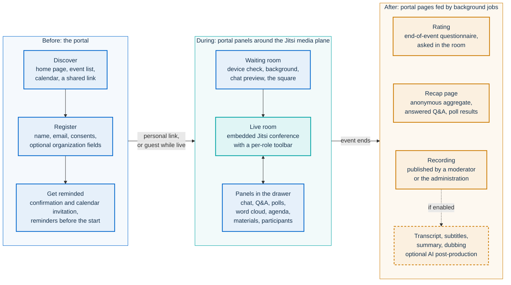
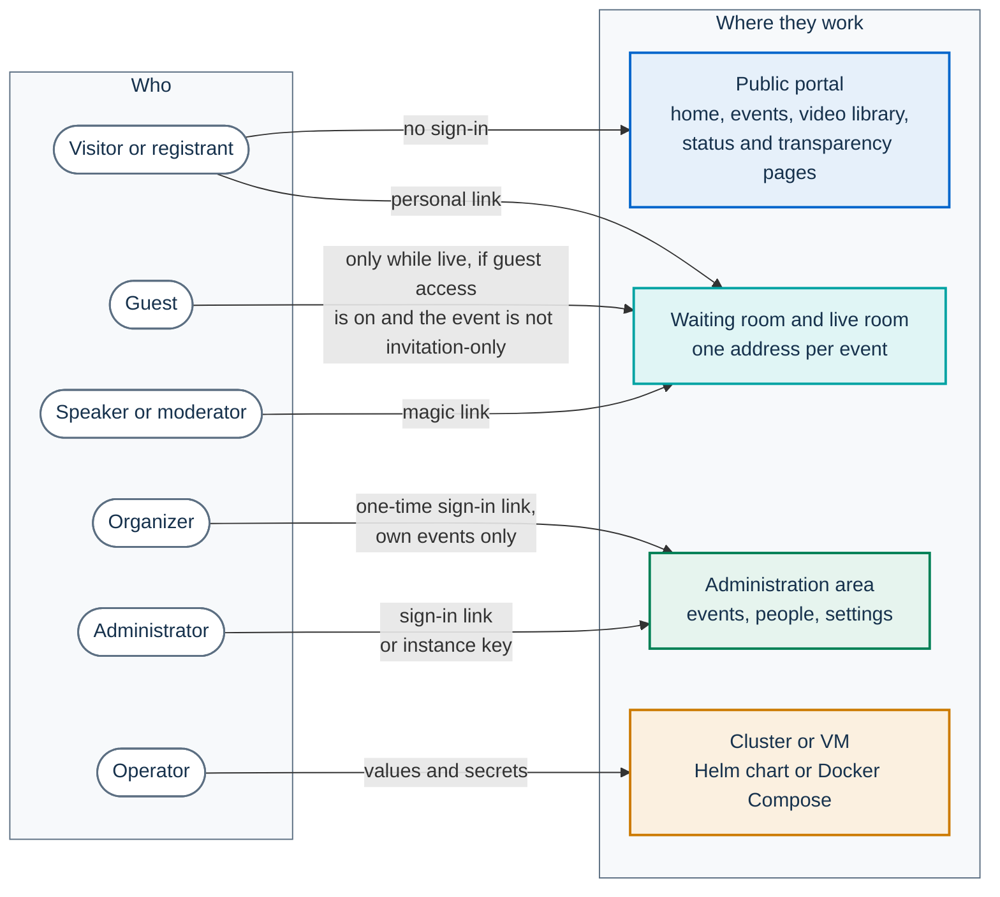
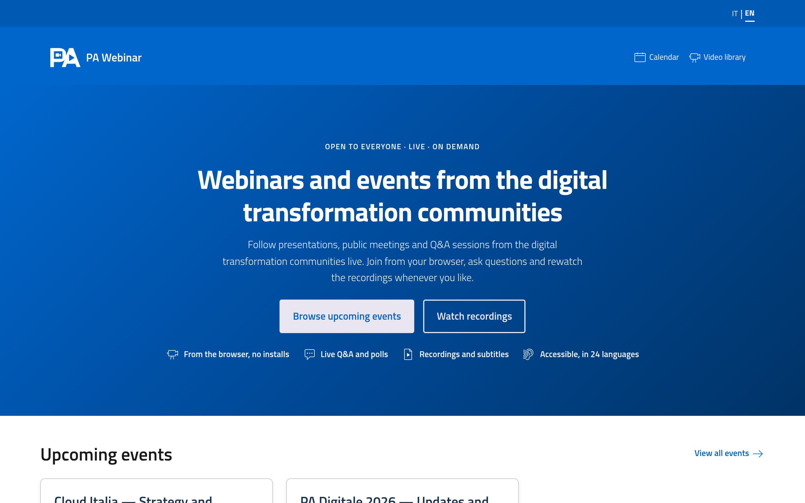
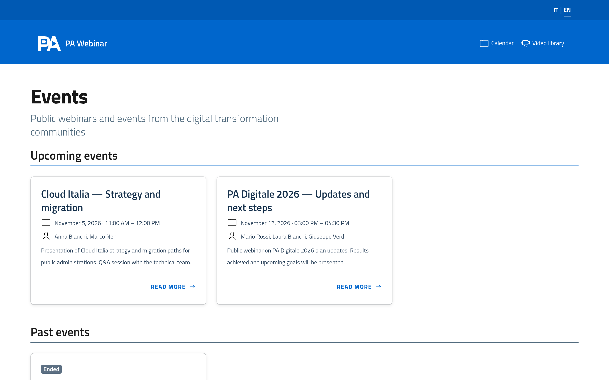
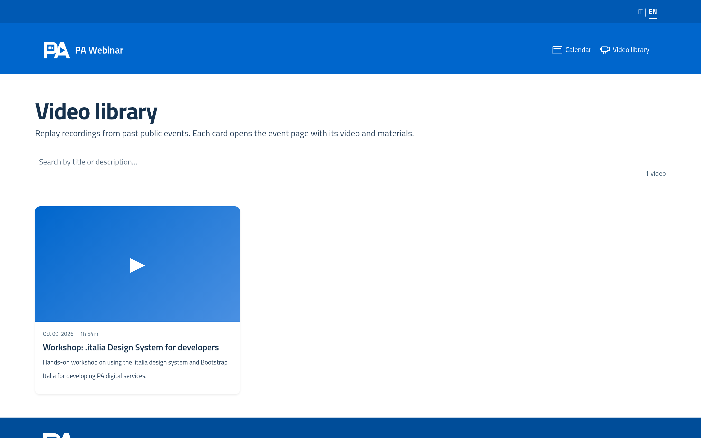
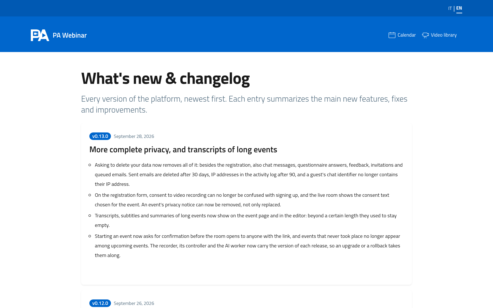

# Feature tour

PA Webinar is a platform that a public administration (PA) can use to run public online events: webinars, presentations, public meetings and instant calls. It embeds [Jitsi Meet](https://jitsi.org/) for audio and video and provides everything around the call: the public portal, registration, the waiting room, live interaction, moderation, the administration area and what happens after the event.

This page lists what the platform currently does, grouped by who uses it. Features that stay off until someone turns them on are marked *Optional*. Features not built yet are in the [roadmap](ROADMAP.md). Terms are defined in the [glossary](GLOSSARY.md).

The interface is available in 24 EU languages. An administrator chooses which ones are offered, and the default is Italian. UI labels are quoted in **bold** exactly as they appear in the English interface (`app/src/i18n/messages/en.json`). The screenshots show the English interface. Because the default interface language is Italian, the Italian label follows some labels in parentheses on first use.

- [At a glance](#at-a-glance)
- [Public portal](#public-portal)
- [Registration and access](#registration-and-access)
- [Waiting room](#waiting-room)
- [Live room](#live-room)
- [Moderators and speakers](#moderators-and-speakers)
- [Organizers](#organizers)
- [Administrators](#administrators)
- [After the event](#after-the-event)
- [For operators](#for-operators)

## At a glance

### An event from the audience's side

Participants use the portal before the event. During the event they use portal panels arranged around the Jitsi media plane, and after it they see portal pages that background jobs fill in. Boxes with a dashed border are optional.

### Who uses which surface

Nobody has a user account with a password. Participants use a personal link. Guests need no link while an event is live, unless an administrator turns guest access off or the event is invitation-only. Moderators and speakers use a magic link. Staff sign in with a one-time link sent by email, and administrators can also use the instance API key.

Configured in: [Identity, access and tokens](architecture/identity-and-access.md).

## Public portal

The portal uses the .italia design system (Bootstrap Italia and design-react-kit) and serves its own fonts, icons and scripts, so no page loads code or fonts from a third-party CDN. Every URL starts with a language prefix, and path segments are translated: `/it/eventi` and `/en/events` are the same page. [Languages and localization](architecture/i18n.md) describes the mechanism.

### Home page

An administrator picks one of five layouts under **Home page mode**: **Landing page** (the default, from `app/prisma/schema.prisma`), **Institutional landing**, **Plain-language landing**, **Events list** or **Custom**. They range from a full presentation of what the platform offers to a single invitation for people new to online events, or the administration's own HTML. [Branding and white-labeling](configuration/branding.md#home-page) describes what each layout contains.

### Finding events

- **Event list.** The **Events** (Eventi) page lists **Upcoming events** (Prossimi eventi) and **Past events** (Eventi passati), and tags filter it (**Filter by tag**). Each tag has an Italian and an English name, a color and a sort order. Events that are warming up (`PROVISIONING`, `IDLE`) stay in the list, so a visitor who arrives a few minutes early still finds the event.
- **Calendar.** *Optional.* **Public calendar** turns on a public calendar with day, week, month, year and list views, and adds a **Calendar** link to the header and the footer. It is off by default (`app/prisma/schema.prisma`). While it is off, the links are hidden and the calendar page returns "not found". Each event takes the color of its first tag (in the tags' configured order), and a legend lists the tags in view. For a title with a kicker, the calendar shows the main part. Clicking an event, or pressing Enter on it, opens a summary beside it (kicker, title, day and time, tags) with **Open the event page**; Ctrl-click or Cmd-click opens the page in a new tab. On a phone the calendar starts in the list view. The staff calendar (**Event calendar**) colors events by status, and its summary adds the status, the registration count, **Manage the event** and, when the event's public page is reachable, **Public page**. Event times in the grid and in the summary use the visitor's browser time zone and a 24-hour clock.
- **Header, cards and pages.** The slim header follows the full header of the Designers Italia models: the language in a dropdown and **Sign in**, the staff entrance (with a staff session, the user area in its place). Every event card is a link as a whole to the event page (its tags stay links of their own). With no events scheduled, the home page says so in one line, with links to past events and recordings. Long public pages offer **Back to top**; the live room and the administration area do not.
- **Event page.** The page shows the title and Markdown description in the visitor's language, the date, the start and end times and the duration, the cover image, the tags, the organizing organizations, the people who take part and the registration button. The cover is shown whole; for a `.jpg` or `.jpeg` file, a blurred copy of the image fills the sides when the banner is wider than the image. The page offers add-to-calendar links (Google, Outlook, Yahoo, and an `.ics` download), carries schema.org `Event` data and appears in the sitemap. A visitor whose browser holds the signed registration cookie gets **Enter room** instead of the registration button. While the event is live, the registration button reads **Register and join**, and when guests are admitted the page also offers **Join as a guest**, with a line saying the difference when registration is open: registering brings the personal link and updates by email, a guest enters at once with just a name, only while the event is live, and receives no email. When the end time has passed without the room opening, the page shows the event as ended and says that registration is closed, in place of the registration button and the calendar links.
  - A person appears only when **Show on the public page** is ticked for them in the wizard's **People** step. The box is unticked by default (`app/prisma/schema.prisma`), also on a duplicated event. The page then shows the person's name, role, photo in a circle (or initials, without a photo), and organization with its logo small beside it. When no speaker is published, the page shows the free-text speakers field instead, and when no organization is set, the free-text organizer. While the agenda is on, people with the same role follow the order of the program.
  - With the agenda on and topics prepared, a **Programme** section after the description lists the topics in order until the event ends. Each topic shows its expected time (computed from the event start and the planned minutes, up to the first topic without a duration), who speaks if the page presents that person (photo or initials, and organization), and the planned minutes. During the live event the topic in progress is marked **In progress**. The topics are prepared in the wizard's **Programme** step, choosing who speaks among the event's people, and the structured data lists them as sub-events.
  - Before the start, the page also lists the event's materials marked **Before the event**. Materials left on the default, **In the room and after the event**, are not listed. The list disappears at the scheduled start time, or earlier if the room goes live first.
  - When registration is by invitation only, the page says that registration is reserved for invited people and that the link to enter arrives by email. When the event has no invitees, the page has no registration button, says that registration is not open to the public, and links to **Already registered? Get your personal link again**.
- **Link previews.** When someone shares a link to the event page, the room or the registration page, the preview shows the event's title and description and an image that the server draws with the title, date, speakers, poster and organization. The title always appears; an administrator chooses whether the date, speakers, poster and organization appear, or turns the preview card off.

Instant calls have no public event page while they run: anyone with the link enters through the waiting room, without registering.

### Video library

The **Video library** (Libreria video) lists concluded events that have a visible public page, were published to the library, and have a published recording or a YouTube link. A recording reserved for registrants (**Registrants only**) keeps its event out of the library. It has a search box for title and description, and pages through the results. Each card opens the event page, which holds the player or the YouTube link, the materials and any AI outputs.

### Transparency pages

- **Status page** (`/status`, **System status**). It shows an infrastructure map with live service health, latency and error figures, bridge capacity, and current participant and conference counts. It is on by default (`app/prisma/schema.prisma`). When an administrator turns off **Status page enabled**, the page and its footer link disappear (`/status` answers "not found"), and only administrators see its data, on the administration's **Infrastructure** page. The live room still reads whether the bridge and the recorder are ready.
- **Changelog** (`/changelog`, **What's new & changelog**, Novità e changelog). It shows release notes in the reader's language, with English as the fallback, and marks the running version with **Current version** (Versione attuale). When the installation links a public GitHub repository, each release has a **Technical detail** section with links to its **Release**, **Sources** and **Pipeline**, and the page links the **OpenSSF Scorecard**. In that section, a release that ships an SBOM also has an **SBOM** button, which opens a searchable view of the release's SPDX SBOM (fetched and trimmed by the server) with a link to the raw file.
- **Service inventory** (`/service-inventory`, **Provider service inventory**). It renders the installation's CycloneDX 1.6 document, which has two parts: the software components (DEV) and the operational services each provider runs (OPS). When no document has been published, the page says so. Publishing is covered in [Service inventory: publishing](SERVICE-INVENTORY.md).
- **Security and transparency** (`/security`). It summarizes open source, SBOMs, the Scorecard, automated scanning and how to report vulnerabilities.

### Legal and privacy pages

- **Accessibility statement.** A built-in statement based on the AgID model (Agenzia per l'Italia Digitale, the Italian digital agency). The administration can replace it with its own text in each language.
- **Legal notes.** They name the organization defined in the site settings.
- **Privacy policy.** The site-wide notice. Each event can link its own notice or a reusable privacy notice template.
- **My data.** Anyone can request a copy of their data (right of access, Art. 15) or its erasure (right to erasure, Art. 17). The platform emails a confirmation link that is valid for one hour, so nobody can read or delete another person's data by typing their address.
- **Address book opt-out.** Opened with the signed opt-out link, the `/rubrica/opt-out` page removes a person from the address book. The confirmation, reminder, post-event and recording notice emails carry that link for people in the address book. An administrator can also delete the entry in **Address book**, and an erasure request under **My data** deletes it together with the registrations. See [Privacy and data protection](GDPR.md#the-address-book).

### Screenshots

The screenshots show demo data (`npm run db:seed`) in the English interface. The live room is not pictured, because a screenshot would need an event in progress and the faces of the people in it.

| | |
|---|---|
|  |  |
| **Home page** in the `LANDING` layout | **Events** with **Upcoming events** |
|  |  |
| **Video library** with search | **What's new & changelog** |

Configured in: [Branding and white-labeling](configuration/branding.md) · [Runtime settings](configuration/runtime-settings.md) · [Service inventory: publishing](SERVICE-INVENTORY.md).

## Registration and access

- **Registration form.** It asks for a name and an email, plus consents that are never pre-checked:
  - the privacy notice (required);
  - recording (required when the event is recorded and participants can speak, turn on their camera or share their screen; when they cannot, the form only says that the event is recorded);
  - the transcription of what the person says, with their name (optional; asked when the event records per-participant audio or keeps a transcript from captions);
  - staying in touch (optional): one box that covers both news about future events and inclusion in the address book.
- **Organization fields.** The form can also ask for an organization (with autocomplete), a role and an organization type. An event turns these on in the wizard's **People** step, under **What we ask people who register** (`requireOrganization`, `requireOrganizationRole` and `requireOrganizationType`). When they are on, the organization name is mandatory, in the form and for the registration API, while the role and the type stay optional.
- **Pre-registration questionnaire.** *Optional.* When an event has one, its questions are part of the registration form, before the consents, and the answers are saved with the registration. When the questionnaire is required, nobody can register without answering it. When it is optional, a registrant who answers must still answer its required questions.
- **Personal link.** Registration returns a personal join link and sets a signed cookie in that browser (with invitation-only registration, opening the emailed link sets the cookie instead). A registrant who comes back to the room without the link is still recognized. A forwarded link does not carry the registrant's name: whoever opens it enters as a guest under a name they type. The emailed link carries a signature. With invitation-only registration, opening it binds the browser to the registration, so forwarding the whole email forwards the identity too.
- **Routing after registration.** If the event starts soon, the new registrant goes straight to the waiting room; the `waitingRoomLeadMinutes` site setting decides how soon. Otherwise they see a confirmation screen with the calendar links. With invitation-only registration they are told to check their email instead.
- **Emails.**
  - A confirmation with the personal link and a calendar invitation, which mail clients show as an invitation to accept or add.
  - Reminders. A new scheduled event gets two, one day and one hour before the start (`app/src/app/api/events/route.ts`). Before the event, the organizer can change them with **Edit** in the **Notifications** panel of the event page: up to five per event, chosen from presets between **7 days before** and **15 minutes before**. A reminder already sent stays, and a moment already passed cannot be chosen.
  - A notice when the date of a published event changes.
  - An *optional* thank-you email after the event, with a recap and, for those who entered the room, a rating link.
  - A notice when the event's recording, or its external video, becomes visible on the event page. It is on by default (`app/prisma/schema.prisma`) and can be turned off per event.

  Emails are written in the registrant's language when copy exists for it, and in English otherwise. See [Email and calendar](architecture/email.md).
- **Capacity.** The expected number of participants sizes the video infrastructure. It is not a registration cap.
- **Guests.** Unless an administrator turns off **Guest access enabled**, anyone can join a scheduled event without registering while it is live (`LIVE`), after typing a name. An event set to **Invited people only** admits no guests, whatever the setting. Instant calls always admit anyone with the link, whatever the setting, also while the room is warming up.
- **Join password.** *Optional.* It is set in the instant-call form, or through the API for any event. Guests must type it. Registrants who use their personal link and people with a magic link skip it.
- **Invitations.** An organizer can keep a list of invitees (name and email) on each event, and administrators can fill it from the address book. Invitees added from the wizard are guests; the invitations API (`/api/admin/events/[id]/invitations`) also accepts the speaker role, and the list marks those invitees as speakers. With **Invited people only**, the list opens inside that choice in the wizard. Once the event is published, the **Invitees** panel of the event page sends the invitation by email, to everyone not yet invited or to one person (again if needed), and shows for each person whether they were invited, when, and whether they registered. The invitation leads to the registration page with the form already filled in; people who already registered are skipped.
- **Who can register.** Each event chooses **Anyone who registers** or **Invited people only** (`Event.accessMode`), in the question **Who can take part?** when it is created and in the wizard's **People** step under **Who registers**. An event that has made no choice follows the site setting **Public registration enabled**. **Anyone who registers** opens registration whatever that setting says, but does not let guests in: guests still follow **Guest access enabled**.
- **Invitation-only registration.** When an event is set to **Invited people only**, or follows the site with **Public registration enabled** off, only addresses on the event's invitation list can register. The form gives the same answer, **Check your email**, whatever address is typed: an invited address is registered, an address that is already registered gets its link again, and any other address gets nothing. The personal link arrives only by email, and opening it binds that browser to the registration, also after registration opens again. An event with no invitees then accepts no new registrations, and its registration page only offers to send the link again to people who registered earlier. People who already hold a personal link or a magic link are not affected. An event set to **Invited people only** admits no guests either: nobody joins without a registration or a moderator or speaker link. A personal link is a seat, not a person, so an invitee who forwards theirs hands over their seat. An event that follows the site setting still admits guests while it is live, unless **Guest access enabled** is off too. Only event staff (administrators, and organizers on their own events) change who can take part; someone editing with a moderator link sees the choice but cannot change it. When the event asks for the organization, registration without it is refused, also when the registration route is called directly.

Configured in: [From creation to recap: the event journey](architecture/event-journey.md) · [Email and calendar](architecture/email.md) · [Privacy and data protection](GDPR.md).

## Waiting room

Every way into an event passes through the waiting room. Personal links and magic links always land there, whatever the event's status. The public room link lands there while guests are admitted; otherwise it sends the visitor to registration, or to the event page once the event has ended. The room adapts to the event's status: see [Event lifecycle](architecture/event-lifecycle.md) for the states.

- **Before the start.** It shows a countdown, a short netiquette and who moderates the event. A moderator sees **Start event**. The room opens by itself at the start time, or earlier when a moderator starts it.
- **While the room warms up.** When the event is `IDLE` or `PROVISIONING`, a progress indicator shows how long the preparation has taken, and moderators can still press **Start event**. Entry opens when the event goes live. The first visitor to an `IDLE` event wakes it. Without bridges that scale to zero there is nothing to warm up, and the room says it opens at the start time.
- **When the time has passed.** A published event that never opened shows that its scheduled time has passed, with no entry.
- **Over plain `http://`.** The browser gives the page no microphone or camera, so the waiting room and the room show a notice with the `https://` address instead of trying to start the call.
- **When the bridge lags.** If the event is live but the bridge still reports not ready after a minute, the room offers **Enter anyway**, so a stale readiness signal never locks people out.
- **When live.** A short cue announces that the room is open, and the join button turns on.
- **After the end.** It links to the recording and, when feedback is on, offers **Leave feedback** to people who entered the room, except moderators. It opens the end-of-event rating in a dialog.
- **Profile photo.** *Optional.* Registrants who opened the personal link from their email in this browser can choose a photo. Someone who registered in this browser but has not opened that link here yet is asked to open it first, because opening it shows that the address is theirs. Others in the room then see the photo instead of the initials, in the video tiles and in the participants panel; the chat keeps the initials. The photo is cropped to a square and saved as a small JPEG without its metadata (date, place, device). It also applies at later events the person registers for with the same email address, until they remove it. Moderators and speakers do not add a photo in the room: there they keep their initials, or their Gravatar where it is enabled. The photo that staff upload for them in the wizard appears only on the public event page. See [Avatars](architecture/identity-and-access.md#avatars).
- **At a glance.** When the event takes place and for how long, who organizes, hosts and speaks, whether the event is recorded, and the description, with links to the event page and **Share**. Above it, how many people are live and how many are waiting.
- **Audio and video.** Camera and microphone switches, off for everyone the first time; the browser asks for no permission until one is turned on. Turning one on opens its test: the camera preview with the virtual backgrounds, the microphone level meter and picker, and an audio test. The last choice is remembered. On phones everyone joins muted, because mobile browsers need a tap to open the camera.
- **Virtual background.** A few calm images, such as **Light office**, **Institutional blue** and **Studio**. The camera preview already shows the chosen image behind the person, cut out in the browser, and the room applies it on entry. In the room the same images are under Jitsi's backgrounds button, together with blur.
- **Waiting-room music.** *Optional.* A track set on the event. It plays only before the start, and only after the participant chooses **Enable music**.
- **Chat preview.** In the side column, while the visitor waits. If the event has chat turned on, registrants, moderators and speakers can read and write in it while the room warms up, and so can everyone in an instant call. A visitor who arrives when **Enter now** can already be pressed does not see it: the same conversation continues in the room.
- **Your name.** Required to enter. While it is empty, the field pulses gently in blue; after an attempt to enter without it, the field and its message turn red. A missing recording consent is shown the same way, next to its checkbox.
- **Notices and consent gates.**
  - When AI post-production is on for the event, an **AI processing after the event** notice appears. Its text can be customized.
  - When live captions are on, a notice says so and says whether the text is kept: not at all, or, with a transcript from captions, with the name, for the people who consented.
  - When the event records per-participant audio or keeps a transcript from captions, everyone who has not given it yet, moderators and speakers included, is asked for the optional consent to the transcription of what they say. Entry does not depend on it: without it, the person's voice is not recorded and their words are not kept.

### Classic view and the square

The waiting room has two layouts. The classic view is a static page with every control inline. The square is an optional 2D space built with Phaser, where the people in it appear as avatars. Messages written in the event chat show as bubbles above their authors (with dots while they type). Five gestures (wave, heart, clap, laugh, idea) have a button and a key each, and sounds can be switched on (fountain, birds, footsteps, gestures, the gate opening). Everyone has a character, random at first and fully customizable (skin, hair, clothes, shoes, hat, glasses, colors).

Four spaces have something to do: a coffee everyone sees at the café; the event's program, speakers and materials at the notice board; the event's images and portraits of the people present at the gallery; the square's mood and the wardrobe at the lab. A fountain and a wishing well hold small surprises, and a legend lists the controls and the secret codes. Once the event is live, walking into the gate enters the room.

A participant opens the square with **Step into the square**, leaves it with **Back to the waiting room**, and can switch to **Classic version** at any time, then return with **Show the square**. The square is offered in the side column as another place to wait; nobody has to pass through it to enter. The choice is remembered in that browser. Phones get the classic view by default.

An administrator sets the starting view per site or per event: **Videogame (Phaser lobby)** offers the square, and **Classic (static)** opens the classic view first. Visitors can still switch. [The waiting room and the square](architecture/waiting-room.md#engines-classic-view-and-the-square) describes how the view is resolved, the square's presence model and the accessibility contract.

Current limits:

- The waiting room's "watch from the start" option needs a temporary recording URL. The platform does not produce one automatically, so catching up during a live event is not available.

Configured in: [Runtime settings](configuration/runtime-settings.md) · [From creation to recap: the event journey](architecture/event-journey.md).

## Live room

### The conference

- **Embedded Jitsi Meet.** The platform embeds Jitsi Meet through the IFrame API, and each role gets its own toolbar. There is no native hang-up button: every exit goes through the app, so that moderators get the leave prompt. The app also handles fullscreen, so the side panels stay visible. See [How PA Webinar extends Jitsi Meet](architecture/jitsi-integration.md).
- **Participant permissions.** Each event decides whether participants may unmute, turn on their camera and share their screen. When a permission is off, its button disappears. Speakers always have full audio and video.
- **Video quality.** A site-wide preset that each event can override: **Save data (360p)**, **Balanced (540p)**, **High (720p, recommended)** or **Maximum (1080p, high fidelity)**. On phones the platform limits the resolution and the number of incoming videos to save battery and data.
- **Watermark.** The administration's logo can appear over the video, with configurable opacity and position.
- **Stage colors.** The area behind the videos is the room's blue instead of black. Where the conference server reads the portal's branding document, Jitsi's toolbar, menus and dialogs, the tiles of people without a camera and the initials avatars use matching blues too. See [Branding limits](architecture/jitsi-integration.md#branding-limits).
- **Advanced noise suppression.** *Optional.* It needs the patched Jitsi web image and `NEXT_PUBLIC_JITSI_RNNOISE_ENFORCE=false` in the app's runtime environment; without the variable, or with any other value, it stays off (`app/src/lib/jitsi/rnnoise.ts`). See [How PA Webinar extends Jitsi Meet](architecture/jitsi-integration.md).
- **Reconnection.** Jitsi absorbs short network drops itself: the XMPP session resumes over the WebSocket and the media reconnect without leaving the conference. While the portal does not answer, or the browser reports being offline, a small notice over the video says that the connection is unstable. When the conference is lost (the server session expired, or a conference component restarted), the room keeps its panels and remounts only the call, as soon as the portal answers. The call comes back with a fresh token from the portal and with the camera and microphone as the person had them, without a click and without going back through the waiting room or its consents. Meanwhile the video area says **Reconnecting…**, through a polite live region for screen readers. The room keeps trying for ten minutes, then shows the screen with **Rejoin**.
- **Top bar.** It shows the number of people present (to moderators), the current agenda topic while the agenda is on (it opens the whole agenda), **Share** and **Leave room**. **Share** offers the **Link to join** and the **Event page**, each with **QR**: a QR code to project or print, drawn in the browser and downloadable as SVG. Moderators can also show the moderator link, which has no QR code. When guest access is off, or the event is invitation-only, scheduled events offer only the event page, because the link to join would send the recipient to registration.
- **Time strip** (moderators and speakers). Under the top bar, the strip shows how long the event has been on air, a progress bar against the scheduled time, and the scheduled end with the minutes left. The bar turns amber in the last ten minutes. Past the end, it shows the overtime and when the room closes on its own, with a moving texture, and turns red in the last ten minutes before the close. Before the start, the strip says when the event begins, and an instant call shows only the time on air. For moderators only, the right side shows the recording state (a red **REC** pill with the recording's duration while it runs) and, while it is on, the talk timer; clicking either opens the **Control** panel. Speakers see the clock without them. Participants see none of this: they see only the **REC** icon while recording and, except in instant calls, a notice in the last ten minutes before the room closes on its own, saying when.
- **Banners.** A banner announces who is sharing their screen.

### Panels in the drawer

On desktop the drawer is a column on the right, which can be widened by dragging its edge or collapsed to a strip of icons (with a short animation, or none when the system asks for reduced motion). Its **×** closes it altogether, leaving only the content (slides, speakers); the **Content only** button in the top bar does the same and brings it back. On smaller screens it is a sheet that rises from the bottom. It holds these panels:

| Panel | What it does | Default |
|---|---|---|
| **Control** | Moderators only, last in the strip, after **Participants**: recording (start, stop with confirmation, recorder warnings), the room features switched on and off for everyone (Q&A, chat, agenda, **In one word**, and live captions where the installation runs them), a button that opens the whiteboard where it is available, the talk timer and, set apart at the bottom, **End event**. Speakers and the audience do not see it. | Always, for moderators |
| **Chat** | Messages grouped by sender, each group headed by name, role and time. It has replies and @mentions: typing `@`, or pressing the **@** button, suggests the people in the call and those who wrote in the chat; the button opens and closes the list without adding another `@`, and an empty list says so. It also has an emoji picker with search and recently used emoji, emoji reactions, image and PDF attachments up to 10 MB where the installation has files storage, and edits within 15 minutes. A line under the messages says who is typing. Moderators can hide messages. Anyone who can read the chat can **Download the chat**. The bell sets the alerts, which the browser remembers: **All messages** (the default for moderators), **Mentions and replies** (the default for everyone else, both set in `app/src/lib/chat/notify-prefs.ts`) or **Silent**. Each alert plays a sound and, once the browser allows it, shows a browser notification while the page is in the background or behind another window. While the chat is not in view, its tab counts the unread messages, and each message that alerts also appears as a preview over the room; a message that mentions or replies to you is highlighted, its preview stays longer and the counter shows **@**. A message already on screen does not alert, and a button with the count of new messages appears when the list is scrolled up. | On |
| **Q&A** | Questions of up to 500 characters, with upvotes. Registrants, guests and speakers can upvote. Moderators **Highlight**, **Mark as answered** or **Dismiss** a question, and can **Answer** in writing (up to 2000 characters): the answer appears under the question for everyone, and a pending or highlighted question becomes answered. The person who asked sees **Your question** on it. For someone on another panel, a dot on the tab signals new questions or answers. A moderator also hears the chat sound for a new question, and whoever asked hears it when their question is answered, with a browser notification while the page is in the background or behind another window, as in the chat. The chat's bell settings apply, and **Silent** turns off sound and notifications here too. | On (off in instant calls) |
| **Polls** | Moderators create a poll, then **Close voting**, **Publish results** or **Reopen**. Each person votes once. | Always shown |
| **In one word** (word cloud) | A moderator asks a question with a duration (1, 2 or 3 minutes, or no time limit until the moderator closes it), and participants answer one word at a time, up to five each. The more people write the same word, the bigger it gets: each person counts once per word, and capitals and surrounding punctuation do not make a different word. Each word keeps its color as the cloud changes. Moderators can remove a word: it leaves the cloud and the recap, and nobody can send it again in that round. The last closed cloud stays visible. Moderators see the tab even while the feature is off, and asking the first question turns it on for everyone. | On (off in instant calls) |
| **Agenda** | Moderators list the meeting's topics, each with an optional planned duration (a pasted list adds one topic per line), reorder them and mark each one in progress, discussed or skipped. Organizers can prepare the topics before the event, with who speaks, as the program published on the event page. One button closes the current topic and starts the next: it reads **Next topic:** followed by the next topic's title (**Start with:** before the first topic, **Finish the current topic** on the last). Everyone sees where the meeting stands, also from the top bar, and moderators see when a topic runs over its planned time. The audience can mark **Agree** or **Disagree** on the topic in progress. | On (off in instant calls) |
| **Materials** | Links and files shared for the event. Each item has an icon and a label for its format (PDF, DOCX, PPTX, XLSX, TXT, link), the size of a file or the site a link leads to, and who added it ("Added by the organisers" when no name is recorded) and when. With more than four items mixing files and links, **All**, **Files** and **Links** filter the list. Files can be uploaded only where the installation has files storage, by dragging them onto the panel or choosing them, with a progress bar and **Cancel upload**; the title is proposed from the file name. For someone on another panel, a dot on the tab signals that new materials were shared. The audience sees the materials marked **In the room and after the event** or **During the event**. Moderators see every material with its visibility and how many times it was opened or downloaded. They choose the visibility when they add a material during the call, **Edit** its title, description and visibility, use **Copy link** on links, and **Delete material** with a second click to confirm. Moderators and speakers can **Present** a PDF to the room (see [Presenting a PDF](#presenting-a-pdf)), and the material being presented is marked **Being presented** for everyone. Clicks in the room and on the event page are counted once per person every 10 minutes, never for moderators and staff, and without recording who clicked. | Always shown |
| **Participants** | Who is present, each with the avatar the video tiles show (a photo, a Gravatar or initials), and **you** on your own row. Raised hands come first, in the order they were raised, each with its turn, and the person speaking is highlighted. The list is split into **Hosts** and **Audience** when the conference's roles tell moderators from participants, and a name search appears above 8 rows. The header counts people: someone who rejoins and leaves an old connection behind counts once, and the number of connections is shown beside it when it is higher. Each other person has a volume control that changes only what you hear. Moderators also see their own connection quality and run the room from here: **Mute all**, **Turn off all video**, the **Microphones locked** and **Video locked** switches, **Give the floor**, **Audio only** and **Lower hand** on a raised hand and, behind each row's actions button, **Mute**, **Turn off video**, **Take back the floor** and **Kick** (with a second click to confirm). For moderators the tab shows the number of raised hands. Under each name, moderators see the email address of the registration or personal link behind it; **Registered as: {name}** when the name typed in the room differs from the registration; **Registration link of {email}** for a registration link opened in another browser, or **Shared moderator link**; and **Identity cannot be verified** when two different links claimed the same connection. Their search also matches those names and addresses. Screen readers announce raised hands to moderators while the panel is open. | Always shown |

The Default column gives the state for an event created from the four questions of the [event wizard](#the-event-wizard) and for an instant call (`app/src/lib/events/guided-format.ts`, `app/src/app/api/events/instant/route.ts`); an event created from a template takes the template's settings.

Moderators can switch Q&A, chat, **Agenda** and **In one word** on and off during the event, and live captions where the installation runs them. Everyone's panels update within seconds, and catch up on their own when the realtime connection comes back after an interruption. See [Live interaction and realtime](architecture/live-interaction.md).

### Presenting a PDF

A moderator or a speaker can show a PDF to the whole room, page by page, without sharing their screen in the call.

- **Starting.** **Present** on a PDF in the **Materials** panel starts the presentation and replaces any presentation in progress. Only an uploaded PDF can be presented, not a link or another format, so slides from PowerPoint, Keynote or Impress must be exported to PDF first. The upload form says so to whoever can present, and a PPTX in the list tells them to upload its PDF version. A speaker chooses among the materials the audience sees, and can upload a PDF to present with **Upload a PDF to present**: it accepts PDF files only, with **Present it to the room once uploaded** already ticked. Moderators can edit or delete what a speaker uploads; the speaker cannot. Moderators get the same tick box, unticked, when they upload a PDF.
- **The presentation area.** On desktop it opens beside the call, which keeps a narrower column with its toolbar. Below 992 px it takes the top half of the screen, above the call. The call is not reloaded. Anyone can **Collapse the presentation** to one line with the title and the page, and **Show** it again; a new presentation reopens it for everyone.
- **Handing over.** A moderator or speaker who is not the current presenter sees **Take over** in the presentation area. Pressing it makes them the presenter of the same document, from the page they are looking at, and their name shows for everyone. Until then they browse on their own like the audience, so a key pressed to read ahead does not move the room, and they can still **Stop presenting**. A speaker can also present a different PDF from the panel, which replaces the one on screen.
- **Pages.** The current presenter moves everyone to the previous or next page, or to a page number. With the area selected, the left and right arrow keys, Page Up, Page Down, Home and End do the same. Everyone else follows the presenter's page. They can also browse on their own with the same buttons and keys, and **Back to the presenter's page** brings them back. Whoever joins late, reloads the page or reconnects lands on the current page.
- **Accessibility.** Screen readers hear what is presented and by whom when a presentation starts or changes hands, and hear the page number without being interrupted. The page has a text alternative with the title and the page number, and **Text of the page** shows the text the PDF holds for that page.
- **Stopping.** **Stop presenting** in the area or on the material in the panel. Deleting the presented material also stops the presentation, and once the event has ended no presentation is shown or served.
- **Who sees it.** Everyone admitted to the room, with the same rule as Q&A and polls; on a password-protected event, only those who entered the password. Presenting shows a material to the room even when its visibility keeps it out of the audience's list, as sharing the screen would. The list does not change, and the file is read through the presentation, only while it is being presented, never through a public address.
- **Recording.** The recording captures the call, not the presentation area. The presenter always sees that the pages are shown in the room panel and not in the call video. While a recording runs, the reminder asks them to also share their screen from the call toolbar if the pages must appear in the video. Each start, page shown and stop is written to the room's journal, so the timeline and the summary of the AI post-production know which page was on screen and when, and the event page can show the pages beside the published video, in sync with it (see [Synced slides](#synced-slides)). See [Live interaction and realtime](architecture/live-interaction.md#presentation).
- **Limits.** The viewer is pdf.js, served by the platform itself. Slides exported from presentation programs embed their fonts and render as designed. JPEG 2000 and JBIG2 images are not decoded, and fonts that a PDF does not embed fall back to the system's fonts.

### Reactions, timers and raised hands

- **Reactions.** The site chooses the mode:
  - `NATIVE` (the default, from `app/prisma/schema.prisma`): Jitsi's own reactions button. Reactions are ephemeral and nothing is counted.
  - `CUSTOM`: the app's reaction bar. Reactions are counted and appear in event analytics.
- **Talk timer.** From the **Control** panel a moderator starts a countdown (presets **1 min** to **30 min**), pauses it and resets it. With **Show to all**, participants see it in a bar above the call; moderators always see it in the time strip, where its color and ring follow the time left. A paused timer resumes where it stopped. It ends with **Time's up!**, which stays on screen for 30 seconds.
- **Raised hands.** They are listed in the **Participants** panel, in order, visible to everyone. A hand stays up while its owner speaks, until they lower it or a moderator deals with it.

### Recording in the room

*Optional*, and only when the event enables recording.

- The waiting room says that the event is recorded, when the installation can record (Jibri, or the per-participant recorder). Whoever has not given the recording consent at registration (a guest from the room link, a registrant on another browser) ticks it there, next to the event's privacy notice, before entering; a registrant who gave it enters with one click. On a listen-only event the waiting room only informs.
- While recording is running, a red **REC** icon stays in the top bar for participants and speakers; moderators see it, with the recording's duration, in the time strip. The duration comes from the start time the room reported to the server, so every moderator sees the same figure, also after joining late.
- Moderators start and stop the recording from the **Control** panel, and stopping asks for confirmation. The wizard does not offer **Start recording automatically**, but an event saved with it starts the recording on its own when a moderator joins, until the switch is turned off.

[Recording: composite video and per-speaker audio](architecture/recording.md) describes the two capture paths (a composite video from Jibri, and per-participant audio from the recorder bot).

### Live captions

*On by default* where the installation runs the captions service. The service's switch, `global.captions.enabled` in `infra/helm/pa-webinar/values.yaml`, is on by default, and so are the site and event settings in `app/prisma/schema.prisma`.

- While the event runs, what each person says appears as captions over the video, with the speaker's name, a few tenths of a second after the words. A recognizer inside the installation transcribes the speech on CPU. No audio or text leaves the installation, and the text is not kept unless the event keeps a transcript from captions.
- Each viewer hides or shows the captions for themselves, with the **×** above them or the captions button in the call's toolbar; hidden, a **CC** button brings them back. Each viewer can also make them smaller or larger and move them to the top of the video, away from the toolbar. These choices stay in the browser. Screen readers hear the finished sentences.
- The waiting room tells participants that captions are on, and whether the text is kept.
- **Transcript from captions.** *Optional*, per event, a sub-option of **Automatic captions** in the wizard; the new-event questions turn it on when the event can be recorded. The sentences of the people who consented to the transcription of what they say are kept with their name and, when the event ends, become its transcript, even without a recording or AI post-production. Everyone else appears only in the live captions. Staff review the transcript in the **After the event** tab, correct it in the transcript editor and can publish it on the event page without a video. See [After the event](#transcript-from-captions).
- Captions start once the event is live, within half a minute, with or without a moderator in the room. Moderators turn them off and on for everyone from the **Control** panel, with **Automatic captions**. Administrators turn them off for the whole instance in the site settings.
- The event's vocabulary (glossary, organizers, moderators and speakers) helps the recognizer spell names and acronyms correctly.
- In Italian, numbers are written as digits from eleven up, and always in percentages, decimals, dates and times.
- If the service falls behind, it captions fewer speakers at once, then pauses and resumes on its own; the room and the status page say so.

[Live captions](architecture/live-captions.md) covers how the service works, how to size it and its limits.

### Whiteboard

*Optional.* This is the native Jitsi whiteboard (Excalidraw). It is opt-in per event and on in instant calls where the installation has the whiteboard service, and only moderators on desktop can open it.

- It needs a whiteboard backend on the Jitsi side (`config.whiteboard.enabled`). The chart neither installs nor configures one. The Jitsi subchart has an optional backend (`jitsi-meet.excalidraw.enabled`, off in the subchart's defaults), which has not been tested with PA Webinar.
- The whiteboard buttons in the room (Jitsi's toolbar button and the app's own **Whiteboard** button) and the reminder to export the board also need `NEXT_PUBLIC_WHITEBOARD_ENABLED=true` in the app's runtime environment. The app reads it at request time, so no rebuild is needed. Without it, the event wizard and the template form do not let anyone switch the whiteboard on. See [Configuration reference](CONFIGURATION.md).

The whiteboard's content is not saved: moderators are reminded to export it and attach it as a material.

### Mobile

Below 992 px, the layout is a full-screen video with a floating control bar, and the drawer opens as a bottom sheet. Below 768 px, the Jitsi toolbar shrinks to microphone, camera, raised hand and settings, plus reactions in native mode and the captions button when captions are on. Moderators run the room from the **Participants** panel of the drawer. Screen sharing is hidden on phones, because `getDisplayMedia` is not available inside iframes on iOS and most Android browsers.

### Leaving

**Leave room** takes participants out, to a screen that says the event is still in progress and offers **Rejoin**. Moderators get a choice:

- **Just leave.** The call goes on for everyone else. The leaving screen reminds the moderator that the event stays open until someone chooses **End for everyone**.
- **End for everyone.** This opens **Event destiny**, which offers **Keep it public**, **Publish to the library** or **Archive (private)**, and says which sections the ended page will show for this event. Polls still open are closed when the event ends, and no poll can be created or reopened afterwards. When the event records and AI post-production is on for it, a checkbox also offers to generate the transcript and summary.

However the event ends, the closing screen then asks everyone except moderators for the end-of-event rating, unless feedback is turned off for the event. The closing screen appears only when the event has ended. Someone who leaves or loses the connection sees the leaving screen instead, which offers **Leave a rating** without waiting for the end. The rating is asked once per visit, whether it is answered or skipped.

Only people who took part can rate. A registrant who entered the room rates once, with their registration. Someone who entered without registering presents the room token they received on entry, which the portal signed for that room, and rates once per entry: they are anonymous, and re-entering gives a new seat. Moderators do not rate. The public page of an ended event offers the rating only to a registrant who entered the room, recognized by the rating link in the thank-you email (a signed link that serves only to rate) or by the access cookie of the browser they registered from; everyone else rates in the room, at the end. The thank-you email invites only those who entered the room to rate; the others receive the recap.

Configured in: [Runtime settings](configuration/runtime-settings.md) · [Configuration reference](CONFIGURATION.md) · [From creation to recap: the event journey](architecture/event-journey.md).

## Moderators and speakers

Moderators and speakers have no accounts. They enter through magic links.

- **Moderator link.** It is the event's primary link (`?token=`). It identifies a seat, not a person: everyone who opens it is a moderator. An administrator can regenerate it from **Moderator links**, and the old link then stops working.
- **Named grants.** Each is a personal link for one organizer or moderator (role `MODERATOR`) or speaker (role `SPEAKER`), with the person's organization and whether the public page lists them. They are created in the wizard's **People** step or on the event page, and each can be revoked on its own. Next to **Copy link**, **Prepare email** opens the organizer's own mail program with a message holding only that person's link. The platform sends nothing for it, and there is no way to copy every link at once.
- **Where to find the links.** The event page in the administration area shows them. Next to the public page and the direct invite, **QR** opens their QR code, to project or print for an audience in the same room, and downloads it as SVG. The moderator link never gets one, because a photo of the screen would carry the credential. **Share** in the room can also reveal the moderator link to a moderator, with a warning. The platform also emails each link when the event is published, and the link of a grant created later as soon as it is created (see [Moderator and speaker links](architecture/email.md#moderator-and-speaker-links)).

What a moderator can do in the room:

| Area | Controls |
|---|---|
| Start and end | **Start event** in the waiting room. **End event** at the bottom of the **Control** panel, set apart and with a confirmation, or **End for everyone** from **Leave room**. |
| Audio and video | In the **Participants** panel: **Mute all**, **Turn off all video**, the **Microphones locked** and **Video locked** switches, and per person **Mute**, **Turn off video**, **Take back the floor** and **Kick**. Jitsi's own security button. When an event does not grant participants the microphone, camera or screen, the room starts locked on the bridge. |
| Raised hands | In the **Participants** panel: **Give the floor** (audio and video), **Audio only**, **Lower hand**. |
| Recording | In the **Control** panel, **Start recording** and **Stop recording** (with a confirmation), when the event enables recording. Beside the button, the recording state reads **Recording starting…** while the recorder starts (the button shows a spinner), **Recording unavailable** if it has not started within the provisioning timeout, and **Recording not configured in infrastructure** without a declared recordings storage (`RECORDING_STORAGE_TYPE`). A running recording can always be stopped. |
| Interaction | In the **Control** panel, switch Q&A, chat, **Agenda**, **In one word** and, where the installation runs them, live captions on and off for everyone, open the whiteboard, and run the talk timer. Run polls, word-cloud rounds and the agenda. Moderate Q&A, hide chat messages and remove words from the word cloud. Add, edit and delete materials, and see how often each was opened. Present a PDF to the room. |

Speakers always have full audio, video and screen sharing. They can present a PDF to the room and upload a PDF to present, but add no other materials. They have no moderation powers and no recording control, and the waiting room does not ask them for the recording consent.

A token that is shared or forwarded cannot act as another person: editing a chat message, for example, needs a personal identity. See [Identity, access and tokens](architecture/identity-and-access.md).

Configured in: [Identity, access and tokens](architecture/identity-and-access.md).

## Organizers

Organizers are staff accounts with the role `ORGANIZER`. They sign in with a one-time link sent by email, and they see and manage the events they created and those where they are named as an organizer with the same email address. See [ADR-014](adr/014-organizer-role.md).

### The event wizard

A new event starts from four questions:

- **How many people do you expect?** Up to 20, up to 100, or more than 100.
- **Who can speak and appear on video?** Everyone, or speakers and moderators while the audience writes in the chat.
- **Do you want to be able to record?** Yes, when you press **REC**, or no.
- **Who can take part?** **Anyone who registers**, or **Invited people only**, which also keeps guests out. The proposed answer is the one that matches **Public registration enabled**.

A preview next to the questions shows the event that results. Every room feature (chat, Q&A, agenda, **In one word** questions) starts on (`app/src/lib/events/guided-format.ts`) and can be turned on or off during the event. The answers are stored in the address (`?formato=medio.tutti.si.tutti`), so a reload keeps them. When the organization has templates of its own, **Start from a template**, next to the heading, opens them above the questions, with a note that a template brings its own settings instead of the answers. Quick calls are created from the event list (**New quick call**).

Creating and editing an event then use the same six steps (five for an instant call, which has no **Programme**), plus separate **Advanced settings**. When creating, a band above the steps names the format (or the template) in use, with **Change format**, which brings back the answers given. What was written about the event (title, description, dates, people, content) moves to the new format, which brings its own settings, and a notice offers **Start over**. The wizard keeps an unsaved draft in the browser, one per format or template, and offers to restore it when the same one is opened again. The buttons of each step stay together in a bar fixed to the bottom of the screen, with **Back** next to **Next**. When editing, **Update event** is available on every step, and the edit links on the event page open the part they refer to (`?step=` on the edit address, `&section=` for a section of the advanced settings).

| Step | Label | What it covers |
|---|---|---|
| 1 | **Event** | The **Event languages** row (the main language and the event's other languages, with **Change languages**), then the title and Markdown description in each language, in tabs that state each language's status in words: **Main**, **On save**, **Translating**, **Automatic**, **Reviewed**, **Needs update**, **Failed** or **Empty** ([automatic translation](#automatic-translation-of-the-title-and-description)). Cover image, and tags when the installation has some; administrators can add one with the **New category** button, and it is selected at once (**Manage categories** opens in a new tab, and says so). Under the title, a hint explains how to add a kicker (`Kicker \| Title`). Once the title has one, the step offers the choice to show it and a preview of the title as it will appear. Typing the first `\|` turns the kicker on when the event has no choice yet and the site setting is off, and deleting that `\|` returns it to the site setting ([kicker](configuration/branding.md#editorial-title-kicker)). The cover's recommended size is 1600 × 900 pixels. An uploaded image of another shape is cropped to 16:9 in the browser before upload, and the crop shows the band the public page draws on a wide screen; a JPEG of the right shape but much larger is scaled down before upload. Beside this step and the **When** and **Programme** steps, **Page preview** shows the public page as the form is filled in. |
| 2 | **When** | Start, end and time zone (the end follows the start, keeping the template's duration), recurrence (a menu that shows **Does not repeat** until a cadence is chosen). The expected participants come from the first question (or from the template) and change in the advanced settings' technical details. |
| 3 | **People** | **Who organizes**: the organizing entities, then the **Lead moderator**, who receives the event's main link (prefilled with the staff account creating the event; photo, organization, logo and **Show on the public page** folded). Then what each role does, always in view, and **Moderators and speakers** in one list, each with a role (**Co-organizer**, **Moderator** or **Speaker**), an organization with an optional logo, a name, an email, a photo and **Show on the public page**. The photo is the one the person sent to the organizer: choosing the file opens a square crop with the circle the public page shows, and the server saves it as a small JPEG without its metadata. The platform asks for no consent of its own: the photo is public only when the person is shown on the public page. Uploading needs a staff session. **Who registers**: anyone, or only invitees (while an event has no choice of its own, the site setting applies), with a warning when an invitation-only event has no invitees yet. **What we ask people who register**: name and email always, plus **Organization (required to register)**, **Role (optional)** and **Organization type (optional)**. Then the questionnaires (the extra questions at registration, before the event, and the satisfaction survey after it), each with its questions to open and **Edit**. Then invitations, open when the event is invitation-only. Each section opens on demand and shows how many entries it holds. Administrators can also pick people from the address book, by organization, when it holds someone: it says who is in it (people who registered for an event and agreed to stay). Under the people, a line says that their talks are prepared in the next step, **Programme** (not for instant calls). |
| 4 | **Programme** | *Optional*, not for instant calls. Whether the program is published (on the event page and, in the room, the current topic); the people, each with a **Talk** button to give them a topic, and **New person**; and the topics in order, with who speaks, the planned minutes and the start time computed from the event start. A card under the description in **Event** also leads to this step: it says what the program holds and warns when the description itself seems to contain one. See [The programme](architecture/event-journey.md#the-programme). |
| 5 | **Permissions** | Who can do what in the room: the grid of what participants can do, agenda, **In one word** questions, shared whiteboard, captions. |
| 6 | **Summary** | What is still missing to publish, each item a link to its field. Then the event as others will see it, in one card with an icon per line: when, expected participants, who organizes and speaks, who can register, what registration asks for and how many questions come before and after the event (with **Add invitees**, highlighted, when an invitation-only event has none), who can speak and appear on video, the room features, the recording (and, after it, transcript, summary and translation, with the event languages and a link to change them in the **Event** step), and the privacy notice. **Customize the settings** opens the advanced settings. **Save as draft** or **Publish event**. |

**Advanced settings** holds what the template has already chosen, in sections that open on demand:

- **Recording and AI**: recording and **Automatic post-production**, offered when the installation has it on.
- **Content: materials and questionnaires**.
- **Waiting room and video**: waiting-room layout, video quality, waiting-room audio.
- **Privacy, data and the page after the event**: the privacy notice (a template, custom text or a document), retention (at most 365 days), and whether the page stays visible.
- **Technical details: capacity and resources**: an estimate of the load the event puts on the video bridge and the network, recalculated as the choices change. It covers how many webcams will be on (presenters only, a few, half, all, the site value or another value), what each participant receives and sends, how many cores of one bridge the event uses (with a level, a suggestion to lower it and the instance's bridges), recording and captions, and the assumptions behind the estimate.

The section reached from the summary (its capacity line opens **Technical details: capacity and resources**) is open, in view and focused, and **Back to summary** returns.

Required fields carry a `*`, explained once at the top of the first step; the lead moderator's name and email also say **Needed to publish the event.** A refused attempt (**Next**, **Save as draft**) shows each missing field as an error, in red next to the field, and from then on the step bar marks **To complete** under each step that still has one; the summary lists every missing field. **Save as draft** is available on every step while creating.

The video recording never starts by itself: a host starts it with **REC**. The per-participant recorder, when the event has per-participant tracks, joins as soon as the event is live, whether or not **REC** is pressed ([Recording](architecture/recording.md)). When the installation has AI post-production on, turning recording on while creating an event also turns on transcription, summary, translation into the event languages (when the event has some besides the main one) and per-participant tracks; each can be turned off in **Advanced settings**. Answering yes to **Do you want to be able to record?** also turns on **Transcript from captions**, which takes effect where live captions are available. The automatic start is not offered: an event saved with it shows the switch while editing, so it can be turned off, and its summary says that the recording starts on its own. The server never sets it on a new, duplicated or template-made event.

A new event lasts one hour (`app/src/lib/events/guided-format.ts`) unless its template sets another duration. When the start changes, the end follows it on leaving the field, keeping the duration the event had.

- **Links by email.** The personal links of the primary moderator, co-moderators and speakers are emailed when the event is published, not while it is a draft; a grant created after publication gets its email at once ([Moderator and speaker links](architecture/email.md#moderator-and-speaker-links)).
- **With the moderator link only.** Someone who opens the wizard with the primary moderator link, without a staff session, sees the invitations but cannot change them. In place of materials and questionnaires, a note says that the event staff manage them and that they can be seen on the event page.
- **Errors.** When a step or the submission is refused, the focus moves to the first field to fix, which is marked as invalid and tied to its message. A list next to **Back** and **Next** links to each field. A message disappears as soon as its field is valid.
- **Files being uploaded.** While a file is on its way to the server (a photo, the cover, an organization's logo, the waiting-room audio, the privacy document or a material), the wizard does not save, change step or change format, and **Add** waits in the forms that add an organization, a person or a material. Each addition leaves the form with an empty file field.
- **After creation.** The wizard lands on the event's page with a summary on top: **Event published**, **Draft saved** or **Publishing failed** (a refused publish leaves a draft), **Moderator and speaker links** (the **People** tab), and the kinds of resources it could not save (organizations, invitations, co-moderators, speakers, materials, questionnaires), which can be added from that page. The summary stays until it is closed.
- **Materials.** A file uploaded in the **Content: materials and questionnaires** section of the advanced settings is saved with its storage key, name, size and type, so deleting the material or the event removes the file too. An address typed there is saved as a link.

### Reuse and series

- **Event templates.** A template pre-fills the wizard: features, permissions, recording and AI options, default duration, retention, whether the page stays public after the event, and a description skeleton. A new installation has five templates, named in Italian and renamable, each built around a typical scenario. The participant figure is an estimate used to size the media bridge, not a limit: registrations beyond it are accepted.
  - Webinar pubblico (large audience, hundreds of people): moderators and speakers on video with screen sharing, while the audience listens and takes part with chat, Q&A, polls and the agenda. Recording is available and a moderator starts it, with per-participant tracks, transcript, summary and translations when recorded, on a public page. Sized for about 300 people, ninety minutes.
  - Evento partecipativo (open meeting of about a hundred people): everyone can speak, use the camera and share the screen, with chat and **In one word** questions. Recording is available and a moderator starts it, with per-participant tracks, transcript, summary and translations when recorded. Sized for about 100 people, one hour.
  - Riunione di lavoro (small group): everyone can speak, use the camera and share the screen. No recording and no public page afterwards. Sized for about 20 people.
  - Corso di formazione (virtual classroom of a few dozen people): participants can speak and use the camera, ask questions (Q&A) and answer **In one word** questions, with the course agenda. Recording is available and a host starts it, with per-participant tracks, transcript, summary and translations when recorded. No public page afterwards. Sized for about 50 people, two hours.
  - Conferenza stampa (press conference): speakers on video with screen sharing, while journalists ask in writing (Q&A and chat) and the moderator gives the floor. Recording is available and a moderator starts it, with per-participant tracks, transcript, summary and translations when recorded, on a public page. Sized for about 150 people, one hour.

  Per-participant tracks are recorded only for the participants who consent to the transcription of what they say; the consent is optional and does not affect registration or entry. The wizard applies the AI and track settings only when AI post-production is on for the installation. Organizers pick templates, and administrators manage them.
- **Duplicate.** **Duplicate** (in the event card's menu and on the event page) creates a draft copy of the whole configuration, including tags, co-organizing organizations, named grants (with new links), agenda topics with who speaks (without their progress), questionnaires and reminders. Invitations are not copied, so a copy open only to invitees accepts no registrations until invitees are added. If the event has a recurrence rule, the copy is dated to the next occurrence; otherwise it keeps the original dates. The copy opens in the editor titled **Copy of the event**, with a notice saying which of the two happened.
- **Recurrence.** Daily, weekly, weekdays, monthly or a custom RRULE, with a preview of the next five occurrences. The rule does not create occurrences by itself: each one is made by duplicating the previous one.

### Running your events

- **Event list.** **Events** in the administration lists events in progress first, then upcoming events by date, then past events from the most recent, and offers other sort orders. It hides archived events; the **Status** filter shows them again, with the number of events in each status. **Create new event** and **New quick call** sit side by side at the top, and the second opens the quick-call form directly.
- **Questionnaires.** A pre-registration questionnaire and a post-event questionnaire. Each combines reusable templates with questions for that event only (single choice, multiple choice, yes/no, Likert scale, open text), and says when it is asked: at registration, before the event, or as the satisfaction survey after it. **See the questions** shows them read-only, as respondents will read them, in the wizard, on the event page (**Content**) and in the template library.
- **Materials.** Documents and links, uploaded to object storage or referenced by URL. Each material has a visibility of **In the room and after the event** (the default, from `app/prisma/schema.prisma`), **Before the event**, **During the event** or **After the event**, and the server applies it on every public surface: the event page before the start, the live-room materials panel and the concluded event page. The status decides the phase: `LIVE` counts as during, `ENDED` and `ARCHIVED` as after, and otherwise the schedule decides. Before the start, the public event page lists only the materials marked **Before the event**: a material left on the default appears in the live room during the event and on the concluded event page, never on the page before the start. Moderators see every material in the room, and staff see every material in the administration area. A staff session does not change what the public surfaces list. Visibility filters the lists only: anyone who already has a file's URL can still download it, so visibility does not keep a document confidential.
- **Co-organizing organizations.** A name, logo and website for each partner organization. They are display information only and grant no access.
- **Event page tabs.** **Overview**, **People** (registrations with CSV export, and the named grants), **Content**, **After the event** and **Statistics**.
  - On an ended or archived event, **After the event** opens with **Close the event**, a checklist with one line each for the recording, the transcript, the AI report, what happened in the room (to do while questions are still open), materials visible after the event, ratings and the public page. Each line is marked **Done**, **To do**, **In progress** or **Not needed**, with a button to the part of the tab where the work is done. The states come from `GET /api/admin/events/[id]/closing`, open to the event's managers and moderators, and refresh as the tab is used. At the end of the live room, the primary moderator's first button leads there.
  - Below it, **What happened in the room** reviews the chat (hide a message), the questions (mark answered or dismiss), the polls (publish results) and the words of **In one word** (hide one). On an ended event each change also rebuilds the recap that the post-event page froze at its first view, and **Update the public summary** rebuilds it on request.
  - Invitations are edited in the wizard's **People** step. Among the **Active features** of the **Overview**, **Registration open to all** shows who can register in practice, from the event's choice or the site setting; instant calls, which have no registration, do not show it.
- **Statistics.** Conversion, peak participants, duration, distinct interactors, raised hands, reactions, retention and an activity timeline. The composite attention score appears only in the administration area, to staff who manage the event, and is never public.
- **Instant calls.** Under **Instant calls**, **New call** opens the instant-call form, where **Create and join** opens a room immediately. The list filters by text, dates, status and recording, shows each call with its moderator link and guest link to copy (not for archived calls), and **Show more** adds calls past the first fifty. The creator gets the moderator link. Everyone else gets full audio, video, screen sharing and file sharing. The whiteboard is on where the installation supports it, and the creator (moderator) can open it for everyone. An optional join password is available. An instant call closes after inactivity, keeps its data for a short period, and has no public page unless someone turns one on.
- **Recordings and AI.** Organizers work with the recordings and AI outputs of their own events under **Video** (**Recordings**, **AI post-production**, **Glossary**). They can also upload an existing video onto an event.

Configured in: [From creation to recap: the event journey](architecture/event-journey.md) · [Identity, access and tokens](architecture/identity-and-access.md).

## Administrators

Administrators are staff accounts with the role `ADMIN`, and they manage the whole installation. The instance API key (`ADMIN_API_KEY`) also works, for emergencies and automation. See [ADR-015](adr/015-named-administrators.md).

The administration area follows the full header of the Designers Italia models, for administrators and organizers alike. In the slim header, the user area shows who is signed in (initials, name and role; **Instance key** for the API key) and opens a menu with **Administration** and **Sign out**, on every page of the site. Under the header, a bar lists the sections the role can open; each opens a megamenu with its pages in columns, the current one marked. The menu closes on Esc, on a click outside, when focus leaves it and when the page changes. Breadcrumbs under the bar say where a page sits.

- **Staff and access.** **Staff accounts**, then **Moderator links** (copy or regenerate each event's moderator link). In **Staff accounts**, add a person as an organizer or an administrator, send them a sign-in link, deactivate or reactivate them, or delete them. A deleted organizer's events go back to the administration.
- **Settings.** One runtime panel, with no redeploy needed: **Branding**, **Header**, **SEO**, **Home page**, **Pages**, **Footer**, **Features**, **Infra sizing** and **Post-event AI pipeline**. It covers the organization's names, logo, favicon and primary color, the email sender name and reply-to address, link previews, the reactions mode, Gravatar (*optional*, fetched through the platform's own server), the scale-to-zero settings and the AI switches. Under **Features**:
  - **Guest access enabled** decides whether people can join a live scheduled event without registering (an event open only to invitees never admits them);
  - **Public registration enabled** decides, for the events that make no choice of their own, whether anyone can register or only invitees (see [Registration and access](#registration-and-access));
  - **Status page enabled** decides whether the status page is public.

  Each pod applies a change within a minute. Web addresses typed without a scheme (`www.example.org`), including the logo, image and footer-link addresses, are saved with `https://`; footer links that are site paths (`/privacy`) stay as they are. When a value is rejected, the panel opens the tab that holds the field, moves the focus to it, marks it as invalid and says what to write there. See [Runtime settings](configuration/runtime-settings.md) and [Branding and white-labeling](configuration/branding.md).
- **Languages.** Choose the enabled EU languages and the default language, set the **Default event languages** every new event starts with, and override any interface string with the organization's own terminology (**Custom translations**).
- **Templates and catalogs.** **Event templates** (under **Events**), **Privacy notices** (reusable privacy notices, one marked as the default), **Email templates** (the confirmation and reminder emails, per language) and **Tags** (under **Settings**).
- **Address book.** People who opted in at registration. Their profile updates when they register again, and opting out removes them. Only administrators see the address book. See [ADR-011](adr/011-person-rubrica.md).
- **People.** **Sign-ups** across all events, the **Address book** and the **GDPR log** (deletions, recorded consents and exports).
- **Questionnaires.** **Questionnaire templates**, **Responses**, and a **Feedback** dashboard.
- **Publications.** One page for every published video: events, instant calls, uploaded archive items, and recordings waiting to be promoted. **New publication** uploads an existing video (MP4, WebM, MOV or M4V, up to 5 GB) straight to object storage and adds its metadata. It works with Azure Blob and with S3-compatible stores (AWS S3, MinIO, Google Cloud Storage through its S3 interoperability). The storage must accept the upload from the browser: its CORS policy must allow `PUT` from the portal origin, and an S3-compatible endpoint must be an HTTPS address that browsers can reach. See [Object storage](configuration/storage.md#5-browser-upload-of-videos).
- **Video.** **Recordings** (a library of all recordings, with **Orphans**: files in storage that belong to no event, deleted after a grace period unless kept), **AI post-production**, the post-production **Glossary**, **Publications** and **New publication**.
- **Analytics.** Figures across all events: registrations, participants, conversion, peaks, Q&A, polls and feedback.
- **Monitoring** and **Infrastructure.** Availability, latency, capacity, hardware, chat and Redis charts (these need Prometheus), plus a component view: deployment mode, database, Jitsi, bridges and scaler, Jibri, storage and email. See [Monitoring and health](operations/monitoring.md).

Configured in: [Runtime settings](configuration/runtime-settings.md) · [Branding and white-labeling](configuration/branding.md) · [Configuration reference](CONFIGURATION.md).

## After the event

### The concluded event page

- **Visibility.** By default (`app/prisma/schema.prisma`) the page stays public after the end. It can be switched off, and it can close at a set date. Instant calls start with it off. When it is off or has expired, the page returns "not found" and leaves listings and the sitemap.
- **Recap.** An anonymous summary is computed the first time someone opens the page, then stored, so that it outlives the retention cleanup. It shows peak and registered participants, the top questions, poll results and the most-shared words. The average rating is read when the page is served, so later ratings count; when fewer answers are left than the summary counted, for example after an erasure, the stored figure is shown. The recap appears only while the event shows its feedback.
- **Video.** A published recording plays in the platform's player, with speed control, picture-in-picture, keyboard shortcuts, subtitle tracks and a download link. When PDFs were presented in the room, the pages appear beside the video, in sync with it ([Synced slides](#synced-slides)). If the event has a YouTube URL, the page shows a **Watch the video on YouTube** link, and nothing from YouTube loads until the visitor follows it.
- **Tabs.** **AI transcript** (also for a transcript from captions, with or without a video), **Live moments** (the agenda topics, presentations, polls with their results, questions dealt with and **In one word** answers, each at its time in the video, which a click jumps to; shown when the event has a video and such moments), **Questions & Answers** (answered and highlighted questions, with their written answers), **Materials**, **Polls** (published results only) and **Feedback**. Each event can hide the Q&A, materials, polls, feedback, recap and word-cloud sections.
- **After the retention period.** The event's personal data is deleted, but the page and its content stay as configured: questions and answers, polls, words, ratings and materials remain, without the names of the people who wrote, voted or added them. See [Privacy and data protection](GDPR.md#what-stays-after-event-retention).

### Recording publication

A recording stays private until a moderator or the administration publishes it (**Publish recording**). When publishing, staff choose **Who can see the recording** (**Everyone**, or **Registrants only**, who reach it through the personal link in the email notice) and how long it stays online: **24 hours (temporary)**, **7 days**, **30 days**, **90 days** or **No automatic deletion**. A published video does not follow the event's data retention: without a period, it stays public until someone deletes it. **Publish to the video library** then lists the event in the **Video library**, unless the recording is for registrants only. See [Recordings, voice data and AI outputs](privacy/recordings-and-ai.md).

When the recording, or an external video, becomes visible on the event page, every registration the event still keeps receives one email with the event page link (**Notify registrants when the recording is published**, on by default in `app/prisma/schema.prisma`). The email goes out once per event, and only after the page itself is public. The switch can be turned off until the notice is sent; after that, the panel shows when it went out. Once data retention has deleted the registrations, nobody is notified. See [Email and calendar](architecture/email.md#recording-notice).

### Synced slides

*On by default* (`app/prisma/schema.prisma`) when a PDF was presented in the room during the published recording. The recording captures the call and not the presentation area, so the event page puts the pages back beside the video:

- **What the viewer sees.** On desktop the video and the slides sit side by side above the rest of the page; on a phone the slides come under the video. At every moment of the video, the panel shows the page that was on screen in the room at that moment, and changes page as the video plays, seeks or is paused. Where nothing was presented (before the first presentation, after **Stop presenting**, between two presentations), the panel says so and offers **Go to the next slide ({time})**. Several presentations, another PDF replacing the one on screen, and handovers between presenters follow the room as it was; a handover on the same page changes nothing.
- **Moving through the slides.** **All slides ({count})** lists every slide change with its time in the video, the page and, with several PDFs, the document; choosing one takes the video there. The previous and next buttons do the same. Pages flipped through in a few seconds are shown in the video but left out of the list.
- **Accessibility.** The panel has a heading and controls reachable from the keyboard. Screen readers hear the current page without being interrupted, and the document when it appears or changes. The slide has a text alternative with its number and the document's title, and **Text of the slide** shows the text the PDF holds for that page.
- **The PDF.** **Download the PDF** appears beside each slide. The file is read through a route that checks, at every request, that the page is public, the video published, the slides switched on, and the PDF one of those shown beside it.
- **Which PDFs.** Only a PDF that is still among the event's materials and is visible after the event (**In the room and after the event** or **After the event**), and only while the page shows the event's materials (**Show shared materials**). The slides never show a document that the page does not already list. A PDF that was deleted, or visible only before or during the event, leaves a gap with no slide; when no PDF qualifies, the panel does not appear.
- **Which video.** The video must be the file of a room recording, so that the time base of the room's journal applies to it. When an event was recorded in several segments, each segment has its own slides; a video uploaded by hand has none.
- **For staff.** The **Slides** tab of the recording in **AI post-production** (also reached with **Synced slides** from the event's recording panel) has **Show synced slides**, the list of presented PDFs with the reason a PDF is not shown, an **Alignment correction (seconds)**, a whole number of seconds (positive values make the slides change later in the video, negative values earlier) and a **Preview** with the video. The preview applies the correction as it is typed, and **Make the nearest slide change here** computes it from the moment where the video is paused. The panel says when the start of the video is estimated rather than recorded, which is when a correction is most likely to be needed, and when the page hides the materials.
- **Limits.** When the platform closes the room, rather than a moderator with **End for everyone**, and nobody pressed **Stop presenting**, the last page stays beside the video until its end.

No personal data is involved: the journal holds times, the material, the page and the title, never who presented. How it works: [Recording](architecture/recording.md#synced-slides).

### Transcript from captions

*Optional*, per event, where the installation runs live captions. An event with **Transcript from captions** gets a transcript without a recording and without AI post-production:

- During the event, the sentences of the people who consented to the transcription of what they say are kept, with their name. For everyone else, only the fact that someone spoke is kept.
- After the event the sentences become the event's transcript on their own, at the next run of the reminders job once sentences have stopped arriving, and the transcript is brought up to date if more sentences arrive or the video recording arrives later. The **Transcript from captions** panel, in the **After the event** tab, counts the saved sentences, the people who spoke and the sentences not saved for lack of consent, and offers **Build the transcript** or **Update from captions**, **Open in the editor** and **Publish the transcript on the event page**.
- Staff correct it, name the speakers and erase passages in the same editor as AI transcripts. It never replaces an AI transcript or one corrected by hand, and an AI transcript made later replaces it.
- Once published, the event page shows it in the **AI transcript** tab, also without a video, with a notice that it comes from the live event's automatic captions and includes only the people who consented. It has no subtitle track. Published on its own, only its text is public, with the `.txt` and `.srt` downloads.
- A registrant who asks for erasure is removed from it: sentences, name and speaker entry.

How it works: [Live captions](architecture/live-captions.md#transcript-from-captions).

### AI outputs

*Optional.* AI post-production runs entirely inside the installation's cluster, and no data goes to outside AI services. It needs three things:

- the site-wide pipeline switch, which is off by default (`aiPipelineEnabled` in `app/prisma/schema.prisma`);
- the event's **Automatic post-production** options;
- a recording.

The public page shows AI outputs only when the recording is published and the concluded page is public. A transcript can also be published on its own, without the video, and then only its text, in the original language, is public.

| Output | Where it appears | Needs |
|---|---|---|
| Transcript | **AI transcript** tab: search, click a line to jump the video there, follow mode, **Now speaking**, shareable links to a moment, personal bookmarks kept in the browser, low-confidence and overlapping-speech marks, and downloads (`.txt`, `.srt`, `.vtt`). | **Automatic transcription** |
| Subtitles | Subtitle tracks in the player, in the original language and in each translation. | Transcription (translations also need **Translation into other languages**) |
| Summary and chapters | A summary card with **Decisions taken**, **Action items** and chapters that jump the video. When the event used the agenda, the chapters are its topics, in the order and at the time the host started them. It can be read in several languages. | **Summary and chapters** |
| Translations | The transcript, summary and subtitles in the target languages. | **Translation into other languages** |
| Dubbed audio | An **Audio** selector in the player, with a banner saying the voice is synthetic. It uses catalog voices only and never clones anyone's voice. | **Audio dubbing** (needs translation) |
| Speaker labels | Speaker names on transcript lines. By default, diarization separates the voices and staff name them. Per-participant recording attributes each line with certainty; its transcript holds only the voices of the participants who consented. | Transcription. For certain attribution, **Per-participant recording**, with each participant's consent |

The transcript and the summary carry the **AI-generated content** label, and dubbed audio carries a synthetic-voice banner.

In the administration area, staff can:

- correct the transcript and speaker names (the machine text is kept, with **Show original text**, and **Erase from the original too** handles erasure requests);
- edit the summary;
- regenerate translations;
- check an **AI reliability** report and the models that were used;
- *optionally* generate a per-participant MKV archive, which only staff who manage the event (administrators and the event's organizer) can download. It is never public.

The pipeline is described in [AI post-production](POSTPROD.md), and the decision in [ADR-016](adr/016-in-cluster-ai-postproduction.md).

### AI event report

*Optional*, per event, where the AI pipeline is on. The report is meant for people who were not there and for those who want to look back:

- Staff request it from the **AI event report** panel of the **After the event** tab, usually once the ratings are in, and can regenerate it. It needs an ended event still within its data retention. The panel lists the material available and the languages to translate into.
- The language model writes the text in the cluster: summary, highlights, the topics explained (with the minute they started, the level of agreement, and the positions in favor, concerns and questions), a concept map, agreement and disagreement, what participants gained, their feedback, open questions and next steps. It reads the transcript, the chat without names, the questions, the published polls, the words, the agenda reactions and the ratings. Every figure and chart comes from the platform, not from the model.
- Staff read it in a preview and publish it with **Show the report on the event page**; a regenerated report must be published again. The public page then shows it after the video, with participation figures and charts over time, the agenda's agree and disagree bars, the polls, the rating distributions and a concept map that can be explored with the keyboard. It is shown in the page's language when it was translated, otherwise in the event's language with a note.

How it works: [AI post-production](POSTPROD.md#the-event-report).

### Automatic translation of the title and description

*Optional*, where the AI pipeline is on and the installation runs the CPU translation engine (`postprod.mt`, off by default in `infra/helm/pa-webinar/values.yaml`), a translation model that runs on CPU inside the cluster, with no GPU. It covers the 24 official EU languages, Irish and Maltese included.

- Each event has one list of languages: the tabs of the title and description, the languages the page is translated into and, when **Translation into other languages** is on, the languages of subtitles and summary. A new event starts from its template's languages or from the installation's **Default event languages**.
- When the event is saved, the server translates the title and description into the event languages that are active on the site and either have no text yet or have machine text made from an older main text. Text written by a person is never replaced. The translation arrives after a few minutes. Drafts are translated too, so they are ready at publication.
- Machine text is published at once: the public page shows it with an **Automatic translation** notice until someone reviews it, with **Mark as reviewed** or by editing it. When the main text changes, a language a person wrote says **Needs update**, with **Translate again automatically** and **Still correct**.
- Without the engine, nothing promises a translation: the wizard says that the other languages are written by hand and that an empty language shows the main text, and administrators see that automatic translation is not active.
- The event page's **Overview** shows the state of each language, with a link to the texts when something needs review.
- The Markdown structure, links, web and email addresses, glossary terms and the title's kicker are kept. Translations take tens of seconds per language, and Irish in particular needs a careful read.

How it works: [AI post-production](POSTPROD.md#event-text-translation).

### Feedback

The end-of-event rating is the event's post-event questionnaire. Every event, instant calls included, gets the platform's generic feedback questionnaire when it is created with feedback collection on, and organizers can change it or remove it. The room asks for it as described in [Leaving](#leaving), and the concluded event page offers it too while it shows feedback. Organizers see the answers without the respondent's name, and the form says so.

- **Ratings.** On the event page in the administration area, the **After the event** tab has a **Ratings** panel: the average and distribution of each question, every comment, the older star ratings, and **Download CSV**. Administrators, the event's organizer and its moderators see it; speakers do not.
- **One average.** The **Feedback** tab of the concluded page, the recap and the event's **Statistics** tab show the same average rating, on a scale of 1 to 5.

The follow-up email is *optional*. It sends registrants a thank-you with the recap and a feedback link, and sends the moderator a recap.

Configured in: [AI post-production](POSTPROD.md) · [Setting up recording](operations/recording-setup.md) · [Recordings, voice data and AI outputs](privacy/recordings-and-ai.md).

## For operators

Each item below links to the page that covers it.

- **Where it runs.** On Kubernetes, the Helm chart ships three example profiles, `simple`, `standard` and `full` (dedicated bridge nodes with scale-to-zero, plus Jibri). Each is a values file in `infra/helm/pa-webinar/examples/` built around a `jitsi.mode` value, with an overlay per platform: minikube to evaluate on a workstation, k3s on your own VMs, AKS, GKE and EKS. Docker Compose is the development loop, not an installation. One app image serves every environment and is configured at runtime. See [Installing PA Webinar](install/README.md), [Deploying with Helm](DEPLOYMENT.md), and [INFRASTRUCTURE](INFRASTRUCTURE.md) for choosing and sizing a setup.
- **Scale to zero.** The Jitsi Videobridge node pool scales to zero when no event is active. It starts ahead of scheduled events and wakes when someone opens an idle event. See [Scaling the media plane](architecture/scaling.md) and [Running the JVB scaler](operations/jvb-scaler.md).
- **Storage.** There are two independent domains: event files, and recordings with AI artifacts. Each can use Azure Blob or an S3-compatible store (AWS S3, MinIO, Google Cloud Storage through its S3 interoperability). See [Object storage](configuration/storage.md).
- **Observability.**
  - A Prometheus endpoint, with an optional ServiceMonitor, alert rules and a Grafana dashboard.
  - Health and readiness probes.
  - The status page, public unless an administrator turns it off, and the administration's monitoring pages.

  See [Monitoring and health](operations/monitoring.md).
- **Supply chain.** Every release attaches an SPDX SBOM for the container image and, when its generation succeeds, a CycloneDX SBOM for the npm dependencies. The changelog page can browse the SPDX SBOM. See [SECURITY.md](../SECURITY.md).
- **Service inventory.** The installation publishes a CycloneDX 1.6 document of its software and operational services at `/service-inventory`. See [Service inventory: generating the document](SERVICE-INVENTORY-GENERATION.md).
- **Scheduled work.** Email delivery, reminders, the event lifecycle (the JVB scaler, or a lifecycle job without it), GDPR cleanup, recording reconciliation and the AI pipeline run as scheduled jobs. See [Scheduled and background jobs](architecture/background-jobs.md).

Configured in: [Installing PA Webinar](install/README.md) · [Deploying with Helm](DEPLOYMENT.md) · [Configuration reference](CONFIGURATION.md) · [Infrastructure reference](INFRASTRUCTURE.md).
