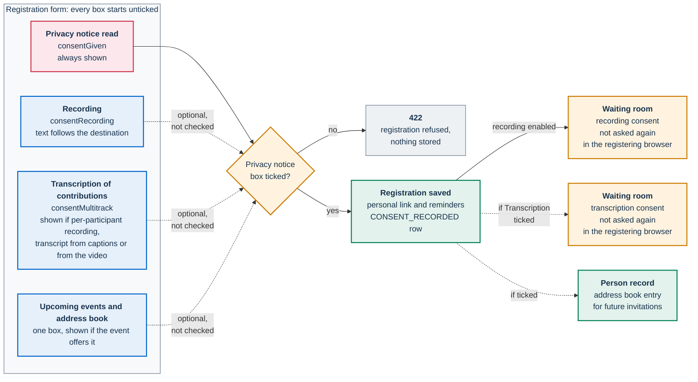
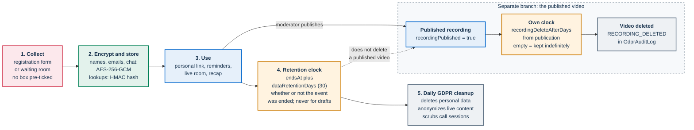
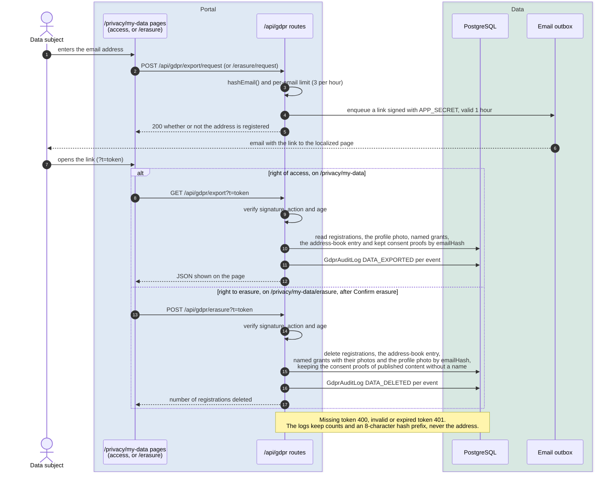

# Privacy and data protection

This page owns the personal data that PA Webinar handles. It covers who is responsible for what, the single inventory of personal data with its retention, the consent model, the cleanup mechanics, the flows for data-subject rights, the address book, staff and guest data, cookies, logs and external resources, the audit trails, how the privacy notice and the privacy sheet of an event are chosen, and the exact consent texts that people see.

It is written for the data protection officers (DPOs) and controllers of administrations that adopt PA Webinar, for auditors, for operators who write privacy notices, and for developers who touch personal data. Every statement describes the current code. Where the code falls short of what a reader might expect, the limitation is stated, and all of them are collected in [Known limitations](#known-limitations).

This page is not legal advice. It tells a controller what the software does, so that the controller can decide what its privacy notice, its records of processing and its data protection impact assessment must say.

Related pages:

- recordings, per-participant audio and AI outputs, with their legal bases and retention regimes: [Recordings, voice data and AI outputs](privacy/recordings-and-ai.md);
- the facts a privacy notice needs, mapped to the settings that control them: [Privacy notice checklist for controllers](privacy/privacy-notice-checklist.md);
- every credential and the technical cookie inventory: [Identity, access and tokens](architecture/identity-and-access.md);
- when each cleanup job runs and which Helm key holds its schedule: [Scheduled and background jobs](architecture/background-jobs.md);
- encryption keys, the secrets map and the application's security controls: [Security architecture](architecture/security.md);
- the event statuses that start the retention clock: [Event lifecycle](architecture/event-lifecycle.md).

## Roles and responsibilities

The public administration (PA) that runs an installation is the **controller** of the personal data processed in it. The providers it uses to run that installation act as **processors**: typically the hosting or cloud provider, the SMTP relay, the object storage provider and, if the installation uses one, an external Jitsi or TURN service. The PA Webinar project does not operate installations, and the software sends no telemetry to the project or to anyone else.

| The software guarantees | The operator must do |
|---|---|
| Boxes are never pre-ticked, no consent is a condition of taking part, and the acknowledgement of the privacy notice is enforced on the server | Write the privacy notice of the installation and of each event, and decide the legal basis of each processing |
| Each event's privacy sheet is computed from the event's and the installation's settings, so it follows them | Keep a privacy notice that holds for every event the sheets can describe, and check that an event's own `recordingConsentText` agrees with where its recording goes |
| Email addresses, most names, chat messages and email bodies are encrypted at rest with AES-256-GCM; the inventory lists the fields that are not | Generate real values for `PII_ENCRYPTION_KEY` and `APP_SECRET`, keep them secret and back them up. Losing `PII_ENCRYPTION_KEY` makes the encrypted data unreadable |
| A daily job deletes event-scoped personal data once an event's retention period has passed, whether or not the event was ended, and strips names and identifiers from the live content the event keeps | Keep the scheduled jobs running: the cleanup job, and the lifecycle job or the JVB scaler that end events on time (see [Retention and cleanup](#retention-and-cleanup)) |
| Self-service access and erasure, confirmed by email | Handle the requests that self-service does not cover (see [What needs an administrator](#what-needs-an-administrator)) |
| No analytics, no tracking cookies, no third-party CDN, self-hosted fonts | Decide whether to use the few external resources that exist (Gravatar, links to YouTube) and declare them |
| Cookies and local-storage entries are functional only | Tell staff that an unsaved event-wizard draft, with the names and email addresses of the contact, moderators, speakers and invitees, stays in the browser's local storage. On shared devices, staff should save or discard drafts (see [Cookies and browser storage](#cookies-and-browser-storage)) |
| Application logs carry no IP addresses | Set retention for ingress, Jitsi, TURN and log-stack logs, which do carry IP addresses |
| In the call, only moderators see the name and email address given at registration, or on a named grant, next to each person; the portal keeps only a link between call connections and registrations or grants, which expires 12 hours after the last person joins the call | Say in the event's notice that its moderators see the registration name and email address of the people in the room |
| The GDPR cleanup and the self-service requests write count-only audit rows | Keep database backups under a retention policy of their own. Deleted rows survive in backups until those expire |
| Only the organizers of an event and its participants see its recordings' content; staff reads are logged ([Who sees a recording](#who-sees-a-recording)) | Restrict the storage, database and cluster credentials, which read the files whatever the application allows |

## Principles

- **Minimization.** A registration asks for a display name and an email address. Organization, role and organization type appear only when the event is configured to ask for them. Guests give only a display name.
- **Consent is never pre-ticked and never a condition.** Every box on the registration form starts unticked. The server requires only the acknowledgement of the privacy notice; every consent is optional, for a separate purpose (see [Consent model](#consent-model)).
- **Encryption at rest.** `encryptPII()` in `app/src/lib/crypto/pii.ts` encrypts with AES-256-GCM under `PII_ENCRYPTION_KEY` (64 hex characters). In production the application refuses a key that looks like a placeholder, a short block repeated to length, and fails closed. The local Docker Compose stack sets `ALLOW_INSECURE_PII_KEY=true` to run with its public development key; a real installation must never set it. The inventory below says, column by column, what is encrypted and what is not.
- **Email lookups use a keyed hash.** `hashEmail()` computes an HMAC-SHA-256 of the lowercased, trimmed address, keyed with `APP_SECRET`. The hash finds duplicates and serves the rights requests without decrypting anything. Without `APP_SECRET`, which only a development setup allows, it falls back to plain SHA-256.
- **No analytics and no third-party CDN.** The portal loads no analytics script or tracking pixel. The only usage figure that the audience's browsers report is first-party and aggregate: a click on an event material increments that material's open count, and nothing records who clicked (see **Materials** in the inventory). Fonts are self-hosted from `app/public/fonts`. The Content Security Policy that enforces this is described in [SECURITY-CSP.md](SECURITY-CSP.md).
- **No IP addresses in application logs.** The portal's log lines carry event and row identifiers, not client addresses (see [Logs and external resources](#logs-and-external-resources)). The database holds client IP addresses in one place, the staff audit log, for 90 days (see [Audit trails](#audit-trails)). Guest chat messages store only a keyed hash of the address; messages written before that change keep a reversible encoding until event retention.
- **Jitsi never receives an email address or a usable hash of one.** The conference token carries a display name, an opaque per-join identifier and an avatar. An uploaded profile photo is linked by a random identifier. When Gravatar is enabled, the avatar URL carries the Gravatar hash encrypted with the platform key, which no other participant can reverse (see [Avatars](architecture/identity-and-access.md#avatars)).

## Data inventory and retention

This is the single inventory of the personal data that PA Webinar stores. `app/prisma/schema.prisma` is the authority on fields. This table says what matters for privacy.

**Event retention** means: after the event's `endsAt` plus its `dataRetentionDays`. For an event that was never ended, the clock starts at the later of `endsAt` and its last activity. Drafts are never cleaned. The daily GDPR cleanup (`/api/cron/cleanup`) applies it: it deletes the event's personal data, and removes names and identifiers from the live content that stays with the event ([What stays after event retention](#what-stays-after-event-retention)). See [Retention and cleanup](#retention-and-cleanup).

| Data | Where | Protection | Retention | Removed by |
|---|---|---|---|---|
| **Registration**: display name, email address, page language, optional organization, role and organization type, consent flags and consent time, the destination and version of the recording text the person read, personal access token, join and leave times | `Registration` | Name and email encrypted. Email looked up by HMAC `emailHash`. Organization fields in plain text | Event retention. The proof of its consents can stay longer ([Consent proofs kept after deletion](#consent-proofs-kept-after-deletion)) | GDPR cleanup, or the registrant's self-service erasure |
| **Primary event contact**: the name and email typed in the event wizard (the lead moderator) | `Event.moderatorName`, `Event.moderatorEmail`, `Event.moderatorOrganization`, `Event.moderatorPhotoId` | Email encrypted, name and organization in plain text. The photo, when staff upload one, is described in the **Photos of event people** row below. With **Show on the public page** on (`moderatorPublicListed`, off by default) the name, the organization and the photo also appear on the public event page. The address receives the moderator-link email ([Email and calendar](architecture/email.md)); calendar files never show it, because their organizer address is the platform's (`SMTP_FROM`). Calendar files never show the name either: their organizer is the event's first organizing body, or the installation's (`app/src/lib/ical/organizer.ts`). The name is copied into `EventMaterial.addedBy` when material is added from the room with the primary moderator link | Kept with the event row, including after event retention; the copies in `EventMaterial.addedBy` and the photo are removed then | Name and email: nothing automatic ([limitation](#known-limitations)). The photo: GDPR cleanup |
| **Public speaker list** | `Event.speakersInfo` | Free text per language (names and descriptions), plain text, public on the event page only when the event lists no speaker (`publicListed` grants) | Kept with the event, including after event retention | Nothing automatic; edit the event |
| **Named moderator and speaker grants** | `EventModerator` | Name and email encrypted, with the email's keyed fingerprint (`emailHash`, to recognize a staff account with the same address); organization and its logo address in plain text, and the person's photo when staff upload one (`photoId`, the **Photos of event people** row below). The token is a durable sign-in credential. When **Show on the public page** is on (`publicListed`, off by default), the name, the organization and the photo appear on the public event page and in its structured data: whoever adds the person decides it, and should have their agreement | Event retention. Duplicating an event copies its grants, with the same photo | GDPR cleanup; self-service export and erasure find the grants by the fingerprint, which the daily cleanup fills in for older grants (erasure also ends the person's link and deletes the grant's photo unless another event uses it) |
| **Photos of event people**: the photo of the lead moderator, a moderator or a speaker | `EventPersonPhoto` (`event_person_photos`), referenced by `Event.moderatorPhotoId` and `EventModerator.photoId` | The person sends the photo to the organizer, and staff upload it in the event wizard; the moderator link alone can neither upload a photo nor attach one that its event does not already use. The platform asks no consent of its own: the photo appears on the public event page and in its structured data only when the person is shown there (**Show on the public page**), like the name. Not encrypted; the row holds the image and its upload time, with no name and no address. The server re-encodes every upload as a 400×400 JPEG without metadata such as date, place or device, whatever the client sent. Served at `/api/avatar/person/{id}`, a random address, without a credential only while a person who uses it is shown on the public page of an event whose page is visible (not a draft or archived event, not a post-event page that is off or expired), and cached by browsers for up to five minutes. Once the person is no longer shown, or the page closes, the address answers 404 to anyone without a staff session, even if it was published in the page's structured data. Staff who manage an event that uses the photo see it in the wizard, and any staff session sees a photo that no event uses yet (a fresh upload), never cached. Anyone else gets a 404, and the page shows initials. A duplicated event uses the same row as the original. Never sent to the conference room ([Avatars](architecture/identity-and-access.md#avatars)) | While an event or a grant uses it. A photo that nothing uses (uploaded and never saved, replaced in the wizard, or left by a deleted event) until 7 days after its upload | GDPR cleanup: at event retention it clears the lead moderator's photo and deletes the photos of the event's grants unless another event uses them; on every run it deletes the photos that nothing uses, 7 days after their upload. Self-service erasure, for the photos of the erased grants |
| **Invitations** | `EventInvitation` | Name and email encrypted, email HMAC, token of the pre-filled registration link. When registration is by invitation only (the event's choice, or the site setting for an event without one), the list decides who may register: the registration route matches the typed address against the HMAC, and sends the personal link only to that mailbox ([Invitation-only registration](architecture/event-journey.md#invitation-only-registration)). A stopped invitation (`declinedAt`) sends nothing more and keeps any access it gave ([The address book](#the-address-book)) | Event retention | GDPR cleanup |
| **Guests** | No row of their own. The typed name lives in the chat, Q&A and questionnaire rows below. A random `paw_guest_id` kept in the browser keys their votes and reactions | As the rows below | Event retention | GDPR cleanup |
| **Chat**, including questions asked in the chat, reactions to messages and attachments | `ChatMessage`, `ChatMessageReaction`, attachment files in object storage | Sender name, message text and attachment file name encrypted. For a guest, the sender identifier (`senderId`) is an HMAC, keyed with `APP_SECRET`, of the client IP address and the typed name: it keeps a guest's messages grouped without storing the address. Messages written before this change keep the older identifier, a reversible encoding of the address, until event retention. It is never sent to other attendees: the history, the live stream and the export carry only a key derived from it with HMAC under `APP_SECRET`, which cannot be reversed by enumeration. Redis relays messages in plain text while live and stores none. Chat is never published: the public page does not show messages or questions asked in the chat, and neither the recap nor the AI models read their text | Event retention. Messages hidden by a moderator stay until then; hiding deletes the attachment file at once | GDPR cleanup, rows and files |
| **Q&A panel** questions and upvotes | `Question`, `QuestionUpvote`, `QuestionGuestUpvote` | Plain text: author name, question and the moderator's written answer. A registrant's upvote holds the registration (`QuestionUpvote`); the upvote of a guest, speaker or moderator holds only the random browser id (`QuestionGuestUpvote`). After the event only the text can be published, never the name: the public page does not receive the author, and once the event has ended the list of questions gives the name only to moderators. Whether the text is published is decided by the rule in [Where the recording goes](#where-the-recording-goes) | Author name, registration link and upvote rows: event retention. Question text, answer, status and upvote count: kept with the event | GDPR cleanup: empties the author name, removes the registration link and deletes the upvote rows. Erasure removes a registrant's own questions. The questions go with the event |
| **Polls and word cloud** | `Poll`, `PollVote`, `WordCloudRound`, `WordCloudSubmission` | A registration ID or a browser guest ID on each vote and word, no names | Registration and browser IDs: event retention. Polls, votes, rounds and words: kept with the event | GDPR cleanup: removes the registration and replaces the browser ID with a per-event pseudonym ([What stays after event retention](#what-stays-after-event-retention)). Erasure deletes a registrant's own votes and words |
| **Live reactions, agenda and agenda reactions** | `Reaction`, `EventAgendaItem`, `AgendaItemReaction` | Live reactions store only the emoji and the time. Agenda items hold the moderators' topics and, for each, who speaks as a reference to a named grant (no name of its own: the reference empties when the grant is deleted). An agenda reaction holds a registration ID or a browser guest ID | Live reactions and agenda reactions: event retention. Agenda items: kept with the event | GDPR cleanup, for the reactions. Agenda items: deleting them or the event |
| **Live action journal**: what happened in the room and when, read by AI post-production for the summary and by the concluded event page for the slides beside the published video | `LiveAction` | No names and no Jitsi endpoint IDs: the role of whoever acted, the server time, and IDs, counts and texts written by moderators (agenda topics, poll questions with their results, word-cloud prompts), plus the most frequent words of each closed word-cloud round, which participants typed. Raised hands are recorded as times only ([details](architecture/live-interaction.md#live-action-journal)) | Kept with the event | Deleting the event |
| **Feedback and questionnaire responses** | `EventFeedback`, `QuestionnaireResponse`, `QuestionnaireAnswer` | `EventFeedback`: the older star ratings, which the room does not write: a rating, an optional free-text comment, and a registration or guest ID. `QuestionnaireResponse` of the end-of-event rating (`POST_EVENT`): no name and no email hash, only the registration ID, kept to allow one response per registration, or the browser's guest ID; organizers see the answers without a name, and the form says so. Pre-registration responses (`PRE_REGISTRATION`): the respondent name in plain text and, for a registrant, the registration's email HMAC (`respondentEmailHash`). Answers in both, including free text | Pre-registration responses: event retention. End-of-event responses and star ratings: kept with the event, without registration, browser ID, name or email hash after event retention | GDPR cleanup: deletes pre-registration responses with their answers; removes the identities from the others, replacing the browser ID with the same per-event pseudonym |
| **Materials** | `EventMaterial` and its files | Files in object storage. The visibility setting (**In the room and after the event**, the default, **Before the event**, **During the event**, **After the event**) decides which public lists show a material, not who can download it: an uploaded file is served from its `/api/assets/…` URL to anyone who has the URL. Before the start, only materials marked **Before the event** are listed publicly. Each material also keeps `openCount`, how many times it was opened or downloaded from a list: one number per material, with nothing about who opened it, shown only to the event's moderators. To count each caller once every 10 minutes, the server holds a hash of the room token or, without a valid one, the client IP address in its memory for those 10 minutes, and never logs or stores it ([Materials](architecture/live-interaction.md#materials)) | Kept with the event, files included. The name of whoever added a material (`addedBy`) is emptied at event retention | Deleting the material or the event, rows and files. The GDPR cleanup empties `addedBy` |
| **Reminder bookkeeping** | `EventReminder`, `ReminderSent` | Identifiers only | Event retention | GDPR cleanup |
| **Call sessions** | `CallSession` | Participant list encrypted. Dominant-speaker log (endpoint ID and display name) in plain text; it is collected in every live room that a moderator attends, whether or not the event records. Hand-raise log with opaque IDs | Personal columns emptied at event retention. Duration and peak attendance are kept | GDPR cleanup (scrub) |
| **Event recap** | `Event.postEventRecap` | Aggregates and Q&A question texts without their authors, in plain text. The recap does not read the chat. One saved by an earlier version can still hold questions asked in the chat, decrypted: they count in the end-of-event email and never reach a page. The public page reads the recap through a filter that also drops the Q&A texts where the event does not publish them | Kept with the event: it survives the retention cleanup | Nothing automatic |
| **AI event report**, requested by staff after the event | `Event.postEventReport` (JSON), `postEventReportAt`, `postEventReportPublished` | Plain text. Figures computed by the platform (attendance, participation over time, agree and disagree counts on the agenda, published poll results, the texts of the most voted questions where the event publishes them, the most frequent words, rating averages and distributions) and text written by the language model inside the installation, in each requested language. The model is instructed to name only the event's listed people and named speakers, to attribute no comment to anyone, to reword comments rather than quote them and to avoid personal data; the portal removes email addresses and phone numbers from its text. To write it, the model reads the transcript with speaker names, polls, words and the questionnaire comments, the Q&A questions only where the event publishes them, and of the chat only the number of messages ([The event report](POSTPROD.md#the-event-report)). Public only when staff publish it, after reviewing it, and the post-event page is visible. On a reserved recording it follows the recording: whoever cannot see the recording does not see the report | Kept with the event: like the recap, it survives the retention cleanup | Regenerating it replaces it; deleting the event |
| **Machine translation proposals** of the event's title and description, requested by staff in the wizard | `Event.textTranslations` (JSON) | Plain text: the event's title and description translated by a model on CPU inside the installation, with the hash of the source text and the model name. They hold participants' data only if the organizer wrote some into the title or description. Never public: they reach the event page only through what staff review and save as the event's text ([Event text translation](POSTPROD.md#event-text-translation)) | Kept with the event | A new request for another text replaces them; deleting the event. Duplicating an event does not copy them |
| **Temporary recording** | `Event.tempRecordingUrl` | Recordings storage, private. Not offered on a reserved recording or to an audience limited to registrants, and a reserved event refuses a new address | 24 hours after `tempRecordingStartedAt`, unless published | GDPR cleanup |
| **Composite video recording** | `Event.recordingUrl`, `CallSession.recordingUrl`, recordings storage | Private container, short-lived signed playback URLs, the provider's encryption at rest. Each recorded session has its file on its call session, and the event points to the latest. The event's destination says who can watch it ([Where the recording goes](#where-the-recording-goes)) | Not published: event retention, for the file the event points to ([limitation](#known-limitations) for earlier sessions). Published: `recordingDeleteAfterDays` after publication, or indefinitely when unset | GDPR cleanup, deletion through the primary moderator link, or `recordings-reconcile` for a file taken off the event ([What needs an administrator](#what-needs-an-administrator)). Details in [Recordings, voice data and AI outputs](privacy/recordings-and-ai.md) |
| **Per-participant audio tracks** | `RecordingTrack` and its files | Only the voices of people who consented to the transcription of what they say: the recorder asks the portal before each track. Never public. Name encrypted | Deleted shortly after transcription, unless the event keeps them. At the latest at event retention, when the post-production jobs run ([limitation](#known-limitations)) | `multitrack-purge`, `postprod-retention`, the orphan sweep of `recordings-reconcile`, GDPR cleanup for the rows. See [Recordings, voice data and AI outputs](privacy/recordings-and-ai.md) |
| **Transcription consent given in the waiting room** (per-participant recording and transcript from captions) | `MultitrackConsent` | Name encrypted; the conference seat identifier, the time, the page language and the version of the consent text (`textVersion`) in plain text. Written when someone who had not consented at registration (a guest, a moderator, a speaker, a registrant on another device) ticks the box in the waiting room and receives the conference token. A later entry in the same visit of the page adds a row for the new seat only while the proof is still valid, with its original time and text: after a withdrawal it adds none. Linked to the registration only in the browser that registered; a personal link opened in another browser enters on a guest seat, and its row has no registration. For moderators and speakers, linked to their named grant or to the staff account behind the primary link (`eventModeratorId`, `staffAccountId`; set to null when the grant or the account is deleted), with the email HMAC of either (`emailHash`), which stays after they are gone. A consent withdrawn from the room keeps its row, with the time of the withdrawal (`withdrawnAt`) | Event retention; with the registration, when linked to one. A copy can stay ([Consent proofs kept after deletion](#consent-proofs-kept-after-deletion)) | GDPR cleanup; erasure on request, through the registration, the named grant, the staff account or the email HMAC |
| **Recording consent given in the waiting room** | `RecordingConsent` | The same fields as the row above, with the destination the text declared (`destination`) and, for a consent given again or replaced, its earlier periods (`earlierPeriods`). Written when someone who had not given the recording consent at registration (a guest from the room link, a registrant on another device, a registrant who registered before recording was turned on) ticks the box in the waiting room and receives the conference token. A later entry in the same visit of the page adds a row for the new seat only while the proof is still valid, with its original time and text, so a guest's re-entries and reconnections each leave one until a withdrawal, and none after it. Linked to the registration only in the browser that registered, and then once per registration (a unique constraint); a personal link opened in another browser enters on a guest seat, and its row has no registration. For moderators and speakers, linked to their named grant or to the staff account behind the primary link (`eventModeratorId`, `staffAccountId`; set to null when the grant or the account is deleted), with the email HMAC of either (`emailHash`), which stays after they are gone | Event retention; with the registration, when linked to one. A copy can stay ([Consent proofs kept after deletion](#consent-proofs-kept-after-deletion)) | GDPR cleanup; erasure on request, through the registration, the named grant, the staff account or the email HMAC |
| **Consent proofs kept** for a video or transcript | `RetainedConsentProof` (`retained_consent_proofs`) | One row per period of a consent: its kind, where it was given, the role, the name as it was on the source (encrypted, copied without decrypting it), the email HMAC where the source knew an address (`emailHash`), the page language, the text version, the destination, the given and withdrawn times, the time it was copied, and a SHA-256 of the event and the holder (`holderHash`, never exported), which counts people and recognizes a person in the transcript from captions once the registration is gone. After an erasure request the row has no name (`nameRemovedAt`) and counts as withdrawn; it keeps the email HMAC. No foreign key to registrations or grants, so nothing that checks a live consent reads these rows | While the event's video or transcript exists; past event retention, while it is published | GDPR cleanup, at the first run that finds nothing left to cover the proof; deleting the event ([limitation](#known-limitations)). Erasure removes the name, not the row |
| **Who is in the room**: which conference seat stands behind each voice on the bridge | `RoomOccupant` (`room_occupants`) | No name and no address: the bridge endpoint id, the conference seat identifier (`context.user.id` of the token, `reg-<registrationId>-…` for a registrant), the meeting id, join and leave times, in plain text. Reported by Prosody (`mod_pa_occupants`) for every occupant who joins a room with a token, and stored for every event of an installation where live captions are available (the captions service installed and `liveCaptionsEnabled` on in the site settings), whatever the event's own captions switch and whether or not the event keeps a transcript, and for every event with per-participant recording; not at all otherwise ([Live captions](architecture/live-captions.md#transcript-from-captions)) | Event retention | GDPR cleanup; erasure on request, for the seats of the registration |
| **Live caption sentences** kept for the transcript from captions | `CaptionSegment` (`caption_segments`) | Written only for events with **Transcript from captions** on. For people who consented to the transcription of what they say: the text and the speaker's name, encrypted, with the conference seat. For everyone else: the bridge endpoint, the language and the times only, with no text, name or seat | Event retention | GDPR cleanup; erasure on request, for the seats of the registration |
| **AI outputs**: transcripts, summaries, subtitles, translations, dubbed audio, speaker labels | `PostprodArtifact`, `PostprodOriginalBody`, `Speaker`, `Recording.pipelineSnapshot`, post-production storage | Inline text encrypted. Files under the provider's encryption. Speaker names (`Speaker.displayName`) and the pipeline snapshot (`Recording.pipelineSnapshot`, which includes speaker names) in plain text | Follow the recording: event retention if the video is not published, the video's lifetime if it is. When only the transcript is published (`transcriptPublished`), the transcript stays while it is published and every other output goes at event retention. An optional site-wide cap applies on top. The purge deletes the `Speaker` rows and scrubs job payloads, but the speaker names copied into `Recording.pipelineSnapshot` remain ([limitation](#known-limitations)) | `postprod-retention`. See [Recordings, voice data and AI outputs](privacy/recordings-and-ai.md) |
| **Transcript from captions**: the event's transcript built from the stored caption sentences | `PostprodArtifact` (`TRANSCRIPT_JSON`, model `live-captions`) and `Speaker` rows, on the event's recording or on a recording without media created for it | Text encrypted, in the database only (no file in object storage). Speaker names (`Speaker.displayName`) in plain text. Public only when published (`transcriptPublished`, or with the published video) and the post-event page is public | Event retention, unless the event's video or transcript is published; then for as long as either stays published | GDPR cleanup: a recording that holds only this transcript is deleted with its job, artifact, machine version and speaker labels; from a recording with video only this transcript and its speaker labels are removed. `postprod-retention` too, where it runs. Erasure of a registration removes the person's sentences, name and speaker entry from it. See [Recordings, voice data and AI outputs](privacy/recordings-and-ai.md#transcript-from-live-captions) |
| **Address book** | `Person` | Display name and email address encrypted, email HMAC. The address is copied as it stands, still encrypted, from the registration that ticked the box. Organization fields in plain text | `retentionMonths` (default 24) from the consent (`optedInAt`): only a new tick restarts it, and on an address that has stopped receiving invitations only a confirmed one. Opted-out entries lose the address at once and the rest at the next run | `rubrica-retention`, an administrator's deletion, or self-service erasure |
| **Profile photo**: the picture a registrant chooses to show in the room instead of initials | `ProfilePhoto` | Not encrypted. Keyed by the email HMAC, with no name and no address, and shared by every event of that address. Uploading needs proof of the address: a registration whose browser has opened the entry link from an email. Named moderator and speaker grants and the shared moderator link have none, because staff choose a grant's address; the photo staff upload for an event's people is a different one (**Photos of event people** above), shown only on the public event page. The server re-encodes every upload as a 256×256 JPEG without metadata such as date, place or device, whatever the client sent. Served without a credential at `/api/avatar/photo/{id}`, a random address that the conference token gives to everyone in the room, and cached by browsers for up to an hour. Not shown in the chat ([Avatars](architecture/identity-and-access.md#avatars)) | While a registration with the same email hash exists, at any event. Then until it has gone 30 days without a change | The person, in the waiting room. Self-service erasure. GDPR cleanup |
| **Who is behind each video tile**: which registration or named grant each connection to the call belongs to | Redis hash `live:seats:<eventId>`; the memory of an app pod when Redis is missing or does not answer | Only references: the Jitsi endpoint id and the registration or grant id, no name and no address. Through it, moderators (the primary link and `MODERATOR` grants, not speakers) see in the participants panel the registration's or grant's name and email address next to each person in the call ([Who is behind each video tile](architecture/identity-and-access.md#who-is-behind-each-video-tile)) | In Redis, 12 hours after the last connection declared in the event. In a pod's memory, 12 hours after each declaration | Redis expiry; in memory, the next use of the map after expiry, or the end of the process |
| **Staff accounts** | `StaffAccount` | Name and email encrypted, email HMAC | Until an administrator deletes the account | An administrator |
| **Staff sign-in links** | `StaffLoginToken` | Only the SHA-256 of the token | One day after use or expiry | GDPR cleanup |
| **Email outbox** | `EmailOutbox` | Recipient, HTML and text encrypted, and so is the calendar invitation, which carries the recipient's address and personal join link. Subject and metadata in plain text. Metadata holds row IDs. For moderator-link emails, the deduplication column holds an HMAC of the recipient's address, used to send each link once | Sent and failed rows: 30 days after their last update (`EMAIL_OUTBOX_RETENTION_DAYS`). Rows with a deduplication key are emptied instead of deleted, so that each link is still sent only once. Rows written for a registration or an invitation are also deleted by erasure, sent or not, and those of an invitation when staff correct its address. A withdrawal removes the unsent emails of the person's invitations, and so does deleting the invitation | GDPR cleanup |
| **GDPR audit log** | `GdprAuditLog` | No personal data: counts, consent flags, an 8-character prefix of the email hash | Kept | Only by deleting the event row. A row with no event, for the withdrawal of an address-book entry with no registrations, is never deleted |
| **Staff audit log** | `AdminAuditLog` | Actor identifier, client IP address, user agent. The detail of the speaker-naming action (`POSTPROD_SPEAKER_MAP`) may include the speaker's name | Rows kept. IP address, user agent and the speaker-naming detail are emptied after 90 days (`AUDIT_LOG_PERSONAL_DATA_RETENTION_DAYS`) | GDPR cleanup |
| **Orphaned recording files** | `OrphanRecording` | File names only | `orphanRecordingGraceDays` (default 30) | `recordings-reconcile` |
| **Who is live and who is waiting** (counts) | Redis sorted sets `presenza:<eventId>:attesa` and `:diretta` | A random identifier generated for each page load, and the time of its last signal. No name, token or address | 75 seconds after a page's last signal; the keys expire ten minutes after the last signal from anyone | Redis expiry, or the leave signal when the tab closes |
| **Presence in the square** | Redis | Display name, avatar choice, position | Removed at once when a person leaves normally. Otherwise, the event's presence record expires about 10 seconds after the last update from anyone in the square; until then, a departed person's entry stays in Redis but is no longer shown | The leave signal, or Redis expiry |
| **Rate-limit counters** | Memory of each app pod | Keyed by IP address, email hash or a hash of the room token, including the once-per-10-minutes count of material openings | The end of each limit window | The process |
| **Application logs** | Container standard output | No IP addresses. Email addresses only inside relayed SMTP errors | The operator's log stack | The operator |
| **Data-subject request links** | Not stored. The email that carries them is in the outbox | HMAC-signed with `APP_SECRET` | 1 hour | Expiry |

### Emails after the event

Two emails can reach registrants after the event. Both go through the email outbox and the SMTP relay, use only the registration's address and language, and go only to people who registered for that event ([Email and calendar](architecture/email.md#emails-the-platform-sends)):

- **Post-event thank-you**, *opt-in* per event (**Send recap email when the event ends**, `postEventEmailEnabled`): once, to every registrant, for events that ended within the previous seven days.
- **Recording notice**, on by default per event (**Notify registrants when the recording is published**, `recordingNotifyEnabled`): once, when the event's published recording or external video becomes visible on its public page, to every registration the event still keeps. A reserved recording does not need a visible page: the notice leaves when the published recording opens to registrants, and an external video alone does not send it, because the page does not show it to them. Its purpose is to tell the people who registered that they can watch the event. It ends with retention: once the cleanup has deleted the registrations, nobody is notified. Staff can turn it off on the event until it is sent.

Neither email depends on the future-communications consent. If your notice does not cover the recording notice, turn it off on each event, in the **Post-event configuration** panel of the **After the event** tab, before it is sent.

### What stays after event retention

The cleanup never deletes the event row, and it does not change the status of a concluded event: an `ENDED` event stays `ENDED`, and one that staff archived stays `ARCHIVED`. Only an event that was never ended is set to `ARCHIVED`. Whether the event keeps a public page, and what that page shows, is decided by its post-event settings: page visibility (`postEventPublic`, `postEventPublicUntil`), the video library (`libraryListed`) and the toggles of what the page shows (`postEventShow*`) ([The post-event page](architecture/event-journey.md#the-post-event-page)).

For as long as the event exists, it keeps:

- its record: title, description, dates, the public speaker list (`Event.speakersInfo`), the co-organizing organizations (`EventOrganizer`), the event recap (with the texts of Q&A questions, without their authors), the questionnaire configuration, the `Recording` rows (emptied of AI outputs and tracks by `postprod-retention` unless the video is published, and of everything but the transcript when only the transcript is published; the purge also removes the speaker names from `pipelineSnapshot`), and the `GdprAuditLog` rows. The primary event contact also stays, and its name stays public in the event's calendar file; see [Known limitations](#known-limitations);
- its live content, without any link to a person, so that organizers can decide what to publish:
  - Q&A questions and the moderators' answers, with their status and upvote count. The author name is emptied, the registration link removed and the upvote rows deleted; the public post-event page shows these questions only if the event publishes them, and without an author;
  - polls with their votes, and word-cloud rounds with their words. Each vote and word loses its registration, and its browser ID is replaced by a pseudonym: `anon:` followed by the MD5 of the event ID and the original registration ID, or browser ID, or the row's own ID when it has neither. The pseudonym is the same for one person across the event's poll votes, word-cloud words, older star ratings and end-of-event answers, and differs from one event to the next. The one-per-person unique indexes therefore still hold, and per-person counts, such as the event's analytics and the words each person sent, stay as they were. Once the registrations are deleted, nothing in the database leads from a pseudonym back to a person; a browser that still holds its browser ID could recompute the pseudonym of its own contributions;
  - end-of-event questionnaire responses with their answers, without name, email hash or registration, and the older star ratings and comments, without registration; in both, the browser ID is replaced by the same pseudonym;
  - materials and their files, without the name of whoever added them. Material files are deleted only when the material or the event is deleted;
  - the agenda items and the live action journal, which hold no names;
- the AI event report, when staff requested one: aggregate figures and model-written text, published or not;
- the consent proofs of what is published ([Consent proofs kept after deletion](#consent-proofs-kept-after-deletion)).

What the audience wrote (question texts, comments, free-text answers, word-cloud words) stays as it was typed, and can itself contain personal data; see [Known limitations](#known-limitations).

## Consent model

### Who is in the video

Only the people who lead an event appear in its video. Organizers, moderators and speakers, and in an instant call its moderators, primary link included, are always in the video, with their name, voice, image and shared screen. This is the platform's rule, not an option of the event, and they tick no box: the waiting room tells them instead (`gdpr.consent.recordingHostAlways*`), no recording proof is stored for them, and the legal basis for recording them is the controller's to state in the event's privacy notice. Their conference token carries `context.user.paInVideo = true` (`mediaDelToken` in `app/src/lib/live/listen-only.ts`, `generateJitsiJwt` in `app/src/lib/auth/jwt.ts`). No other token carries it, the recorder's included, and the mark is the contract with Prosody and the recorder: `mod_pa_media_lock` marks the presence of everyone without it, where the client can neither add nor remove the marks, and Jibri's session leaves those people out ([Only hosts in the video](architecture/jitsi-integration.md#per-event-participant-policies)).

Participants never appear in the video: no tile, no image, no name, no shared screen, and the stage never moves to them when they speak. Of what they say only the voice is recorded, and only with their consent; without it not even the voice (see below). The recording consent is therefore a participant's consent to the recording of their voice when they speak. Its text says so, and says that face and name never appear (version 2 of the text, `VERSIONE_TESTO_REGISTRAZIONE` in `app/src/lib/recording/destination.ts`). A consent given on version 1, which covered name, voice and image, also covers the narrower version 2 and is not asked again. All of this holds as far as the installation guarantees it: the table below says what changes where it does not.

`Event.hostsAlwaysRecorded`, which used to let an organizer declare this event by event, stays in the database and is no longer read: the wizard shows a fixed note in place of the switch, and templates no longer offer it.

The guarantee holds only where Jibri's session reads Prosody's marks, which the chart declares with `RECORDING_VOICE_EXCLUSION`, and participants are heard only where the conference text plays their voices, which it declares with `RECORDING_PARTICIPANT_VOICE` ([CONFIGURATION.md](CONFIGURATION.md)). The portal reads the two variables once (`partecipantiNelVideo` in `app/src/lib/recording/availability.ts`), and the consent rule, the conference token and every text of the registration form, the privacy sheet, the waiting room, the room and the event wizard derive from that answer (`app/src/lib/live/consent-rule.ts`). No text promises more than the installation guarantees, and where the answer is unknown the portal assumes the weakest case.

| What the installation guarantees | When | Participants in the video | Recording consent | A participant without it | Instant calls | What the texts say |
|---|---|---|---|---|---|---|
| `solo-voce` | Chart conference text with both parts | Never face, name or tile; the voice, with consent | Asked, on the voice-only text (version 2) | Takes part like everyone, voice out (`voiceExcluded`) | Recording offered; the question comes at each start | Face and name never appear; with consent, only the voice |
| `esclusi` | Conference text that hides participants but does not play their voices | Never, voice included | Not asked: it would cover nothing in the video | Not applicable | Recording offered, with the hosts only, and no question | Only the hosts are seen and heard in the video |
| `visibili` | A Jitsi other than the chart's, or a values file that replaced the chart's conference text | Can appear with face and name, even silent in the thumbnails | Asked, on the text that covers name, voice and image (version 1, stored as 1); only that text covers | Listens only | Recording not offered | Never "only the voice"; the name a person takes part with can appear even if they do not speak |
| `assente` | No Jibri: no composite video | None | Asked, on the no-video text | Per-participant tracks follow the transcription consent | Recording not offered | No video to speak of |

Where participants never enter the video (`esclusi`), their voice is recorded only by the per-participant recorder and kept only in the transcript from captions, both under the transcription consent, which there does not wait for a recording consent: the token marks `voiceExcluded` whoever has no valid transcription consent (`voceDallaTrascrizione` in `app/src/lib/live/consent-rule.ts`), and the recorder and the captions transcript follow the mark as everywhere else. The organization's own recording text (`Event.recordingConsentText`) belongs to the recording box, so it is not shown where there is no box. The participant list shows nobody's recording state there. A recording consent given earlier covers nothing there, and the room's **Consents** window does not list it: withdrawing it from the room would also withdraw the transcription consent ([Withdrawing consent](#withdrawing-consent): the two go together). It stays withdrawable from My data.

Where participants can appear (`visibili`), only a consent given on the text that says name, voice and image covers (version 1, `provaCopre` in `app/src/lib/recording/destination.ts`), or one stored without a version, given before the texts declared one, when every recording text with a video said audio and video. A consent on the voice-only text (version 2) does not, nor one on the no-video text (version 3, which covers no video anywhere), so the person enters listening only and is asked again in the room, and the proof is updated to the new text with the earlier period kept (`versioneCopre`). The registration form and the room send the version of the text they showed: a registration form opened before the installation changed answers `422` as for a changed destination, and a room opened before it stores no proof and keeps the person listening only until the page is reloaded with the current text.

One limit follows from reading the capability from the chart's variables: an installation that adds the voice script to its conference text without declaring `RECORDING_PARTICIPANT_VOICE` would play into the video the voices of participants who gave the transcription consent only. The chart sets both variables from the same text, so this arises only from settings made by hand.

### What the format decides

The format sets starting values, never people's rights. The organizer's answers in the event wizard, or a template, fill in the settings below (`presetDaFormato` in `app/src/lib/events/guided-format.ts`), and the organizer can change each of them.

| Setting | Meeting or community call: everyone speaks, small audience | Participatory event: everyone speaks, medium audience | Public webinar or large-scale event: only speakers speak, or a large audience |
|---|---|---|---|
| Recording, when the event records | Reserved | Public | Public |
| Participant list | Visible | Visible | Hidden |
| Audience names | Real | Real | Pseudonyms |
| Moderators and speakers in the recording | Always, with name and image | Always, with name and image | Always, with name and image |
| Q&A after the event | Not published | Text only | Text only |
| Address book on the form | Not offered | Offered | Offered |

An event by invitation starts with a reserved recording. Among the system templates, the course follows the meeting, and the press conference follows the public webinar with real names.

The installation decides what no event overrides: its privacy notice, the legal texts, its templates, and whether it has an address book at all (`SiteSetting.addressBookEnabled`).

These rules hold in every format, and no setting changes them:

- a box is never ticked in advance and is never a condition of entering;
- recording, transcription and the address book are separate purposes, with a box each;
- participants never appear in the video, and a participant who refuses is not recorded at all, not even the voice, or listens only where the voice cannot be left out; the room does not change for anyone else;
- the room tells people about recording and transcription;
- a consent can be withdrawn;
- the proof of a consent lasts as long as the video or transcript exists and, past event retention, as long as it is published;
- chat is never published, not even the questions asked in it, and of Q&A questions only the text can be published, never the name. Neither depends on the recording consent, and a note under both fields asks people not to write personal data (`live.chat.personalDataNotice`, `qa.personalDataNotice`, or `qa.personalDataNoticeNotPublished` where the questions are not published).

### Where the recording goes

An event that records declares where its video goes (`Event.recordingDestination`, `app/src/lib/recording/destination.ts`). This is what people agree to when they tick the box: an event has one recording box, for recording and publication together, and its text follows the destination.

| Destination | Text of the box | What can happen to the video |
|---|---|---|
| `PUBLIC` (**Public**) | `gdpr.consent.recordingPublic` | It can be published for anyone, on the event page and in the video library |
| `REGISTRANTS` (**Reserved**) | `gdpr.consent.recordingReserved` | Only registrants and the organizers of the event can watch it ([Who sees a recording](#who-sees-a-recording)). Once the room has opened it can no longer be made public, and while it is reserved it cannot be linked to an external video |
| Not declared | `gdpr.consent.recording` | Events that were already recording before this choice existed, instant calls, imported historical events, and events that received a file after their room had opened. Nothing blocks publication, and whoever publishes sees a warning that the consents do not say where the video would go (`recording.destinationMissing`). Imported historical events get no warning |

Where the installation records no room video, the box says so (`gdpr.consent.recordingNoVideo`) and declares no destination, whatever the event's column holds.

**Starting value.** The wizard asks whether to record and, if so, whether the recording is reserved or public. An event that starts recording without a choice starts reserved (`destinazioneDiPartenza`): a new event, a copy of an event without a destination, an existing event without recording that turns it on, and one that receives an uploaded file before its room has ever opened. That includes a change made with a moderator link, because only the event staff can choose the destination. Instant calls, imported historical events and their copies stay without a destination. So does an event whose room has already opened and that then receives a file, such as one that ended without recording: a reserved destination could no longer be widened there, so the event declares none and publishes with the warning above.

**Changes.** A declared destination cannot be removed. Before the room opens it can change in either direction. Once the room has opened, even if it has closed since, it can only become reserved, and an attempt to make it public answers `409` (`puoCambiareDestinazione`). While the room may be open a restriction is not applied either: the update ignores it and reports it in `ignoredCreationOnlyFields`.

**Which consent covers which destination** (`consensoCopre`). On an event without a destination, every consent counts. Otherwise a consent to a public video also covers a reserved one, a consent to a reserved video does not cover a public one, and a consent whose text declared no destination covers neither. So restricting asks nothing of anyone, while widening before the room opens means that whoever is no longer covered is asked again in the waiting room. Without a new consent they take part and stay out of the video. A consent given on a text that does not cover the one in force is not stored.

**The guard on publishing.** On a reserved event, a write that would expose the video more answers `409 RECORDING_DESTINATION_NOT_COVERED` (`assertEsposizioneConsentita`): making it visible to everyone, publishing the video or the transcript for everyone, or adding an external video or a catch-up address. A new video address on a reserved event must also be a file in the recordings storage, and any other address answers the same `409` (`assertVideoNelloStorage`), unless the installation has no recordings storage. Only the event staff can attach a new video to an event: a moderator link can only send back the address already there. Restricting is never refused. The guard looks at the event, not at each proof: everyone in the video holds a consent that covers the destination, so it still holds after the cleanup has removed the sources.

**What a reserved recording means** (`app/src/lib/recording/audience.ts`, `app/src/lib/events/post-event-sections.ts`):

- The video, the transcript and what comes from them can be seen by the organizers of the event and by registrants, who prove it with the personal link of the recording notice or with the event's access cookie, even if they never entered the room. The registration must still exist.
- The event page can stay private: it opens for a registrant, and search engines are told not to index it. `postEventPublic` does not apply, and `postEventPublicUntil` does. An event without a destination whose audience is limited to registrants still needs `postEventPublic`.
- Q&A questions are not published, whatever the toggle says, also on an event that becomes reserved later, and also when the destination is public or undeclared and the audience chosen afterwards is limited to registrants (`domandePubbliche`, which needs `postEventShowQA` and `qaEnabled` as well). The same rule decides what the AI models read for the summary and the report, which also need the page after the event to be public when the job starts (`domandePerIModelli`). On an older event the limited audience alone already keeps the questions off the page ([limitation](#known-limitations)).
- The AI event report follows the recording.
- An external link already on the event stays there, and the page shows it only to whoever can see the video. The copy on the external site is the controller's to remove.

### At registration

The registration form shows the event's [privacy sheet](#the-privacy-sheet-of-an-event), the link to its privacy notice, and then the boxes below. All start unticked (`app/src/components/registration/registration-form-client.tsx`). Only the first is needed to register: without it `POST /api/events/{slug}/registrations` rejects the request with a validation error (`422`). It records that the person read the notice, and is not a consent to the purposes that follow, each of which is optional.

| Consent | Stored as | Shown when | Required | Effect |
|---|---|---|---|---|
| Having read the privacy notice | `Registration.consentGiven`, `consentTimestamp` | Always | Yes | The registration is stored. When the event asks for organization data, the label adds that it is processed for statistics |
| Recording of the person's voice when they speak, never their face or name, and publication where the destination is public; where the installation cannot keep participants out of the video, the recording of name, voice and image ([Who is in the video](#who-is-in-the-video)) | `Registration.consentRecording`, `null` when the event does not ask; `consentRecordingDestination` and `consentRecordingVersion`, the text read | `recordingEnabled`, something can record the event (without Jibri, only its per-person tracks), participants may use the microphone, camera or screen, and the installation does not keep participants out of the video entirely (`esclusi`) | No | The registration is stored either way. With it, the waiting room does not ask again in the registering browser, as long as it covers the destination; without it, the person takes part and is not recorded (see below) |
| Transcription of the person's contributions, with their name | `Registration.consentMultitrack`: `true` or `false` when asked, `null` when not asked; `consentMultitrackVersion`, the version of the text it was given with | Per-person tracks on an event that can record them (`multitrackRecordingEnabled`, with `eventoRegistrabile`), a transcript from captions that will run (`captionsTranscriptEnabled`, with captions on for the event and available on the instance), or an AI transcript of the video (`trascrizioneDalVideo`). Where refusing the recording keeps the voice out, it depends on the recording box, and it is left out when the event only informs its audience | No | The registration is stored either way. With it, the per-participant recorder records the person's voice and the transcript from captions keeps their sentences with their name; without it, neither does. The waiting room does not ask again in the registering browser once it is given with the current text |
| Upcoming events and the address book, one box for one purpose | `Registration.consentFutureCommunications`, `Person.optedInAt`, and the `consentAddressBook` flag in the audit row | The installation has the address book and the event offers it (`rubricaProposta`) | No | Creates or renews the person's address-book entry. On an address that has stopped receiving invitations the tick counts only once it is confirmed (see [The address book](#the-address-book)). The registration flag is included in the export, and no built-in feature sends anything based on it |

The recording consent counts for the text the person read: the form sends the destination of the text it showed (`consentRecordingDestination`). If the box is ticked and the destination has changed while the form was open, in either direction, the route answers `422` and the form asks the person to reload and read it again (`registration.errors.recordingDestinationChanged`). An unticked box is never refused.

An event can also make its audience anonymous (`Event.audienceAnonymous`): participants appear to each other under a per-event pseudonym on video, in the chat and in questions, with no address or photo in the conference token; only the organizers and the hosts' seats view see who is behind each pseudonym. The pseudonym is a fingerprint of the event and the seat, not of the person, so the same person cannot be linked across events by it.

Whether the audience sees the participant list follows the event's format and the organizer's choice (`Event.participantListVisible`, `app/src/lib/live/participant-list.ts`). A call where people speak and show themselves, such as a community call or a meeting among colleagues, starts with the list visible; a public event, or one expecting 300 participants or more, starts with it hidden, and then the **Participants** tab, the tile view, the thumbnail strip and the names in the square stay with hosts and speakers. The organizer can change it before the room opens. Events created before this rule keep it visible where people can speak. Instant calls always show it, and an anonymous audience always keeps it hidden. The setting governs the interface: Jitsi delivers the display names of everyone in the conference to each browser, so a participant who inspects the client can still read them. An anonymous audience is the setting that removes real names from that traffic.

The recording consent is free and is never a condition of registering or entering, and refusing it affects only the person who refuses. In an event that records, a participant who has no valid consent takes part with the rules of everyone else, and is not in the recording, not even with the voice (`app/src/lib/live/listen-only.ts`, `mod_pa_media_lock`). The token carries `voiceExcluded`, and the module writes `hidden-from-recorder` into the person's presence, where the client can neither add nor remove it. Jitsi's own feature then keeps that person out of Jibri's session: no name, voice, image or shared screen reaches the video, and the per-participant recorder skips the track. Room locks, the floor and the look of the video stay as the event set them, for everyone. The room tells the person, with a one-click consent for whoever only forgot the box. Prosody also reports the mark to the portal (`RoomOccupant.voiceExcluded`): without the recording consent neither the name nor the text is kept, whatever the transcription consent says. If they speak while a recording is running, a note next to the published video says that some contributions are missing (`Event.unrecordedSpeech`), and the transcript from captions marks each one with `***` and its time, without text or name. Live captions keep showing their words to the people in the room, and are not stored. Moderators and speakers are always in the recording ([Who is in the video](#who-is-in-the-video)). Where the voice cannot be left out (`visibili`: a Jitsi other than the chart's, or a values file that replaced the chart's conference text, so `RECORDING_VOICE_EXCLUSION` is unset), the audience without consent takes part listening only, room locks follow the consent, moderators and speakers host with the composite video recording them, as the waiting room says, and the names of the people in the room can appear in the video, as the registration form, the waiting room and the listen-only notice say; on an event that only informs, whoever is given the floor is in the video, as that notice says. Where participants never enter the video (`esclusi`), nobody is asked for the recording consent and `voiceExcluded` follows the transcription consent. The transcription consent is not a condition either: it is enforced voice by voice on the server, so whoever does not give it takes part without being recorded by the per-participant recorder or kept in the transcript from captions. Whether consent is the right legal basis for a recorded event is for the controller to assess.

### In the room

- **Recording consent in the waiting room.** When an event has `recordingEnabled`, participants may use the microphone, camera or screen, and something may be able to record the event (without Jibri, only its per-person tracks), the waiting room asks for the recording consent of anyone who has not given it yet: a guest who came through the room link, a registrant who opens the personal link in a browser other than the one used to register, and a registrant who registered before recording was turned on. A registrant who gave it at registration, in the registering browser, enters with one click, as long as that consent covers the destination in force; a consent that no longer covers it is asked for again ([Where the recording goes](#where-the-recording-goes)). The box carries the same text as the registration form, which follows the destination, under **Event recording** and a short explanation: `waiting.recordingConsentIntro`, or the event's own `recordingConsentText`. Where the installation records no room video the explanation is `waiting.recordingConsentIntroNoVideo` and the event's own text is not shown. The [privacy sheet](#the-privacy-sheet-of-an-event) and the event's privacy notice, the same text or link as the registration form (`app/src/lib/events/privacy-notice.ts`), come after the boxes and before **Enter now**. The consent is free, so **Enter now** and the square's gate do not wait for it. The tick is stored as proof with the conference seat, the time, the page language and the destination and version of the text read (`RecordingConsent`) when the conference token is issued. A page that stayed open keeps the text it showed: every token response carries the destination in force (`recordingDestination`), so the room shows the current text, and a consent given on an earlier text that does not cover it is forgotten and asked for again with a message (`live.consents.textChanged`). A visitor who goes back to the waiting room during the same visit of the page is not asked again, as long as the server still finds the proof. Only a click gives a consent: every later entry brings it back as a replay (`consentReplay` in `POST /api/events/{param}/jitsi/token`, with the conference tokens of that page), and the server honours it only where a proof that is not withdrawn remains on those seats or, behind the primary link, on the staff account, and for the recording only if it covers the text in force. The new seat then carries that proof, with its original time and text. A consent withdrawn elsewhere, from **My data** or in another tab, is therefore not revived by a re-entry: the server writes nothing and the room asks again. Each token response also says which consents hold for the seat (`consentsInForce`), and they replace what the page read when it opened. When the write fails, the token is still issued, the failure is logged, and the waiting room asks again at the next return. For an event where participants may use neither microphone, nor camera, nor screen, there is nothing to consent to: the privacy sheet says so and nothing blocks entry. Both are left out only when the absence of a recorder is certain: Jitsi is the one the chart installs, the chart runs no Jibri (it sets no `JIBRI_HEALTH_URL`), no recordings storage is declared, and the per-participant recorder is not configured (`RECORDER_CONTROLLER_URL`). With an external Jitsi they are always shown, because the portal cannot know whether that deployment records (`app/src/lib/recording/availability.ts`). Moderators and speakers are not asked: wherever the event records a room video they are in it, and the waiting room shows them a notice instead of the box, which says where the video goes. The conference token route stores no recording proof for them, even when a page sends a consent. Their transcription consent stays theirs, free and with its own box: its proof is tied to their named grant (`MultitrackConsent.eventModeratorId`) or, behind the primary link, to the staff account whose session opened it (`staffAccountId`). Only the staff account, which is a person, spares them the question at a later visit of the page: a named link can be forwarded, and whoever opens it does not inherit someone else's consent, so it is asked at every visit, as with the primary link opened without an account. Erasing a person's named grants also deletes the proofs tied to them, and the data export lists them with the grant. The check runs in the browser ([limitation](#known-limitations)). A red **REC** icon in the top bar, labelled **Recording in progress** for screen readers and on hover, stays visible while Jibri records. The per-participant recorder shows no banner, because it joins the conference as a hidden participant and starts no Jitsi recording; participants learn about it through the transcription consent below and the privacy notice (see [Recordings, voice data and AI outputs](privacy/recordings-and-ai.md)).
- **Transcription consent.** On an event with per-person tracks it can record (`multitrackRecordingEnabled`, with `eventoRegistrabile`), with a transcript from captions that will run, or with an AI transcript of the video, the waiting room asks everyone who has not given the consent yet, under **Transcript of what you say**, with the registration form's text (`gdpr.consent.multitrack`, or `gdpr.consent.multitrackRetained` where the tracks stay with the event's data) and a note that it is optional (`gdpr.consent.multitrackOptional` where the voice stays in the video, `gdpr.consent.multitrackOptionalShort` elsewhere): guests, moderators, speakers, and a registrant who opens a personal link in a browser other than the one used to register or who left the box unticked at registration. Leaving it unticked does not block entry or the square. A registrant who gave it at registration, in the registering browser, is not asked again, and neither is whoever gave it earlier in the same visit of the page. The exception is a consent given with an earlier version of the text, which covered only the per-person audio track: where what people say will be transcribed (from captions, from the video, or from the tracks with AI post-production on), that registrant is asked again, because a transcript counts only consents given with the current text (`VERSIONE_TESTO_TRASCRIZIONE` in `app/src/lib/registration/consents.ts`). The per-participant recorder follows the same rule, so whoever leaves the box unticked is not recorded; it accepts the earlier version only where nothing is transcribed (`versioneConsensoTrascrizione` in `app/src/lib/ai/voice-consent.ts`). The tick is stored as proof with the conference seat and the text version (`MultitrackConsent`) when the conference token is issued. A registrant who ticks the current text after an earlier consent gets a new proof beside the earlier one, which stays unchanged as the record of the consent to the audio track. The consent is enforced on the server, voice by voice: the per-participant recorder records, and the transcript from captions keeps, only the voices whose conference seat has it ([Live captions](architecture/live-captions.md#transcript-from-captions)). Because the composite video holds every voice, the AI pipeline never transcribes a recording without per-participant tracks on its own: staff must confirm that everyone who speaks in it has consented, even if only the hosts spoke, because the video does not say who did. The closing checklist reports a video that waits for this confirmation. On a recording under this rule a name needs a consent to the current text. In a transcript of the video, a voice with an older consent stays anonymous unless staff name it; with per-participant tracks, its track does not reach the transcription at all, and the archive receives it without a name. A recording that predates the rule keeps the earlier one (`Recording.transcriptConsentRule`, read per recording in `regimeConsensoVoce`, `app/src/lib/ai/voice-consent.ts`). See [Recordings, voice data and AI outputs](privacy/recordings-and-ai.md#transcript-from-live-captions).
- **Live captions notice.** When the installation runs the captions service and both the instance and the event have captions on, the privacy sheet says, under **Captions**, that the voice of whoever speaks is transcribed in real time to show captions, on the servers that host the platform. It follows what moderators turn on and off in the room. Instant calls have no sheet: there the waiting room shows the same text as a notice. It is a notice, not a consent. While captions are on, the bridge sends the audio of everyone whose microphone is not silent to the captions service inside the installation, and the service logs neither text nor names. Without the transcript from captions, the notice says that the text is not kept (`waiting.captionsNotice`): the text exists only in the participants' browsers while it is on screen. With it, the notice says that the text is kept, with the name, only for the people who consented to the transcription of what they say, and becomes the event's transcript (`waiting.captionsNoticeTranscript`). The vocabulary the service receives holds the names of the event's organizers, moderators and speakers, never data of registered participants. See [Live captions](architecture/live-captions.md#privacy).
- **AI disclosure.** When the installation enables AI post-production (`aiPipelineEnabled`), the privacy sheet says what can be processed. The disclosure text from the site settings (`aiConsentDisclosure`, per language) replaces its built-in sentences on summary, translation and dubbing where the event has processing to disclose; the sentences on the event report and on accuracy stay, and so does the one on what can be requested after the event, where it applies. On an instant call, which has no sheet, the waiting room shows that text, or a built-in generic one (`waiting.aiNotice`), when the event turns on at least one AI output. The AI regime is described in [Recordings, voice data and AI outputs](privacy/recordings-and-ai.md).

Recording is off unless both the operator and the event turn it on. Jibri is disabled in the chart's default values (`jitsi-meet.jibri.enabled: false`; the profiles that enable it are listed in [Deploying with Helm](DEPLOYMENT.md)), `recordingEnabled` stays off until the event's format or its organizer turns it on, and `autoStartRecording`, which starts Jibri as soon as a moderator joins, is a separate opt-in per event. The per-participant recorder runs only for events that have `recordingEnabled`, `aiTranscriptEnabled` and `multitrackRecordingEnabled` all set.

### In instant calls

An instant call has no registration form and no privacy sheet, so it asks participants nothing at the entrance. Participants, guests on the call link included, enter with their voice outside the recording (`voiceExcluded` in the token), and nothing changes while nobody records. Their waiting room says how recording works in one line (`waiting.recordingNoticeInstant`) and does not ask them for the transcription consent either, because it would not count before the recording consent. The moderators of the call are in the video like every host: their waiting room shows the host notice instead, and asks them for the transcription consent where the call transcribes.

When a recording starts, Jitsi tells every browser in the call (`recordingStatusChanged`), and whoever is outside the recording sees an accessible dialog asking whether their voice may be recorded (`app/src/components/live/recording-question.tsx`, `live.recordingQuestion.*`), with the text of the recording box. **Yes** gives the consent the way the room does elsewhere: a new conference token with the proof (`RecordingConsent`, on the seat of that entry) and a reconnection of a few seconds, from which the voice is recorded. The dialog stays open while the call reconnects and says so if the voice is still out. **No**, Escape or the close button leave the person outside for that recording, and nothing else happens. Each start of the recording is a new round: a yes holds until it is withdrawn, carried to every later entry of that visit of the page as a replay, while a no is asked again at the next start. Whoever joins while a recording runs is asked too, and whoever withdraws during a recording is not asked again until the next one (`app/src/lib/live/recording-question.ts`). The **Consents** button gives and withdraws the consent in both directions while a recording runs, and at any time once it is given.

Where the installation cannot leave a voice out of the video (`visibili`, or `assente` without a video), an instant call does not offer recording: the **Control** panel shows the start button disabled, with the reason (`live.controlRoom.recordingNotOfferedInstant`), and nobody is moved to listen-only.

Where participants never enter the video (`esclusi`), an instant call offers recording, and the video holds its moderators only. Nobody is asked anything when it starts: the waiting room says that only the hosts are seen and heard in the video (`waiting.recordingNoticeInstantHostsOnly`), and the transcription consent, where the call transcribes, is asked at the entrance as in a scheduled event, because there it does not wait for the recording consent.

Every entry in the conference, a reconnection included, has a new bridge endpoint and leaves its own `RoomOccupant` row, with `voiceExcluded`, `joinedAt` and `leftAt`: the periods in and out of the recording stay apart, and [removal from a recording](#removal-from-a-recording) reads them.

### Evidence of consent

- Each registration stores its consent flags and `consentTimestamp`, with the destination and version of the recording text read.
- Each registration writes a `CONSENT_RECORDED` row to `GdprAuditLog` with the flags given, including `consentAddressBook` and `addressBookPending`, the same destination and version, and no personal data.
- When a recording enters AI post-production, `Recording.consentSnapshot` freezes the event-level AI and multitrack flags of that moment.

- The proofs given in the waiting room or in the room (`RecordingConsent`, `MultitrackConsent`) keep the time, the page language, the text version, for the recording the destination, and after a withdrawal the time of the withdrawal. When a registrant's recording proof is replaced, because the consent was given again or on a text with a wider destination, the earlier period stays in the proof with its destination and version (`earlierPeriods`).

Staff who manage an event (administrators, and organizers on their own events) see the proofs under **Consent proofs** in the event's **After the event** tab: how many people hold a valid recording or transcription consent and how many withdrew it (a registration, a staff account or a named link counts once; a guest who comes back in another visit has a new seat and counts again), and a CSV list with one row per proof (consent, where it was given, role, name, when given, when withdrawn, text version, destination, and whether a later consent replaced it) to prove them. A replaced period is not a withdrawal: it does not count, and whoever withdraws after a replacement counts as withdrawn. The panel also says how many proofs are kept after deletion. A name that cannot be decrypted, or that was removed on request, is written as such, not left empty (`GET /api/admin/events/{id}/consents`, `app/src/lib/gdpr/consent-proofs.ts`). The list holds names, so the moderator link does not open it, and every export writes a `DATA_EXPORTED` row to the event's GDPR audit log.

When the registration is deleted, at retention or by erasure, the per-person proof goes with it, unless a video or transcript still needs it ([Consent proofs kept after deletion](#consent-proofs-kept-after-deletion)). The `CONSENT_RECORDED` rows remain, and they prove that consents were collected without saying by whom.

### Consent proofs kept after deletion

A controller must be able to demonstrate a consent (Art. 7.1), and a video or a transcript can outlast the data behind its proofs. So, before the cleanup or an erasure deletes the sources of a proof (`Registration`, `RecordingConsent`, `MultitrackConsent`), the same database transaction copies it to `RetainedConsentProof`, one row per period of the consent (`app/src/lib/gdpr/retained-consent-proofs.ts`).

What is copied depends on when it is copied (`app/src/lib/gdpr/cleanup-selection.ts`). At the cleanup the event's retention is over, so what counts is what is published (`tipiDiProvaDaConservare`). An erasure can come before anyone has decided on publication, and the person's voice is in the video all the same, so what counts is what exists, published or not (`tipiDiProvaDiCioCheEsiste`):

| Proofs kept | At the cleanup, the event has | At an erasure, the event has |
|---|---|---|
| Recording and transcription | A published recording with its file, or an external video link (`youtubeUrl`) | A video file, published or not (the event's, a temporary recording, or the file of any of its call sessions), an external video link, or per-participant tracks whose audio has not been deleted |
| Transcription | Only a published transcript that still exists | Only a transcript, published or not |
| None | Nothing published, and the ones kept earlier are deleted | None of these |

- **At the cleanup** a proof keeps the encrypted name of its source, copied without decrypting it.
- **At an erasure**, requested by the person or carried out by staff on one registration, a proof keeps no name and counts as withdrawn from the time of the request. It keeps the type of consent, the dates, the text version, the destination, the language and the email HMAC, without which it would prove nothing. A later erasure request removes the name from the proofs that a cleanup kept, and the person's lines from the transcript from captions, and repeating it changes nothing.
- **The rows are history, not consent.** They have no key to registrations or grants, and nothing that checks a live consent (the room token, the captions, the build of a transcript) reads them.
- **They leave** at the first cleanup run that finds nothing left to cover them, and with the event ([limitation](#known-limitations)). Until the event's retention ends, the right-hand column decides: when the video and the transcript are gone the proofs go, and when the audio of the tracks is deleted and no video remains, the recording proof goes and the transcription proof stays as long as a transcript exists. Past the event's retention the middle column decides.

The person sees them in the export and on the **My data** page, even with no registration left, and can withdraw the consent from there ([Withdrawing consent](#withdrawing-consent)). Staff see them in the **Consent proofs** panel, in the same count as the live proofs, so that one person counts once.

`Registration` also has the columns `aiConsentTranscript`, `aiConsentSummary` and `aiConsentTranslation`, left over from an earlier design. The application ignores them (`@ignore` in the schema) and they are always empty; they stay in the database because a release that dropped them would break the pods of the previous release during a rolling update. A person's consent to the transcription of what they say is the per-participant consent above; the rest of AI processing is governed at the event level.

### Withdrawing consent

**From the room.** Whoever has a consent to give or to withdraw opens **Consents** in the top bar (**Your consents**). The dialog lists the consents the event asks of them, the ones they have given, and the recording consent that brings them back into the recording, even where the event does not ask for it. For the recording and for the transcription of what they say, it shows whether they gave it, what changes, and a button to give it or withdraw it. Whoever has not given a consent reads there the text of the box, with the event's `recordingConsentText` for the recording, and the click counts for that text. Withdrawing asks for a confirmation; giving is one click, as in the waiting room. Each change gives the person a new conference token and the call reconnects for a few seconds (`app/src/components/live/consents-dialog.tsx`).

The room also rereads the person's state when the dialog opens, and for whoever holds the transcription consent when moderators turn captions on or off, because a consent can change with no new token: a withdrawal from **My data** removes the proof, and captions turned on live can raise the version of the text required. `POST /api/events/{param}/consents/in-force` takes the conference tokens the portal issued to that page (`roomTokens`, oldest first), applies the rules of the conference token, and answers with `recording`, `transcription` and `recordingDestination`; without a valid token it answers `401`. Reading it does not reconnect the call. It changes what the dialog shows and what the room asks for, and the conference token in use stays as it is until the next entry.

The room proves the person's seats with the conference tokens the portal issued to that page (`POST /api/events/{param}/consents/withdraw`, `app/src/lib/live/consent-withdrawal.ts`); no other data travels. From the seats the server reaches everything that carries the same consent: for a registrant on their own link, the consent given at registration and the proofs of every entry; for staff on the primary moderator link with their own session, the recording and transcription proofs linked to the staff account, with the seats of earlier entries; for everyone else (guests, forwarded links, named moderator and speaker links), the proofs of the seats of that page. A named link is a seat, not a person: it can be forwarded, and one holder's withdrawal does not touch another holder's consents.

- **Recording.** The proof stays, with the time of the withdrawal (`RecordingConsent.withdrawnAt`, `Registration.consentRecordingWithdrawnAt`), and no longer counts. The person stays in the room and rejoins with a new token: from then on they are out of the recording, and nothing else changes for them (listening only, where the voice cannot be left out). On an event that only informs its audience, where the voice cannot be left out, the room stays as it was and whoever is given the floor is still in the video: what the withdrawal takes away is the transcription. The transcription consent is withdrawn with it in every case. What is already in the composite video stays, and removing it is a request to the controller; the dialog says so wherever the installation records a composite video.
- **Transcription of what the person says.** The proof stays with the time of the withdrawal (`MultitrackConsent.withdrawnAt`, `Registration.consentMultitrackWithdrawnAt`). The caption sentences already saved lose text, name and seat, keeping only their times like those of people who never consented (`CaptionSegment`); a batch of sentences that was being saved during the withdrawal is cleared too. From the reconnection on, the per-participant recorder no longer records the voice. Tracks recorded before are not handed to the transcription or to an archive, and the next `multitrack-purge` run deletes their files, also on events that keep participant tracks (`endpointRitirati` in `app/src/lib/captions/room.ts`).

If the call cannot reconnect after a withdrawal (three attempts), the room leaves the conference and goes back to the waiting room: the old token, which carried the consent, is not kept in use.

Every withdrawal writes a `CONSENT_WITHDRAWN` row to the event's GDPR audit log, with the number of proofs and caption sentences it touched and no personal data. A registrant who gives the recording consent again gets the registration's proof back with the new time; the earlier period (when it was given and withdrawn) stays in the proof (`RecordingConsent.earlierPeriods`) and in a `CONSENT_RECORDED` row of the audit log.

A consent given again from the room after a withdrawal counts with a new proof. For a guest, and for anyone outside the cases above, the withdrawal covers the seats of the page they are on: a seat from an earlier visit, in another tab or browser, is not reached.

**Outside the room.** A registrant can withdraw each consent on its own at any time, before or after the event, from `/privacy/my-data`, without erasing the registration: the page opened from the signed link lists the recording, the transcription and future communications for each registration, and a button with a confirmation that states what changes withdraws one. The emailed link stays read-only: the page receives a separate one-hour token with the data (`POST /api/gdpr/consents`, `app/src/lib/gdpr/consent-state.ts`). The effects are those of the withdrawal from the room, including the caption sentences and the tracks, and a transcript from captions that is already built loses the person's sentences and name; the audit row says `source: self-service`. An AI transcript already made from the tracks stays, and removing it is a request to the controller. Future communications share one box with the address book, so withdrawing them leaves both on every registration of the address, as the address-book opt-out does, and keeps the time of the withdrawal on each of them (`Registration.consentFutureCommunicationsWithdrawnAt`). The address-book entry loses its address at once, and the person's invitations stop ([The address book](#the-address-book)). A tick of the address-book box that waits for confirmation appears on the same page, where the address book is still offered, with a button that confirms it (`confirmAddressBook`, `404` when none is waiting) and one that cancels it, which is the same withdrawal. Withdrawing the recording withdraws the transcription too. A person who is in the room at that moment keeps the conference token they entered with, so the change counts from the next entry: the page says so, and the room's **Consents** button applies it at once. The confirmation email links to the page. The same page offers erasure of everything (see [Data-subject rights](#data-subject-rights)). Address-book consent has its own opt-out, which the page links to (see [The address book](#the-address-book)). Anything else goes to the controller.

**After the registration is gone.** A proof kept after deletion can still be withdrawn from the same page (`POST /api/gdpr/consents` with `proofId` instead of `registrationId`, for the recording or the transcription). The withdrawal covers every period of that consent at that event, the recording takes the transcription with it, and it writes a `CONSENT_WITHDRAWN` row with `source: self-service`; repeating it changes nothing. The person also leaves the transcript from captions: the transcript holds the registration, or for people who led the event the fingerprints of their named grant, staff account and seats, and the proof's `holderHash` recognizes them. An older transcript without those fingerprints keeps the lines of hosts ([limitation](#known-limitations)). The confirmation states what changes, also that the recording takes the transcription with it and that the page cannot undo the withdrawal, and the result announced names every consent withdrawn. The video does not change: what is already in it stays, and removing it is a request to the controller. A proof replaced by a later consent offers no button, because the later one is the one to withdraw.

A withdrawal that reaches a registration while the cleanup of the same event is deleting it waits for its turn and applies to the proof the cleanup has just kept.

## Who sees a recording

A recording's content is for the organizers of its event and for its participants ([ADR-021](adr/021-recording-content-access.md)). Content means the composite video, the per-participant tracks and the archive that joins them, the waveform, the transcripts from the AI pipeline and from live captions, the summaries, the event report, the translations, the subtitles and the dubbed audio. Changing it, producing it and publishing it count as content too.

| Who | What they see |
|---|---|
| The organizers of the event: the staff account that created it, and any staff account whose address has a valid organizer grant on it, administrators included | The content, also before publication, in the administration area and in the event page's preview. Each read they make as staff writes a `RECORDING_CONTENT_READ` row in the event's GDPR log ([Audit trails](#audit-trails)) |
| An administrator who does not organize the event | That a recording exists, its status, duration, size, files and processing jobs, the quality figures of the transcript and which languages exist. Not the video, the voices, the texts or the names tied to a voice (tracks and speakers), and not the moderator link, which publishes and deletes the video. They can still archive or delete the event, cancel queued jobs and regenerate the moderator link, which then goes only to the organizers |
| The instance API key | Metadata only, never content: it has no person behind it |
| Registrants | A recording reserved for registrants, while their registration exists ([Where the recording goes](#where-the-recording-goes)) |
| People who were in an instant call while it was recorded | The recording of that call, from the call's link, until the call is deleted at the end of its retention. Their browser received the presence pass while the recording was running, whether or not they consented to appear in the video. Nothing is emailed |
| Anyone | A recording published for everyone, within the post-event window |

The worker, the recorder and the scheduled jobs keep reading and writing content through their internal routes. Staff reads of a published recording that anyone could see are not logged as staff reads.

**Consequence.** Correcting transcripts, naming speakers, editing summaries, adding translations, building the archive or the report, and publishing are the organizers' work. An administrator who must do it on an event needs an organizer grant on it from someone who organizes it.

**Limit.** The block is enforced by the application, not by cryptography. Whoever holds the credentials of the recordings storage, of the database, `PII_ENCRYPTION_KEY` or access to the cluster can read the files and decrypt the texts. Signed storage addresses already handed out stay valid until they expire, at most 120 minutes; Azure addresses signed with the account key cannot be revoked one by one.

## Retention and cleanup

### The retention window

- **Per event.** `Event.dataRetentionDays` is set in the event wizard's advanced settings, section **Privacy, data and the page after the event** (**Retention days**), from 1 to 365, default 30 (`app/prisma/schema.prisma`, `app/src/lib/validation/schemas.ts`). An event template can preset it (`EventTemplate.defaultRetentionDays`). The wizard shows only one help line under the field: "After this threshold, personal data is automatically deleted." The environment variable `DEFAULT_DATA_RETENTION_DAYS` in the chart's `app.env` is not read by the application.
- **The clock starts at `endsAt`.** The comparison is strict: with 30 days, the data is still there on day 30 and becomes eligible after it (`isEventDataRetentionExpired()` in `app/src/lib/gdpr/cleanup-selection.ts`).
- **The event need not be finished.** `ENDED` and `ARCHIVED` events are cleaned once `endsAt` plus the retention days has passed. Events that were never ended (`PUBLISHED`, `PROVISIONING`, `IDLE` or `LIVE`) are cleaned too, once the later of `endsAt` and their last activity (`lastActiveAt`) plus the retention days has passed, so an open-ended room still in use is not emptied under its participants. Every installation also ends events on time: the JVB scaler in the Helm `full` profile, the lifecycle job everywhere else ([Event lifecycle](architecture/event-lifecycle.md#running-without-the-scaler)). `DRAFT` events are never cleaned: they hold no registrations, and their configuration is what copies inherit. Archiving does not start the clock early: the data still stays until `endsAt` plus the retention days.

### The daily GDPR cleanup

`GET /api/cron/cleanup` runs daily in the Helm chart and hourly in Docker Compose (schedules in [Scheduled and background jobs](architecture/background-jobs.md)). It works in phases:

1. **Temporary recordings.** An unpublished `Event.tempRecordingUrl` whose `tempRecordingStartedAt` is more than 24 hours old is deleted from storage and cleared, with a `TEMP_RECORDING_DELETED` audit row. No built-in flow creates temporary recordings today; phase 3 also deletes any that exist at event retention.
2. **Published recordings past their own retention.** A published video whose `recordingDeleteAfterDays` has passed since `recordingPublishedAt` is deleted from storage and unpublished, and the call sessions that pointed to the file lose it, with a `RECORDING_DELETED` row.
3. **Event data past event retention.** Eligible events are the `ENDED` and `ARCHIVED` ones past retention, and those never ended past retention as defined above. Every run goes through all of them again, including those cleaned on an earlier run. An event that was never ended is archived in the same run, and its open call sessions are closed with an estimated end time; the job's response counts these as `unfinishedEventsArchived`. A concluded event keeps its status. For each eligible event, one database transaction:
   - takes the event's lock, which an erasure of the same event also takes, so that the same proof is never copied twice;
   - deletes the Q&A upvotes, of registrants and of browser IDs;
   - removes the identities from the live content that stays with the event ([What stays after event retention](#what-stays-after-event-retention)): it empties the author name of Q&A questions and removes their registration; it removes the registration from poll votes, older star ratings and word-cloud words and replaces their browser ID with the per-event pseudonym; it does the same on end-of-event questionnaire responses and also empties their name and email hash; and it empties `addedBy` on materials;
   - copies the consent proofs of what is published, while their sources still exist, and deletes the proofs kept earlier that nothing published covers any more ([Consent proofs kept after deletion](#consent-proofs-kept-after-deletion)); the job's response counts these as `consentProofsRetained` and `retainedConsentProofsDeleted`;
   - deletes the pre-registration questionnaire responses (their answers cascade), reminder bookkeeping and reminders, the transcription and recording consents given in the waiting room, the record of who was in the room (`RoomOccupant`), the caption sentences stored for the transcript from captions (`CaptionSegment`) and, unless the event's video or transcript is published, the transcript built from them (a recording that holds only that transcript goes whole, with its job, artifact, machine version and speaker labels; from a recording with video, only the `live-captions` transcript and its speaker labels), registrations, chat messages, live reactions, agenda reactions, invitations, named grants, and the per-participant track rows whose audio is already gone;
   - deletes the photos of the event's people: it clears the lead moderator's photo (`moderatorPhotoId`), whose name and email stay ([limitation](#known-limitations)), and deletes that photo and those of the named grants, read before the grants go, unless another event still uses them (a duplicated event shares the original's photos);
   - deletes the requests of removal from a recording that are closed or rejected, and those whose recording no longer exists; a request still open stays until someone handles it, and a later run deletes it ([Removal from a recording](#removal-from-a-recording));
   - empties the personal columns of every call session (`participants`, `dominantSpeakerLog`, `handRaiseLog`);
   - sets `ARCHIVED` on an event that was never ended;
   - writes a `DATA_DELETED` row with the count of each kind deleted or anonymized, only when the run deleted or anonymized at least one row. Emptying the call-session columns, which every run does again, does not count.

   The identities are removed before the registrations are deleted because Q&A questions and poll votes reference their registration with a cascading delete: deleting the registrations first would delete them too. After the transaction commits, the job deletes the files: the temporary recording, the composite video unless it is published, and chat attachments. Material files stay with the event. File deletion is best effort: a storage error is logged and does not undo the database cleanup. The event still references its unpublished composite video, so every later run tries to delete it again; a chat attachment is not retried, because its message is already deleted.
4. **Consent proofs of events still within retention.** An erasure can leave proofs before the event's retention ends. On every other event that holds kept proofs, the job deletes those that what exists no longer covers ([Consent proofs kept after deletion](#consent-proofs-kept-after-deletion)), under the same event lock, with a `DATA_DELETED` row that counts them (`retainedConsentProofs`). The response adds them to `retainedConsentProofsDeleted`.
5. **Staff sign-in links.** Links used or expired more than a day ago are deleted.
6. **Profile photos.** A photo is deleted once no registration with its email hash is left, at any event, and it has not been changed for 30 days. Registrations leave with their events' retention, so the photo outlives the last of them by up to 30 days, depending on when it was last changed. The job does this with a single SQL `DELETE` on the photos last changed more than 30 days ago for which no registration with the same email hash exists, so no list of photos passes through the application. The response counts these as `profilePhotosDeleted`.
7. **Photos of event people.** The photos that no event and no named grant use, uploaded more than 7 days ago, are deleted: uploads never saved, photos replaced in the wizard, and those of deleted events. The 7 days leave time to save the wizard in which a photo was uploaded. One `DELETE` with the reference check inside, so no list of photos passes through the application. The response counts these as `personPhotosDeleted`.

Phase 3 runs on every eligible event at every run, and every step is idempotent: the deletions remove whatever is there, and the updates touch only rows that still carry a name or an identity. A later run therefore changes nothing that an earlier run already handled, and removes what was written afterwards or left behind by a failed run: for example the data collected by an event whose end date was moved later after a first cleanup, once its new retention passes, or rows written after the first run. An event that staff archived before its retention passed is processed like an `ENDED` one when it does. The selection rules live in `app/src/lib/gdpr/cleanup-selection.ts`, and the job's contract is tested in `app/src/app/api/cron/cleanup/route.test.ts`.

### The published-recording exemption

A published video is a public record, so the event's retention does not delete it, and its consent proofs stay with it ([Consent proofs kept after deletion](#consent-proofs-kept-after-deletion)). A recording published for registrants only stays in the same way, while the registrations that could watch it do not ([limitation](#known-limitations)). Its lifetime is `recordingDeleteAfterDays`, counted from publication and chosen in the recording panel: **24 hours (temporary)**, **7 days**, **30 days**, **90 days**, or **No automatic deletion**, which stores no value. With no value the video stays public until someone deletes it, and the note under the options says so: event retention does not remove a published video. Unpublishing a video whose event is already past retention makes it eligible for deletion on the next run. The AI outputs of a published video follow the video; see [Recordings, voice data and AI outputs](privacy/recordings-and-ai.md). A transcript published on its own (`transcriptPublished`, from the **Transcript from captions** panel) has no expiry of its own either and stays while it is published; at the event's retention the event's other AI outputs (summaries, translations, subtitle files, dubbing, waveform) are deleted all the same. Unpublishing it after the event's retention makes it eligible on the next run.

### Other retention jobs

| Job | What it deletes | Runs in |
|---|---|---|
| `/api/cron/rubrica-retention` | Address-book entries past their retention from the consent, and opted-out entries, after stopping their invitations | Helm chart, daily |
| `/api/cron/multitrack-purge` | Per-participant track audio once transcription is done | Helm chart, with `postprod.enabled` |
| `/api/cron/postprod-retention` | AI outputs, speaker labels and remaining tracks, by the recording's retention | Helm chart, with `postprod.enabled` and `postprod.retention.enabled` |
| `/api/cron/recordings-reconcile` | Files under `recordings/` that no event or call session references, after `orphanRecordingGraceDays`. While the event's data retention lasts (or a later retention date of the recording, or a pipeline task that reads them), tracks still present and the `tracks.json` of their recording are left to the purge jobs; past it, they are swept too | Helm chart, Docker Compose |

With the recorder on (`recorder.enabled`) the chart renders `multitrack-purge` even without post-production (`postprod.enabled`): tracks that no transcription consumes are deleted when the event's data retention expires, the same rule as the GDPR cleanup. The Docker Compose `cron` service calls `email-outbox`, `lifecycle`, `reminders`, `cleanup`, `multitrack-purge`, `recordings-reconcile`, `postprod-retention` and `rubrica-retention`.

### Rules for developers

The cascade does not fire: every event-scoped model has `onDelete: Cascade` on its event, but the cleanup never deletes the event row. A model that is not named in the cleanup transaction therefore keeps its rows forever, and `app/src/lib/gdpr/cleanup-coverage.ts` with its test makes every table with an `eventId` column declare whether the cleanup purges it. A new table that holds a consent must also reach the copy of the proofs, which reads the sources before they are deleted (`leggiRigheProve` in `app/src/lib/gdpr/consent-proofs.ts`). A table whose rows stay with the event and reference a registration with a cascading delete, as Q&A questions and poll votes do, must lose that reference in the transaction before the registrations are deleted. Every step of the transaction must stay idempotent, because phase 3 runs again every day on every event past retention: an update selects only the rows that still carry an identity, so that a run that finds nothing new reports zero and writes no `DATA_DELETED` row. The checklist for a new model with personal data is in [Extending PA Webinar](development/extending.md#a-model-that-holds-participant-data).

Deleting an event outright (`DELETE /api/events/{id}` with a moderator credential, or the bulk delete in the administration area) removes every row of the event by cascade, including its `GdprAuditLog` rows and its consent proofs, also those kept for a video that stays online on an external site ([limitation](#known-limitations)). The photos of the event's people are rows of their own, which a duplicated event may share: the next cleanup run deletes them once nothing uses them ([Retention and cleanup](#retention-and-cleanup)). Before the cascade it removes the event's emails that are not sent yet (queued, or failed and waiting for a retry: `annullaEmailInCoda()` in `app/src/lib/email/outbox.ts`), so no confirmation, reminder or invitation leaves for a deleted event, and it deletes the event's uploaded material files and chat attachments (`removeFilesOfEventsBeingDeleted()` in `app/src/lib/events/material-files.ts`); when storage does not confirm a deletion, the event is kept and the request answers 503, so a retry finishes the job. It does not delete the event's other stored files. Composite recordings and per-participant track files, which live under `recordings/`, are swept by the orphan sweep of `recordings-reconcile` after `orphanRecordingGraceDays`; post-production files are not. Removing a single uploaded material, from the room or the administration area, deletes its file first as well, and so does replacing the file in the administration area; when storage does not confirm, the material stays.

## Data-subject rights

### Self-service access and erasure

People who registered with an email address can exercise the right of access (Art. 15) and the right to erasure (Art. 17) on their own: access at `/privacy/my-data` and erasure at `/privacy/my-data/erasure` (Italian URLs `/it/privacy/i-miei-dati` and `/it/privacy/i-miei-dati/cancellazione`). The public privacy page links to the access page, which links to the erasure page. Both flows prove ownership of the mailbox in two steps, so that knowing someone's address is not enough to read or delete their data. From the access page a registrant can also ask not to appear in the recording of an event ([Removal from a recording](#removal-from-a-recording)).

1. **Request.** `POST /api/gdpr/export/request` or `POST /api/gdpr/erasure/request` takes the email address and the page language. It answers `200` whether or not the address is registered, so the answer reveals nothing. A malformed address answers `422`. More than 5 requests per hour from one IP address answer `429`. After 3 emails per hour to the same address, further requests still answer `200` but send nothing.
2. **Email.** The link goes out through the email outbox, in Italian, English, French, German or Spanish, with English for every other language. It opens the localized page for the language of the request.
3. **Token.** The link carries a token signed with HMAC-SHA-256 under `APP_SECRET` over the action, the email hash and the issue time (`app/src/lib/gdpr/request-token.ts`). It is valid for one hour and only for the action it was issued for. It is not stored and is not single-use: it works for the whole hour.
4. **Fulfillment.** `GET /api/gdpr/export?t=…` returns the data. The erasure page shows **Confirm erasure** first, so opening the link erases nothing; the button calls `POST /api/gdpr/erasure?t=…`. Both answer `400` without a token and `401` for an invalid or expired one, and both allow 10 calls per hour per IP address.

Rate limits are counted in the memory of each app pod, so with several replicas they are approximate.

### What the export contains

For every registration with the requester's email hash:

- the registration: display name, email address, organization, role and organization type, every consent flag with the consent time and, for the recording, the destination and version of the text read, the email language, the registration time and the first join time, and every recording and transcription consent given in the waiting room with its time and language, and for the recording its destination and text version, and whether a tick of the address-book box waits for confirmation (`addressBookPending`);
- the event: title, start, end and status;
- the questions the person posted in the Q&A panel, with status and time;
- the person's poll votes, with the poll question, the chosen option index and the time;
- the person's sentences stored for the transcript from captions (`liveTranscript`: the time and the text of each), found through the conference seats of the registration (`reg-<registrationId>-…`). Sentences spoken from a guest seat, such as a personal link opened in another browser, are not tied to the registration and are not included.

Beside the registrations, the export returns the profile photo of the address as `profilePhoto`, with its upload time (`uploadedAt`) and the image as a data URL (`dataUrl`), or `null` when there is none. The photo is included also when no registration is left, and the **My data** page shows it.

The export also returns the named grants with the same email hash as `grants`: for each, the event's title and start, the role, the name, the organization, whether the person is shown on the public page (`shownOnPublicPage`), the photo staff uploaded for the person (`photo`, a data URL, or `null`), and the creation and revocation times. The **My data** page lists them, with the photo.

Three more blocks outlive the registrations, so they are returned also when none is left, and the page shows them:

- `addressBook`, the address-book entry of the address, or `null`: name, email address, organization, role and organization type, whether the person is in the address book, the opt-in and opt-out times, the expiry (`expiresAt`), and for whoever is in it the token of the opt-out page (`optOutToken`);
- `retainedConsentProofs`, the proofs kept with the same email hash: the event's title and start, the kind of consent, where it was given, the role, the name if it is still there, the language, the text version, the destination, the given and withdrawn times, and whether a later consent replaced it;
- `roomConsentProofs`, the recording and transcription proofs given in the room while leading an event, found through the same links as erasure: the named grants of the address, its staff account and the email HMAC on the proof. For each: the event's title and start, the kind of consent, the name, the language, the text version, the destination, the given and withdrawn times, and whether a later consent replaced it. The proofs of a registration come with the registration.

It does not contain chat messages, including questions asked in the chat, questionnaire answers, feedback, word-cloud words, agenda reactions, invitations, staff accounts, recordings, audio tracks or the transcripts built from them or from the captions. Each export writes one `DATA_EXPORTED` row per event concerned, counting the events of the kept proofs and of the proofs given in the room. A person who has only an address-book entry leaves no row, because the log needs an event.

### What erasure deletes

Erasure deletes every `Registration` with the requester's email hash. The database cascade removes the person's Q&A questions and upvotes, poll votes, agenda reactions, reminder bookkeeping and waiting-room recording consents with it. The route also deletes, explicitly, what a cascade does not reach:

- the address-book entry (`Person`) with the same email hash, even when no registration is left; the response reports it as `addressBookDeleted`, and the confirmation page says so;
- the invitations addressed to the same email hash, even when no registration is left, with their emails in the outbox, sent or not;
- the profile photo (`ProfilePhoto`) of the same email hash, even when no registration is left; the response reports it as `profilePhotoDeleted`;
- the named grants (`EventModerator`) with the same email hash, even when no registration is left, which ends their personal links at once, and the photos staff uploaded for them, unless another event still uses them; the response reports them as `grantsDeleted` and `grantPhotosDeleted`;
- the recording and transcription consents given with those grants, on the primary link with the staff account of the same address, which stays, or with the same email HMAC, also when the grant or the account is gone; the caption sentences of the conference seats of those consents go with them, under the same per-event lock. So does the person's speaker entry in a transcript from captions already built, when the transcript holds the person's fingerprints: an older one does not, and keeps the lines ([limitation](#known-limitations));
- the feedback and questionnaire responses linked to those registrations;
- the chat messages written with those registrations (sender `reg-<registrationId>`), including questions asked in the chat, and their attachment files;
- the word-cloud words sent with those registrations, which have no foreign key to the registration and are not reached by the cascade;
- the caption sentences stored for the transcript from captions and the records of who was in the room, for the conference seats of those registrations (`reg-<registrationId>-…`). The person's sentences, name and speaker entry are also removed from the transcript already built from captions, in its published text and in the original text kept at the first correction, under the same per-event lock as the transcript's build, so that a build running at the same time cannot bring them back; lines that staff moved by hand to another speaker stay with that speaker, and a transcript left empty is deleted, with its recording when that recording holds nothing else;
- the outbox rows written for those registrations (confirmation, reminders, date changes, post-event recap, recording notice), including the ones not yet sent.
- the requests of removal from a recording made for those registrations that are already closed or rejected; an open request stays, because staff still have to handle it ([Removal from a recording](#removal-from-a-recording)).

It does not delete:

- chat messages written from another device as a guest, word-cloud words and questionnaire responses given as a guest, and caption sentences spoken from a guest seat: nothing ties them to the email address;
- recordings, audio tracks and AI outputs, which follow their own retention: the person can ask, from the access page, not to appear in a recording ([Removal from a recording](#removal-from-a-recording)), and a person's words in an AI transcript are removed with the transcript editor ([What needs an administrator](#what-needs-an-administrator));
- the consent proofs of a video or transcript that exists, even if it is not published yet, which stay without a name for as long as it exists ([Consent proofs kept after deletion](#consent-proofs-kept-after-deletion)). The confirmation page says so before and after the erasure (`gdpr.erasure.confirmProofs`, `gdpr.erasure.doneProofs`), and the response reports them as `consentProofsKept`;
- the AI event report, which holds aggregates and model-written text: when a request concerns it, staff withdraw it from the event page or regenerate it;
- the outbox rows of the data-subject request emails themselves, which follow the outbox retention.

Each erasure writes one `DATA_DELETED` row per event concerned, with the source, an 8-character hash prefix and the number of proofs left without a name (`consentProofsWithoutName`).

### What needs an administrator

Self-service covers only registrations found by email address. Everything else goes to the controller, through the contact published in its privacy notice.

| Request | How an administrator handles it |
|---|---|
| Rectification (Art. 16) | On the event page, **People** tab, **Correct** on the registration row: name, a new email address, organization and role (the API also accepts the organization type). The email is never shown, because the page does not decrypt it. Emails still queued for that registration go to the new address; one that the sender has already picked up at that moment still reaches the old one. The address-book entry is shared across events and keyed by the email, so: a correction by an administrator also updates the name and organization in the linked entry, while an organizer's correction stays on the registration; the email of a registration linked to an entry cannot be changed there, because the entry, its invitations and the opt-out links already sent stay tied to the old address: an administrator first deletes the entry from the address book (the registration is detached), then the email is corrected. The change is logged in `AdminAuditLog` as `REGISTRATION_RECTIFY`, with the names of the changed fields only |
| Erasure of one registration, for a request that did not come through **My data** | On the same row, **Delete**: the registration to this event with what it brought (chat, feedback, questionnaire answers, word-cloud words, queued emails, waiting-room consents, stored caption sentences and room records, and the person's lines in the transcript from captions), as self-service erasure does for each registration. The consent proofs of a video or transcript that exists stay in the same way, without a name. The address-book entry and the invitations tied to the address do not belong to one event and stay: an administrator deletes the entry from the address book, or the person uses **My data**, which removes everything tied to the address. It writes a `DATA_DELETED` row with the source `admin-registration-delete`, and `REGISTRATION_DELETE` in `AdminAuditLog` |
| Removal from the address book | The person can use the opt-out link in the emails, or self-service erasure, which deletes the entry. Otherwise **Address book**, open the entry, delete it. The deletion is logged in `AdminAuditLog` as `RUBRICA_PERSON_DELETE` |
| Removal from a recording, for a request that did not come through **My data** | **People** > **Removal requests**, **Register a request**: choose the recording and the person among those who were in the room, then handle it as below ([Removal from a recording](#removal-from-a-recording)) |
| A person's words in a transcript, from AI or from captions | The transcript editor's erasure mode removes a segment from both the machine version and the revised version, and logs `POSTPROD_TRANSCRIPT_REDACT`. See [Recordings, voice data and AI outputs](privacy/recordings-and-ai.md) |
| A recording | Delete it from the event's recording panel. This writes `RECORDING_DELETED`. Removing the address from the event (`recordingUrl: null` in `PUT /api/events/{id}` or `PATCH /api/admin/publications/{id}`) does not delete the file at once: it detaches it from the event and from its call sessions, so `recordings-reconcile` treats it as an orphan and deletes it after `orphanRecordingGraceDays` |
| A single chat message | A moderator can hide it, which deletes its attachment. The text is removed at event retention |
| Staff account data | **Staff and access** > **Staff accounts**: an administrator deletes the account |
| A person who cannot receive the email, or data the self-service does not reach | Only in the database, today. Chat messages carry an encrypted name and a seat identifier, not an email address, so they cannot be found by email. The same goes for the kept proofs without an address ([limitation](#known-limitations)) |
| Objection (Art. 21) and other rights | Decided by the controller. The platform's only built-in objection path is the address-book opt-out |

### Removal from a recording

A person who appears in a recording can ask not to appear in it: as the right to erasure (Art. 17), or simply because they changed their mind. The request goes to the controller, whose administrators handle it in the administration area; the platform does not decide on its own.

**How a request arrives.**

- **From My data.** On the access page, every registration to an event that has a recording with media (a video, or per-participant tracks) shows **I don't want to appear in this recording**. The page says what happens and what the removal does not reach (copies on other sites) and asks for a confirmation. `POST /api/gdpr/recording-removal` takes the registration and the page's token (the one that also withdraws consents, valid for an hour, proving the mailbox), and creates one request for each recording with media of that event, unless the same registration already has an open one. The person is recognized by the conference seats of the registration (`reg-<registrationId>-…`). The page then shows the status of each request: being processed, completed on a date, or rejected (the person writes to the controller to learn why).
- **From the controller.** For a request that arrived by email, post or in person, an administrator registers it at **People** > **Removal requests** (`/admin/recording-removals`): the recording, the person among those who were in the room (grouped by registration, otherwise one line per seat, with the name the room saw), the name, and how the request arrived. A person who left no trace in the room can be registered by name only.

**What a request holds** (`RecordingRedactionRequest`): the event and the recording, the origin, the status, the person's name (encrypted), the email fingerprint for a request from **My data**, the registration, the person's conference seats and bridge endpoints, the intervals proposed on arrival and those confirmed, the staff note (encrypted, for example the reason of a rejection) and the times. The proposed intervals are stored because the room records they come from leave at the event's retention.

**Statuses.** Open, then in progress when an administrator opens the editor, then processing while the job that rewrites the video runs, then closed; or rejected, with a reason, from open or in progress. A request on a video is closed only by covering at least one interval: when the person does not appear in the video, it is rejected with the reason. A processing request whose job fails for good goes back to in progress with the error, and can be sent again.

**Access by exception.** The content of a recording belongs to the event's organizer. While a request is open, an administrator can open **that** recording, and only from the removal editor: the video and its waveform, to find where the person is. The exception holds only for a named administrator account (never the instance key, which has no name), only for the recording of the request, and ends when the request is closed or rejected. Every opening writes `RECORDING_REDACTION_ACCESS` to the admin audit log, with the account, the recording and the request, and no data of the person (`app/src/lib/recording/redaction/access.ts`). The request's metadata (who, which event, status, intervals) is visible to administrators without opening the recording.

**What the removal does.** The administrator confirms the intervals in which the person appears or speaks, starting from the proposals: the person's presence in the video, their caption sentences and speaking turns, their per-participant tracks. Then:

- every interval of the video becomes a full-frame card, **Content removed on request**, with the audio muted, and the video keeps its duration; the redacted video replaces the original, also as the event's published video when it was the same file, and the original file is deleted;
- the person's per-participant tracks are deleted whole, with their files and the recording's track manifest, which holds names in plain text;
- the person's caption sentences are deleted, for the whole event, and their lines leave the transcript built from captions; their name leaves the speaking timeline;
- the outputs of post-production derived from the original (transcript, subtitles, summaries, translations, dubbing, waveform, archive) are deleted with the files of earlier runs, and the pipeline runs again when it was on and the recording had an AI transcript, so that the new outputs no longer contain what was removed.

The details are in [AI post-production](POSTPROD.md#removal-from-a-recording).

**What it does not do.**

- It does not reach copies outside the platform: a video on another site (`youtubeUrl`), downloads already made, a published video that is a different file from the recording (uploaded by staff). The editor reminds the administrator, who removes or replaces them.
- It does not reach the AI event report or the recap of the event, which are rewritten by hand.
- It does not delete the record of who was in the room or the speaking timeline, which keep their own retention: the person's name leaves the speaking timeline, and the record holds no names.
- The video re-encoding runs on the post-production worker: without it (`postprod.enabled`) the job never runs, and with the post-production switch off it waits until the switch is on, which the editor says. A recording with only per-participant tracks needs no worker.
- It does not erase anything else: the registration, the consent proofs and the rest stay. The person can also use self-service erasure.

**Audit.** The GDPR audit log records each request (`RECORDING_REDACTION_REQUESTED`, with the origin), each rejection (`RECORDING_REDACTION_REJECTED`) and each removal (`RECORDING_REDACTED`, with what changed: intervals, seconds covered, tracks, sentences, outputs deleted, whether the pipeline ran again), never the name. The admin audit log records who registered, sent or rejected a request and every access by exception.

**Retention.** A closed or rejected request is deleted at the event's retention by the daily cleanup, and so is a request whose recording no longer exists; an open request stays until someone handles it. Erasing the registration, by self-service or by staff, deletes its closed or rejected requests at once; an open one stays, and so does the removal it asks for.

## The address book

The address book (model `Person`, admin UI **Address book**) keeps people who asked to be invited to future events. It is described in [ADR-011](adr/011-person-rubrica.md).

- **Who is offered it.** The form offers the box only where the installation has the address book (`SiteSetting.addressBookEnabled`) and the event offers it (`Event.offerAddressBook`, from the format). Otherwise a value that arrives anyway does not count, and the registration writes neither the entry nor the future-communications flag. Turning the address book off for the installation leaves the entries, the retention job, the opt-out links and the administration page as they are, and removes the box and the wizard's picker. An event's own switch can be changed only by its staff.
- **Opt-in only.** An entry is created or renewed only when a registrant ticks the address-book box. A registration without that tick creates nothing and changes nothing: if an entry already exists, it is only linked to it.
- **A tick that waits for confirmation.** The form does not prove whose address it is, so a tick cannot undo someone's withdrawal. When the address has a withdrawal or a stopped invitation (`indirizzoFermato`), the tick changes neither the entry nor the invitations, the future-communications flag stays off, and the tick stays on the registration (`Registration.addressBookPending`). The person confirms it with the personal link from an email, signed with `proof`, opened in the browser that filled in the form, or with the button on the **My data** page, which says what changes and with which data (`app/src/lib/persons/spunta-in-attesa.ts`). The link alone is not enough, because mail filters open links before the person does, and a link signed with `sig` does not confirm, because it sets the cookie by itself. The response of the form says nothing about the tick, also on an event by invitation, where it stays the same for everyone: the confirmation email does, in a paragraph above the link to the **My data** page. Confirming brings the entry back with the data of that registration, restarts the months, lifts the stop and writes a `CONSENT_RECORDED` row with the source (`registration-link` or `self-service`). The state belongs to the address, so the confirmation closes every tick waiting on it: on each other registration the future-communications flag goes on, the registration is linked to the entry and the event gets its own row, without changing the entry again; a second confirmation finds nothing and renews nothing. Where the address book is no longer offered (`rubricaProposta`) a tick cannot be confirmed: the page shows no button, the email no paragraph, and the link or a confirmation from a page left open drops the tick, with no entry and the withdrawal in place: a `CONSENT_WITHDRAWN` row of that event records it, with the cause, and the same goes for each other tick the confirmation closes on an event that no longer offers the address book. A page left open removes the buttons and says that the request is no longer waiting. A new withdrawal drops the tick, and so does the cancel button on the **My data** page; the `CONSENT_WITHDRAWN` row of that event records it (`addressBookPending`).
- **Contents.** Email HMAC, encrypted email address, encrypted display name, organization, role and organization type in plain text, opt-in and opt-out times, the time of the last tick (`lastActiveAt`, shown as the last activity) and `retentionMonths`. The address is the one of the registration that ticked the box, copied without decrypting it. A new tick updates the fields that registration carries and keeps the others, unless the entry was withdrawn: then only what the registration carries remains. The daily job gives an opted-in entry without an address the one of the latest registration with the same hash, still encrypted. An entry with no registration to take one from stays out of the wizard's picker until a new tick. Participation history is not copied: an administrator sees the person's registrations only while those registrations exist.
- **Retention.** The months run from the consent (`optedInAt`), and the form says so: only a new tick restarts them, and on an address that has stopped receiving invitations only a confirmed one. The daily `rubrica-retention` job deletes entries older than `retentionMonths` from the consent (default 24, per entry; no screen changes it), and deletes opted-out entries at its next run. Registrations linked to a deleted entry stay, with the link cleared. The job writes no audit row.
- **Opt-out.** `/rubrica/opt-out?token=…` and `POST /api/rubrica/opt-out` accept a token signed with `APP_SECRET`, valid for 90 days (`app/src/lib/persons/opt-out-token.ts`). The page shows the name and organization, and the button marks the entry opted out, clears its address at once, stops the person's invitations and withdraws consent to future communications on every registration of that address, with a `CONSENT_WITHDRAWN` row for each event involved, or one row with no event when the person has no such registration; the daily job then deletes the entry. The time of the withdrawal goes on every registration of the address, also those without the tick, so the withdrawal is remembered after the entry is gone. A tick that waits for confirmation is dropped, and a person who is already out of the address book but has one still finds the button. For people in the address book, the confirmation, reminder, post-event thank-you, recording-notice and invitation emails carry this link, with a footer note on how to leave the address book, also when an administrator has customized the footer (`app/src/lib/persons/opt-out-link.ts`). The **My data** page shows the entry with its expiry and links to the same page, because the link in an old email expires before the entry does.
- **Administrator deletion.** An administrator can delete an entry at once, logged as `RUBRICA_PERSON_DELETE`. The person's invitations stop first.
- **Invitations that stop.** When a person withdraws, or their entry expires or is deleted, nobody writes to them any more (`app/src/lib/persons/inviti-fermati.ts`). An invitation not yet sent, on an event anyone can register for, is deleted. Every other invitation is marked (`declinedAt`) and sends nothing more, not even a manual resend: staff see it as stopped, and on an event by invitation it keeps the person's access. The emails of these invitations that are still waiting in the outbox are removed. An expired entry stops only the invitations that came from it; a withdrawal or a deletion also stops those written by hand to the same address. Only a confirmed tick lifts the stop, with one limit: the row can be the last trace of the withdrawal ([limitation](#known-limitations)). A new address on the row starts again only if that address has not stopped receiving invitations, and a new row for a stopped address starts stopped. Staff who correct an address remove every email of the invitation, sent or not, so the invitation can go to the new address and nothing still waiting reaches the old one. Staff who delete an invitation remove its emails still to send.
- **Who sees it.** Administrators only. Organizers have no access.
- **Picking people in the event wizard.** The picker in the **People** step asks for the address explicitly (`POST /api/admin/rubrica` with `withEmail`, administrators only), and the route decrypts it from the entry. The picker proposes only entries that are opted in and have an address (an opted-out entry is never offered) and searches by name, address or organization. Names and addresses are encrypted, so the route decrypts the 5,000 most recent entries and filters them in memory; beyond that the page says that others stayed out. The text travels in the request body, to keep it out of access logs, and is never logged. The address-book page searches the same way. It appears only when the installation has the address book and it holds someone.
- **Invitations.** An administrator can link an invitation to an entry; the email comes from the entry, as above, and the invitation keeps its own encrypted copy. An invitation is skipped, and counted as such, for an address whose entry is opted out, and each invitation to someone in the address book carries a new opt-out link.

## Staff and guest data

### Staff accounts

Staff members are organizers and named administrators ([ADR-014](adr/014-organizer-role.md), [ADR-015](adr/015-named-administrators.md)). Administrators create them in **Staff and access** > **Staff accounts**.

- **Stored.** Name and email encrypted, email HMAC for sign-in, role, active flag, creation time and last sign-in time. No password.
- **Sign-in links.** Only the SHA-256 of the token is stored. A link lasts 20 minutes and works once. The daily cleanup deletes links a day after use or expiry.
- **Session.** The `admin_session` cookie carries the role and the account ID, never a name or an email address.
- **Deactivation and deletion.** Deactivating an account blocks it at the next request. Deleting it also deletes its sign-in links, hands its events back to the administration and changes the moderator links of those events. Audit rows keep the actor as `organizer:<id>` or `admin:<id>`, which no longer resolves to a name once the account is gone.
- **Retention.** The GDPR cleanup deactivates an account with no sign-in for `STAFF_INACTIVE_DEACTIVATE_DAYS` days (default 365), counted from the latest of its creation, its last sign-in and its last reactivation; `0` turns this off. Unlike a manual deactivation, it does not change the moderator links of the account's events, which others may be using. A deactivated account stays until an administrator deletes it, and can be reactivated.

The instance API key (`ADMIN_API_KEY`) has no owner. Its sessions appear in the audit log as a hash of the session cookie.

### Guests

Guests join without registering, and only while the event is `LIVE`.

- They give only a display name, typed in the waiting room. It appears in the conference, in chat messages (encrypted), as the author of Q&A questions (plain text) and as the respondent of pre-registration questionnaires (plain text). The end-of-event rating stores no name.
- Their votes, word-cloud words, agenda reactions and feedback are keyed by `paw_guest_id`, a random identifier kept in the browser's local storage.
- The waiting room does not ask guests for an email. An address stored in the browser by an earlier version (`pawebinar.participant.email`) is deleted when the room opens.
- Everything a guest leaves follows event retention: the chat messages are deleted, the name on Q&A questions is removed, and the browser ID on votes, words and answers is replaced by a per-event pseudonym in the content that stays with the event. The exception is a consent proof on an event with something published: it stays, with the encrypted name the guest typed ([Consent proofs kept after deletion](#consent-proofs-kept-after-deletion)). A guest cannot use the self-service export or erasure, because nothing ties their data to an email address.

## Cookies and browser storage

PA Webinar sets only first-party, functional cookies. None is used for analytics, advertising or tracking, and the platform ships no cookie banner. Flags, contents and the routes that set each cookie are listed in the [cookie inventory](architecture/identity-and-access.md#cookie-inventory).

| Cookie | Who gets it | Purpose | Lifetime |
|---|---|---|---|
| `admin_session` | Staff | Keeps a staff member signed in | 24-hour cookie holding a 6-hour token, `SameSite=Lax` |
| `event_access_<eventId>` | The browser that registered, or the browser that opened a personal link from an email built while the event's registration was by invitation only | Lets a registrant return to the room without the link, and binds the registrant's name and transcription consent to that browser. Once the browser has opened the personal link from an email, it also records that the address was proved, which the profile photo requires | Until 6 hours after the event ends, between 1 hour and 30 days, `SameSite=Lax` |
| `recording_access_<eventId>` | A registrant who opens the personal link of the "recording available" email, for a recording reserved to registrants | Lets the registrant watch the recording and what comes from it, and open the event page if it is private. It holds a signed reference to the registration and nothing else, and stops working when the registration is deleted | 180 days, `SameSite=Lax` |
| `rec_pass_<eventId>` | The browser of whoever is in an instant call while it is being recorded | Lets that browser watch the call's recording from the call's link after the call. It holds an expiry and a signature of it with the event, and nothing about the person | Until the call's retention ends, `SameSite=Lax` |
| `join_granted_<eventId>` | Anyone who enters an event password | Remembers the correct password for that event | 12 hours, `SameSite=Lax` |
| `NEXT_LOCALE` | Visitors whose page language differs from the browser's | Remembers the interface language | Browser session, `SameSite=Lax` |

The portal also uses the browser's local storage, which never leaves the device, for these entries:

- the last display name typed in the waiting room (`pawebinar.participant.name`);
- the guest identifier `paw_guest_id`, and the separate identifiers with which moderators and speakers vote in the room (`paw_moderator_voter_id`, `paw_speaker_voter_id`);
- in the administration area, a draft of the event wizard (`pa-wizard-draft:<id>` when editing, `pa-wizard-draft:new:<format or template>` for a new event, `pa-wizard-draft:new` from earlier versions), saved as the form is filled in. It can contain the names and email addresses of the primary contact, moderators, speakers and invitees, in plain text, and stays in the browser until the event is saved or the draft is discarded; saving a new event removes every creation draft;
- in the administration area, what was written about an event when **Change format** was pressed (`pa-wizard-draft:trasloco`, with the same kind of data), kept for ten minutes so the next format can take it over: it is removed when the next wizard opens, when the format questions are shown again after it expired, or when a new event is saved;
- preferences such as the chosen virtual background, the classic waiting-room view, bookmarks, the language of the recap summary, the chat alerts (`pa-webinar.chat-notify`: when to alert, with sound and with browser notifications) and whether live captions are shown (`pawebinar.captions.visible`).

Whether this storage needs consent under the ePrivacy rules is the controller's assessment.

## Logs and external resources

- **Application logs.** The portal writes to standard output. Its log lines carry event, registration and job identifiers, never IP addresses, and no email addresses of its own making. The exception is an SMTP error relayed from the mail server, which can quote the recipient's address; the outbox job logs permanent failures and stores the last error in `EmailOutbox.lastError`. How long logs are kept depends on the operator's log stack: the application enforces no log retention. See [Monitoring and health](operations/monitoring.md).
- **Staff audit log.** `AdminAuditLog` stores the IP address and user agent of every privileged write action. The GDPR cleanup empties both after `AUDIT_LOG_PERSONAL_DATA_RETENTION_DAYS` days (default 90) and keeps the rows. Guest chat messages store a keyed hash of the client address, not the address itself.
- **Which address is recorded.** The address in the audit log and in the rate-limit counters is the one read from `X-Forwarded-For` according to `TRUSTED_PROXY_HOPS` ([Configuration reference](CONFIGURATION.md#client-address-and-rate-limits)). With the wrong value it can be the address of a load balancer instead of the client's.
- **Infrastructure logs.** The ingress controller, Jitsi (Prosody, Jicofo, Jitsi Videobridge), coturn and the SMTP relay log IP addresses in their own logs. Their retention is set by the operator.
- **Redis.** Chat messages and live updates pass through Redis in plain text on their way to other participants; Redis stores none of them. The live and waiting counts hold only a random identifier per page load and the time of its last signal, for 75 seconds. Presence in the square (display name, avatar and position) is removed when a person leaves normally. Otherwise, the presence record of an event's square expires about 10 seconds after the last update from anyone in it; while others are still in the square, a departed person's entry stays in Redis but is no longer shown. The map of who is behind each video tile holds only endpoint, registration and grant ids, and expires 12 hours after the last connection declared in the event; in a pod's memory, when Redis is missing, each entry expires 12 hours after it was declared.
- **Fonts and scripts.** Everything the portal loads is served by the installation itself. See [SECURITY-CSP.md](SECURITY-CSP.md).
- **Gravatar (off by default).** By default every avatar is generated by the server from the initials of the name, unless the person uploaded a profile photo, which the portal serves itself. An administrator can enable Gravatar in the site settings (`gravatarEnabled`). Then:
  - the portal's own `/api/avatar` proxy calls gravatar.com, and the participant's browser never does, so Gravatar receives neither the participant's IP address nor their user agent;
  - the proxy sends the MD5 hash of the email address, never the address, which is the format Gravatar requires;
  - the proxy asks with `d=404`, so a person without a Gravatar keeps their initials and nothing is inferred;
  - the avatar URL inside the Jitsi token carries that hash encrypted with the platform key, so other participants receive neither the address nor a hash they could test guesses against;
  - with the setting off, the proxy sends no request to Gravatar, even if called directly.

  Gravatar is a service of Automattic Inc., in the United States. Enabling it must be declared in the privacy notice.
- **YouTube links.** An ended event that carries a `youtubeUrl` shows an external link, **Watch the video on YouTube**, that opens in a new tab with a note that YouTube is an external site. On a reserved recording the link follows the video, and a reserved event refuses a new one ([Where the recording goes](#where-the-recording-goes)). Nothing from YouTube loads until the visitor clicks, and the Content Security Policy allows frames only from the portal and its conference server ([SECURITY-CSP.md](SECURITY-CSP.md)). No page embeds third-party content. A controller that uses `youtubeUrl` may still want to mention the link in its notice.

## Audit trails

`GdprAuditLog` is the privacy audit trail. Its rows hold an event ID, an action, a record count and a JSON detail with no personal data. The administration reads it at **People → GDPR log** (`/admin/gdpr-audit`, administrators only).

| Action | Written by | Details |
|---|---|---|
| `CONSENT_RECORDED` | Every registration; a recording consent given again or replaced in the room; a confirmed address-book tick, one row for each event whose tick the confirmation closes | The consent flags given, including `consentAddressBook` and `addressBookPending`, and the destination and version of the recording text; in the room, the previous destination and times too; for a confirmed tick, the source |
| `CONSENT_WITHDRAWN` | A withdrawal from the room or from **My data**, also from a kept proof; the address-book opt-out; an address-book tick dropped because the event no longer offers the address book, with no withdrawal by the person | The source and the number of proofs and caption sentences touched; for future communications, whether the consent was in place (`futureCommunications`) and whether a waiting tick was dropped (`addressBookPending`); for a tick dropped without a withdrawal, also the cause (`reason: address-book-not-offered`) |
| `DATA_DELETED` | The cleanup, per event past retention, on each run that deletes or anonymizes something: the first run after the retention passes, and any later run that finds data written since; the cleanup, when kept proofs of an event still within retention go; self-service erasure, per event; deletion of one registration by staff | For the cleanup, counts of each kind deleted or anonymized; for self-service erasure, the source, an 8-character hash prefix and the proofs left without a name; for deletion by staff, the source `admin-registration-delete` and the counts |
| `DATA_EXPORTED` | Self-service export, per event; the list of consent proofs exported by staff | An 8-character hash prefix; for staff, the source |
| `RECORDING_DELETED` | The cleanup when a published video expires; manual deletion of the video or of a call session by the primary moderator link | The reason and the retention days, which files existed, or the call session and whether its file was the event's video |
| `TEMP_RECORDING_DELETED` | The cleanup, 24 hours after a temporary recording | The reason |
| `RECORDING_CONTENT_READ` | A staff member who reads recording content as staff: the video, the tracks, the transcript, the summary or the report, in the administration area or in the event page's preview. The same read by the same account within 15 minutes is written once. Reads by participants and by the public are not logged | The surface read, the recording ID, the way in (`organizzatore`, or `deroga` for an exception), the role and the staff account ID. No name, address or IP |
| `RECORDING_REDACTION_REQUESTED` | A request of removal from a recording, from **My data** or registered by an administrator | The request, the recording, the origin, the number of proposed intervals and, from **My data**, an 8-character hash prefix |
| `RECORDING_REDACTION_REJECTED` | An administrator rejects a request of removal | The request, the recording and the origin; the reason stays encrypted with the request |
| `RECORDING_REDACTED` | A person is removed from a recording | The request, the recording, the intervals and seconds covered, whether the video was replaced, the tracks, caption sentences and outputs deleted, the jobs closed and whether the pipeline ran again |

Address-book deletions by the retention job, AI-output purges and track purges write no `GdprAuditLog` row; the jobs report counts in their response and in the application log.

`AdminAuditLog` records privileged write actions, by staff and by moderator links: the actor, the action, the target ID, the IP address, the user agent and a JSON detail that normally holds IDs, field names and counts. The speaker-naming action of AI post-production (`POSTPROD_SPEAKER_MAP`) also records the name assigned to the speaker, which therefore outlives the purge of the AI outputs. Read-only requests are not recorded, with one exception: every opening of a recording by exception during a removal request (`RECORDING_REDACTION_ACCESS`), with the request and what was opened. The actor format is described in [Audit actor format](architecture/identity-and-access.md#audit-actor-format). There is no screen for this table. The GDPR cleanup keeps its rows but empties the IP address, the user agent and the speaker-naming detail after `AUDIT_LOG_PERSONAL_DATA_RETENTION_DAYS` days (default 90).

## Privacy notices

### The notice of an event

The registration form shows the event's privacy notice above the consent boxes, under its privacy sheet. `app/src/app/[locale]/events/[slug]/registration/page.tsx` resolves it in this order:

1. the event's own text, `privacyPolicyText`;
2. the body of the linked GDPR template (`gdprTemplateId`) in the page language, then in Italian;
3. the event's `privacyPolicyUrl`;
4. the environment variable `DEFAULT_PRIVACY_POLICY_URL`;
5. the installation's own page, `/privacy`.

An event's `privacyPolicyUrl` can be replaced but not removed, so once set it keeps taking precedence over steps 4 and 5 ([Roadmap](ROADMAP.md#known-limitations-of-shipped-features)). A text from steps 1 or 2 appears in an expandable section of the form. Otherwise the form shows a link that opens in a new tab. Privacy notice templates are managed at **Settings → Privacy notices**; an event's text saved empty counts as no text, so the template applies; the template marked as default is preselected on new events, and choosing a template in the wizard clears any text typed by hand.

### The privacy sheet of an event

The privacy sheet (**This event and your data**) sits above one privacy notice: it says what happens to people's data at this event, from the settings of the event and of the installation (`app/src/lib/events/privacy-sheet.ts`). It is computed for each page, so it follows the event and is never stored. It says only what is true, and where something depends on the organizers it says *can*.

It covers the recording and where it goes, what happens to whoever does not consent, whether hosts are always in the recording, the transcript, the live captions, AI processing, the participant list, real names or pseudonyms, chat and questions, retention, and on the form the address book.

The registration form shows it above the link to the notice, and the waiting room between the consents and **Enter now**, until the event ends. In the waiting room captions, chat and questions follow what moderators turn on and off. Instant calls have no sheet: they have no registration form, and the waiting room says in one line how recording works there ([In instant calls](#in-instant-calls)).

### The installation's privacy page

`/privacy` shows the privacy text an administrator enters in the site settings (**Privacy policy content**), which has fields for Italian and English. For a language without a text of its own, the page shows a built-in generic notice from the translation catalogs: it names the controller from the site settings and always includes a paragraph on AI post-production that names specific models, even when the installation does not enable it. This is one more reason for a controller to publish its own text. What that text needs to cover is listed in the [Privacy notice checklist for controllers](privacy/privacy-notice-checklist.md).

## Consent texts shown to users

These are the English texts, quoted from `app/src/i18n/messages/en.json`. Italian is the default interface language, and each key exists in all 24 languages: the locale parity test fails when a key is missing or empty. Operators can change these texts through translation overrides; a changed text should still match the processing it asks consent for. An override works key by key: changing `gdpr.consent.recording` does not touch the texts for a reserved or public recording. The rest of the privacy sheet is under `gdpr.sheet`.

An event's own `recordingConsentText` replaces the explanation in the waiting room, and appears next to the recording consent wherever it is given: under the box on the registration form, in the **Consents** dialog, and in the room's notices to whoever is out of the recording or listening only, where it has a maximum height and scrolls. An installation that records no room video does not show it.

| Key | Where | English text |
|---|---|---|
| `registration.gdprConsent` | Registration form, the only box needed to register | I have read the privacy notice on the processing of personal data (name, email) for taking part in this event. |
| `registration.gdprConsentProfiling` | Appended when the event asks for organization data | Organization data will be processed for statistical purposes. |
| `registration.gdprLink` | Link or expander for the privacy notice, in the registration form and in the waiting room | Read the full privacy policy |
|  `gdpr.consent.recording` | Recording box on an event without a destination: registration form, waiting room, room | I consent to my voice being recorded when I speak at this event. My face and my name never appear in the video. |
|  `gdpr.consent.recordingReserved` | Recording box on a reserved recording | I consent to my voice being recorded when I speak at this event. My face and my name never appear in the video. The video stays reserved for the organizers and registrants: it is not published. Registrants can watch it for as long as their registration data is kept. |
|  `gdpr.consent.recordingPublic` | Recording box on a public recording | I consent to my voice being recorded when I speak at this event. I also consent to the publication of the video: anyone can watch the video on the event page and in the video library. My face and my name never appear in the video. |
| `gdpr.consent.recordingNoVideo` | Recording box where the installation records no room video | I consent to the recording of this event. The room video is not recorded: only the audio tracks of people who consent to transcription are kept, if the event uses them. |
| `gdpr.consent.recordingOptionalVoice` | Note under the box, on the registration form and in the waiting room, where the voice can be left out | If you do not consent you still take part and can speak, but stay out of the recording: no name, no voice, no image. You can consent later from the room. |
| `gdpr.consent.recordingOptionalListenOnly` | The same, where it cannot | If you do not consent you still take part, listening only: you follow and write in the chat, but microphone, camera and screen sharing stay off. You can consent later, from the room. |
|  `gdpr.consent.recordingNotice` | Registration form, instead of the box, when participants may use neither microphone, camera nor screen and the voice cannot be left out | The event may be recorded. You take part without microphone or camera: your face and your name never appear in the video, and your voice only if the host gives you the floor. |
|  `gdpr.consent.recordingNoticeVoice` | The same, where the voice can be left out | The event may be recorded. You take part without microphone or camera: your face and your name never appear in the video, and your voice only if you consent in the room. |
|  `gdpr.consent.recordingHostAlwaysReserved` | Moderators and speakers in the waiting room, instead of the box, on an event that records a room video, with a reserved recording | You host this event: you are always in the recording, with name, voice, image and shared screen. The video stays reserved for the organizers and registrants: it is not published. Registrants can watch it for as long as their registration data is kept.  |
| `gdpr.consent.recordingHostAlwaysPublic` | The same, on a public recording | You host this event: you are always in the recording, with name, voice, image and shared screen. The video can be published and watched by anyone. |
| `gdpr.consent.recordingHostAlways` | The same, without a destination | You host this event: you are always in the recording, with name, voice, image and shared screen. |
| `gdpr.consent.multitrack` | Registration form, waiting room and **Consents** dialog, optional, where per-participant tracks are deleted after transcription, whenever the event records per-participant audio (also for listen-only events: the recorder takes the track of anyone who is given the floor and has not entered without the recording consent), keeps a transcript from captions or has the video transcribed by AI | I consent to my contributions being transcribed, with my name, for the event's report. If the event records a separate audio track for each person, my voice is recorded for this purpose only and the track is deleted after transcription; it is not used to identify or reproduce my voice. |
| `gdpr.consent.multitrackRetained` | The same, where the tracks stay with the event's data: the event keeps them, or AI post-production is off and no transcription deletes them (`traccePerPersonaConservate`) | I consent to my contributions being transcribed, with my name, for the event's report. If the event records a separate audio track for each person, my voice is recorded for this purpose only and the track is kept with the event data; it is not used to identify or reproduce my voice. |
| `gdpr.consent.multitrackOptional` | Note under that box, where the voice stays in the video | It is optional: if you do not consent you still take part, but what you say stays out of the transcript and your voice is not recorded on a separate track. If the event is recorded, your voice is still in the video. |
| `gdpr.consent.multitrackOptionalShort` | Note under that box elsewhere | It is optional: if you do not consent you still take part, but what you say stays out of the transcript and your voice is not recorded on a separate track. |
| `gdpr.consent.stayInTouch` | Registration form, one optional box for one purpose: being contacted about upcoming events. Only where the address book is offered | I want to receive information about upcoming events and be added to the address book, to be invited to similar events |
| `gdpr.consent.stayInTouchHelp` | Help under that box | Optional consent (GDPR art. 6.1.a). You can withdraw it at any time with the "Remove me from the address book" link in the confirmation email, the reminders and the invitations, or from the "My data" page. Your name, email address and organization are the ones in this registration. |
| `gdpr.consent.stayInTouchRetention` | Added to that help | We keep this data for {months} months from this consent: the period restarts only if you tick the box again. |
| `registration.requiredMark`, `registration.optionalMark` | Beside each box | required / optional |
| `registration.errors.consentRequired` | Error when the privacy notice box is not ticked | To register, confirm that you have read the privacy notice |
| `registration.errors.recordingDestinationChanged` | Error when the destination changed while the form was open | The text about the recording changed while you were filling in the form: reload the page and read it again. |
| `live.consents.textChanged` | Room, when a consent was given on a text that no longer covers the one in force | The consent text changed after you opened this page: read the new text and confirm if you agree. |
| `waiting.recordingNotice` | Waiting-room summary, on an event that can record | This event may be recorded. |
|  `waiting.recordingConsentTitle` | Waiting-room consents, title | Recording of your voice |
|  `waiting.recordingConsentIntro` | Waiting-room consents, explanation, unless the event sets its own `recordingConsentText` | The event may be recorded. Only the hosts appear in the video: your face and your name never do. With your consent, your voice is recorded when you speak. |
|  `waiting.recordingConsentIntroAnonymous` | The same, for the audience of an anonymous event, whose recording holds the pseudonym. Until it has its own custom translation it shows the one of `waiting.recordingConsentIntro` | The event may be recorded. Only the hosts appear in the video: your face and your pseudonym never do. With your consent, your voice is recorded when you speak. |
| `waiting.recordingConsentIntroNoVideo` | The same, where the installation records no room video | The room video is not recorded at this event. |
| `waiting.recordingNoticeInstant` | Waiting-room summary of an instant call that can record | This call may be recorded. Only the hosts appear in the video: your face and your name never do. If someone starts the recording, you will be asked whether you consent to your voice being recorded. |
| `live.recordingQuestion.question`, `live.recordingQuestion.body` | Instant call, dialog shown when a recording starts to whoever is outside it, above the text of the recording box | Do you want your voice to be recorded? Only the hosts appear in the video: your face and your name never do. If you answer yes, the call reconnects for a few seconds and from then on your voice is recorded when you speak. If you answer no, or close this window, you keep taking part as before and your voice is not recorded. |
| `waiting.multitrackConsentTitle` | Waiting-room consents, title of the transcription box | Transcript of what you say |
| `gdpr.sheet.recording.destinationReserved` | Privacy sheet, reserved recording | The recording stays reserved for the organizers and registrants and is not published. Registrants can watch it for as long as their registration data is kept. |
| `gdpr.sheet.recording.destinationPublic` | Privacy sheet, public recording | The recording may be published after the event. |
| `gdpr.sheet.recording.destinationUnset` | Privacy sheet, no destination | The organizers decide after the event whether to publish it. |
| `gdpr.sheet.transcript.fromVideo` | Privacy sheet, when the only way to a transcript is the video | After the event, the organizers can have the video transcribed only if everyone who speaks in it has consented. |
| `gdpr.sheet.chat.messages` | Privacy sheet, event with chat | Chat messages are never published, not even questions asked in the chat. |
| `gdpr.sheet.chat.questionsText` | Privacy sheet, event that can publish its Q&A questions | After the event the text of the Q&A questions may be published, never the name of the person who asked them. |
| `gdpr.sheet.chat.questionsNone` | Privacy sheet, event that does not | The Q&A questions are not published. |
| `waiting.captionsNotice` | Privacy sheet, live captions on, no transcript from captions; on an instant call, a waiting-room notice | During the live session, the voice of whoever is speaking is transcribed in real time to show captions. Transcription runs on the servers that host the platform and the text is not kept. Captions can be hidden with the captions button in the call's toolbar. |
| `waiting.captionsNoticeTranscript` | The same, with the transcript from captions | During the live session, the speaker's voice is transcribed in real time to show captions, on the servers that host the platform. The text is kept, with the name, only for people who consented to the transcription of what they say, and becomes the event transcript. Captions can be hidden with the captions button in the call toolbar. |
| `gdpr.erasure.confirmProofs` | Erasure page, before confirming | If a video or transcript of an event exists, even if it is not published yet, the type of consent, the date and the text you answered stay, without your name, for as long as that video or transcript exists. They are there to prove the consent. The video does not change: to ask for your contributions to be removed, write to the data controller. |
| `gdpr.export.proofsIntro` | **My data** page, above the consent proofs kept | The data for these events has been deleted. These proofs stay for as long as the video or transcript exists. You can withdraw your consent: what is already in the video stays, and to have it removed you must write to the data controller. |

Both texts have a version, stored with every consent given to them (`VERSIONE_TESTO_TRASCRIZIONE` in `app/src/lib/registration/consents.ts`, `VERSIONE_TESTO_REGISTRAZIONE` in `app/src/lib/recording/destination.ts`); a change of purpose comes with a new version. The recording text is at version 2: the voice of the person when they speak, with face and name never in the video. Version 1 covered name, voice and image, and a consent given on it covers version 2. Where the installation cannot keep participants out of the video (`visibili`), the box shows the words of version 1 again, the proof stores 1, and a consent on version 2 does not cover (`provaCopre`). The version is stored with or without a destination (`versioneDellaProva`); the text where the installation records no room video has a number of its own (3), and a consent on it covers no video once the installation records one. The two transcription texts share a version, because they differ only in how long the track stays. The transcription text covers the purpose, the name that goes with the text, the exclusion of biometric use and how long the track stays (see [Recordings, voice data and AI outputs](privacy/recordings-and-ai.md)). Encryption, legal basis, retention and publication of the transcript, and rights are not repeated in the box; they belong in the event's privacy notice and sheet.

## Known limitations

These are verified differences between what a reader might expect and what the code does today. Each one is also something a controller may need to mention or work around.

| Limitation | Effect | What an operator can do |
|---|---|---|
| The primary event contact survives retention | `Event.moderatorName` and the encrypted `Event.moderatorEmail` stay on the event after its retention; the photo staff uploaded for the contact goes then. Self-service export and erasure do not find the contact or the photo, because the address has no fingerprint | Leave the fields empty, or use a role mailbox and a role name. Remove the photo in the wizard on request |
| What the audience wrote stays after retention | Question texts, comments, free-text answers and word-cloud words stay with the event without their authors, for as long as the event exists. People may have typed personal data into them, their own or someone else's, and the cleanup does not read them. The AI event report rewords comments, and a model can still echo a detail from them | Review the AI event report before publishing it. Say in the notice that contributions are kept without their authors. Choose with the post-event settings what the public page shows, and delete the event when its content is no longer needed |
| Erasure and export are narrower than a reader might assume | See [What the export contains](#what-the-export-contains) and [What erasure deletes](#what-erasure-deletes) | Handle the remainder by hand |
| The speaking timeline is kept in plain text | `CallSession.dominantSpeakerLog` stores display names unencrypted in every live room that a moderator attends, until event retention | Declare it in the notice |
| Deleting an event leaves some of its files | Post-production files of a deleted event stay in storage, and recording and track files under `recordings/` are removed only by the orphan sweep. Its material files and chat attachments are deleted; its `GdprAuditLog` rows go | Prefer keeping the event and letting retention and `postprod-retention` remove its personal data |
| Files of earlier sessions outlast retention | An event recorded in several sessions keeps a file for each and points only to the latest. The cleanup deletes the file the event points to. The file of an earlier session stays in storage, and the orphan sweep leaves it, because its call session still references it | Delete that call session with the primary moderator link |
| Changing `APP_SECRET` breaks email lookups | Stored email hashes stop matching, so rights requests no longer find older data, and every session and personal cookie is invalidated | Treat `APP_SECRET` as permanent |
| Waiting-room consents leave no audit row | A consent given at registration also writes a `CONSENT_RECORDED` row to the GDPR audit log, which outlives the registration. The proofs of consents given in the waiting room (`RecordingConsent`, `MultitrackConsent`) write none (a withdrawal from the room does, `CONSENT_WITHDRAWN`), and leave the database at event retention with the rest of the participants' data, unless a video or transcript is published then ([Consent proofs kept after deletion](#consent-proofs-kept-after-deletion)) | Keep the recording's legal basis and the consent wording in the event's privacy notice, which stays with the event |
| A forged recording consent counts | The conference token route trusts the recording consent it receives from the page, and the text the page says was read, and stores the proof: someone who calls the route directly can claim it. The consent is theirs to give, so the effect is on their own voice. The transcription consent is different: it is checked on the server for each voice, so whoever enters without it is neither recorded by the per-participant recorder nor kept in the transcript from captions | Mention recording in the event's privacy notice too; the waiting-room summary always says that the event may be recorded |
| Deleting an event deletes its consent proofs | The cascade removes the proofs even if a video stays online on an external site (`youtubeUrl`): the platform does not know when a video disappears from another site, and nothing stops the deletion | Remove the external video first, or download the list of proofs before deleting the event. Prefer keeping the event |
| Recording content is protected by the application, not by encryption | An administrator who does not organize an event cannot open its recordings' content in the portal, but whoever holds the storage or database credentials, `PII_ENCRYPTION_KEY` or the cluster can read it | Give those credentials only to the people who may read the content, and log their use outside the platform |
| A reserved recording outlives its viewers | Registrants can watch a reserved recording only while their registration exists. Once the cleanup deletes the registrations they lose it, whatever cookie or link they hold, and only the organizers of the event can watch it. The box, the sheet and the wizard say so | Choose the event's retention days knowing that they are also how long registrants can watch. A registrant has no other right to view |
| A registrant who loses the link on a private page has nowhere to ask for it | The form that sends the personal link again is on the event page, which a private page answers with a 404 to whoever has no valid cookie. The route behind it, `POST /api/events/{slug}/recording/access`, also works for a private page, but no screen calls it, and the recording notice leaves only once | Make the post-event page visible for as long as the person needs: without the link it shows that the recording is reserved, with the form |
| A cleanup keeps proofs only for what is published then | A cleanup before an external link is added leaves no proof for the event. An erasure does not have this gap: it keeps the proofs of whatever exists | Decide on publication within the event's retention |
| Some kept proofs have no address | The proofs of guests and of the primary link opened without a staff account have no email HMAC, and neither do the transcription proofs of hosts written before that link was recorded, when no recording proof shared their seat. The person cannot find, withdraw or anonymize them by self-service, and the encrypted name stays until the proofs leave | Say in the notice that the proof of a consent stays while the content exists |
| A withdrawal or erasure does not reach every transcript already built | A registrant leaves the transcript from captions, also from a kept proof. So does a host, through an erasure or a kept proof, and through a withdrawal from the room with a staff account. An AI transcript keeps the person's lines, as after any withdrawal. A transcript from captions keeps the lines of guests, and those of a named link withdrawing from the room, because a seat can be shared and a line does not say which seat wrote it. A transcript built before it held the fingerprints of hosts keeps their lines and name even after an erasure, because nothing in it ties them to a person; the sentences saved for it are deleted, but it is not rebuilt. The erasure page and the withdrawal of a kept proof say so (`gdpr.erasure.confirmProofs`, `gdpr.export.proofWithdrawHost`) | Remove them with the transcript editor |
| Proofs written during an upgrade can lack their link | The links and the email HMAC on `MultitrackConsent` are filled once, by the migration, while pods of the previous release keep writing until the rollout ends. A transcription proof written by such a pod for a named link has neither, even with a recording proof on the same seat, and nothing fills it later. An erasure does not find it, and the cleanup copies it with the name and no email HMAC | Upgrade outside live events. For a request about a room used during the upgrade, handle the proof by hand |
| A video deleted by an older release can still keep a proof | A call session whose video was deleted by an older release can still point to the file, and it counts as a video that exists. An erasure on such an event keeps a proof without a name for a file that is gone, and the cleanup run does not remove it until the event's retention ends, when only what is published counts | Nothing to do: the proof has no name and leaves at the end of retention. To remove it sooner, delete that call session with the primary moderator link |
| Older proofs on a text without a destination have no version | Proofs given before the version was stored on texts without a destination (`gdpr.consent.recording`, the text of events without a destination and of instant calls, and the text where the installation records no room video) keep `textVersion` null. Where participants can appear in the video they count as given on the audio and video text, which every recording text with a video said then; a no-video consent from that time counts the same way on an event without a destination. Only the date of a proof tells the texts apart | Note the date of the release that changed the text, and keep the release notes |
| A proof does not hold the event's own text | It keeps the version and the destination of the box, not `recordingConsentText`, and that text can say something other than the box and the sheet, because nothing compares them | Keep that text true to the destination, or leave it empty |
| A limited audience reserves an older event for the questions only | On an event without a destination whose audience was limited to registrants, `domandePubbliche` counts the event as reserved, and `Event.recordingDestination` stays empty because no migration fills it in. Such an event used to publish its answered questions: they now leave the page, `GET /api/events/{param}`, what the summary reads and a regenerated report, and the catch-up address is no longer offered. The external video link and a report already published stay public, because for them a limited audience counts only where the event declares a destination. The questions are not deleted | To publish the questions again, set the audience of the recording back to everyone |
| A report or summary keeps what it was written from | Reports and summaries are not rewritten when the rules change: one written by an earlier version can draw on the chat, and one written while questions were public can still reflect them after the event stops publishing them | Regenerate it |
| The sheet tells what holds now | It is computed for each page, so whoever read it earlier is not told about a later change, for example questions published after the event. The destination is the exception: the consent stays tied to the text read | Say in the notice what organizers can still change after the event |
| A removal does not reach copies outside the platform | A video on another site, downloads already made, and a published video that is a different file from the recording keep the person. The AI event report and the recap are not rewritten | Remove or replace them by hand; the removal editor lists the external link and the different published file |
| A removal needs the post-production worker | Rewriting the video runs on the post-production worker: on an installation without it, such as Docker Compose, a request on a recording with a video waits for good, and with the post-production switch off it waits until the switch is on | Enable the CPU worker of post-production before handling requests on videos |
| A new invitation can reach someone who withdrew | The withdrawal is remembered by the entry, by the registrations of the address and by its stopped invitations. Once they are all deleted, or the last stopped invitation is deleted or moved to another address, nothing remembers it: an invitation written afterwards, or that row put back on the old address, is sent, and a tick of the box counts with no confirmation | Check with the person before writing an invitation by hand |
