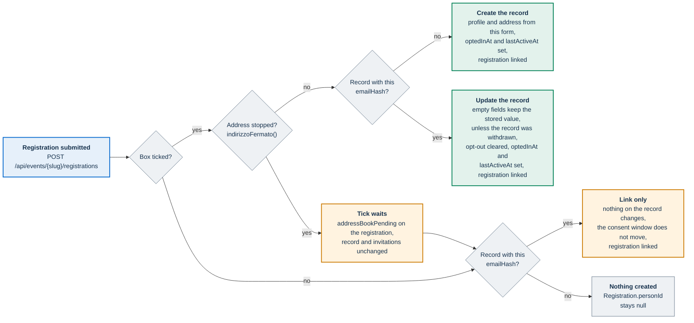
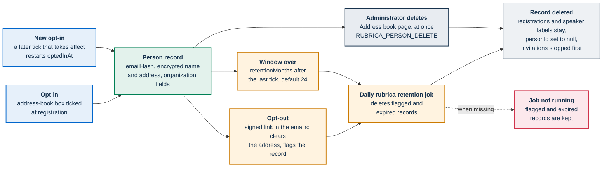

# ADR-011: Cross-event person record and opt-in address book

**Status:** Accepted; extended by [ADR-020](020-consents-follow-event-format.md) (the address book follows the event
format, keeps the address and counts its retention from the consent)

**Related decisions:** [ADR-004](004-jitsi-jwt.md) (the keyed email hash stays in the portal),
[ADR-010](010-site-settings-singleton.md) (runtime settings: the installation's switch for the address book, not its retention),
[ADR-014](014-organizer-role.md) (the address book stays administrator-only),
[ADR-015](015-named-administrators.md) (named administrators also see the address book),
[ADR-016](016-in-cluster-ai-postproduction.md) (transcript speaker labels can point to a person record),
[ADR-020](020-consents-follow-event-format.md) (where the address book is offered, and why the record keeps the address)

## Context

PA Webinar stores participation per event. A `Registration` holds one registrant's name, email address,
optional organization fields and consent flags for a single event. The daily GDPR cleanup deletes it
once the event's retention period has passed ([GDPR.md](../GDPR.md#retention-and-cleanup)). After that
deletion nothing about the person is left, so the platform cannot recognize the same person at the next
event.

Public bodies that run recurring community events need three things that depend on recognizing people:

1. **An address book.** Administrators need a list of people to invite to the next event without retyping
   their details.
2. **A stable profile.** A returning participant should not have to declare an organization, a role and an
   organization type from scratch every time.
3. **A participation history.** Administrators need to see which events a person has registered for.

These needs create a record that outlives the retention of any single event. That changes the legal
footing:

- **Taking part in one event** is the purpose of a registration. This record assumes Art. 6(1)(b), a
  request to take part. The controller's privacy notice names the actual basis, and for a public body
  that may be Art. 6(1)(e). Whatever the basis, it ends with the event's retention.
- **Being invited to future events** is a different purpose, and the event's basis does not extend to it.
  It needs a consent of its own under Art. 6(1)(a). That consent must be distinguishable from other
  matters (Art. 7(2)), must not be a condition of taking part (Art. 7(4)) and must be as easy to withdraw
  as to give (Art. 7(3)). The data kept under it must be limited in time (Art. 5(1)(e)).

| | Event registration | Address book |
|---|---|---|
| Purpose | Take part in one event | Be invited to future events |
| Legal basis | Chosen by the controller for the event. This record assumes Art. 6(1)(b) | Consent, Art. 6(1)(a) |
| Model | `Registration` | `Person` |
| Lifetime | Event retention (`Event.dataRetentionDays`) | Consent window (`Person.retentionMonths`, counted from `optedInAt`) |
| Ended by | The daily GDPR cleanup, or self-service erasure | Deletion by an administrator, self-service erasure, or the daily `rubrica-retention` job after an opt-out or once the consent window has passed |

## Decision

### A person record separate from the registration

`Person` (table `persons`) is a model of its own. It is not a view over registrations. It is keyed by
`emailHash`, the same keyed hash that `Registration.emailHash` uses: HMAC-SHA-256 of the lowercased,
trimmed address, keyed with `APP_SECRET` (`hashEmail()` in `app/src/lib/crypto/pii.ts`). The hash is the
portal's lookup key and never leaves the portal. [ADR-004](004-jitsi-jwt.md) keeps it out of the Jitsi
token.

`Registration.personId` is a nullable foreign key. It stays `null` for anyone without a person record. Two
other models can also point to a person record: `EventInvitation.personId` and `Speaker.personId`. All
three relations use `onDelete: SetNull`, so deleting a person record never deletes a registration, an
invitation or a speaker label.

A person record is never created retroactively. Registrations made before a record existed stay unlinked,
even if the same person ticks the box later: only the new registration is linked.

### A separate, optional consent

Where the address book is offered, the registration form has one optional box for being contacted about
upcoming events. The box starts unticked and is never required. It reads **I want to receive information about upcoming events and be
added to the address book, to be invited to similar events**. It is separate from the required
participation consent. It covers one purpose and sets two flags: the address-book opt-in, received as
`consentAddressBook` (default `false` in `createRegistrationSchema`, `app/src/lib/validation/schemas.ts`),
and the per-registration `Registration.consentFutureCommunications`, which creates nothing. The
address-book withdrawal link revokes both: it clears the opt-in and the flag on every registration of
the person. Below the box the form states how long the data is kept.

The address book is offered when the installation keeps it on (`SiteSetting.addressBookEnabled`) and the
event offers it (`Event.offerAddressBook`). `rubricaProposta()` in `app/src/lib/persons/address-book.ts` is
the one rule. Where it is not offered the form has no box, and the registration route ignores both consent
fields. [ADR-020](020-consents-follow-event-format.md) explains how the format of an event sets the starting value.

Only a ticked box creates a person record. If the box is not ticked and no record exists, nothing is
created. On an address that has stopped receiving invitations the tick waits for a confirmation
([A tick after a withdrawal](#a-tick-after-a-withdrawal)).

### Stable profile fields only

A person record holds the fields that describe a person, as opposed to a single moment:

- `displayName` and `email`, encrypted at rest with AES-256-GCM under `PII_ENCRYPTION_KEY`. The email is the
  ciphertext of the registration that gave the consent, copied without being decrypted;
- `organization`, `organizationRole` and `organizationType`, in plain text so that administrators can
  search and filter by them;
- the consent state, in `optedInToAddressBook`, `optedInAt` and `optedOutAt`;
- `retentionMonths`, which sets the record's expiry together with `optedInAt`;
- `lastActiveAt`, the time of the last tick, which orders the administrators' list.

The record keeps the address so that an administrator can add the person to a later event after the
registrations that carried it have been deleted ([ADR-020](020-consents-follow-event-format.md)). The address goes as soon as the person withdraws.

Answers that belong to an event stay on that event's records and expire with them. These are
questionnaire responses, feedback, Q&A, poll votes and chat. The platform never copies them to the person
record and never uses the record to skip asking them again. The profile is kept, and the answers are not.
Each registration also keeps its own copy of the organization fields as they were declared at that event.

### Retention per record

Each record has its own retention window, independent of any event. A record expires `retentionMonths`
calendar months after `optedInAt`, the last time the person ticked the box (`scadenzaRubrica()` in
`app/src/lib/persons/retention.ts`). `retentionMonths` defaults to 24 in `app/prisma/schema.prisma`. Only a
tick that takes effect restarts the count: a registration without the box changes nothing, and neither
does a tick waiting for confirmation. A daily job deletes expired records and records that have been
opted out.

### A stateless signed opt-out token

Withdrawal works through a signed token. There is no account and no stored nonce. The token is issued
and verified in `app/src/lib/persons/opt-out-token.ts`:

- **Format.** The token is `<payload>.<signature>`. The payload is `<personId>:<issued-at seconds>`,
  base64url-encoded. The signature is HMAC-SHA-256, keyed with `APP_SECRET`, over that encoded payload,
  also base64url-encoded, and it is compared in constant time.
- **Validity.** A token is valid for 90 days from issue (`TOKEN_TTL_SECONDS`), so a link in an old email
  still works.
- **No server state.** A token can be used more than once while it is valid. Tokens cannot be revoked one
  by one, although deleting the record makes its tokens useless. Changing `APP_SECRET` revokes all of
  them.
- **Not a JWT.** A token with a single purpose needs no algorithm header and no claims, and so it offers
  less to attack.

The confirmation, reminder, post-event, recording-notice and invitation emails to a person in the address
book carry the link, each with a new token (`rubricaOptOutUrl()` in `app/src/lib/persons/opt-out-link.ts`).
The self-service export issues one too, so a person whose last email is older than the token can still
leave.

The page `/<locale>/rubrica/opt-out?token=…` reads the token from the query string. The path is the same
in every language. The page calls `GET /api/rubrica/opt-out?token=…` to show the name and organization on
the record. That call says the person is already out only when no tick is waiting for confirmation on
that address: with one, there is still something to withdraw. The page then calls
`POST /api/rubrica/opt-out?token=…` to confirm; the API also accepts the token in a JSON body. The
confirmation is rate-limited per client address. Confirming sets `optedInToAddressBook` to `false`, stamps
`optedOutAt`, clears the stored address, stops the invitations to that address and withdraws consent to
future communications on every registration of that address. It also marks the withdrawal on the
registrations that never had that consent, so that a later tick finds it, and drops any tick waiting for
confirmation. The daily job deletes the record at its next run. The page warns that event registrations
are not deleted.

### What the record never holds

- **Audio and video telemetry**, such as whether or for how long someone used the microphone, the camera
  or screen sharing. That would be behavioral profiling and would need a basis of its own. Event
  analytics are computed per event, not on the person record.
- **Free text** from questionnaire answers, Q&A questions and chat messages.
- **Technical and location data**, such as the IP address, the user agent or the device.

## Consequences

### What the decision buys

- **Invitations with consent.** Administrators keep a directory of people who asked to be invited again,
  and nobody else is in it.
- **Privacy by design.** A record exists only after an explicit opt-in. It has its own purpose, its own
  lifecycle and its own retention. It holds no event answers, and the name and address on it are encrypted.
- **Separation by purpose, not by storage.** Records live in the same database as registrations. What
  keeps them apart is the purpose, the lifecycle and access limited to administrators.
- **Current profile, historical truth.** The record holds the latest profile. Each registration keeps the
  organization as it was declared at that event.

### What it costs

- **More moving parts.** The decision adds a model, three nullable relations, a public endpoint, a daily
  job and a conditional step in registration.
- **A second purpose to disclose.** The privacy notice has to describe a second purpose, basis and
  retention period ([privacy notice checklist](../privacy/privacy-notice-checklist.md)).
- **Search by reading.** SQL cannot search or sort the encrypted name and address. The search decrypts
  the records on the server and filters them in memory, within a limit, so it costs more than a query and
  can leave the least recent records out.
- **An address that outlives its event.** The record keeps an encrypted address for the whole consent
  window, after the registration that supplied it has been deleted. The privacy notice has to say so.

### Risks and how they are contained

| Risk | Effect | Containment |
|---|---|---|
| The link in an old email has expired | Withdrawing consent is harder than giving it (Art. 7(3)) | The next confirmation, reminder or invitation carries a new link, and the self-service export issues one on request |
| The retention job does not run | Opted-out and expired records are kept | The Helm chart and the Docker Compose `cron` service both call `GET /api/cron/rubrica-retention` daily. Other installations schedule it with the header `x-api-key: <CRON_API_KEY>` ([background jobs](../architecture/background-jobs.md#rubrica-retention)) |
| A record is linked without a fresh opt-in | The participation history shown to administrators grows without a new consent. The retention window does not move | State in the privacy notice that later registrations are linked, and delete records on request |
| Someone ticks the box with another person's address | A withdrawal is undone and the invitations restart | The tick waits for a confirmation that needs the mailbox of that address or the person's data page ([A tick after a withdrawal](#a-tick-after-a-withdrawal)) |
| `APP_SECRET` changes | Hashes stop matching. Returning registrants who tick the box get a new record, others are no longer linked, old records wait for the end of their consent window, and every opt-out token becomes invalid | Treat `APP_SECRET` as permanent ([GDPR.md](../GDPR.md#known-gaps)) |
| A name copied onto a speaker label | The name stays on the label after the record is deleted | Speaker labels go with their recording |

## Alternatives considered

### A1. Derive the address book from registrations

The address book could have been a query: the distinct email hashes of registrations that carry an
address-book flag. This was rejected for two reasons. First, registrations expire with their event, so the
address book would empty itself as events are archived. Second, purpose limitation (Art. 5(1)(b)) calls
for data kept for another purpose to be held under that purpose's own rules and retention. Stretching the
event's records to cover it would not meet that.

### A2. One consent for taking part and for the address book

A single box ("I take part and want to be contacted about future events") was rejected. Consent must be
distinguishable when it covers other matters (Art. 7(2)). Taking part must not depend on consent to a
purpose that the event does not need (Art. 7(4)). A bundled consent would not be freely given.

### A3. A rich profile

A profile with audio and video telemetry, an engagement score or preferences was rejected. It would breach
data minimization (Art. 5(1)(c)). It would also turn the record into profiling as defined in Art. 4(4).
Profiling needs safeguards of its own, and Art. 22 restricts decisions based solely on automated
processing, including profiling, that have legal or similarly significant effects.

### A4. Reusing event-specific answers

Not asking again a question that a person answered at an earlier event was rejected. An answer about one
event means nothing for another. Keeping it beyond its event would breach purpose limitation and storage
limitation (Art. 5(1)(b) and Art. 5(1)(e)). Only stable profile fields carry over.

## Implementation notes

### Where it lives

| Concern | Location |
|---|---|
| Model and indexes | `Person` in `app/prisma/schema.prisma`: unique `emailHash`, and indexes on `optedInToAddressBook` with `lastActiveAt` and with `optedInAt`. `Registration` and `EventInvitation` also have an index on `emailHash`, because a withdrawal and a tick look up an address across events |
| Where it is offered | `rubricaProposta()` in `app/src/lib/persons/address-book.ts`, from `SiteSetting.addressBookEnabled` and `Event.offerAddressBook` |
| Expiry | `scadenzaRubrica()` and `MESI_RUBRICA_PREDEFINITI` in `app/src/lib/persons/retention.ts` |
| Create, refresh and link at registration | `upsertPersonOnRegistration()` in `app/src/lib/persons/index.ts`, called inside the transaction of `POST /api/events/{slug}/registrations`. Where the address book is not offered the route only looks up an existing record, to link it |
| Withdrawal | `ritiraComunicazioni()` in `app/src/lib/live/consent-withdrawal.ts`, shared by the opt-out page and `POST /api/gdpr/consents` |
| Stopped invitations | `fermaInviti()`, `riapriInviti()` and `indirizzoFermato()` in `app/src/lib/persons/inviti-fermati.ts` |
| A tick waiting for confirmation | `Registration.addressBookPending`, and `applicaSpuntaInAttesa()` in `app/src/lib/persons/spunta-in-attesa.ts`, called by `GET /api/events/{slug}/registrations/enter` and by `POST /api/gdpr/consents` with `confirmAddressBook` |
| Opt-out token and link | `app/src/lib/persons/opt-out-token.ts` and `app/src/lib/persons/opt-out-link.ts` |
| Opt-out page and API | `app/src/app/[locale]/rubrica/opt-out/page.tsx` and `app/src/app/api/rubrica/opt-out/route.ts` |
| Retention job | `app/src/app/api/cron/rubrica-retention/route.ts`, with `riempiEmailRubrica()` in `app/src/lib/persons/riempimento-email.ts`. Chart template `infra/helm/pa-webinar/templates/cronjob-rubrica-retention.yaml`, with the keys `cronjobs.rubricaRetention.enabled` and `cronjobs.rubricaRetention.schedule` in `infra/helm/pa-webinar/values.yaml` |
| Administration | **Address book** (`/admin/rubrica` and `/admin/rubrica/{id}`), backed by `GET` and `POST /api/admin/rubrica`, `GET /api/admin/rubrica/{id}` and `DELETE /api/admin/rubrica/{id}` |
| Picker | `app/src/components/admin/rubrica-picker.tsx`, used in the **People** step of the event wizard. `rubricaConPersone()` in `app/src/lib/persons/rubrica-picker.ts` says whether anyone can be picked |
| Tests | `app/src/lib/persons/*.test.ts`, and `rubrica.db.test.ts` and `rubrica-spunta.db.test.ts` in `app/src/test/db/` |

### What a registration does to the record

A registration creates a person record, and so does the confirmation of a tick that was waiting: no other
code path does. Registration runs inside the registration's database transaction, so a failed registration
never leaves a record behind. "Ticked" below means ticked on an event that offers the address book:
elsewhere the box does not exist, and a value sent to the route does not count.

- **An existing record is linked even without a new opt-in.** Suppose a record with the same hash exists
  and the box is not ticked, or the event does not offer it. The registration is still linked to the
  record, so that its emails can carry the link for leaving the address book. Nothing on the record
  changes: not the profile, not the consent state, not the retention. Leaving the box unticked is treated
  as "not now", not as a withdrawal. The same applies to an opted-out record that the daily job has not
  deleted yet: the registration is linked to it until the next run deletes it.
- **An opt-in updates what the form carries.** A registration with the box ticked writes that form's name,
  address and organization fields over the stored ones. The form sends the organization fields only when
  the event asks for them, and an empty field leaves the stored value in place, so a tick on an event that
  does not ask for the organization keeps it. Each field stands on its own: a new organization with no
  role keeps the old role. On a withdrawn record the old profile does not survive: the tick leaves only
  what this form carries.
- **Re-consent.** Every tick that takes effect sets a new `optedInAt`, on an opted-in record too, so the
  consent window restarts.

### A tick after a withdrawal

The form does not prove who owns an address, so anyone who knows an address could otherwise undo its
withdrawal and restart the invitations. On an address that has stopped receiving invitations a tick takes
effect only once the person confirms it. `indirizzoFermato()` in `app/src/lib/persons/inviti-fermati.ts`
decides from three signs: an opted-out record, a stopped invitation to that address or, without an
opted-in record, a registration that carries a withdrawal.

Such a tick changes neither the record nor the invitations. The registration keeps it in
`addressBookPending`, with `consentFutureCommunications` off, and is linked to an existing record as it
would be without a tick. Two things confirm it:

- **The `proof` link of the confirmation email, opened in the browser that filled in the form.** That
  browser holds the event cookie born from the form, without the email proof. A mail filter that opens the
  link does not have it. A cookie that carries the email proof came from a link, and a `sig` link sets the
  cookie itself and does not read an existing one, so neither shows a choice and neither confirms.
- **The button on the person's data page**, which says what changes and with which data:
  `POST /api/gdpr/consents` with `registrationId` and `confirmAddressBook`. It answers
  `{"confirmed": "addressBook"}`, and `404` when no tick is waiting. Where the address book is no longer
  offered the page shows no button.

Confirming (`applicaSpuntaInAttesa()`) writes that registration's data on the record as an opt-in does,
clears the withdrawal, lifts the stop on the invitations of that address, sets
`consentFutureCommunications` and links the registration. The state belongs to the address: the other ticks
waiting on it close too, with the flag, the link and an audit row on the events that still offer the address
book. A second confirmation finds nothing to apply and does not renew the consent. Where the address book is
no longer offered (`rubricaProposta()`) the tick is dropped with no address-book record and the withdrawal
stands, and a `CONSENT_WITHDRAWN` row of that event records it with the cause. A new withdrawal drops the tick, and **Cancel the request** on the same page
is that withdrawal.

### Who sees the address book

- **Administrators only.** An administrator signs in with the instance API key (`ADMIN_API_KEY`) or with a
  named administrator account ([ADR-015](015-named-administrators.md)). The pages are guarded by
  `soloAdmin()` and the APIs by `isAdminAuthenticated()`. Organizers do not see the picker. An organizer
  who sends a `personId` to the invitations API or to the speaker-label API receives `403`
  ([ADR-014](014-organizer-role.md)).
- **List.** By default the list shows opted-in records, most recent tick first, each with its number
  of linked registrations. It can filter by organization type and can include opted-out records. Its text
  search matches the name, the address and the organization, without regard to case or accents: the route
  decrypts the records and filters them in memory (`app/src/lib/persons/ricerca-rubrica.ts`), looking at
  the 5,000 most recent ones, and the page says when others stayed out. The text travels in the body of a
  `POST`, because a name or an address in a URL would end up in the access logs, and it is never logged.
  An encrypted name cannot give an alphabetical order.
- **Detail.** The detail page shows the profile, the consent times, the last activity, the retention window
  and the most recent linked registrations with their events and organization snapshots. So the
  participation history is visible only for as long as those registrations exist. Neither the list nor the
  detail page shows the address: only the search can return it, on request (`withEmail` in the `POST`), for
  the picker.
- **Picker.** The wizard's picker searches opted-in records that keep an address. It appears only to
  administrators, with the address book on and at least one such record. It matches like the list.
- **Links from other records.** A pick adds the person to the moderators, the speakers or the invitations
  with the name and address from the record. The invitations API accepts a `personId` from
  administrators, and an invitation picked in the wizard stores it as a link only: the invitation keeps its
  own name and address, independent of the record. The speaker-label API of AI post-production also accepts
  a `personId`, and fills the label's name from the record when the request supplies none.

### Audit trail

| Action | What is recorded |
|---|---|
| Opt-in at registration | The `consentAddressBook` flag in the `CONSENT_RECORDED` row of `GdprAuditLog`, which holds no personal data, and `optedInAt` on the record |
| Opt-in on an existing record | `optedInAt`, `lastActiveAt` and `updatedAt` on the record, and the `CONSENT_RECORDED` row |
| Tick waiting for confirmation | `addressBookPending` on the registration and in the `CONSENT_RECORDED` row, where `consentAddressBook` stays `false` |
| Tick confirmed | A further `CONSENT_RECORDED` row with the source `registration-link` or `self-service`, and `optedInAt`, `lastActiveAt` and `updatedAt` on the record |
| Link without an opt-in | Only `Registration.personId` |
| Opt-out | `optedOutAt` on the record, until the record is deleted, and a `CONSENT_WITHDRAWN` row in `GdprAuditLog` for each event whose registration still held that consent |
| Deletion by an administrator | `RUBRICA_PERSON_DELETE` in `AdminAuditLog`, with the record id, the actor, the client IP and the user agent |
| Deletion by the retention job | No audit row. A log line and the job's JSON response give the counts |
| Deletion by self-service erasure | `addressBookDeleted` in the details of the erasure's `DATA_DELETED` rows in `GdprAuditLog`, written only when the person also had registrations; the response carries the same flag |

Once a record is deleted, nothing refers to it except the `AdminAuditLog` entry, if an administrator
deleted it. The `CONSENT_RECORDED` rows still show that an opt-in happened at a given event, without
pointing to the record.

### Deletion paths

There are four ways a record ends:

- **An administrator deletes it.** The deletion takes effect at once.
- **The person erases their data.** The self-service erasure at `/api/gdpr/erasure` deletes the
  registrations that match the email hash and, at once, the person record with the same hash.
- **The person opts out.** The address goes at once, the record is flagged, and the daily job deletes it.
- **The consent window ends.** The daily job deletes the record.

The opt-out page deletes no registration. The self-service export at `/api/gdpr/export` includes the record,
with its expiry and a token for the opt-out page ([GDPR.md](../GDPR.md#data-subject-rights)).

Each run of the retention job first gives an address to opted-in records that have none, from the latest
registration with the same hash (`riempiEmailRubrica()`): an older release can write such records during a
rollout or after a rollback, when the migration that filled them does not run again. The response counts
them as `emailsFilled`. The job then deletes a bounded batch of opted-out records. It also checks a bounded
batch of opted-in records, oldest consent first, and deletes the expired ones. Each deletion runs in a
transaction that locks the records and reads them again in the state first seen, so a tick that arrives
in between either shows there and the record stays, or finds the record already gone. A record with no
`optedInAt` does not expire and stays out of that batch. The batch size is `BATCH_SIZE` in the route. A
backlog larger than one batch clears over several runs. The Helm chart and the `cron` service in Docker Compose both call the
job daily ([background jobs](../architecture/background-jobs.md#rubrica-retention)).

### Invitations after a withdrawal

A person who withdraws must stop receiving invitations, and the invitation row can outlive the record.
So the stop is written on the row, in `declinedAt`, by `fermaInviti()` before the record goes:

- A withdrawal, a deletion by an administrator and the deletion of an opted-out record by the daily job stop
  every invitation to that address, also those typed by hand. The expiry of a record stops only the
  invitations linked to it.
- An unsent invitation to an event open to anyone is deleted. Any other row stays with `declinedAt` set. On
  an event with restricted registration the row is also the person's place on the list, so the person keeps
  access and receives nothing more.
- `fermaInviti()` also cancels the emails of those invitations still in the outbox, queued or waiting for a
  retry, so nothing goes out after the stop.
- `sendInvitations()` in `app/src/lib/email/invitation.ts` skips a stopped row and any address whose record
  is opted out, and counts them as skipped. The invitations panel shows the row as stopped.
- Only a confirmed tick lifts the stop (`riapriInviti()`), with the limit in
  [Known limitations](../GDPR.md#known-limitations). A tick from the form alone does not
  ([A tick after a withdrawal](#a-tick-after-a-withdrawal)).
- The stop follows the address. `PATCH` on an invitation clears it only if the new address has not stopped
  receiving invitations, and `POST` creates a row for a stopped address already stopped
  (`indirizzoFermato()`).

## Known limitations

These parts of the decision are not built:

- **Retention as a site setting.** `retentionMonths` is a per-record column with a schema default, and
  the texts shown to people quote `MESI_RUBRICA_PREDEFINITI`. No screen, no API and no `SiteSetting` field
  ([ADR-010](010-site-settings-singleton.md)) changes them. Changing the window takes a schema change, a
  code change and a data update.
- **A form prefilled from the record.** The form does not fill in the profile from the record. A record can
  be matched only after the person has typed an address, and showing a stored profile to whoever types an
  address would disclose it. The link in an invitation email prefills the name and address from the
  invitation itself (`invitoDaToken()` in `app/src/lib/email/invitation.ts`), not from the record.
- **Records without an address.** A record whose registrations were deleted before the record kept an
  address stays without one, and out of the picker, until the person ticks the box again.
- **A withdrawal with no trace left.** The memory of a withdrawal lives on the record, on the invitations
  and on the registrations of the address. Once all of them are deleted nothing remembers it: a new tick
  takes effect at once, and a new invitation goes out.
- **CSV export** of the address book.

## Related

- [ADR-020](020-consents-follow-event-format.md) covers where the address book is offered and why the record keeps the address.
- [Privacy and data protection](../GDPR.md#the-address-book) owns the privacy view of the address book.
  The same page has the data inventory, the consent texts and the known gaps.
- [Scheduled and background jobs](../architecture/background-jobs.md#rubrica-retention) covers the
  retention job, its schedule and what breaks if it does not run.
- [Data model](../architecture/data-model.md) shows where `Person` sits among the participation models.
- [The event journey](../architecture/event-journey.md#invitations-and-named-grants) covers registration,
  invitations and the wizard's address-book picker.
- [Identity, access and tokens](../architecture/identity-and-access.md) explains who counts as an
  administrator.
- [API surface](../architecture/api.md) covers the self-service link endpoints, including
  `/api/rubrica/opt-out`.
- [Privacy notice checklist](../privacy/privacy-notice-checklist.md) lists what a controller's notice must
  say, including the address book.
