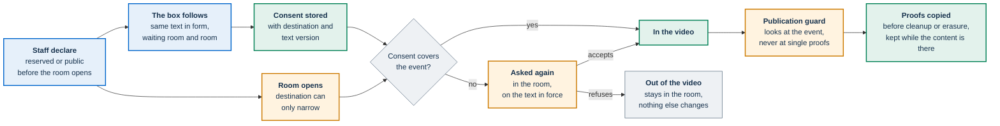

# ADR-020: Consents follow the event format, which sets starting values and never rights

**Status:** Accepted; the retention of consent proofs follows the recording retention described in [GDPR.md](../GDPR.md#recording-retention)

**Extends:** [ADR-011](011-person-rubrica.md)

**Related decisions:** [ADR-006](006-recording-and-storage.md) (recording paths and the audience of a published recording), [ADR-010](010-site-settings-singleton.md) (the installation's switch for the address book), [ADR-013](013-multitrack-speaker-attribution.md) (the transcription consent and the voice of who refuses), [ADR-014](014-organizer-role.md) (the address book stays administrator-only), [ADR-016](016-in-cluster-ai-postproduction.md) (what the AI pipeline reads), [ADR-018](018-live-captions.md) (the caption transcript)

## Context

A small call between colleagues and a public webinar are different events for the people who attend them, and they asked those people the same thing. Five gaps followed:

- **A consent did not say what it covered.** The box read "I consent to the audio/video recording of this event". Whether the video would be public was decided after the event, by whoever published it, so nobody could know it when ticking.
- **The proof of a consent went before the video.** The daily cleanup deletes registrations and room consents when the event's retention ends, and a published video outlives them. Art. 7(1) GDPR asks the controller to be able to demonstrate a consent, and that need lasts as long as the video does.
- **Words typed in the room reached the public.** The public recap kept questions asked in the chat, the AI report read the chat, and the page after the event showed who had asked each Q&A question.
- **The facts of an event were nowhere in one place.** One privacy notice has to stay valid for every event of an installation, so it cannot say whether this event is recorded, where the video goes, or whether names are real. The waiting room had separate notices for AI and captions.
- **The address book was offered everywhere.** A work meeting offered it like a public event. An entry had no address of its own, and a registration without the box extended its retention.

Organizers should not have to work all this out for each event, so the wizard needs defaults. Defaults must not become a way to reduce what a person is entitled to.

## Decision

### The format sets starting values

The wizard asks how many people are expected, who speaks and shows on video, whether to record and for whom, and who can take part. Those answers give one of three families (`classeFormato()`), and `presetDaFormato()` turns them into the wizard's starting values. Organizers can change every one of them.

| Starting value | Meeting: small group, everyone speaks | Participatory event: medium group, everyone speaks | Public event: only speakers talk, or large scale |
|---|---|---|---|
| Participant list | Visible | Visible | Hidden |
| Audience names | Real | Real | Pseudonyms |
| Recording destination | Reserved | Public | Public |
| Hosts in the recording | Choose like everyone else | Choose like everyone else | Choose like everyone else |
| Q&A after the event | Not published | Text only | Text only |
| Address book | Not offered | Offered | Offered |

On an event on invitation every family proposes a reserved recording: a public destination that comes only from a family or a template goes back to reserved, and the wizard says so. A public video that staff chose stays, and the wizard warns that anyone will see it, not just the invitees. A destination saved on an event counts as chosen, even when it was only proposed when the event was saved: the data does not tell the two apart, and the note warns on the way to invitation-only. The page after the event follows the move to invitation-only and the move to a public video, unless staff touched its switch. When the video stops being public the page goes back to where it started, and closes on an invitation-only event; going back to open does not reopen it, and the wizard says so. The answer "no recording" leaves the destination empty. The system templates carry the same columns, so an event created from a template starts the same way. The course template follows the meeting, and the press conference template follows the public event without pseudonyms. `hostsAlwaysRecorded` can be set on an event by its staff, and it counts only where a person who refuses can be left out of the video. Its value in the preset comes from one constant, which is off.

### Rights do not depend on the format

These hold for every format and no setting removes them:

- The consent box is never ticked in advance and is never a condition for registering or entering.
- Purposes stay separate: recording, the transcription of one's own contributions, and the address book each have their own box.
- A person who refuses stays out of the recording, and the room does not change for anyone else. How that happens depends on the installation's recorder, not on the format. Where the recorder can leave the person out, the person takes part as usual. Where it cannot, the audience without a consent listens only ([ADR-013](013-multitrack-speaker-attribution.md)).
- People are told that the event can be recorded and transcribed. Where the audience has no microphone, camera or screen there is nothing of theirs to record, and the event informs them instead of asking.
- A consent can be withdrawn, from the room or from the person's own data page.
- The proof of a consent stays for as long as the video or transcript it covers exists, published or not.

The installation decides what applies to all its events: the privacy notice, the legal texts, whether the address book exists, and the templates.

Instant calls stay outside this model. They declare no destination, ask no consent and show no privacy sheet, because the room hides their recording from whoever enters by link.

### The recording destination

`Event.recordingDestination` says where the video goes, before the room opens. It is what a person consents to.

| Value | Meaning |
|---|---|
| `PUBLIC` | The video can be published for anyone. |
| `REGISTRANTS` | Reserved. Registrants and staff see it. `recordingAudience` stays `REGISTRANTS`, and no external video can be linked. |
| Null | Never declared: events that predate the choice, instant calls and imported archives, with their copies, and events that receive a file after their room has opened. |

`recordingAudience` keeps its meaning from [ADR-006](006-recording-and-storage.md): who sees a video once it is published. A public destination can still be published to registrants only, and the reverse is refused.

The rules for the value:

- **Only staff declare it.** A moderator link cannot, because the link is a seat. Any path that starts recording without a choice starts reserved: creating an event, copying one, editing it, uploading a file to an event that did not record and whose room never opened. After the room has opened the destination could no longer be widened, so a file uploaded then declares nothing. Widening is an explicit act.
- **It freezes when the room opens.** Before that, staff can change it freely. After that, it can only move to reserved, also on an event that had none.
- **A declared destination cannot be removed.** On an event with no destination every consent counts, so removing it would let a video reserved by its consents be published.
- **A reserved video does not depend on the event page.** A registrant sees it even when the page after the event is private, within `postEventPublicUntil`. The registrant loses access when the registration is deleted by the cleanup, and from then on only staff see it. The consent text and the privacy sheet say so.

### One recording box per event

Each event asks at most one recording box, and it covers both the recording and where the video goes. The text follows the destination. The form, the waiting room and the room show the same text, chosen by `chiaveConsenso()`:

| Case | Text says |
|---|---|
| Reserved | Recording, reserved to organizers and registrants, not published |
| Public | Recording and publication, for anyone |
| No destination | Recording, as before |
| No room video on this installation | Recording of audio tracks only, no video |

The destination and text version a person read are stored with the consent, on the registration and on the room proof. A consent is valid for the text read. `consensoCopre()` compares it with the event:

| Consent given on | Reserved event | Public event | Event with no destination |
|---|---|---|---|
| Public text | Covers | Covers | Covers |
| Reserved text | Covers | Does not cover | Covers |
| Text with no destination | Does not cover | Does not cover | Covers |

So narrowing asks nothing, and widening before the room opens asks again. A person whose consent does not cover the event sees the new text in the room, and stays out of the video by not accepting it. A person filling in the form when the destination changes gets a 422 and reads the text again before registering. A consent replaced by a later one stays as an earlier period of the same proof, marked as superseded, so a change of text is not mistaken for a withdrawal.

The transcription consent stays a separate, optional box ([ADR-013](013-multitrack-speaker-attribution.md)). It is also asked when the AI pipeline would transcribe the full video.

### The publication guard looks at the event

`assertEsposizioneConsentita()` refuses with 409 `RECORDING_DESTINATION_NOT_COVERED` a change that exposes a reserved event further: making the recording visible to everyone, publishing it or its transcript for everyone, or adding an external video or catch-up address. `assertVideoNelloStorage()` answers the same way to a new video address outside the recordings storage, which no access rule would protect. The first compares the state before and after a request, so narrowing is never refused and closing an event never stops here.

The guard reads the event and never counts consents. Everyone in the video has a consent that covers the event, because anyone else was asked again or left out. That stays true after the cleanup removes the proofs, and one refusal never blocks a publication.

An event with no destination is not blocked: its consents do not say where the video would go, and whoever publishes it sees a warning. Imported historical events (`LEGACY`) have no consents to warn about, and an upload to one declares nothing.

### Chat and questions are outside the recording consent

- **Chat is never published**, including questions asked in the chat. The public recap drops them when it is read, which also covers recaps saved earlier, and the AI report receives only the number of messages.
- **Q&A questions are published as text, never with a name.** After the event the name stays with the moderators. `domandePubbliche()` is the one rule for the page, the room, the public API and the input of the AI summary and report, which also needs the page after the event to be public (`domandePerIModelli()`): with a recording reserved by its destination, or by an audience narrowed to registrants (`registrazioneRiservata()`), questions are not published, whatever the event's switch says.
- **A notice sits under both fields**, in the chat and in the Q&A composer, asking people not to write personal data.

### Proofs of consent outlive their sources

`RetainedConsentProof` holds one row per consent period, copied in the same transaction that deletes the sources. It has no foreign key to registrations or room consents, so the code that reads live consents cannot mistake a historical proof for a consent in force. Its only key is to the event.

One rule says how long a proof lasts. A recording does not follow the event's data retention ([Recording retention](../GDPR.md#recording-retention)), and the voice of whoever consented is in it whether or not it is published. `tipiDiProvaDiCioCheEsiste()` looks at what exists, at the cleanup and for whoever deletes registrations, grants or staff accounts:

- The event's video, the file of any session, an external video, a catch-up file or per-participant tracks whose audio is still there keep both the recording and the transcription proofs.
- A transcript alone keeps its own proof.
- Otherwise nothing stays, and the cleanup deletes such proofs at the first pass in which neither exists, for example after the recording's period ends.

The cleanup copies a proof with its encrypted name. After an erasure requested by the person the proof stays without the name, with its type, dates, text version and keyed email hash, which are what make it a proof. A consent still valid at that moment counts as withdrawn at the time of the request. The video does not change. A person can see these proofs on their own data page and withdraw from there, and staff see them in the event's consent export.

### The privacy sheet

`schedaPrivacy()` computes what happens to a participant's data at this event, from the event and the installation: recording mode and destination, what happens to who refuses, transcription, captions, AI, chat and questions, participant list, names, retention and the address book. The form and the waiting room show it alongside a single privacy notice, which does not have to vary by format.

The sheet returns facts and the component picks the words, in the language of the page. It is computed on the server for every page and never stored, so it follows the event and cannot go stale. Where a thing depends on the organizers it says "may", so a fact that is absent denies nothing. In the room, the values that moderators change live replace those computed at load. Instant calls have no sheet.

### The address book follows the consent

This extends [ADR-011](011-person-rubrica.md):

- **It can be off.** `SiteSetting.addressBookEnabled` turns it off for the installation, and `Event.offerAddressBook`, which starts from the format, decides per event. Turning it off removes the box and the picker. Existing records stay until they are withdrawn or expire.
- **The record keeps the address, encrypted.** Without it a record could not reach anyone once the registrations that carried the address were deleted, which is the moment the address book is meant for.
- **Retention counts from the consent.** A record expires `retentionMonths` after the last tick. A registration without the box links to the record and changes nothing, so no one's data is kept longer without a new consent.
- **A withdrawal takes effect at once.** The address goes immediately, the invitations stop, and the rest of the record goes at the next daily run.
- **A tick does not undo a withdrawal by itself.** The form does not prove who owns an address, so after a withdrawal a tick waits for the person's confirmation ([ADR-011](011-person-rubrica.md#a-tick-after-a-withdrawal)).

## Consequences

### What the decision buys

- **A consent that says what it covers.** The box states where the video goes, and the proof records the text that was read.
- **A safe default.** Whoever does not choose gets the reserved video, on every path that can start a recording.
- **A publication that one refusal cannot block.** A person who refuses affects only their own presence in the video.
- **Proof for as long as it is needed.** A published video can show its consents after the event's data is gone, and no longer than that.
- **Less to read, closer to the moment.** The sheet says the facts of this event next to the box.

### What it costs

- **Recording and publication go together.** A person cannot accept the recording and refuse its publication: on a public event they refuse both and stay out of the video. Organizers who want to record without publishing choose reserved.
- **A choice that closes early.** Once the room has opened, a reserved event stays reserved, and its video cannot be made public.
- **Another copy of personal data.** Retained proofs keep an encrypted name after the event's retention. The privacy notice has to say so ([privacy notice checklist](../privacy/privacy-notice-checklist.md)).
- **More for an organizer to confirm.** A full video with no per-person tracks needs a confirmation before transcription, also when only the host spoke, because the video does not say who talked.

### Effect on installations

- Migrations are additive, so the previous release runs on the new schema during a rollout. Existing events keep a null destination, and `Recording.transcriptConsentRule` stays `false` on existing rows: their published transcripts and names do not change. Rows created from then on default to `true`, whichever release creates them.
- Events scheduled at the moment of the upgrade follow the new rules. If a transcript from the video needs a confirmation, staff give it.
- System templates change only if nobody has edited them. An edited template stays as it is, a deleted one does not return, and existing events are not touched.
- Bookmarked wizard addresses that encode the old yes/no answer still work: `decodificaFormato()` reads them as the answer proposed for that format.
- What a person who refuses experiences depends on `RECORDING_VOICE_EXCLUSION`, which the chart sets ([CONFIGURATION.md](../CONFIGURATION.md)).

### Risks and how they are contained

| Risk | Effect | Containment |
|---|---|---|
| A value of the format is mistaken for a right | A preset quietly narrows what a person can do | Consent rules live outside the preset, and `privacy-sheet.test.ts` runs across every format |
| A reserved recording leaves through a side door | A published address or derived content reaches people outside the event | `lib/recording/audience.ts` is the one rule for the page, the player and the derived content. External and catch-up addresses are refused or hidden |
| A proof is taken for a live consent | A consent that no longer applies counts as valid | Proofs live in their own table, with no key to the sources |
| A deleted event had an external video | The video stays online with no proof on the platform | Stated limit: see [Known limitations](#known-limitations) |
| The sheet disagrees with the box | People read two different things | Both read the same rules, and the sheet says "may" for what depends on organizers |

## Alternatives considered

### A1. Let the format decide the rights

A webinar could have recorded everyone, or skipped the box, on the grounds that the audience expects it. This was rejected. Consent cannot be a condition for taking part (Art. 7(4) GDPR), and a right that changes with an option in a wizard is not a right. Hosts always in the recording are the nearest case: the column exists, and it stays off in every preset.

### A2. Two boxes, one for recording and one for publication

A person could have accepted the recording and refused its publication. This was rejected because a video has one destination for everyone in it. Honoring that refusal would mean either leaving the person out, which is what refusing the single box does, or letting one person block the publication for all. The destination is a property of the event, and the text of one box can state it.

### A3. A guard that counts the consents behind a video

Publication could have required a covering proof for each person in the video. This was rejected. The proofs are deleted by the cleanup while the video stays, and a missing proof would block a video already public. It would also let one refusal block a publication. Leaving out whoever has no covering consent makes the event the right place to check.

### A4. Block or backfill events with no destination

Existing events could have been refused publication, or set to reserved by a migration. Refusing would stop videos whose consents were valid when given, and a backfill would state a destination nobody declared or read. Those events keep a null destination and a warning. A copy of one is a new event and starts reserved.

### A5. Keep proofs by exempting the source rows from cleanup

Registrations and room consents could have stayed for as long as the video is published. This was rejected. Those rows carry addresses and access tokens that no longer have a purpose, and every reader of live consents would have to learn to ignore them. A separate table holds only what proves the consent.

### A6. A privacy notice per format, or a stored sheet

A notice for each format would multiply the texts a controller has to approve, and would still not say what one event has chosen. A sheet stored with the event would go stale at the next change. A computed sheet alongside one notice avoids both, at the cost described under [Known limitations](#known-limitations).

### A7. Keep deriving the address from the latest registration

This was the previous behavior. A record lost its address when the cleanup deleted its registrations, and dropped out of the picker, which is when the address book was needed. Reading the address from a registration also tied the record to data with a shorter life and another purpose. See [The address book follows the consent](#the-address-book-follows-the-consent).

## Implementation notes

| Concern | Location |
|---|---|
| Format and starting values | `app/src/lib/events/guided-format.ts`, `app/src/components/admin/guided-format.tsx` |
| Fields of a template that reach the wizard | `app/src/lib/events/template-preset.ts`. A new template column has to be passed on or listed with a reason, and a test checks it against the schema |
| Destination rules | `app/src/lib/recording/destination.ts` |
| When the wizard asks for it | `app/src/lib/events/destination-question.ts`, `app/src/lib/live/room-open.ts` (`salaGiaAperta`), `app/src/components/admin/event-wizard/step-3-permissions.tsx` |
| Who sees a reserved recording | `app/src/lib/recording/audience.ts` |
| Guards on writes | `POST /api/events`, `PUT /api/events/{param}`, `POST /api/admin/events/{id}/duplicate`, `PATCH /api/admin/publications/{id}` |
| Consent required, and the room's rule | `app/src/lib/registration/consents.ts`, `app/src/lib/live/consent-rule.ts`, `app/src/lib/live/entry-consents.ts`, `app/src/lib/live/listen-only.ts` |
| Consent at the door | `POST /api/events/{slug}/registrations`, `POST /api/events/{slug}/jitsi/token` |
| Transcription from the video | `app/src/lib/ai/voice-consent.ts`, with `Recording.transcriptConsentRule` |
| Chat and questions | `domandePubbliche()` in `app/src/lib/events/post-event-sections.ts`, `riepilogoPubblico()` in `app/src/lib/events/recap.ts`, `app/src/lib/report/input.ts` |
| Proofs | `app/src/lib/gdpr/consent-proofs.ts`, `app/src/lib/gdpr/retained-consent-proofs.ts`, `tipiDiProvaDaConservare()` and `tipiDiProvaDiCioCheEsiste()` in `app/src/lib/gdpr/cleanup-selection.ts` |
| Copy before deletion | `/api/cron/cleanup`, `app/src/lib/gdpr/erase-registrations.ts`, `/api/gdpr/erasure` |
| Withdrawal of a retained proof | `POST /api/gdpr/consents` with `proofId` |
| Privacy sheet | `app/src/lib/events/privacy-sheet.ts`, `app/src/components/events/privacy-sheet.tsx` |
| Migrations | `20261105200000_consensi_per_formato` (structure), `20261105210000_rubrica_con_email` (fills `persons.email` from the latest registration of records still opted in, and gives them an `optedInAt`), `20261105220000_modelli_secondo_il_formato` (system templates nobody edited) in `app/prisma/migrations/` |
| Tests | `destination.test.ts`, `audience.test.ts`, `guided-format.test.ts`, `privacy-sheet.test.ts`, `retained-consent-proofs.test.ts`. On a real database: `prove-conservate.db.test.ts`, `iscrizione-consensi.db.test.ts`, `modelli.db.test.ts`, `rubrica.db.test.ts` in `app/src/test/db/` |

A consent records the destination of the text read (`testoLetto()`), which can differ from the one in force after a narrowing.

## Known limitations

- **A registrant who loses the link on a private page.** The form that sends a personal viewing link lives on the event page. A registrant with no valid link cannot reach it while the page is private, and has to ask the organizers.
- **Deleting an event deletes its proofs**, also when an external video stays online. The platform cannot tell what another site still shows: a proof kept for an external video stays until someone removes the link.
- **Proofs with no email hash.** Guests, and hosts who enter from the primary link without a staff session, cannot be matched to a retained proof, so they cannot withdraw it or remove the name alone. It goes with the video.
- **The sheet leaves no record of what was shown.** Being computed, it has no version. The proof records the consent text, not the sheet beside it.
- **Keeping tracks after consents are given.** `retainParticipantTracks` stays editable after people have consented to a text that promises deletion. The two texts have the same version, so those consents stay valid.
- **The AI report on a reserved event.** Publishing it is not refused. The event page hides it from whoever cannot see the recording.

## Related

- [Privacy and data protection](../GDPR.md#consent-model) owns the consent model, the retention rules and the texts shown to people.
- [Recordings, voice data and AI outputs](../privacy/recordings-and-ai.md) covers consent and retention for what the recording produces.
- [Recording](../architecture/recording.md) covers the audience of a published video and the consent gates.
- [The event journey](../architecture/event-journey.md) covers the wizard and registration.
- [Data model](../architecture/data-model.md) shows where these columns and `RetainedConsentProof` sit.
- [Privacy notice checklist](../privacy/privacy-notice-checklist.md) lists what a controller's notice must say.
