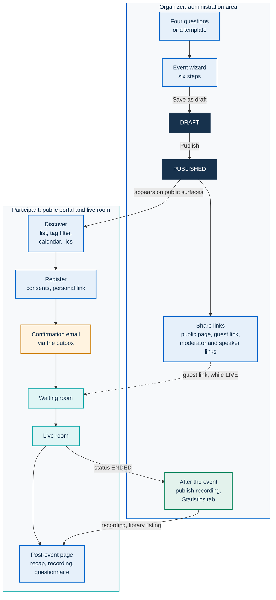
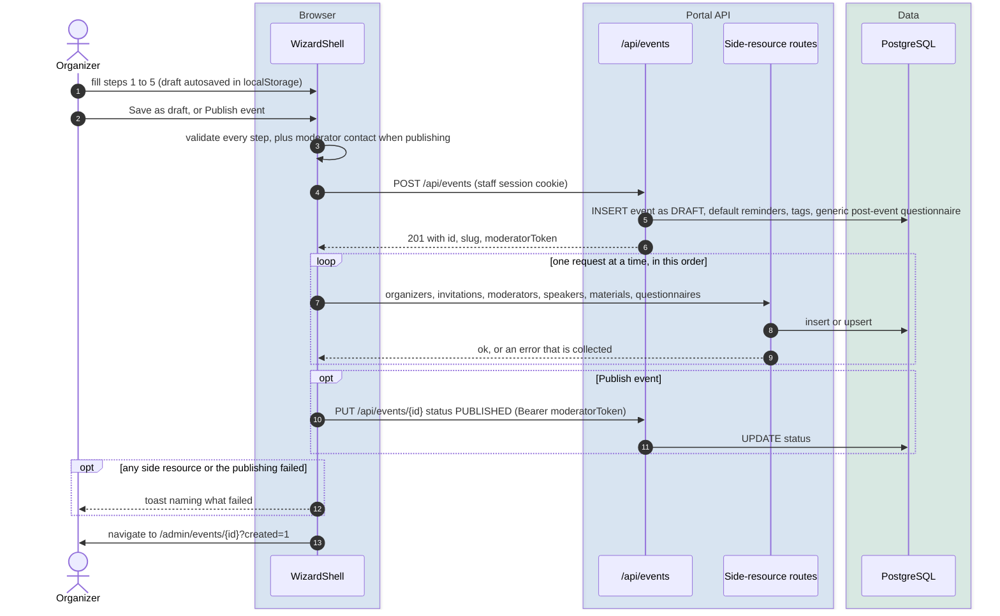
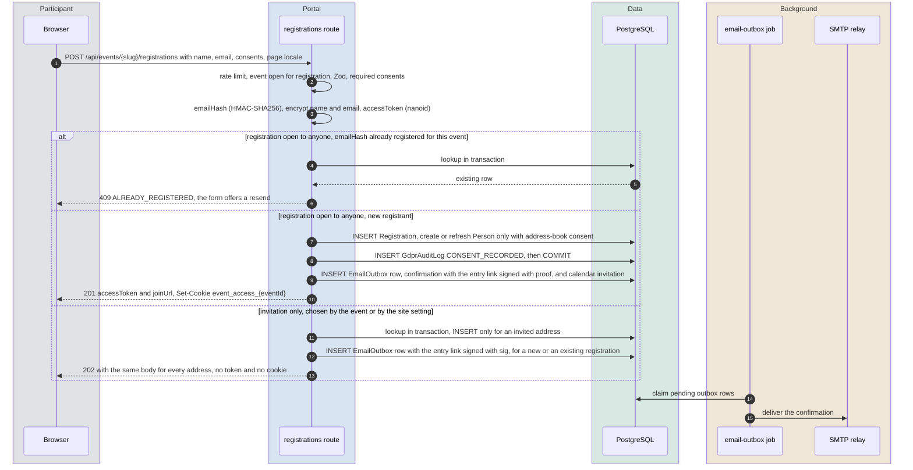

# From creation to recap: the event journey

This page follows an event outside the live room. It covers how an organizer creates, templates, duplicates and publishes an event, how people discover it, register or get invited, which access modes exist, how questionnaires and materials are attached, and what happens after the event: the recap, the recording and the video library, the transcript and the analytics. It also covers how an instant call is created.

Neighboring mechanisms have their own pages:

- statuses and who changes them: [event-lifecycle.md](event-lifecycle.md);
- the waiting room and the optional square: [waiting-room.md](waiting-room.md);
- Q&A, polls, chat, agenda and the other in-room features: [live-interaction.md](live-interaction.md);
- moderator links, named grants, registrant and guest identities, cookies: [identity-and-access.md](identity-and-access.md);
- every email the platform sends, reminders and calendar files: [email.md](email.md);
- consent texts, retention and the cleanup job: [GDPR.md](../GDPR.md).

Paths on this page are the internal route paths (`/events/…`, `/admin/events/…`). Public URLs are localized per language, for example `/it/eventi/…` and `/en/events/…`; see [i18n.md](i18n.md#localized-urls).

## The event at a glance

An event is one row of the `Event` model (table `events`) plus a handful of related records. `app/prisma/schema.prisma` is the authority for its fields; the ones that shape the journey are:

| Aspect | How it is stored |
|---|---|
| Content | `title`, `description` and `speakersInfo` are JSONB objects keyed by language code (`{ "it": "…", "en": "…" }`). Empty translations of the title and description are dropped on write. Reads fall back from the requested language to Italian, then to any non-empty value (`getLocalized()` in `app/src/lib/utils/locale.ts`). |
| Address | `slug`, derived from the Italian title (or the first available one) in kebab case, with a numeric suffix when taken (`app/src/lib/utils/slug.ts`). Public URLs are localized: `/it/eventi/<slug>`, `/en/events/<slug>` ([i18n.md](i18n.md)). |
| Type | `eventType`: `SCHEDULED` (the default), `INSTANT` for [instant calls](#instant-calls), `LEGACY` for recordings imported from an external source, which have no live room. |
| Status | `status`, one of `DRAFT`, `PUBLISHED`, `PROVISIONING`, `LIVE`, `IDLE`, `ENDED`, `ARCHIVED` ([event-lifecycle.md](event-lifecycle.md)). |
| Tags | `Tag` (slug, multilingual name, color, sort order) linked through `EventTagLink`. |
| Co-organizing organizations | `EventOrganizer` rows: a name, an optional logo and an optional website, shown on the public page under **Organized by**. Display metadata only: they grant no access and receive no email. The older single-string `organizerName` column is still read as a fallback when the event has none. |
| People on the public page | The lead moderator when `moderatorPublicListed` is on, and named grants with `publicListed` (organizers, moderators and speakers), under **Organizers and speakers**: each with their photo in a circle, or their initials without one (or when the photo address does not serve it), and their organization, with the organization's logo small beside its name. The photo is the one staff uploaded for the person (`EventPersonPhoto`, served at `/api/avatar/person/{id}`), and the page's structured data gives it as each speaker's `image`. A logo is shown only when the app serves it (`/api/assets/…`), never from a third-party site. When the event lists no speaker, the free-text `speakersInfo` is shown instead (`app/src/lib/events/public-people.ts`). Within each role, while the agenda is on, people are ordered by the first [programme](#the-programme) topic they speak on, then by name; the same order holds in the structured data, the waiting-room summary and the link preview image. |
| Owner | `createdById`, the staff account that created the event. Administrators manage every event; an organizer manages the events they created and those where they are named as an organizer with their account's email ([ADR-014](../adr/014-organizer-role.md)). An event without an owner is managed by administrators only. |
| Who can take part | `accessMode`: `OPEN` (anyone can register), `INVITATION` (only invitees register, and no guests), or `NULL`, which follows the site settings ([Invitation-only registration](#invitation-only-registration)). |
| Where the recording goes | `recordingDestination`: `PUBLIC`, `REGISTRANTS`, or `NULL` on an event that never declared one ([The recording destination](#the-recording-destination)). |
| Address book | `offerAddressBook`: whether the registration form offers the address book, while the site setting `addressBookEnabled` is on (`rubricaProposta()` in `app/src/lib/persons/address-book.ts`). |
| Room and moderator seat | `jitsiRoomName` (a fresh UUID-based name per event) and `moderatorToken` (a UUID, the event's primary moderator link). Both are generated on creation and never copied ([identity-and-access.md](identity-and-access.md#moderator-and-speaker-links)). |

## Creating an event

Administrators and organizers create events at `/admin/events/new` (**New event**). The page first asks four questions: how many people are expected, who can speak and appear on video, whether the event can be recorded and for whom, and who can take part (`app/src/components/admin/guided-format.tsx`). The recording question has three answers, **Yes, reserved**, **Yes, public** and **No**. It proposes the answer of the format, reserved for an invitation-only event, and follows the other answers until someone picks one. The last question starts on the answer that matches the site setting `publicRegistrationEnabled`. A preview follows the answers.

**Continue** reloads the page with `?formato=<people>.<voice>.<recording>.<access>` (recording `no`, `riservata` or `pubblica`, access `tutti` or `invitati`), and the wizard opens with the values that `presetDaFormato()` derives from them (`app/src/lib/events/guided-format.ts`): every room feature on, participants' microphone, camera and screen on when the answer is **Everyone** and off when only speakers and moderators speak, the expected participants (20, 100 or 300), one hour, recording available with transcript, summary, translation and per-participant tracks, or no recording, and `accessMode` `OPEN` for **Anyone who registers** or `INVITATION` for **Invited people only** ([Invitation-only registration](#invitation-only-registration)).

An address saved when the recording answer was only a yes (`?formato=medio.tutti.si.tutti`) stays valid: `si` means reserved for a group of up to 20 where everyone speaks and for an invitation-only event, and public otherwise (`decodificaFormato()`). The installation has the last word (`formatoPossibile()`), also on a saved address: where it cannot record, the question is not asked and the format has no recording; where it has per-participant tracks but no room video, **Yes, public** is not offered and a public answer becomes reserved.

**Change format** returns with `?scegli=` and the answers already given. Moving to invitation-only in the **People** step and then changing format turns a public answer back into the proposed one; the opposite move never widens the answer (`formatoConAccesso()`). **Start from a template**, next to the page's heading, opens the organization's [templates](#templates) above the questions, with a note that a template brings its own settings instead of the answers; choosing one reloads the page with `?template=<id>`. Instant calls are created from the event list (**New quick call**), not from this page. A template does not choose who can take part: an event started from one follows the site settings until a choice is made in **People**.

### What the format sets

The format chooses starting values, and the organizer can change each of them in the wizard. It never chooses a person's rights, which are the same on every event: a consent box is never pre-checked and is never a condition of entering, each purpose has its own box, whoever refuses stays out of the recording while the rest of the room does not change, the room announces recording and transcription, and a consent can be withdrawn.

The answers on people and voice give one of three families (`classeFormato()`), and the family gives the values:

| Setting | Meeting: **Everyone**, up to 20 | Participatory: **Everyone**, up to 100 | Public: speakers and moderators only, or more than 100 people |
|---|---|---|---|
| Proposed recording answer | **Yes, reserved** | **Yes, public** | **Yes, public** |
| Participant list for the audience (`participantListVisible`, from `elencoPredefinito()`) | Shown | Shown | Hidden |
| Audience names (`audienceAnonymous`) | Real names | Real names | Pseudonyms |
| Text of Q&A questions after the event (`postEventShowQA`) | Not published | Published without names | Published without names |
| Address book on the registration form (`offerAddressBook`) | Not offered | Offered | Offered |

In every family the hosts choose about the recording like everyone else: `hostsAlwaysRecorded` starts off, and one constant in `guided-format.ts` changes that for the events of the public family.

The recording answer gives the destination (`REGISTRANTS` for **Yes, reserved**, `PUBLIC` for **Yes, public**, none for **No**) and turns on the transcript from captions with the recording. The page after the event (`postEventPublic`) starts visible, except for a meeting or an invitation-only event; **Yes, public** always keeps it visible, because a public video would otherwise have no page. With a reserved destination registrants see the video on a private page too ([Who sees the recording](#who-sees-the-recording)), and the questions stay off the page whatever `postEventShowQA` says (`domandePubbliche()`), so the preview and the summary say that they are not published.

On an invitation-only event a `PUBLIC` destination that nobody chose goes back to `REGISTRANTS`, in the questions (`formatoConAccesso()`) and in the wizard (`destinazioneSuInvito()` in `app/src/components/admin/event-wizard/campi-del-formato.ts`): at the start, when the template's access or the site setting makes the event invitation-only, and when **Who registers** changes. A destination that staff chose stays, **Yes, public** included. With a staff session and recording on, a note in the **People** step, under **Where the recording goes** and in the summary says which of the two happened: that the recording moved to reserved, also when the template proposed a public video and the form started reserved, or that anyone will be able to see the video, not just the invitees. The opposite move never widens the destination.

### The wizard steps and the advanced settings

The wizard (`app/src/components/admin/event-wizard/`, shell in `wizard-shell.tsx`) has six steps in its step bar, **Event**, **When**, **People**, **Programme** (optional), **Permissions** and **Summary**, and, apart, **Advanced settings** (`advanced-settings.tsx`) with what the template has already chosen. All of them share one form state, so moving between them loses nothing. The step keys are in `app/src/lib/events/wizard-steps.ts`; an [instant call](#instant-calls) has no **Programme** step (`passiPrincipali()`), and an address naming it opens **People**. An edit address can name a step (`?step=schedule`) and a section of the advanced settings (`&section=recording`), and earlier keys still work (`content` opens its section of the advanced settings, `participation` the **Permissions** step). When creating, a band above the steps names the format or template in use and offers **Change format** (or **Change template**): the fields written about the event (title, description, dates, people, content) that differ from the starting values are kept in the browser for ten minutes (`pa-wizard-draft:trasloco`) and applied once over the new format's values, with a notice and **Start over** to drop them. The unsaved draft kept in the browser is one per format or template (`pa-wizard-draft:new:<id>`), offered when the same format is opened again; one saved by earlier versions under `pa-wizard-draft:new` is offered in any creation until it is restored or discarded, and a successful creation removes every creation draft.

Beside the **Event**, **When** and **Programme** steps, on screens at least 1200 pixels wide, **Page preview** shows a reduced copy of the public event page built from the form (`page-preview.tsx`): it renders the same header components as the page (`app/src/components/events/event-header.tsx`: cover, status, title and kicker, tags, date, organizing entities and published people), the description and the [programme](#the-programme), and updates as the form changes; until the date is set, the time shown is an example. Beside **Programme** the reduced copy leaves out the cover, shortens the description to a few lines and shows the whole programme, or a dashed placeholder where it will appear. **Open the preview** shows it full width, with the registration card; on narrower screens only that button appears. Links in the preview are not followed, so the form is never lost, and the reduced copy is inert. Instant calls, which have no public page, have no preview.

| Part | What it sets |
|---|---|
| **Event** (step 1) | The **Event languages** row (`Event.aiTargetLocales`, with **Change languages**), then the title and Markdown description in tabs: the main language, the event languages active on the site and any site language that already has text, each tab with the state of its language in words and the fields marked with `lang` ([Event text translation](../POSTPROD.md#event-text-translation)). One cover image (stored both as the library cover and as the event image) and tags. Under the title, a help line explains the `Kicker \| Title` convention; when the title contains `\|` with text on both sides, **Show “…” as a kicker above the title** sets `parseTitleKicker`, with a live preview ([branding](../configuration/branding.md#editorial-title-kicker)). The cover's recommended size is 1600 × 900 pixels (16:9): an uploaded JPEG, PNG or WebP with a different shape opens a crop dialog (`app/src/components/ui/image-crop-dialog.tsx`), where the image is dragged and zoomed inside a 16:9 frame and the crop is uploaded as a JPEG, at most 1600 pixels wide and never enlarged, with a note when it would look blurry; SVG, GIF and images already 16:9 upload as they are. |
| **When** (step 2) | Start, end and time zone (the site's default time zone; a new event starts tomorrow at 10:00 in that time zone and lasts the template's default duration, or 60 minutes), recurrence (a menu showing **Does not repeat** until another cadence is chosen; the rule only suggests the date of the next occurrence when the event is duplicated). |
| **People** (step 3) | **Who organizes**, in one section: the organizing entities first, then the **Lead moderator**, whose name and email receive the primary moderator link ([email.md](email.md#moderator-and-speaker-links)) and are prefilled with the name and email of the staff account creating the event (empty with the instance key); photo, organization, logo and public listing folded. Then the roles of the event with what each one does (**Co-organizer**, **Moderator**, **Speaker**, **Participant**), always visible, and **Moderators and speakers**, the event's people with their role and organization ([named grants](#invitations-and-named-grants)); the form that adds a person asks for role, organization, name and email, in that order. Administrators can pick people from the address book, offered only when it holds someone, by organization (names are encrypted), unless the site setting **Events address book** is off; the picker proposes only people who agreed to stay in it, with the email kept in their entry. Under the people, a line says that their talks are prepared in the next step, **Programme** (not for instant calls). **Who registers** (`SezioneIscrizione` in `step-2-people.tsx`): **Anyone who registers** or **Invited people only** (`accessMode`), with a note that the site setting applies while an event has no choice, and the warning "No invitees yet: while the list below is empty, nobody can register." when the event is invitation-only without invitees; then **What we ask people who register**, name and email always plus the organization fields ([The form](#the-form)) and, while **Events address book** is on, **Offer to join the address book (optional for people who register)** (`offerAddressBook`), which a moderator link sees but cannot change. When editing, an event without a choice keeps following the site until one is picked. Then [invitations](#invitations-and-named-grants), open when the event is invitation-only. The address-book picker appears only to administrators. |
| **Programme** (step 4, optional) | The topics, who speaks and for how long ([The programme](#the-programme)). It is also reached from a card under the description in **Event**, which says what the programme is or how many topics it has and at what times, and warns when the description itself seems to contain a programme (a heading **Programme** or **Agenda**, or two lines starting with a time). Not shown for instant calls. |
| **Permissions** (step 5) | The role-by-feature permission matrix (only the participant column is chosen; the speaker column shows what speakers have in the room and the organizer and moderator column is always on; the stored matrix is normalized by `withRoleInvariants()` in `app/src/lib/utils/permission-matrix.ts`), the programme (**Meeting programme**, with a link to the **Programme** step and, when switched off with topics, a note on what happens to them: not saved with a new event; when editing, the last saved programme stays and changes are saved only if it is turned on again), word cloud and whiteboard (which can be switched on only when the installation declares the whiteboard service, `NEXT_PUBLIC_WHITEBOARD_ENABLED`), and automatic captions, on by default and shown only where [live captions](live-captions.md) are available, with **Transcript from captions** under them (`captionsTranscriptEnabled`, off by default; the new-event questions turn it on when the event can be recorded). |
| **Summary** (step 6) | What is still missing (`campiMancanti()` in `validation.ts`; in edit mode only what saving needs), each item a button that opens the step and focuses the field; then one preview card, headed by the title with its kicker, with an icon per line: dates, expected participants, organizer and people, the programme (**Programme: N topics, duration**, **Programme: no topics** with **Prepare**, or off with the number of topics and whether they are saved, each opening **Programme**), who registers (**Anyone can register, from the event page.**, or **Invitation only. Invitees: N.** with **Add invitees** or **Change** opening **People**, highlighted when there are no invitees) and **At registration we ask for: …**, with a line when the address book is not offered, who speaks and appears on video, room features, recording and post-production (where the recording goes, with **Change**, a note when the video can be transcribed only after a confirmation about the voices, and the event languages, with a link to change them in the **Event** step), the participant list, the audience's names, what happens to questions after the event, privacy notice. **Customize the settings** opens the advanced settings; the capacity line (bridge load, its level and what each viewer receives, shown as a warning from **Caution** up) opens their technical details. |
| **Advanced settings** | Folded sections, the one reached from a card open: **Recording and AI**: recording, **Where the recording goes** ([The recording destination](#the-recording-destination)) and the AI post-production options; the video recording never starts by itself (a host starts it with **REC**), the automatic start is shown only on an event saved with it, and the per-participant recorder joins when the event goes live ([recording.md](recording.md)); turning recording on while creating also turns on transcription, summary, translation (when the event has languages besides the main one) and per-participant recording, when the installation has AI post-production on, and starts **Where the recording goes** at **Reserved** when nothing chose it. The options depend on each other: transcription needs recording; summary and translation need transcription; dubbing needs translation; per-participant recording needs recording and transcription; keeping participant tracks needs per-participant recording. Translation uses the event languages, shown read-only with a link to the **Event** step, and needs at least one. **Content: materials and questionnaires**: [materials](#materials-and-agenda) and the pre-registration and post-event [questionnaires](#questionnaires-and-post-event-feedback), where a questionnaire that already has responses is shown read-only, with the count and a link to the event's **Questionnaires** page; **Save draft and go to questionnaire management** creates the event as a draft and opens its questionnaire page. **Waiting room and video**: waiting-room engine, video quality preset, waiting-room audio. **Privacy, data and the page after the event**: the privacy notice template (the one marked as default is preselected), a custom privacy text and a privacy document; data retention in days; whether the page stays visible; and, except with a moderator link, **Show the text of Q&A questions, without names**, off and locked with a reserved destination. The **Privacy and GDPR** edit link of the event page opens this section. **Technical details**: the expected participants (2 to 5,000) and the capacity estimate ([scaling.md](scaling.md#the-capacity-estimate-in-the-wizard-and-on-the-event-page)), recalculated as the choices change, where the share of webcams expected on is set. The event page shows the same estimate read-only under **Capacity and infrastructure**. |

Required fields carry a `*`. A refused attempt (**Next**, **Save as draft**) marks each missing field as an error, in red and next to the field, as the design system does; the lead moderator's name and email also say that they are needed to publish, not to save. From the first refused attempt, the step bar shows **To complete** under each step with such a field. In creation, **Save as draft** is offered on every step, next to **Next**.

Client-side checks run before moving on (`app/src/components/admin/event-wizard/validation.ts`): a title of at least three characters and a description of at least 10 characters, both in the site's default language and with leading and trailing spaces ignored; an end after the start; 2 to 5,000 expected participants (asked once by the questions above, and changed in the advanced settings' technical details, next to the load they drive); at least one event language when translation of subtitles and summary is on (checked in the **Event** step); and where the recording goes, when the wizard asks for it ([The recording destination](#the-recording-destination)). Title and description carry a `*` on the default language's tab, and when another language tab is open the error says which tab to switch to. The checks of the first two steps apply to **Save as draft** too, because the server stores drafts under the same rules. **Publish event** also requires the lead moderator's name and a valid email, in the **People** step; **Save as draft** does not.

The events API also requires an Italian title of at least 3 characters and an Italian description of at least 10 characters (`eventBaseSchema` in `app/src/lib/validation/schemas.ts`, with the threshold in `app/src/lib/validation/event-description.ts`), whatever the site's default language, on creation and on every edit that sends them. When the server still refuses the data (`422 VALIDATION_ERROR`), the wizard maps each issue to its step and field, jumps there and shows the localized message asking to check the highlighted fields. An issue that no field can show, such as a missing Italian text on a site whose default language is another, is quoted in the alert. The alert scrolls into view.

`maxParticipants` is an estimate of attendance used for capacity planning, not a cap: registrations beyond it are accepted. The events API accepts up to 10,000 as a sanity bound (`app/src/lib/validation/schemas.ts`); the wizard stops at 5,000.

The permission matrix is authoritative. The wizard and the server both derive the older boolean toggles (`qaEnabled`, `chatEnabled`, `participantsCanUnmute`, `participantsCanStartVideo`, `participantsCanShareScreen`) from it, so the two representations never disagree.

### What happens on submit

1. **`POST /api/events`** requires a staff session (administrator or organizer) and is rate-limited to 5 requests per minute per IP address. It validates the body with Zod, rejects an unknown privacy notice template with a field error, and creates the event:
   - with the column default status `DRAFT` (the create endpoint does not accept a status);
   - with a fresh `slug`, `jitsiRoomName` and `moderatorToken`, and `createdById` set to the caller;
   - with the destination the form chose; an event that records without one, also with an explicit `null`, starts `REGISTRANTS`, with `recordingAudience` aligned, and a `youtubeUrl` on a reserved event is refused with `409` ([The recording destination](#the-recording-destination));
   - with a capacity estimate snapshot (`capacityEstimateJson`) for later comparison with real usage;
   - with two reminders, one day and one hour before the start ([email.md](email.md));
   - with the tags whose slugs exist (unknown slugs are dropped silently);
   - with the platform's generic post-event feedback questionnaire attached, unless `feedbackEnabled` is `false`.

   It records an `EVENT_CREATE` entry in the administration audit log and answers `201` with the event and two links: the public page and the moderator link.
2. **Side resources** are created one request at a time, in a fixed order. Each route authenticates differently:

   | Resource | Route | Credential |
   |---|---|---|
   | Co-organizing organizations | `POST /api/events/{id}/organizers` | `Authorization: Bearer <moderatorToken>` |
   | Invitations | `POST /api/admin/events/{id}/invitations` | Staff session cookie |
   | Co-moderators, then speakers | `POST /api/events/{id}/moderators` with role `MODERATOR` or `SPEAKER` | `Authorization: Bearer <moderatorToken>` |
   | Materials | `POST /api/admin/events/{id}/materials` | Staff session cookie |
   | Questionnaires | `PUT /api/admin/events/{id}/questionnaires/{placement}`, for `PRE_REGISTRATION` and `POST_EVENT` | Staff session cookie |

   A failure does not stop the sequence: the wizard collects the names of the resources that failed.
3. **Publishing.** With **Publish event**, the wizard sends `PUT /api/events/{id}` with `{ "status": "PUBLISHED" }` and the moderator token.
4. **Outcome.** If any side resource failed, a toast names it ("Event created, but some items weren't saved: …"). If the publishing request fails, the event stays a draft and a second toast says so, with the server's answer when there is one ("The event was created but not published: it is still a draft. …"). The toast lives in the administration layout, so it survives navigation. The wizard then clears its saved draft and navigates to the event's page, `/admin/events/{id}?created=1`, or to the event's questionnaire page when the organizer came from **Save draft and go to questionnaire management**.

The browser keeps an unsaved copy of the form in `localStorage` under `pa-wizard-draft:new:<format or template>` (or `pa-wizard-draft:<eventId>` when editing), written 800 ms after the last change and no longer once the event is saved or the format changed. When the wizard opens and finds one, it offers to restore or discard it.

### Editing reuses the wizard

`/admin/events/{id}/edit?token=<moderatorToken>` loads the event with its organizations, active named grants, invitations, materials and questionnaires, and opens the same wizard in `edit` mode. The page answers `404` without the matching token in the URL. On **Update event**:

1. The wizard sends the whole form to `PUT /api/events/{id}` with the moderator token. The server:
   - ignores the capture flags (`recordingEnabled`, `autoStartRecording`, `whiteboardEnabled`, `multitrackRecordingEnabled`, `waitingRoomEngine`, `videoQuality`) on an `ENDED` or `ARCHIVED` event when the request carries no status and no dates, and lists them in `ignoredCreationOnlyFields`. The wizard always sends the dates, so this guard applies only to partial updates from other callers;
   - answers `403` to a moderator link that changes `recordingDestination`, `offerAddressBook` or `hostsAlwaysRecorded`, which only staff who manage the event decide; the wizard opened with that link does not send them;
   - applies the rules of [The recording destination](#the-recording-destination);
   - revives an ended event whose end is moved into the future ([event-lifecycle.md](event-lifecycle.md#revival));
   - recomputes the capacity estimate when the request carries any of its inputs, which a wizard save always does;
   - queues a date-change email to registrants when the dates of a `PUBLISHED` event change ([email.md](email.md)).
2. Related records are reconciled by difference against a snapshot taken when the page opened. A row is identified by a stable key: `name|organization` for organizations, `role|email` for named grants, the email for invitations, `title|url` for materials. Rows present only in the form are created and rows present only in the snapshot are deleted; rows on both sides are left untouched, so renaming one amounts to deleting it and adding it again.
3. Questionnaires are written only if they changed, because the upsert rewrites fields the wizard does not show (title, required flag, extra languages). The upsert is refused with `409` once responses exist. An emptied questionnaire is deleted, together with all its responses: the wizard asks for no confirmation and shows no response count. Only the event's **Questionnaires** page shows the count and asks before deleting.
   Every request of this reconciliation carries the primary moderator link as `Authorization: Bearer` (`app/src/components/admin/event-wizard/edit-fanout.ts`). Each ends as done, already done (a `404` on a removal, a `409` on an invitation that exists) or failed.
4. If anything fails, the wizard stays on the page with a persistent alert that names the resources and the server's first reason, and keeps the local draft. The snapshot changes only for requests that are done or already done: saving again creates no second copy of anything (a duplicated named grant would otherwise be one more working credential), and retries whatever failed, removals included. A failed revocation of a co-moderator or speaker is named in the alert, one line per person, saying that their link is still valid and that it can be revoked from the **People** tab of the event page.
5. On success, the wizard navigates to the event page, `/admin/events/{id}?token=<moderatorToken>`.

### The recording destination

`Event.recordingDestination` says who the video is for, before the room opens. The text of the consent box states it, so it is what people consent to. The rules are in `app/src/lib/recording/destination.ts`.

| Value | Label | Meaning |
|---|---|---|
| `PUBLIC` | **Public** | The video can be published on the event page and in the video library. |
| `REGISTRANTS` | **Reserved** | The video stays with the organizers and the registrants. `recordingAudience` stays `REGISTRANTS`, the event stays out of the video library and accepts no external video. |
| `NULL` | | The event never declared one. Nothing is blocked: the recording panel warns whoever publishes that the consents collected do not say where the video would go. |

**Starting value.** With no choice, a new event or a copy that records, and an event that starts recording now, become `REGISTRANTS` with `recordingAudience` aligned (`destinazioneDiPartenza()`). The rule is the same for `POST /api/events`, `PUT /api/events/{id}`, a copy, and a file attached with `PUT /api/events/{id}` or `PATCH /api/admin/publications/{id}` to an event that was not recording and whose room never opened. An event that does not record declares nothing, because a reserved destination would by itself take the questions off the page. An event that already recorded without a destination keeps none, and so does an event that receives a file after its room has opened, because it could no longer widen the destination: it publishes with the warning. Instant calls and `LEGACY` events also stay without one, with their copies.

**Who chooses.** Staff who manage the event choose in **Where the recording goes**, in the **Recording and AI** section. The wizard requires a choice in creation, on an event never opened and without registrations (`domandaDestinazione()`, copies included), and on an event that did not record until now. It does not ask with a moderator link, while the room may be open, on an instant call, or where the installation has no room video. A moderator link that turns recording on saves without being stopped, and a note says that the recording starts reserved and that staff can widen it until the room opens.

**When it can change.** Until the room has opened for the first time, it moves freely between the two values. From then on (`salaGiaAperta()`, also on a concluded event) it can only move to `REGISTRANTS`. A declared destination can never be removed. A change that breaks these rules answers `409` with the code `RECORDING_DESTINATION_NOT_COVERED`. While the room may be open an allowed change is not applied either: it is listed in `ignoredCreationOnlyFields`, like the other settings the room depends on.

**What a consent covers** (`consensoCopre()`). On an event without a destination every consent covers. Otherwise a consent that declares no destination does not cover, and a consent to a public video covers a reserved one but not the reverse. Narrowing therefore asks nobody anything, and widening before the room opens makes the room ask again the people the consent no longer covers. Whoever does not consent stays out of the video and still enters.

**What publishing checks** (`assertEsposizioneConsentita()`). The guard looks at the event, never at the individual proofs: everyone in the video has a consent that covers the event, so it holds also after the cleanup removes the proofs. On a reserved event it answers `409` to showing the recording to everyone, to publishing the video or the transcript for everyone, and to a new address of an external video or of the catch-up recording. A new `recordingUrl` on a reserved event must be a file in the recordings storage, which the signed-address route protects, and otherwise gets the same `409` (`assertVideoNelloStorage()`); with no storage configured the address is accepted as it is. Attaching a new `recordingUrl` with `PUT /api/events/{id}` takes the session of staff who manage the event: a moderator link can only send back the address already there. Narrowing is never refused, and neither is uploading a file, which only registrants and staff then see.

**Without a room video.** Where the installation records only per-participant tracks, the text of the box says that the room video is not recorded and declares no destination, so the wizard does not ask for one. An event without those tracks records nothing there (`eventoRegistrabile()`): as in the sheet, the form and the room show no recording box, no notice and no recording command. An event that records still starts reserved: a file uploaded later stays reserved, and if the installation adds a room video, people who read that text are asked again in the room.

## Templates

An event template (`EventTemplate`, UI **Event templates** at `/admin/events/template`) is a preset that pre-fills the wizard. Everything stays editable in the wizard. A template can set:

- the live features: Q&A, chat, agenda, word cloud, whiteboard and automatic captions (on in a new template, as in a new event), and the participants' microphone, camera and screen-sharing permissions, or a full permission matrix;
- recording, per-participant recording and the retention of participant tracks (a template's automatic start is ignored: recording starts only with **REC**);
- where the recording goes: **Reserved**, **Public** or **Chosen when creating the event**, in which case an event that records starts reserved;
- whether the audience appears under a pseudonym, whether the hosts are always in the recording, whether the registration form offers the address book, whether the page after the event is public and whether it shows the text of the Q&A questions;
- the AI post-production options and their target languages (empty means the site default);
- the waiting-room engine (empty means the site default);
- the expected participants and the default duration, from which the wizard computes the end time;
- a description in Italian and English, the suggested retention days and the expected number of speakers.

The dependencies of **Recording and AI** apply when a template is loaded: a template that turns on transcription without recording pre-fills neither.

System templates (`isSystem`) are inserted by database migrations that skip templates already present. Administrators can edit and delete them like any other: events copy the template's values at creation and keep no reference to it, so deleting a template never changes an existing event.

| System template | Recording destination | Audience names | Questions after the event | Address book |
|---|---|---|---|---|
| Webinar pubblico | Public | Pseudonyms | Published without names | Offered |
| Evento partecipativo | Public | Real names | Published without names | Offered |
| Conferenza stampa | Public | Real names | Published without names | Offered |
| Corso di formazione | Reserved | Real names | Not published | Not offered |
| Riunione di lavoro | Reserved, if someone turns recording on | Real names | Not published | Not offered |

The migration that sets these values skips a system template already edited, and it changes no existing event.

The API is `/api/admin/templates`: every method requires the administrator session, and `POST`, `PUT` and `DELETE` write an audit entry. Organizers use templates but cannot manage them.

For developers: the new-event page passes the selected template to the wizard through `presetDelModello()` in `app/src/lib/events/template-preset.ts`, an explicit list of fields. A new template column goes in that list and in `WizardTemplatePreset`, or in `NOT_PRESET_TEMPLATE_FIELDS` with its reason: a test compares them with the schema.

## Duplication and series

### Duplicating as the next occurrence

A recurring meeting is recreated by duplicating the previous occurrence. Two buttons do it, both labelled **Duplicate**: one in the event card's menu (not offered for instant calls) and one on the event page. Both call `POST /api/admin/events/{id}/duplicate` with `{ "nextOccurrence": true }`, then open the copy's edit page with the staff session and `?copia=prossima` or `?copia=stesse`, from the response's `scheduleProjected`. While the copy is a draft, that page is titled **Copy of the event**, says that the original does not change and whether the copy already has the next occurrence's date or the same dates as the original, and its save button reads **Save the copy**.

The route is open to administrators and to the organizer who owns the source event; the copy belongs to whoever creates it. The optional body is validated strictly and accepts either `nextOccurrence` or explicit `startsAt` and `endsAt`. The dates are resolved in this order:

1. Explicit dates win. An explicit start without an end keeps the original duration.
2. With `nextOccurrence` and a recurrence rule, the copy gets the first occurrence of the rule after the later of the source's start and the current time, computed in the event's own time zone and keeping the original duration.
3. Otherwise, including when the rule is exhausted, the copy keeps the source's dates and the response says so with `scheduleProjected: false`.

The copy is always a `DRAFT`, with a new slug, moderator token and room name, and a title followed by "(copy)" in English and "(copia)" in every other language. It records an `EVENT_DUPLICATE` audit entry.

### What a copy inherits

The rule is that a copy inherits the configuration, not the life of the occurrence that ran. Two classified lists implement it, and a test fails when a new column or relation is left out of them:

- `app/src/lib/events/duplicate-fields.ts` for columns;
- `app/src/lib/events/duplicate-relations.ts` for relations.

| Inherited | Not inherited |
|---|---|
| Description, time zone, event type, sizing and quality settings, every live-feature and permission setting, registration rules (who can register, `accessMode`, and what the form asks), the moderator contact with its organization, branding, whether the address book is offered, the privacy and retention settings, recording and AI post-production flags, where the recording goes, the post-event page settings and the library listing, the recurrence rule | Title (suffixed), slug, dates (resolved as above), status, room name, moderator token, owner, join password, whether the lead moderator is shown on the public page, the statement that the hosts are always in the recording, series membership, `postEventPublicUntil`, `youtubeUrl`, and all runtime, analytics and recording state |
| Tags, co-organizing organizations, active named grants (each with a fresh token, its role and organization, and not shown on the public page until chosen again), agenda topics (title, order, planned duration and who speaks, pointing at the copied person), questionnaires, reminder schedule | The agenda's progress (status and times), registrations, invitations, questions, chat, reactions, polls, word-cloud rounds, feedback, call sessions, recordings, materials, GDPR audit entries |

A copy of an event that records without a destination starts reserved, except a copy of an instant call or of a `LEGACY` event, which stays without one ([The recording destination](#the-recording-destination)). Revoked grants are not recreated. Invitations are not copied, so a copy open only to invitees (`accessMode` `INVITATION`) accepts no registrations until invitees are added. Materials and polls are left out on purpose: they are the content of a specific day. The permission matrix is copied normalized, like every write of it.

### Recurrence

Step 1 compiles a recurrence preset (daily, weekly, weekdays, monthly, or a custom rule) into an RFC 5545 rule stored in `recurrenceRule` (`app/src/lib/utils/recurrence.ts`). The rule is shown on the review step and used to propose the next date when duplicating. Nothing else consumes it: no scheduler creates occurrences, and a series is not an entity. `recurrenceSeriesId` can be set through the API when the caller may manage the parent event, but no screen sets it and a copy never inherits it. The target design, in which a series owns the configuration and each occurrence inherits it, is in [ROADMAP.md](../ROADMAP.md#recurring-events-and-series).

## Markdown descriptions

Descriptions are written in Markdown, one text per language, in a text field (`MarkdownEditor` in `app/src/components/ui/markdown.tsx`). Its **Write** / **Preview** toggle appears only where the wizard's page preview, next to the form, does not already show that text rendered: for languages other than the interface's, and for instant calls. `renderMarkdown()` in the same file turns them into HTML for the public event page and the event page in the administration area; the same renderer displays AI summaries in the transcript panel. It uses `marked` with GitHub-flavored Markdown and line breaks, then DOMPurify with an allowlist of tags and attributes. The sanitization rules are described in [security.md](security.md).

The same text is reused without conversion elsewhere:

- the page's meta and Open Graph description take the first 160 characters of the raw text in the page's language;
- the calendar file's `DESCRIPTION` receives the raw text;
- the video library's search matches against it.

Markdown syntax therefore appears as typed in those places.

A template can pre-fill the description; the wizard takes its Italian and English texts.

## Publishing and discovery

An event is published with **Publish event** in the wizard, or later with **Publish** in the event card's menu or on the event page; **Unpublish** sets it back to `DRAFT` and keeps the registrations received so far. The card menu offers these buttons only for scheduled events in `DRAFT` or `PUBLISHED`; the event page disables its button, with an explanation, while the event is `LIVE` or `ENDED`. All of them send a status change to `PUT /api/events/{id}` with the moderator token.

Whether an event appears on public surfaces depends on its status, its type and, once ended, its post-event settings. The rules live in `app/src/lib/events/visibility.ts` and are tabulated in [event-lifecycle.md](event-lifecycle.md#public-visibility-and-registration-by-status). Instant calls never appear on the public surfaces while they are running.

| Surface | What it shows |
|---|---|
| Home page | Upcoming public events |
| `/events` | Upcoming and past public events, with tag chips and a tag filter: `/en/events?tag=<slug>` |
| `/calendar` | Upcoming public events, read from `GET /api/events/calendar` (title split from its kicker as on the event page, and the event's tags for the colors and the legend). When the site setting `calendarPublic` is off, the page answers `404` and the feed returns an empty list. The staff view of the same feed (`mode=admin`) is sent with `Cache-Control: private, no-store`, so no shared cache keeps drafts |
| Sitemap | Every public event |
| `GET /api/events` | The same public events as JSON, cached for 60 seconds |
| `GET /api/events/{slug}/calendar.ics` | A calendar file for any event with a page: like `GET /api/events/{slug}`, it follows `isEventPageVisible()` and answers `404` for drafts, `ARCHIVED` events, concluded events whose post-event page is off or expired, and instant calls before they end. Times are UTC instants. The organizer's address is the platform's sender address (`SMTP_FROM`), never the moderator's personal email; its name is the event's first organizing body, or else the installation's organization name, or else the site name (`app/src/lib/ical/organizer.ts`), never the moderator's name |
| Event page | A schema.org `Event` block, with the expected participants as the attendee capacity |

Tags are managed by administrators in **Settings → Tags** (`/admin/settings/tags`, API `/api/admin/tags`) and attached in step 1 of the wizard. Saving the wizard replaces the event's tags with the ones selected (`tagSlugs` on `PUT /api/events/{id}`), and only when they changed. Changing them takes the session of staff who manage the event, as choosing who can take part does: with a moderator link the step does not show tags, and a request that changes them is refused with `403`.

## Registration

The registration page is `/events/{slug}/registration`. It is reachable while the event is open for registration: `PUBLISHED` until `endsAt`, `LIVE` also past it, and for scheduled events also `PROVISIONING` or `IDLE` until `endsAt` (`isEventOpenForRegistration()` in `app/src/lib/events/visibility.ts`). Past that point the page answers 404 and the registration API `409`.

### The form

The form asks for a name and an email address and shows the event's [privacy sheet](#the-privacy-sheet), then the privacy notice ([GDPR.md](../GDPR.md) describes how the notice is resolved and the exact consent texts). Its checkboxes are never pre-checked:

- acknowledgment of the privacy notice, the only mandatory box;
- consent to the recording, optional, when the event records and participants can speak, turn on their camera or share their screen; when they cannot, the form only informs. The text follows the destination (`chiaveConsenso()`): reserved, public, or, where the installation has no room video, a text saying so. The event's own text (`recordingConsentText`), if any, appears under the box, except where there is no room video. Without this consent the person registers, enters and stays out of the recording. Where the installation cannot remove a voice from the video, the person takes part listening only;
- a separate, optional consent to the transcription of one's own contributions, with one's name, when the event records per-participant audio, keeps a transcript from captions or has the AI pipeline transcribe the video: without it the person registers and takes part, but is neither recorded on a track of their own nor kept in the transcript. Where the voice can be removed from the video, it has no effect without the recording consent;
- one optional box for future communications and the address book, shown only where the address book is offered ([What the server does](#what-the-server-does)). It says how long the entry is kept.

When the event's `requireOrganization`, `requireOrganizationRole` or `requireOrganizationType` flags are on, the form also asks for the organization, the role and the type of public body. Only the organization is mandatory: the form asks for it, and the registration API answers `422` (`registration.errors.organizationRequired`) to a request without it. The role and the type stay optional. The wizard sets the flags in the **People** step, under **What we ask people who register** (**Organization (required to register)**, **Role (optional)**, **Organization type (optional)**); the events API accepts them too, and duplication copies them.

The page's language is sent along and stored on the registration. Later emails use it for their links, and for their text when it is one of the email languages; otherwise the text is in English ([email.md](email.md#languages)).

### The privacy sheet

Above a single privacy notice, each event has a sheet, **This event and your data**, which says what happens to participants' data with the settings of that event and installation (`schedaPrivacy()` in `app/src/lib/events/privacy-sheet.ts`, texts in `app/src/components/events/privacy-sheet.tsx`). It is computed at every page view and never stored, so it follows the event. It holds facts, and where something depends on the organizers it says that it may happen.

The registration form shows it above the link to the privacy notice. The waiting room shows it after the consents and before the entry button, with the link right below, in place of the AI and captions notices. A concluded event, or one never held, does not show it. Instant calls have no sheet, because their guests are asked nothing while a moderator can still record: they keep the two notices.

| Line | What it says |
|---|---|
| **Recording** | Whether a recording is planned, started by the hosts or automatic, or only one audio track for each person who consents. Where the video goes. What happens to someone who does not consent. Whether the hosts are always in it |
| **Transcript** | Whether the caption text is kept, whether the audio tracks are deleted after transcription or kept, and whether the video can be transcribed only if everyone who speaks in it has consented |
| **Captions** | That captions are on, and whether their text is kept |
| **Artificial intelligence** | With the pipeline on: summary, translation and dubbing, what the organizers can still ask for after the event, the event report, and that these texts may contain inaccuracies. The text an administrator wrote for that language (`aiConsentDisclosure`) replaces the sentences on summary, translation and dubbing |
| **Participant list** | Whether participants see who is in the room |
| **Your name** | Real name or pseudonym in the room, in the chat and in questions. With a pseudonym, that the name stays in the transcript for someone who consents, where the event asks for that consent |
| **Chat and questions** | That chat messages are never published, and whether the text of Q&A questions may be, never with the name |
| **Retention** | When registration and room data are deleted, and what happens to the recording |
| **Address book** | That the form offers it and for how many months the data stays. The form only, as the waiting room has no such box |

A line with nothing to say does not appear. In the waiting room captions, chat and Q&A follow the current value, because moderators turn them on and off live (`schedaInSala()`). The computed sheet speaks to participants, so in the waiting room someone who leads or speaks reads two lines written for them: **Your name** gives no pseudonym, and **Recording** says what happens to them without the consent.

### What the server does

`POST /api/events/{slug}/registrations` (`app/src/app/api/events/[param]/registrations/route.ts`):

1. Allows 10 requests per minute per IP address and answers `409` if the event is not open for registration.
2. Validates the body with Zod: `consentGiven` must be literally `true`. The recording consent counts only if the event asks for it and for the text in force: when the destination changed while the page was open, someone who ticked the box gets `422` (`registration.errors.recordingDestinationChanged`) and reads the new text, while someone who did not tick it registers. The address-book box counts only where it is offered.
3. Computes `emailHash`, an HMAC-SHA256 of the lowercased, trimmed address keyed with `APP_SECRET` (plain SHA-256 when the variable is unset; `hashEmail()` in `app/src/lib/crypto/pii.ts`). The hash deduplicates registrations and is the form used for every lookup and match. The encrypted address is decrypted only where the address itself is needed: to send email, in the staff **Sign-ups** list and its export, in a data-subject export, to derive the optional avatar reference in the room token, and to show the room's moderators who is behind each video tile ([identity-and-access.md](identity-and-access.md#who-is-behind-each-video-tile)).
4. Encrypts the name and the email address with AES-256-GCM (`encryptPII()`), and generates the personal `accessToken` with `nanoid` (24 characters).
5. In one transaction:
   - refuses a second registration with the same hash for the same event (`409` with code `ALREADY_REGISTERED`). When registration is by invitation only it keeps the existing row instead, to send its link again (see [Invitation-only registration](#invitation-only-registration));
   - when registration is by invitation only, stops without writing anything when the address is not on the event's invitation list (`isInvited()` in `app/src/lib/events/registration-access.ts`);
   - handles the address book ([ADR-011](../adr/011-person-rubrica.md)). With the box ticked, the entry takes the name, the encrypted address and the organization of this registration, and its retention restarts from this consent. On an address that withdrew or has stopped invitations (`indirizzoFermato()`) the form proves nothing about who owns it, so the tick changes neither the entry nor the invitations and waits on the registration, in `addressBookPending`, until the person confirms it ([A tick after a withdrawal](../adr/011-person-rubrica.md#a-tick-after-a-withdrawal)). Without a tick nothing is created or refreshed. Where the address book is not offered the registration writes nothing to it, and only links an entry that already exists, so that the event's emails keep the link to leave it;
   - inserts the registration with the consent timestamp and, with the recording consent, the destination and the version of the text that was read;
   - writes a `CONSENT_RECORDED` entry to `GdprAuditLog` with the consent flags, that destination and version, and no personal data.
6. After the commit, queues the confirmation email in the outbox (`sendConfirmationEmail()`, which calls `enqueueEmail()`): the personal link as the signed entry link `/api/events/{slug}/registrations/enter?token=…&proof=…&lang=…` (with `sig=…` in place of `proof=…` while registration is by invitation only, as described next), links to add the event to Google, Outlook and Yahoo calendars, which carry the unsigned link, and the registrant's calendar invitation (`METHOD:REQUEST`, with the unsigned link, [email.md](email.md#the-calendar-invitation)). A failure to queue is logged and does not fail the registration. `confirmationSentAt` records the time the email was queued; delivery status lives in the outbox row ([email.md](email.md)).
7. Answers `201` with the access token and the unsigned personal link, `/events/{slug}/live?token=<accessToken>` localized to the page's language, and sets the signed `event_access_<eventId>` cookie. The cookie lets the same browser return to the live page without the token in the URL. Opening the signed link from the email in the same browser also records that the address is proved, which the profile photo requires ([identity-and-access.md](identity-and-access.md#registrants)), and confirms an address-book tick waiting on the registration. A link signed with `sig` confirms nothing: there the person confirms from **My data**. When registration is by invitation only, it answers `202` instead, as described next.

### Invitation-only registration

Each event chooses who can register with `Event.accessMode`: `OPEN` (**Anyone who registers**), `INVITATION` (**Invited people only**), or `NULL`, which follows the site setting `publicRegistrationEnabled` (**Public registration enabled**). `publicRegistrationFor()` in `app/src/lib/events/registration-access.ts` resolves the choice, and the registration route, the resend route, the reminders job and the event and registration pages all read it there. `OPEN` opens registration whatever the site setting says; it does not turn guest entry on.

When registration is by invitation only, because the event says `INVITATION` or because it has no choice and the site setting is off, the event's invitation list (`EventInvitation`) is the list of addresses that may register. Whoever fills in the form has not proved that they own the address they typed, so the response never carries the personal link:

- `POST /api/events/{slug}/registrations` answers `202` with `{ eventSlug, delivery: "email" }` and no cookie, whatever the address. An invited address is registered. An address that is already registered gets its confirmation again, in the language of the registration. Any other address gets nothing. The form shows **Check your email**. Neither the status code nor the body tells the caller which case applied.
- In this mode the personal link in the confirmation, resend and reminder emails is the entry link signed with `sig`. Opening it sets the `event_access_<eventId>` cookie in whichever browser opens it, and redirects to the room, so the mailbox is the proof of identity. The signature is chosen when each email is built, from the event's choice or the site setting at that moment: a link sent in this mode keeps binding after registration is opened, and a link sent while registration was open (`proof`) never binds a browser other than the one that registered ([identity-and-access.md](identity-and-access.md#registrants)). The add-to-calendar links in the same emails carry the unsigned `/live?token=…` link, which gives a seat but not the registrant's identity.
- Staff send each invitee the invitation by email from the event page once the event is published ([email.md](email.md#emails-the-platform-sends), `event-invitation`): it opens the registration page with name and address filled in. The address can be changed, but only an invited one registers.
- An event with no invitations accepts no new registrations. Its registration page says that registration is not open to the public and offers only the resend form, and the event page links to it with **Already registered? Get your personal link again**.
- Existing registrations, moderator and speaker links, and staff paths are unaffected.
- An `INVITATION` event admits no guests, whatever `guestAccessEnabled` says (`guestAccessAllowed()` in `app/src/lib/events/guest-window.ts`): otherwise anyone not invited could join without registering. An event that follows the site setting keeps guest entry as a separate switch, so a closed meeting needs both site settings off.
- A duplicate does not copy the invitations, so an `INVITATION` copy accepts no registrations until invitees are added ([What a copy inherits](#what-a-copy-inherits)).

The registration page and the event page choose what to show with `registrationAccessFor()` in `app/src/lib/events/registration-access.ts`: `open`, `invitation` (invitation only, at least one invitation) or `closed` (invitation only, no invitations).

### After the form

The pre-registration questionnaire, when the event has one, is part of the form, and its answers travel with the registration ([Questionnaires on an event](#questionnaires-on-an-event)). When the event starts within `waitingRoomLeadMinutes` (a site setting, 15 by default in `app/prisma/schema.prisma`), the browser moves into the waiting room after about a second. Otherwise the participant sees a thank-you screen that checks the time again every 30 seconds and moves them in once the event is close.

With registration open to anyone, a second registration with the same address shows **Resend my access link**. With invitation-only registration, the form answers every address in the same way and emails the link to an address that is already registered. `POST /api/events/{slug}/registrations/resend` queues the original confirmation again when the address is registered, with the entry link signed for the event's registration at that moment: `sig` while it is by invitation only, `proof` while it is open. It always answers `200` with the same neutral body, so it cannot be used to find out who is registered, and allows 5 requests per minute per IP address. The registration page also offers it on its own, under **Already registered? Get your personal link again**, when registration is closed.

Registrations are listed in the administration area under **Sign-ups**, both across events and on each event's page.

## Invitations and named grants

The wizard's **People** step handles four different things: the organizing entities shown on the public page (`EventOrganizer`: name, website, logo, with no access of any kind), the event's people, who registers and what the form asks ([Invitation-only registration](#invitation-only-registration), [The form](#the-form)), and invitations.

**Named grants** are the event's people: organizers and moderators (role `MODERATOR`) and speakers (role `SPEAKER`), stored as `EventModerator` rows, each with its own magic-link token. The step lists them together, each with a photo, a role (**Co-organizer**, **Moderator** or **Speaker**), an organization with an optional logo, and **Show on the public page**. An organizer is a moderator with the `organizer` mark: in the room it has the same powers, and the public page lists it among the organizers. A person's organization is their own and can differ from the organizing entities. **Show on the public page** (`publicListed`) starts off for everyone: publishing a person's name and organization is a choice made person by person. The lead moderator has the same photo, organization, logo and **Show on the public page** fields, stored on the event (`moderatorPhotoId`, `moderatorOrganization`, `moderatorOrganizationLogoUrl`, `moderatorPublicListed`). The public page shows only logos uploaded to the platform: a logo given as another website's address is not shown, and the form says so next to the field and next to each organizing entity. Duplicating an event copies each person's role, organization and photo, but not the public listing. When editing, a saved person is recognized by the id of their grant, so grants without an email are told apart; a role change between moderator and speaker creates the new grant first and revokes the old one only once the new one exists. The wizard creates grants through `POST /api/events/{id}/moderators` with the primary moderator token; organization, logo, photo, organizer mark and public listing change with `PATCH /api/events/{id}/moderators/{modId}`, which keeps the person's link. A role change between moderator and speaker revokes the grant and creates a new one, with a new link. Each person's link, `/events/{slug}/live?token=<grant token>`, is emailed once when the grant is created with an address ([email.md](email.md#moderator-and-speaker-links)), and can be copied from the **Organizers, moderators and speakers** panel on the event page, where each grant can also be revoked. The panel builds the links with the localized path of the page language. What each seat can do is described in [identity-and-access.md](identity-and-access.md#moderator-and-speaker-links).

**Photos.** The person sends a photo to the organizer, who uploads it in the step: for the lead moderator in the folded panel, for a person in the list from their row (**Add a photo**, **Change the photo**, **Remove the photo**, with the photo next to the name), and in the form that adds a person. Choosing a file (JPEG, PNG or WebP) always opens the crop dialog with a square frame, narrower than the cover's, and the circle that the public page shows; the square crop, at most 400 pixels wide, goes to `POST /api/admin/person-photos`, which needs a staff session and stores the photo in the database ([API](api.md#uploads)). The form keeps only the returned id, which is saved with the rest of the person (`moderatorPhotoId` on the event, `photoId` on the grant). In the form that adds a person, **Add** waits while the photo or the organization's logo is uploading, and each added person leaves the form with empty photo and logo fields. Every file field of the wizard reports its upload to the wizard, which does not save or change step until the file has arrived: a field that leaves the form cancels its upload. When saving, an id that no longer exists, or that only another event uses, is stored as no photo, without refusing the person; an id that no event uses yet is kept only with the staff session of someone who manages the event, so the moderator link alone keeps the photos its event already has and attaches no other. With only the moderator link, the step shows the photos without the controls, and initials for the people who are not on the public page, because the photo address answers that link with a 404 ([API](api.md#routes-outside-the-wrapper)). A person picked from the address book starts without a photo. The platform asks no consent of its own: the photo is public only while the person is shown on a visible public page, and then by its address too. Retention is in [Privacy and data protection](../GDPR.md#data-inventory-and-retention).

**Invitations** (`EventInvitation`) are a per-event list of people to invite, with role `GUEST` or `SPEAKER`:

- The email address is stored encrypted, next to its HMAC hash, which keeps it unique per event (a duplicate answers `409`). The optional name is encrypted too.
- An invitation can be linked to an address-book person (`personId`). Only administrators can link one: the address book belongs to the administration ([ADR-014](../adr/014-organizer-role.md)), and an organizer who sends a `personId` gets `403`.
- The API is `/api/admin/events/{id}/invitations`, for administrators and the owning organizer. Each creation writes an `EVENT_INVITATION_CREATE` audit entry.
- Invitations are not copied by duplication, and the GDPR cleanup deletes them with the event's other personal data.
- When registration is by invitation only, the list is the set of addresses allowed to register for the event ([Invitation-only registration](#invitation-only-registration)). The help text of the section says which of the two cases applies: with registration open, anyone can register after publication, invited or not.

Staff send the invitations from the event page (`POST /api/admin/events/{id}/invitations/send`), only while the event accepts registrations; `sendInvitations()` in `app/src/lib/email/invitation.ts` generates the personal link (`token`) and skips a stopped row.

An invitation stops when the person must not be contacted any more (`declinedAt`, `fermaInviti()`), and its emails still in the outbox are cancelled. The stop follows the address: a new row for it starts stopped, a row that takes that address stays stopped, and only a confirmed address-book tick lifts it ([Invitations after a withdrawal](../adr/011-person-rubrica.md#invitations-after-a-withdrawal)). An erasure deletes the rows and their emails.

## Access modes

| Mode | Who gets in | How |
|---|---|---|
| Registration | Anyone who registers while registration is open. When registration is by invitation only, only the addresses on the invitation list | The personal link from the confirmation email, or the `event_access_<eventId>` cookie in the browser that registered, or in the browser that opened an entry link signed with `sig`, which the emails built while registration is by invitation only carry |
| Guest link | Anyone holding `/events/{slug}/live`. The administration's event page shows it under **Event links** as **Direct invite (no registration)**, with its QR code (**QR**, drawn in the browser by `app/src/components/ui/link-qr.tsx`), and hides it for scheduled events that admit no guests | The visitor types a name in the waiting room. Scheduled events admit guests only while `LIVE`, only when the site setting `guestAccessEnabled` is on, and never when the event is `INVITATION`; instant calls, whatever that setting, admit them while `LIVE`, `IDLE` or `PROVISIONING`. At other times a scheduled event redirects to its registration page, or to the event page once `ENDED` or `ARCHIVED` |
| Join password | Visitors arriving without a personal token, when `joinPasswordHash` is set | Redirected to `/events/{slug}/password` first. A correct password sets a 12-hour grant cookie ([identity-and-access.md](identity-and-access.md#password-protected-events)) |
| Moderator and speaker links | Holders of the primary moderator link or of a named grant | [identity-and-access.md](identity-and-access.md#moderator-and-speaker-links) |

The join password can be set when creating an instant call, or with the `joinPassword` field of the events API (an empty string removes it). The wizard has no field for it.

A personal link with an unknown token, for example after the registration was deleted at the end of retention, sends the visitor back to the event page with a notice, as long as that page is public.

The status-by-status table of who can obtain a Jitsi token is in [event-lifecycle.md](event-lifecycle.md#which-joins-each-status-admits).

Capacity is not enforced at any of these doors. `maxParticipants` sizes the bridges ([scaling.md](scaling.md)) and appears as the attendee capacity in the page's structured data.

## Questionnaires and post-event feedback

### The template library

Reusable question sets (`QuestionTemplate`) are managed under **Questionnaires → Questionnaire templates** (`/admin/questionnaires`). Each question has a multilingual prompt and one of five types: `SINGLE_CHOICE`, `MULTI_CHOICE`, `YES_NO`, `LIKERT` (1 to 5 by default, with optional labels at the ends) and `OPEN_TEXT`. System templates are seeded by migrations and cannot be deleted.

Each template says when it is offered (`QuestionTemplate.usage`, **When it is offered**): **Before the event (registration)**, **After the event (feedback)**, or both when unset. The wizard and the event's **Questionnaires** page offer, for each questionnaire, only the templates for that moment and those for both, plus any template already chosen, marked with its moment, so that it can be removed and picked again (`templatesFor()` in `app/src/lib/questionnaires/template-usage.ts`). The system feedback template is for after the event, and its moment cannot be changed (`PUT` answers `422`). The filter is a guide for the organizer: the questionnaire API accepts any template.

### Questionnaires on an event

An event has at most one questionnaire per placement: `PRE_REGISTRATION` and `POST_EVENT` (`EventQuestionnaire`). A questionnaire combines linked library templates, in link order, with questions written for that event. It also has a title, a description, a `required` flag and an `allowEdit` flag.

- **Where they are edited.** In the wizard's **Content** step, or on the event's **Questionnaires** page (`/admin/events/{id}/questionnaires`), through `GET`, `PUT` and `DELETE` on `/api/admin/events/{id}/questionnaires/{placement}`. `PUT` replaces the questionnaire as a whole and is refused with `409` once responses exist. `DELETE` removes it together with all its responses; once responses exist it requires `?withResponses=1` and is refused with `409` (`HAS_RESPONSES`) without it. The **Questionnaires** page shows the response count, asks for confirmation and sends the parameter. The edit wizard never does: it shows a questionnaire with responses read-only and does not write it, and a questionnaire that receives its first responses while the wizard is open cannot be deleted by emptying it there.
- **Default feedback.** Every new event, instant calls included, gets the platform's generic feedback template as its post-event questionnaire (the system template «Feedback generico», named by `FEEDBACK_GENERIC_TEMPLATE_NAME` in `app/src/lib/feedback/constants.ts`), unless it is created with `feedbackEnabled` off (`ensurePostEventQuestionnaire()` in `app/src/lib/feedback/default-questionnaire.ts`). A questionnaire configured in the wizard replaces it. Organizers can change or delete it on the **Questionnaires** page; nothing attaches it again afterwards, and reading an event never does.
- **Where participants answer.** The pre-registration questionnaire is part of the registration form, invitation-only registration included: `POST /api/events/{slug}/registrations` takes the answers (`questionnaireAnswers`), checks them against the questions and saves the response in the same transaction as the registration. With `required` on, a registration without answers is refused with `422` on `questionnaireAnswers`; whether required or not, answers that leave out a required question are refused the same way, and answers to questions that no longer exist (the questionnaire changed while the form was open) are refused with a message that asks to reload the page. A questionnaire with no questions asks nothing, required or not. With open registration an address that is already registered gets `409` first, so it is offered its link again. With invitation-only registration the questionnaire check comes before the invitation check, so its answer is the same for every address, and the answers are saved only when the address is invited and new, like the registration itself. The response stores no name: it is linked to the registration. The post-event questionnaire is the end-of-event rating: the room asks for it on the closing screen, offers it on the leaving screen and from the waiting room of an ended event ([live-interaction.md](live-interaction.md#post-event-feedback)), and the public post-event page invites people to answer it. The standalone page `/events/{slug}/questionnaire/{placement}` shows either one. The post-event questionnaire can be read and answered only while feedback collection is on, the event is `LIVE`, `IDLE` or `ENDED`, and its retention has not expired (`endsAt` plus `dataRetentionDays`): from then on the event's personal data is being removed, and no new answer is collected.
- **Submission.** `POST /api/events/{slug}/questionnaires/{placement}/responses` allows 60 requests per minute per IP address, times `ROOM_RATE_LIMIT_MULTIPLIER`, and validates the answers against the questions. A registrant is identified by the access token (one response per registration). Everyone else is identified by a random id kept in the browser's local storage (one response per id). A second submission updates the response when `allowEdit` is on, and is refused with `409` otherwise. A post-event response stores neither the respondent's name nor an email hash: the registration is kept only to allow one response each.
- **Results.** Responses and statistics are under **Questionnaires**, **Responses and statistics** (`/admin/questionnaires/responses`). The post-event answers of one event are also in the **Ratings** panel of its page ([Ratings](#ratings)).

The room does not offer the older rating-and-comment feedback (`EventFeedback`); `POST /api/events/{slug}/feedback` accepts it while `LIVE` or `ENDED`, until the event's retention expires. Its rows count in the event's average rating next to the post-event answers ([Ratings](#ratings)).

## Materials and agenda

Materials (`EventMaterial`) are links or uploaded files, each with a title, an optional description and a visibility: `ALWAYS`, `BEFORE`, `DURING` or `AFTER`. `ALWAYS` is the default and the interface labels it **In the room and after the event**: despite the stored value's name, it is never listed before the start. Files go through the upload widget to object storage (`POST /api/admin/assets/upload-url`) and are served under `/api/assets/…` ([configuration/storage.md](../configuration/storage.md)).

| Where | Route | Credential |
|---|---|---|
| The wizard's **Content** detail, and the event's **Materials** page (`/admin/events/{id}/materials`) | `/api/admin/events/{id}/materials` | Staff session (administrator or owning organizer) |
| Live room, by moderators | `POST /api/events/{slug}/materials`, 20 per minute per IP address and event; `POST …/materials/upload`; `PATCH` and `DELETE …/materials/{id}` | Moderator token |
| Open count, on a click in the room or on the public event page | `POST /api/events/{slug}/materials/{id}/opened` ([Materials](live-interaction.md#materials)) | Optional room token; moderators and staff are not counted |
| Public read | `GET /api/events/{slug}/materials` and `GET /api/events/{slug}/files`, while the event is publicly visible (`isEventPubliclyVisible()`, which also covers a running instant call) | None for the public view; the primary moderator link or a co-moderator grant returns every material. On a password-protected event, a reader needs a room token of the event (registration or named grant), the join-password grant cookie or the registrant's access cookie, otherwise 401 |

Visibility is enforced on the server (`app/src/lib/events/material-visibility.ts`). The event's phase comes from its status when the status is decisive: `LIVE` is `DURING`, and `ENDED` and `ARCHIVED` are `AFTER`. In any other status the clock decides: before `startsAt` is `BEFORE`, from `endsAt` on is `AFTER`, and in between is `DURING`.

- **Public readers** see only the `BEFORE` materials before the start, the `ALWAYS` and `DURING` materials during the event, and the `ALWAYS` and `AFTER` materials after it. This applies on every surface that lists materials: the public event page before the start, the live room's drawer, the post-event page's **Materials** tab (when `postEventShowMaterials` is on) and the public API.
- **Holders of the primary moderator link or of an active co-moderator grant** see every material on the public API (`app/src/lib/events/material-access.ts`), and the room's drawer shows them each item's visibility, the default included. Speakers, registrants and guests get the public view. A speaker who enters the room while it warms up, before the start and before the event is `LIVE`, therefore sees only the `BEFORE` materials: to give speakers their slides before the start, mark them **Before the event**, which also lists them on the public event page, or share them outside the platform.
- **Staff** see every material in the administration area. A staff session does not widen the public API: staff who open the live room as a registrant or a guest see what the public sees.

The filter governs lists, not access: a link stays an external address, and an uploaded file stays downloadable from its `/api/assets/…` URL by anyone who already has it. Materials are not copied when an event is duplicated.

The agenda is the list of topics for the meeting, each with an optional planned duration and who speaks. It is turned on with `agendaEnabled` (advanced settings, the **Programme** step of the wizard, or during the event). Organizers prepare it before the event as the [programme](#the-programme), and moderators lead it from the live room, even while the event is running ([live-interaction.md](live-interaction.md#agenda)). When an event is duplicated, each topic's title, order, planned duration and speaker are copied, the speaker pointing at the copy of the person (a revoked person is not copied, and the topic keeps no speaker); its status and times are not. The topics are written after the event and its people, in the same transaction.

### The programme

The **Programme** step of the wizard (`programme-section.tsx`) says first whether the programme is published: on, it appears on the event page and in the room shows everyone the current topic; off, it appears in neither, with **Turn on**. While it is off, the topics already written are read-only, with a note on what happens to them (a new event is saved without them; an edited one keeps the last saved programme, and changes made in this session are saved only if the agenda is turned on again), and adding a topic from the step turns the agenda on and says so. **Change format** carries a programme that is on together with its switch.

**Who speaks** starts from the people: one button per person, the lead moderator included (photo or initials, name, role and **+ Talk**), adds a row with that person, or fills the blank row just added, and moves the focus to its topic; a line lists the speakers who have no talk yet. **New person** opens a short form (name, email, role, organization, and **Show on the public page**, off) with the same rules as the **People** step (`people-draft.ts`: name and email required, a valid email not already used, the lead moderator's included); **Add and assign** adds the person to the event's people and gives them a new row. Without people, the step says so and links to **People**. The address-book picker and photos stay in **People**.

Under **Topics**, the rows are listed in order. Each row shows its computed start time (the event start in its own time zone plus the planned minutes of the topics before it), the topic (up to 500 characters), **Who speaks** (nobody, the lead moderator, or one of the step's moderators and speakers, shown as "Name (role)") and the planned minutes (1 to 600), with buttons to move the row up or down and to remove it. **Add a topic** adds a row, and **Paste a list** adds one topic per line, without bullets or numbers. Under the list: the planned duration and end time, or a note that the times stop at the first topic without a duration, and a warning, which does not block saving, when the programme runs past the end of the event. Times, duration and warning count only the rows with a title, the ones that are saved: a blank row shows a dash and does not move the times of the rows after it. Choosing a person who is not shown on the public page says, by name, that the programme will show only the topic, with **Show the name on the page**, which sets that person's public listing. Removing a person in **People** clears their topics' speaker at once, even if the **Programme** step is never opened (`senzaRelatoriAssenti()` in `programme-plan.ts`, applied by the wizard to every change of the people), and the **Programme** step says so the next time it opens. Changes the step cannot show by moving the focus (a talk added, the agenda turned on, a person shown on the page) are announced in one polite live region. A blank topic is not saved; minutes that are not a whole number from 1 to 600 stop saving on their field.

Who speaks is kept in the form as a key that also works for people not saved yet: `primary` for the lead moderator, `e:` and the lower-case email for a person with an email (which survives a role change that gives the person a new grant), `g:` and the grant id for a grant without an email. On save the key becomes `EventAgendaItem.speakerGrantId` (a foreign key to the named grant, `ON DELETE SET NULL`) or `speakerPrimary`, never both (`programme-plan.ts`). When creating, the wizard keeps the id of each person it creates and then sends the whole programme in one `PUT /api/events/{id}/agenda` with `{base: [], plan}`; when editing, it sends it after the people, only when something changed, with the topics it read as `base` ([live-interaction.md](live-interaction.md#agenda)). While the agenda is off the programme is not sent: a new event is saved without its topics, and an edited one keeps the programme of its last save, which comes back when the agenda is turned on again. The minutes are checked only while the agenda is on. A rejected programme is reported like the other unsaved resources. Once the agenda has been used in the room (a topic no longer to discuss; audience reactions alone do not count) the step is read-only, without the people buttons, the short form or the row commands, removing a person leaves the topics as they are, and the wizard does not send it. With only the moderator link (no staff session) the step works the same, since the people and agenda routes accept the moderator's Bearer token.

The public event page shows the programme in the main column, after the description and before the materials, while the agenda is on, there are topics and the event is not over (`app/src/components/events/event-programme.tsx`, also used by the wizard preview). Each topic shows its expected time, computed from the event start and the planned minutes and formatted like the header's times; from the first topic without a duration on, no time is shown. The speaker appears only when the page presents them: a named grant with `publicListed` and not revoked, or the lead moderator with `moderatorPublicListed`, with their photo in a circle (or initials) and organization. During the live event the topic in progress is marked **In progress** and `aria-current="time"`. The list is an ordered list with a `<time datetime>` per start, and no heading per topic. The structured data adds one `subEvent` per topic, with dates only when they are known and a `performer` only for a speaker the page presents. The agenda API's reads, which need no token, never say who speaks.

## After the event

The event page in the administration area has five tabs: **Overview**, **People**, **Content**, **After the event** and **Statistics**. They work like system tabs: Tab reaches the open one, the arrow keys, Home and End move the focus between them, and Enter or Space opens the focused one (opening on every arrow would load each tab passed through). The open tab stays in the address (`?tab=`), so a reload or a copied link reopens it. On a wide screen the actions and the summary (registrations, reminders, tags) stay in view on the right, scrolling on their own when taller than the window; on a phone the actions come first, then the tabs, then the summary.

The **People** tab lists, in order: the organizing entities, as the public page shows them; the organizers, moderators and speakers, each with **Copy link**, **Prepare email**, **Resend link** and **Revoke**; the invitees, each marked **Signed up** or **Not signed up yet**, with the count; and the registrations. **Resend link** queues the person's link email again (`POST /api/events/{id}/moderators/{modId}`); it is offered only while the platform emails links (the event is published and not concluded) and for grants with an address. Whether an invitee has signed up is decided by the address fingerprint (`hashEmail()`), the same one the registration stores; invitations made before the address was encrypted are compared through the plain address. The organizing entities are shown with the public page's filters: only logos served by the platform, only `http(s)` websites. The invitees need a staff session and are not shown with the primary moderator link alone; the registrations are listed in both cases, but only a staff session corrects or deletes them. **Edit** on the entities and on the invitees opens the wizard at **People**. On an invitation-only event the invitees are the list of who can register, and an empty list is shown as a warning.

### Ending and choosing the destination

When a moderator chooses **End for everyone**, the **Event destiny** dialog asks what the concluded event becomes, preselecting the current configuration:

- **Keep it public**: the post-event page stays visible.
- **Publish to the library**: the page stays visible and the event is also listed in the video library. The option is not offered when the recording is reserved, by its destination or by an audience narrowed to registrants.
- **Archive (private)**: the page returns `404`; the status stays `ENDED`, and retention removes the personal data as for any concluded event.

The dialog preselects **Publish to the library** when the event is already listed. Only that option writes `libraryListed`: choosing **Keep it public** does not remove an existing library listing. **Archive (private)** takes the event out of the library in practice, because the library shows only events whose post-event page is public.

A checkbox can also turn on the AI transcript and summary, which then run when the recording is processed. The choice is sent with the status change in a single `PUT /api/events/{id}`. How the status itself changes is in [event-lifecycle.md](event-lifecycle.md#leaving-and-ending).

### Close the event

On an ended or archived event the **After the event** tab opens with **Close the event**, the list of what is left to do (`app/src/components/admin/event-closing-checklist.tsx`). It reads `GET /api/admin/events/{id}/closing`, which a staff session that manages the event or a moderator token can call, and rereads it every 15 seconds and when the page regains focus. The states are decided in `app/src/lib/events/closing.ts`:

| Line | Done | To do | In progress | Not needed |
|---|---|---|---|---|
| **Recording** | published, or a YouTube link | a file not yet published | no file yet, up to 3 hours after the room closed (the end of its last session, or the scheduled end) | not planned, or still no file after those 3 hours |
| **Transcript** | shown on the public page: published, or the video published (the rule of `assertPostprodAccessible()`) | ready, from the recording the public page would use (`registrazionePubblica()`); or a video waiting for the confirmation that every voice consented, opened from here on its recording's page | a transcription job running | neither source, or the feature off; an archived event, whose page is never public; with only a moderator link, what staff does |
| **Report** | published | not generated, or generated and not published | the report job running | AI post-production off; an archived event; not generated and past the data retention, when it can no longer be generated; with only a moderator link |
| **What happened in the room** | used, with no question left open: the counts of messages, questions, polls and words | questions neither answered nor dismissed, on an ended event | | no chat, questions, polls or words |
| **Materials** | at least one visible after the event, with the page's materials section on | some hidden because that section is off, on a visible page | | none visible after the event, as they are optional, or hidden on a page that is not visible |
| **Ratings** | the request email sent; or, after the week from the end or on an archived event, the responses collected | the email off, within a week of the end | the email on and not yet sent, within a week of the end | ratings off |
| **Public page** | always: visible, in the video library (only with a video to watch, open to everyone), withdrawn or expired | | | archived event |

A line is **To do** only when whoever looks at the tab can do it from there: with only a moderator link, the transcript and the report, which staff handle in the administration area, are not.

Each line has a button to the part of the tab where it is done. A transcript from post-production opens in the editor of its recording, whose page has **Back to the event**; rows of **Post-production** link to their event's **After the event** tab. At the end of the live room, the primary moderator's first button opens this tab.

**What happened in the room**, below **Post-event configuration**, reviews the live content of the concluded event (`app/src/components/admin/event-room-review.tsx`). Changes go through the room's own routes with the moderator token, which the event page always holds: **Chat** lists the last 500 messages, with **Hide** on each (`DELETE /api/events/{slug}/chat/{id}`, after a confirmation, as it cannot be undone and removes any attachment); **Questions** lists the Q&A questions and the chat messages marked as a question (all the open ones, then the most recent closed ones up to 1000, with a note when some are left out), open ones first, with **Mark as answered** and **Dismiss**; **Polls** shows each poll's results and **Publish the results** on a closed one; **In one word** lists the words of every round, with **Hide** after a confirmation. The chat questions and the words of all rounds come from `GET /api/admin/events/{id}/room-review` (staff who manage the event or the moderator token), because the room's routes return only the latest messages and the latest round. The post-event page shows a recap frozen at its first view, so on an ended event the panel ends with **Update the public summary**, `POST /api/admin/events/{id}/recap`: it rebuilds the recap from the current data within the data retention, answers `409` otherwise, and of two rebuilds at once keeps the one that started later. On an ended event, any change that alters the room's content (hiding a message, editing a question, changing the state of a question, changing the state of a poll or deleting it, hiding a word) also rebuilds the frozen recap, so the public page stops showing what was removed; during the live session nothing is rebuilt.

### The post-event page

The **Post-event configuration** panel on the **After the event** tab controls the concluded event's public page:

- **Event page visible after end** (`postEventPublic`), always or until a date (`postEventPublicUntil`). When off or expired, the page returns `404` and the event leaves the listings and the sitemap.
- **Publish to the video library** (`libraryListed`). With a recording reserved by its destination or by an audience narrowed to registrants, the switch stays off, and an event already listed can still be taken out.
- What the page shows: Q&A, materials, poll results, feedback, the recap and the word cloud (`postEventShow*`). With a recording reserved in either way **Show the text of Q&A questions, without names** stays off and says why, and the stored choice does not change.
- **Send recap email when the event ends** (`postEventEmailEnabled`), described in [email.md](email.md).
- **Notify registrants when the recording is published** (`recordingNotifyEnabled`, on by default), with the time the notice went out once it has (`recordingNotifiedAt`), described in [email.md](email.md#recording-notice).
- **Feedback survey active at event end** (`feedbackEnabled`).

These settings keep applying after the event's retention: the GDPR cleanup removes the personal data but leaves the status and the content the page draws on (Q&A, materials, polls, ratings, word cloud), without names or identifiers ([GDPR.md](../GDPR.md#what-stays-after-event-retention)).

The page shows, when available:

- **The video**: the self-hosted recording once published, for the people it is meant for ([Who sees the recording](#who-sees-the-recording)). A `youtubeUrl` is shown as an external link, **Watch the video on YouTube**, never embedded, and only when it is an `http(s)` address on a YouTube host. Both appear when both exist. For a recording reserved on an event with a destination, the link appears only to whoever sees the video.
- **The AI event report**, when staff requested and published it: after the video and before the description, with the platform's figures and charts and the text written by the language model ([AI post-production](../POSTPROD.md#the-event-report)). For a recording reserved on an event with a destination, the report appears only to whoever sees the recording.
- **The event recap** (`app/src/lib/events/recap.ts`): an anonymous, aggregate snapshot with the peak headcount, the number of registrations, the most upvoted answered questions (text only, no author), published poll results, the most frequent word-cloud words and the average feedback. It is generated on the first view of the concluded page and stored on the event (`postEventRecap`), so it survives the GDPR cleanup, which deletes the registrations it counts. It never reads the chat. The page reads it through `riepilogoPubblico()`, which leaves out any question asked in chat that a stored snapshot still holds, and leaves out the text of the questions when the event does not publish them; the whole snapshot stays with staff. The average rating is the exception: the page reads it when it is served ([Ratings](#ratings)), and shows it only while **Show feedback** is on.
- **Tabs**: **AI transcript** (when AI outputs are available for the recording, or a transcript from captions is published, also without a video), **Questions & Answers** (the text and the written answers of answered and highlighted questions, never the name of who asked, when the event publishes them), **Materials**, **Polls** (published polls) and **Feedback** (the average rating and its distribution).
- **An invitation to answer the post-event questionnaire**, when feedback is shown, feedback collection is on and the event has one, until the event's retention expires. It is meant for people who did not answer in the room, and answers with the browser id, never with a registration.

Chat messages are never published, not even questions asked in the chat. The event publishes Q&A questions when `postEventShowQA` and `qaEnabled` are on and the recording is not reserved, by its destination or by an audience narrowed to registrants (`domandePubbliche()` in `app/src/lib/events/post-event-sections.ts`, `registrazioneRiservata()`). The rule is applied when reading, so it also covers an event that becomes reserved later. The page, the end-of-event dialog and `GET /api/events/{param}`, whose `postEventShowQA` is this effective value, all use it. The moderators' answers are shown with the question, and the answer field says so. Where the sheet says that questions are not published, the room drops its note about the event page and the fields say only that people in the room can read the text.

### Who sees the recording

The rule is in `app/src/lib/recording/audience.ts`, for the page and for the routes that serve the video, the transcript, the summary, translations, dubbed audio and the slides beside the video:

- `recordingAudience` `PUBLIC`: anyone, once published and while the post-event page is public and not expired.
- `recordingAudience` `REGISTRANTS`: whoever proves a registration to the event, even without having entered the room, through the viewing cookie or the event access cookie. The registration must still exist: once it is deleted, by the retention cleanup too, the person loses access.
- Staff who manage the event see it also before publication, through the page with `?anteprima=1`.

On an event with a destination, a recording for registrants does not depend on `postEventPublic`: the page can stay private, and it opens for a registrant who can see the recording. The date in `postEventPublicUntil` still applies. On an event without a destination, a recording for registrants follows the same window as a public one.

Registrants reach it through the personal link in the [recording notice](email.md#recording-notice), `GET /api/events/{slug}/recording/access?t=<token>`, which sets the viewing cookie and leads to the event page. A registrant who also manages the event lands there with `?anteprima=1`. The waiting room of a concluded event shows **Watch the recording** only to someone who can see the video, with a link to the route that checks again, so the address of the file never reaches the client.

Someone who opens the visible page without proof reads that the recording is reserved, and can type the address they registered with: `POST /api/events/{slug}/recording/access` queues the notice with the personal link again when a registration exists. It always gives the same answer, and allows 5 requests per minute per IP address. On a private page this form cannot be reached ([known limitations](#known-limitations)).

While the event is live, a catch-up recording is offered only when the recording is not reserved, by its destination or by an audience narrowed to registrants (`recuperoAperto()`).

The answers that recognize nobody, `GET /api/events`, `GET /api/events/{slug}` and the data that the home page and the event list pass to the browser, carry the address of the video only when it is published for everyone and within the post-event window, whatever the state of the event (`videoPerTutti()`).

### The recording and the video library

A recording is published with **Publish recording** in the recording panel of the event page, which sets `recordingPublished`. With a reserved destination, **Everyone** cannot be chosen under **Who can see the recording**; on an event with no destination, the panel shows the warning described in [The recording destination](#the-recording-destination). The recording lifecycle, capture paths and storage are described in [recording.md](recording.md); retention is in [GDPR.md](../GDPR.md).

The public **Video library** (`/video-library`, fed by `GET /api/public/video-library`) lists an event when all of these hold:

- it is `ENDED`;
- `libraryListed` is on;
- its post-event page is public and not expired;
- `recordingAudience` is `PUBLIC`;
- it has a published self-hosted recording or a YouTube link.

Library membership is thus always a subset of the visible post-event pages.

Administrators curate the library in **Publications** (`/admin/publications`). The page lists every event with a playable recording, plus instant calls whose session recordings are waiting to be promoted, and toggles each listing. A recording reserved for registrants carries a **Reserved** badge and cannot be listed, and one already listed can still be taken out. **New publication** creates a `LEGACY` event, already `ENDED`, from a video that the browser uploads straight to the recordings storage, with an optional YouTube link. The upload works on Azure Blob and on S3-compatible storage ([Browser upload of videos](../configuration/storage.md#5-browser-upload-of-videos)).

### Transcript and AI outputs

When the installation's AI pipeline is on (the site setting `aiPipelineEnabled`) and AI post-production is enabled for the event, subtitles, the transcript, the summary, translations and dubbed audio are attached to the recording. The public page shows them next to the player, and staff review them in the administration area. The pipeline, the review workflow and the transparency notices are described in [POSTPROD.md](../POSTPROD.md); the privacy regime is in [privacy/recordings-and-ai.md](../privacy/recordings-and-ai.md).

An event with **Transcript from captions** gets a transcript without the AI pipeline: after the event, the caption sentences of the people who consented become its transcript, on its recording or on one created without media. The **Transcript from captions** panel of the **After the event** tab builds or updates it, opens it in the editor and publishes it on the event page (`transcriptPublished`), where it can be read also without a video while the post-event page is public; published this way, only the transcript text is public, not the AI outputs that accompany a published video. See [Live captions](live-captions.md#transcript-from-captions).

### Ratings

The **Ratings** panel of the **After the event** tab, below **Post-event configuration**, reads `GET /api/admin/events/{id}/feedback` (`app/src/lib/feedback/event-feedback-report.ts`) and refreshes every minute. Administrators and the event's organizer read it with their staff session, and the event's moderators (the primary link or a `MODERATOR` grant) with their token, when they open the event page from a moderator link. Speakers cannot. It shows:

- how many ratings arrived;
- for each question of the post-event questionnaire, how many people answered it, and the average and distribution of scale and yes/no answers, or the count per option of choice questions;
- every comment (open-text answer), without names;
- the older star ratings (`EventFeedback`), with their average and comments, when the event has any.

**Download CSV** fetches `?format=csv&locale=<language>`: one row per response, with the submission time, whether it came through a registration or a browser id (`registration` or `guest`; after the event's retention every row reads `guest`), and one column per question, worded in the chosen language. Fields are separated by `;`, the file starts with a UTF-8 byte-order mark so spreadsheet programs read accented letters, yes/no answers are written as words, and a field that starts with `=`, `+`, `-`, `@`, a tab or a carriage return gets a leading `'` so that it is never run as a formula.

**One average.** `getFeedbackSummary()` in `app/src/lib/feedback/feedback-summary.ts` computes the event's average rating for the **Feedback** tab and the recap of the concluded page, and for the **Statistics** tab. Each response with at least one scale (`LIKERT`) answer counts once, as the mean of those answers, each rescaled to 1–5; each older star rating also counts once. The distribution rounds each value to the nearest star. It is computed on every request, so ratings given after the recap was first built are included.

### Event analytics

The **Statistics** tab reads `GET /api/admin/events/{id}/analytics`, open to administrators and the owning organizer. It works for any event, recorded or not, and combines:

- the recap, with the average rating read at request time ([Ratings](#ratings));
- attendance and conversion from the registrations' join and leave times;
- the newest call session's peak headcount and times, and the raised-hand log across all sessions;
- dwell and retention for registrants with both a join and a leave time;
- chat volume and authorship;
- an engagement timeline of chat, questions, upvotes, poll votes, words and reactions over the call;
- reactions by emoji;
- a speaker leaderboard and talk-time balance when a recording carries speaker data;
- a composite attention score.

Per-person speaker figures are pseudonymous by default. Guests and people who used a forwarded link never record a join time, so the headcount prefers the call session's peak. Call sessions are described in [event-lifecycle.md](event-lifecycle.md#call-sessions).

The platform-wide **Analytics** page (`/admin/events/statistics`) is for administrators only.

## Instant calls

An instant call is a room created on the spot, for internal meetings that need no announcement. There are two ways to create one:

- **New quick call** in the event list, which opens `/admin/events/new?instant=1` and asks for a name, an optional display name for the creator, an optional join password and an optional number of expected participants, and then takes the creator straight into the room as moderator;
- the quick form of the **Instant calls** list (`/admin/events/calls`), which asks only for the name and the creator's display name and opens the new call's event page.

Both call `POST /api/events/instant`, which requires a staff session and allows 10 requests per minute per IP address. The join password must have at least 4 characters; the expected participants range from 2 to 500, 50 by default. The route creates an event with:

- event type `INSTANT` and status `LIVE` straight away: no draft, no publication, no registration;
- start time now and a nominal end four hours later. The end is cosmetic: it does not close the room;
- `gracePeriodMinutes` set to `-1`, so the room closes on inactivity instead of at its nominal end ([event-lifecycle.md](event-lifecycle.md#instant-calls));
- chat and whiteboard on, Q&A off, and microphone, camera and screen sharing open to everyone;
- recording on (`recordingEnabled: true`), so the creator and the other moderators can record. The guest view of an instant call forces the recording flags off, so guests are not asked for the recording consent before joining ([known limitations](#known-limitations)). The call has no recording destination and no [privacy sheet](#the-privacy-sheet);
- a retention of 7 days and the post-event page off;
- the platform's generic post-event feedback questionnaire, so the end of the call asks for a rating. If it cannot be attached, the call is created without it;
- the name as the title, and the fixed Italian description `Videocall istantanea`. The API requires the `it` key, so the card stores the name there whatever language it was typed in; the list's quick form stores it under both `it` and `en`.

The response carries the moderator's room link and the share link, `/events/{slug}/live`. Anyone with the share link enters as a guest while the call is `LIVE`, `IDLE` or `PROVISIONING`.

Instant calls do not get the bridge pre-scaling of scheduled events, so a large audience has to wait for a cold start. The creation form suggests a scheduled event with some lead time when more than about 50 participants are expected ([scaling.md](scaling.md)). Instant calls stay off the public surfaces; a concluded call gets a public page only if staff turn its post-event page on. They cannot be duplicated from the event card.

## Known limitations

These describe the current code. Planned work is tracked in [ROADMAP.md](../ROADMAP.md).

- **Content must exist in Italian.** The events API refuses a title or description without an Italian version, whatever the site's default language. The wizard checks the default language; on a site whose default is another language, the Italian requirement appears in the alert only after submit ([ROADMAP.md](../ROADMAP.md#known-limitations-of-shipped-features)).
- **Unchecked publication.** On **Publish event**, the wizard does not check the result of the publishing request: if it fails, the event stays a `DRAFT` without any message.
- **Organization names.** Step 3 asks for a contact name and an organization for each co-organizing organization, but only the contact name, the logo and the website are stored.
- **Recording consent in instant calls.** Instant calls have recording on, but their guest view skips the recording consent that the waiting room asks of participants of a recorded scheduled event, so people who join through the share link are not asked before a moderator records.
- **A lost link on a private page.** The form that sends the link to a reserved recording again is on the event page. A private page opens only for someone who can already see the recording, so a registrant who lost the link has nowhere to ask for it.
- **Feedback can be counted twice.** A registrant or a speaker who answered the post-event questionnaire in the room can answer again on the public post-event page, which submits with the browser's guest id.
- **No series.** A recurrence rule only proposes the next date on duplication; occurrences are not created automatically and have no shared configuration ([ROADMAP.md](../ROADMAP.md#recurring-events-and-series)).

## Where the code lives

| Area | Path under `app/src/` |
|---|---|
| Wizard | `components/admin/event-wizard/`, `components/admin/create-event-with-template.tsx`, `app/[locale]/admin/events/new/`, `app/[locale]/admin/events/[id]/edit/` |
| Format and recording destination | `lib/events/guided-format.ts`, `components/admin/guided-format.tsx`, `components/admin/event-wizard/campi-del-formato.ts`, `lib/recording/destination.ts`, `lib/events/destination-question.ts` |
| Event create, list and update | `app/api/events/route.ts`, `app/api/events/[param]/route.ts`, `lib/validation/schemas.ts` |
| Templates | `app/api/admin/templates/route.ts`, `components/admin/template-management.tsx`, `lib/events/template-preset.ts` |
| Duplication | `app/api/admin/events/[id]/duplicate/route.ts`, `lib/events/duplicate-fields.ts`, `lib/events/duplicate-relations.ts`, `lib/events/event-actions.ts` |
| Visibility | `lib/events/visibility.ts` |
| Privacy sheet | `lib/events/privacy-sheet.ts`, `components/events/privacy-sheet.tsx` |
| Registration | `app/api/events/[param]/registrations/`, `components/registration/registration-form-client.tsx`, `lib/event-session.ts`, `lib/crypto/pii.ts`, `lib/events/registration-access.ts`, `lib/events/registration-link.ts` |
| Invitations and grants | `app/api/admin/events/[id]/invitations/`, `app/api/events/[param]/moderators/`, `app/api/events/[param]/organizers/` |
| Questionnaires | `app/api/admin/events/[id]/questionnaires/`, `app/api/events/[param]/questionnaires/`, `lib/questionnaires/` |
| Materials | `app/api/admin/events/[id]/materials/`, `app/api/events/[param]/materials/`, `app/api/events/[param]/files/`, `lib/events/material-visibility.ts`, `lib/events/material-access.ts`, `lib/validation/materials.ts` |
| Post-event | `app/[locale]/events/[slug]/page.tsx`, `components/events/post-event-*.tsx`, `components/admin/post-event-config.tsx`, `lib/events/recap.ts`, `lib/events/post-event-sections.ts`, `lib/recording/audience.ts`, `app/api/events/[param]/recording/access/route.ts` |
| Library and publications | `app/api/public/video-library/route.ts`, `app/api/admin/publications/` |
| Analytics | `app/api/admin/events/[id]/analytics/route.ts`, `lib/analytics/event-analytics.ts` |
| Instant calls | `app/api/events/instant/route.ts`, `components/admin/create-instant-call.tsx`, `components/admin/instant-calls-list.tsx` |

## Related pages

- [event-lifecycle.md](event-lifecycle.md): statuses, transitions, joins by status, call sessions, archiving.
- [waiting-room.md](waiting-room.md): the single front door before the live room.
- [live-interaction.md](live-interaction.md): Q&A, polls, chat, agenda, materials drawer and feedback during the event.
- [identity-and-access.md](identity-and-access.md): moderator links, named grants, registrants, guests, cookies.
- [email.md](email.md): confirmation, reminders, date changes, post-event emails and calendar files.
- [data-model.md](data-model.md): schema conventions and the domain map.
- [api.md](api.md): API conventions and route families.
- [recording.md](recording.md) and [POSTPROD.md](../POSTPROD.md): recording and AI post-production.
- [GDPR.md](../GDPR.md): consent, retention and the cleanup job.
- [runtime-settings.md](../configuration/runtime-settings.md): site settings such as `waitingRoomLeadMinutes` and `calendarPublic`.
- [ROADMAP.md](../ROADMAP.md#recurring-events-and-series): what is missing, including series.
