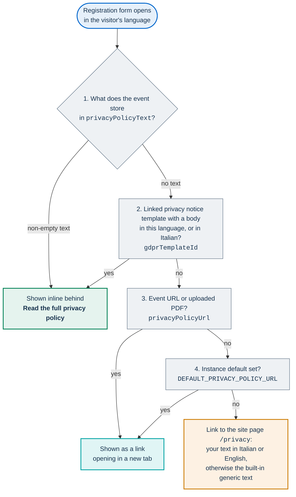
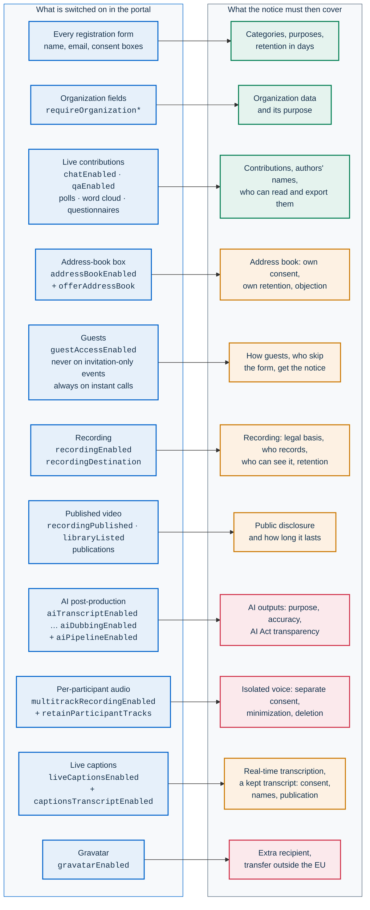

# Privacy notice checklist for controllers

This page lists the platform facts that the privacy notice of a PA Webinar
installation has to cover, and maps each fact to the setting that controls it.
It is written for data protection officers (DPOs) and for the controllers of an
installation: the public administration (PA) or public body that runs the
events.

> **This is not legal advice.** The controller is responsible for its privacy
> notice, for choosing the legal bases and for deciding whether a data
> protection impact assessment is needed. This page describes what the software
> does, so that the notice matches it. When a fact here and your notice
> disagree, change the setting or change the notice.

PA Webinar does not write a notice for you. It shows the texts you provide in a
few places, and it ships a generic built-in text for the cases where you have
provided nothing. Where the platform's own interface text says something
different from what the code does, the difference is called out in
[Platform texts to check](#platform-texts-to-check).

This page does not repeat the descriptions it relies on. Each fact has one
owner:

| Looking for | Go to |
|---|---|
| What each feature stores, where, how it is protected and how long it is kept | [Data inventory and retention](../GDPR.md#data-inventory-and-retention) |
| The exact consent texts and their translation keys | [Consent texts shown to users](../GDPR.md#consent-texts-shown-to-users) |
| Cookies, local storage and their lifetimes | [Cookies and browser storage](../GDPR.md#cookies-and-browser-storage) |
| What self-service access and erasure cover | [Data-subject rights](../GDPR.md#data-subject-rights) |
| Differences between what a reader expects and what the code does | [Known gaps](../GDPR.md#known-limitations) |
| Recording, per-participant audio and AI outputs in detail | [Recordings, voice data and AI outputs](recordings-and-ai.md) |
| Cookie flags, credentials and tokens | [Identity, access and tokens](../architecture/identity-and-access.md#cookie-inventory) |
| Which providers an installation depends on | [Service inventory: publishing](../SERVICE-INVENTORY.md) |
| Roles and responsibilities of a reusing administration | [Reusing PA Webinar](../REUSE.md) |

## How notices are attached

### Where people meet the notice

| Place | What it shows | Set in |
|---|---|---|
| Registration form of an event | The event's privacy sheet, then the event's notice, inline or as a link, above the consent boxes | The sheet is computed from the event ([The privacy sheet](#the-privacy-sheet)). The notice: event wizard, step **Review**, section **Privacy and data retention**; see [Which notice the registration form shows](#which-notice-the-registration-form-shows) |
| Site privacy page, `/<locale>/privacy`, linked from the footer as **Privacy policy** | Your site-wide text, or the built-in generic text | **Settings** > **General** > **Pages** > **Privacy policy** |
| Waiting room, before entering | The event's privacy sheet and, under it, the event's notice: the same text or link as the registration form. Both appear also when nothing is left to consent to | [The privacy sheet](#the-privacy-sheet) |
| Waiting room | **This event may be recorded.** in the event summary when the sheet says that something is recorded. People who host an event set to keep them in the recording read where the video goes instead | Built-in texts `waiting.recordingNotice` and `gdpr.consent.recordingHostAlwaysReserved`, `recordingHostAlwaysPublic` or `recordingHostAlways` |
| Waiting room, before entering | For whoever has no consent that covers the event (guests, registrants on another browser, people who consented to a narrower destination), the recording consent box under **Event recording**, with the text that follows the destination. Moderators and speakers get the same box in every event that records, always optional, with a note on what happens without it | Explanation above the box: built-in text (`waiting.recordingConsentIntro`), or the event's `recordingConsentText`. Box: [The recording box follows the destination](#the-recording-box-follows-the-destination). Note: `gdpr.consent.recordingOptionalVoice`, or, where a voice cannot be left out of the video, `gdpr.consent.recordingOptionalListenOnly` and, for hosts, `gdpr.consent.recordingOptionalHost` |
| Waiting room, before entering | For whoever has not given it (moderators and speakers included), the optional transcription box under **Transcript of what you say**, when the event records per-participant audio, keeps a transcript from captions or has the AI pipeline transcribe its video | Built-in texts `gdpr.consent.multitrack`, or `gdpr.consent.multitrackRetained` when tracks are kept, with the note `gdpr.consent.multitrackOptional` or `gdpr.consent.multitrackOptionalShort` |
| Waiting room of an instant call | Instant calls have no sheet. When they apply, the **AI processing after the event** and live-captions notices stand on their own | **Settings** > **General** > **Post-event AI pipeline** > **AI notice in the waiting room**; built-in texts `waiting.aiNotice`, `waiting.captionsNotice` and `waiting.captionsNoticeTranscript` |
| During the call | A written notice and a short tone for everyone when a recording or a transcript starts or stops, also on entry while one runs; **REC** and **Transcript** marks in the top bar while they run | Automatic |

The event page does not link the event's notice. Guests, where they are
admitted (see item 8 of
[Settings to review](#settings-to-review-before-the-first-public-event)),
never see the registration form: they meet the sheet and the event's notice in
the waiting room, before entering, whether or not the event asks them for a
consent. Instant calls are the exception: without a consent box their waiting
room links no notice, and the only link people meet is the footer's **Privacy
policy**, which leads to the site page, not to the event's notice.

The notice can say that the recording and transcription consents are
withdrawn from the room, under **Consents** in the top bar, at any time during
the event, and what follows ([Withdrawing consent](../GDPR.md#withdrawing-consent)).

### Which notice the registration form shows

The registration form shows one notice, chosen in this order
(`app/src/lib/events/privacy-notice.ts`, shared with the waiting room). An event's text
field saved empty counts as no text (the server stores it as `NULL`), and
choosing a privacy notice template in the wizard empties it, so the template is
what the form shows.

What follows from that order:

- **The event's own text wins when it is non-empty.** **Privacy notice
  (text)** has one version for all languages and is shown inline.
- **Otherwise the event's privacy notice template is shown.** The wizard
  preselects the template marked as default (★) under **Settings** >
  **Privacy notices**. Templates hold a body in Italian and in English; a
  registrant in any other language sees the Italian body.
- **To attach a different notice to an event,** pick another template, type it
  in **Privacy notice (text)**, or set **Privacy notice document (PDF or
  link)**; without any of these the form links the site page.
- **`DEFAULT_PRIVACY_POLICY_URL`** is unset in the chart's
  `infra/helm/pa-webinar/values.yaml`, so the form links the site page
  `/privacy`. Set it in `app.env` only to point at a notice published
  elsewhere, for example `https://webinar.example.com/it/privacy`
  ([Configuration reference](../CONFIGURATION.md)). `.env.example` and
  `infra/helm/pa-webinar/values-production.yaml` carry example hosts: replace or
  remove them. A value set to the empty string is not a fallback: it renders a
  link to the registration page itself.
- **The site page** shows the content saved under **Settings** > **General** >
  **Pages** > **Privacy policy** for the visitor's exact language, and only
  Italian and English can be edited there. Visitors in every other language,
  and everyone when nothing is saved, see the built-in generic text. That text
  names the controller from **Organization name** (**Settings** > **General** >
  **Branding**), describes the AI pipeline even on installations that do not
  run it, names specific default models, and says rights are exercised through
  "the data controller's institutional channels". Replace it, or adjust it per
  language with **Settings** > **Languages** > **Custom translations** (keys
  under `legal.privacy`).

### The privacy sheet

The registration form and the waiting room show a privacy sheet, **This event
and your data**: the facts of this event, computed from its settings and from
what the installation can do (`app/src/lib/events/privacy-sheet.ts`). Nobody
writes it and it is not stored: it is computed on every page, so it follows the
event. It sits on top of one notice, which the sheet points to for everything
else. Where something depends on the organizers, it says "may".

| Row | What it says | Follows |
|---|---|---|
| **Recording** | Nothing planned, the hosts can start it, it starts on its own, or only per-person audio tracks. Where the video goes. What happens to people who do not consent. Whether the hosts are always in it | `recordingEnabled`, `autoStartRecording`, `recordingDestination`, `hostsAlwaysRecorded`, the audience's microphone, camera and screen, and whether the installation records a room video |
| **Transcript** | The caption text is kept for people who consent; the per-person track is deleted after transcription or kept; the video is transcribed only if everyone who speaks in it has consented | `captionsTranscriptEnabled`, `multitrackRecordingEnabled`, `retainParticipantTracks`, `aiTranscriptEnabled` |
| **Captions** | The text of `waiting.captionsNotice` or `waiting.captionsNoticeTranscript` | `liveCaptionsEnabled`, `captionsTranscriptEnabled` |
| **Artificial intelligence** | Summary, translation and dubbing the event asks for, what staff can still request after the event, the event report, and that outputs may be inaccurate. No row with the AI pipeline off | `aiPipelineEnabled`, the event's AI flags, **AI notice in the waiting room** |
| **Chat and questions** | Chat messages are never published. The text of Q&A questions may be published, never the name, or the questions are not published | `chatEnabled`, `qaEnabled`, `postEventShowQA`, `recordingDestination`, `recordingAudience` |
| **Participant list** and **Your name** | Whether the audience sees who is present, and whether people appear under their name or a pseudonym | `participantListVisible`, `audienceAnonymous` |
| **Retention** | The days of the event's data, and how long the recording and what is made from it stay: until the organizers delete them, or that many days after the event's end, or after publication if the video is made available. Without a video, the same for the transcript | `dataRetentionDays`, `recordingDeleteAfterDays` |
| **Address book** | The optional offer, with its months. Registration form only | `addressBookEnabled`, `offerAddressBook` |

- **When it appears.** On every event except instant calls, which ask for no
  consent; a moderator can still start their recording, so no answer would be
  true for everyone. The waiting room shows it until the event ends.
- **Live changes.** In the waiting room, the captions, chat and Q&A rows follow
  what moderators switch on during the event. The other rows are those of the
  page load.
- **People who lead the event.** In the waiting room moderators and speakers read
  two rows written for them. **Your name** says they appear under their name,
  also where the audience has a pseudonym. **Recording** says what happens to
  them without the consent: they stay out of it, or, where a voice cannot be left
  out of the video, the text of `gdpr.consent.recordingOptionalHost`.
- **Rewording.** Every sentence is a key under `gdpr.sheet`, or under `waiting`
  for the captions, and can be changed with custom translations. The sentence
  is chosen by the fact, so a reworded sentence applies to every event with that
  fact: do not make it more specific than the fact.
- **The AI notice.** **AI notice in the waiting room** replaces the sentences on
  summary, translation and dubbing for its language when the event processes
  the recording. The sentences on what staff can request, on the event report
  and on accuracy stay. If your text leaves out the synthetic voice of a dubbed
  video, the sheet leaves it out too.
- **What it does not say.** The controller, the legal bases, rights, and
  **Artifact retention (days)**. Those stay in the notice.

### Custom recording consent text

Events have a `recordingConsentText` field. It can be set only through the
events API (`POST /api/events`, `PUT /api/events/<slug>`) and appears on the
event page of the administration area. When it is set, people read it wherever
they can give the recording consent: under the box on the registration form,
above the box in the waiting room, in place of the built-in explanation
(`waiting.recordingConsentIntro`), with the box text in the room's **Consents**
dialog for whoever has not given the consent, and above the consent button in
the room's notices to people who follow in listen-only mode or are out of the
recording. In those notices the text has a maximum height and scrolls, so a long
text leaves the conference and the button on screen. It appears as written and
in every language, because the field is not translated. A registration form that
shows a notice instead of a box does not show it. On an installation with no
room video it is not shown anywhere, and the waiting room's built-in text is
`waiting.recordingConsentIntroNoVideo`. When it is empty, the waiting room shows
the built-in text; change it for the whole installation with that custom
translation key. The audience of an anonymous event reads
`waiting.recordingConsentIntroAnonymous`, which says pseudonym instead of name
and shows the custom translation of the built-in text until it has its own: a
custom text that says name is wrong for that audience. Nothing compares the field with the event: a text
that calls the video public on a reserved event contradicts the box and the
sheet, so review it when the destination changes. A
custom translation saved under `live.recordingConsent` or
`live.recordingConsentTitle`, the keys of the full-screen dialog this box
replaced, still applies to `waiting.recordingConsentIntro` and
`waiting.recordingConsentTitle` until those keys get their own
(`app/src/i18n/renamed-keys.ts`). The box itself carries the same label as the
registration form
([The recording box follows the destination](#the-recording-box-follows-the-destination)).
Consent is given by ticking the box, not by entering: review an event text or a
custom translation written for the dialog, and rewrite a sentence such as "by
entering, you consent" as an explanation of what is recorded and why.

### The consent boxes on the registration form

None of the boxes is pre-ticked, and the server rejects a registration that
lacks the required one. The exact English texts are quoted in
[Consent texts shown to users](../GDPR.md#consent-texts-shown-to-users), and
what is stored as evidence is in
[Evidence of consent](../GDPR.md#evidence-of-consent). Reword a box per
language with **Settings** > **Languages** > **Custom translations**.

| Box | Shown | Required | Key to reword |
|---|---|---|---|
| Acknowledgement of the privacy notice | Always, with a sentence on statistics added when organization fields are on | Yes. It records that the person read the notice: it is not a consent to the processing | `registration.gdprConsent`, `registration.gdprConsentProfiling`; see [Purposes and legal bases](#purposes-and-legal-bases) |
| Audio and video recording | When `recordingEnabled` is on and participants may use the microphone, camera or screen. Otherwise the form shows an information notice instead of a box, and the room lets the person consent later, under **Consents** | No: whoever leaves it unticked takes part with the rules of everyone else, and stays out of the recording | Follows the destination, see below; the notices are `gdpr.consent.recordingNotice` and `gdpr.consent.recordingNoticeVoice` |
| Transcription of the person's contributions, with their name | When `multitrackRecordingEnabled` is on and the event can record its tracks (`eventoRegistrabile`), also for listen-only events, when the event keeps a transcript from captions (`captionsTranscriptEnabled`, with captions available), or when the AI pipeline transcribes its video (the event records a room video, `aiTranscriptEnabled` and `aiPipelineEnabled` are on, not on instant calls) | No: whoever leaves it unticked takes part, but is neither recorded on a track of their own nor kept in the transcript | `gdpr.consent.multitrack`, or `gdpr.consent.multitrackRetained` where tracks are kept, because the event keeps them or the AI pipeline is off and nothing transcribes them, with the note `gdpr.consent.multitrackOptional` or `gdpr.consent.multitrackOptionalShort` |
| Upcoming events and address book | Where the installation (`addressBookEnabled`) and the event (`offerAddressBook`) offer it, one box for being contacted about upcoming events: it sets both `consentFutureCommunications` and the address-book opt-in, and the address-book withdrawal link revokes both. On an address that has stopped receiving invitations the tick waits for a confirmation | No | `gdpr.consent.stayInTouch`, `gdpr.consent.stayInTouchHelp`, `gdpr.consent.stayInTouchRetention`; see [Address book](#address-book) |

The form groups the boxes under **Privacy notice and consents** and marks each one **required** or **optional**. Rules in
`app/src/lib/registration/consents.ts`.

#### The recording box follows the destination

An event has one recording box, and it says where the video goes
(`chiaveConsenso` in `app/src/lib/recording/destination.ts`). The form, the
waiting room and the room use the same key:

| The event | Key |
|---|---|
| Reserved recording | `gdpr.consent.recordingReserved` |
| Public recording | `gdpr.consent.recordingPublic` |
| No declared destination | `gdpr.consent.recording` |
| The installation records no room video, whatever the destination | `gdpr.consent.recordingNoVideo` |

A custom translation of `gdpr.consent.recording` therefore reaches only events
with no declared destination. It does not apply to the texts with a
destination, which are the ones every new event that records uses: repeat the
change on `gdpr.consent.recordingReserved` and `gdpr.consent.recordingPublic`,
in each enabled language, and on `gdpr.consent.recordingNoVideo` if the
installation has no room video.

A consent is stored with the destination of the text the person read and its
version (`VERSIONE_TESTO_REGISTRAZIONE`), not with its wording. A custom
translation changes neither, so it has to keep what the text says about who can
see the video.

## Checklist by notice section

Use the diagram to see which sections a given event needs. Blue boxes are what
is switched on in the portal; green, amber and red boxes are the notice sections
it triggers, from lower to higher risk.

AI post-production needs recording, and per-participant audio needs automatic
transcription: the wizard offers each option only when the one before it is on.

### Data categories per feature

The fields each feature stores, and which of them are encrypted, are listed in
the [data inventory](../GDPR.md#data-inventory-and-retention);
`app/prisma/schema.prisma` is the authority. This table says what switches each
feature on and what the notice should say about it.

| Feature | Switched on by | What the notice should say |
|---|---|---|
| Registration | Always | Name and email, the consent choices, and join and leave times. The personal join link in emails is an access credential. In the call, the event's moderators see each registrant's registration name and email address next to the name shown in the room ([Who is behind each video tile](../architecture/identity-and-access.md#who-is-behind-each-video-tile)) |
| Organization fields | `requireOrganization`, `requireOrganizationRole`, `requireOrganizationType`, per event: the wizard's **People** step, under **What we ask people who register**, or the events API. Off by default | When on, the organization name is required (by the form and by the registration API); role and type of body are optional. State the statistical purpose |
| Guests | **Guest access enabled** for scheduled events, except those open only to invitees (**Invited people only**), which never admit guests; always on instant calls | The display name typed in the waiting room, and, in chat messages, an identifier derived from the IP address and that name. |
| Q&A, chat, polls, word cloud, reactions, agenda reactions | `qaEnabled`, `chatEnabled` and the other live-interaction flags of the event | Contributions carry the author's display name: chat sender names and texts are encrypted; Q&A author names and questions are stored in plain text. Everyone who can read the chat can download it, names included. Chat messages are never published, not even questions asked in the chat. After the event only moderators see who asked a question: the event page can show its text, never the name, and shows none where the recording is reserved, by its destination or by its audience, or where its post-event settings hide them. A notice under both fields tells people not to write personal data. At the event's retention the chat is deleted, while questions, votes and words stay with the event without names or identifiers |
| Questionnaires and post-event feedback | Per event; every event created with feedback collection on gets the generic end-of-event rating | Pre-registration answers carry the respondent's name. The end-of-event rating stores no name and no email hash, only the registration (one response each) or a browser id, and the form tells respondents that organizers see the answers without their name. Administrators, the event's organizer and its moderators read every answer and can download them as CSV. Free-text answers can contain anything |
| Materials | Staff and moderators add them per event | Whatever the documents contain. The visibility setting decides which public lists show a material, not who can open it: an uploaded file is served from its URL to anyone who has the URL, so a document with personal data should not be shared as a material. Openings and downloads are counted as one number per material, which only the event's moderators see; to count each person once every 10 minutes the server holds a hash of the room token, or else the IP address, in memory for that time, and stores neither |
| The square | Offered in the waiting room; the waiting-room engine sets only the starting view ([Engines](../architecture/waiting-room.md#engines-classic-view-and-the-square)) | Display name and position, visible to others waiting who have access to the room (people who only know the address see positions without names), expiring seconds after the last update ([Presence](../architecture/waiting-room.md#presence)) |
| Raised hands and call analytics | Always; shown in the event's **Statistics** tab | Attendance, who spoke when and who raised a hand, per call session |
| Composite recording | `recordingEnabled` | Video and mixed audio of the conference, shared screens included, without the people who did not consent. Where the video goes, reserved or public ([Recording destination](recordings-and-ai.md#recording-destination)) |
| Per-participant audio | `multitrackRecordingEnabled` | One isolated voice track per participant who consented to the transcription of what they say, labeled with a name; nobody else's voice is recorded on a track of its own |
| Live captions | `liveCaptionsEnabled` on the instance and on the event, where the installation runs the captions service; on by default | The voice of everyone who speaks is transcribed in real time inside the installation, and every participant sees the captions with the speaker's name. Without a transcript from captions no text is kept |
| Transcript from captions | `captionsTranscriptEnabled` per event, off by default; the new-event questions turn it on for events that can be recorded | The sentences of the people who consented, with their name, become the event's transcript, which staff can correct and publish on the event page; for everyone else only the times of their sentences are kept |
| Who is in the room | Every event, where the installation runs live captions and **Automatic captions in video calls** is on, whatever the event's own captions switch; events with per-participant recording. In both cases where Prosody loads the project's occupants module (the chart and Docker Compose do) | Which conference seat stands behind each voice on the bridge, with join and leave times and no names. It lets the recorder and the transcript from captions honor each person's consent, also for people who joined before the transcript was turned on, and is deleted at the event's retention. For other events, nothing |
| AI outputs | `aiPipelineEnabled` and the event's AI flags | Transcript with speaker labels, summary, translations, subtitles, dubbed audio. A video without per-person tracks is transcribed only after staff confirm that everyone who speaks in it has consented. Staff can map a speaker label to a name or an address-book entry |
| AI event report | Requested by staff after the event, with `aiPipelineEnabled` on | A language model inside the installation reads the transcript, polls, words and the post-event comments, and the Q&A questions only where the event page publishes them, and writes a report beside the platform's figures. It reads the number of chat messages, never their text. It rewords comments, without authors. It is public only after staff review and publish it, and it stays with the event after its retention |
| Consent proofs | Whoever gives or withdraws the recording or transcription consent | The person's name, when each consent was given and withdrawn, the version of the text and the destination it stated, and the role. Staff who manage the event read them under **Consent proofs**. They outlast the registration while a video or a transcript is published and, after an erasure, while one exists, published or not (see [Retention and where to change it](#retention-and-where-to-change-it)) |
| Address book | The optional box on the registration form, where it is offered | See [Address book](#address-book) |
| Invitations | Staff add them in the event wizard, and send each invitee an invitation email from the event page once registration is open. The email links to the registration page with the form filled in, through a random token kept with the invitation until the event's data is deleted | The invitee's name and email. When an event is open only to invitees (**Invited people only**, or **Public registration enabled** off for an event without a choice of its own), the list decides who may register, and the personal join link reaches the registrant only by email |
| Moderators and speakers | Event wizard and named grants | The primary moderator's name and email, which registrants receive (see [Recipients and processors](#recipients-and-processors)); named grants; the public speaker list; the photos staff upload for these people, which the public event page shows only for the people it lists. The platform asks no consent for them: the person supplies the photo to the organizer |
| Staff accounts | **Staff and access** > **Staff accounts** | Name, email, role, last sign-in |
| Administration audit log | Always | For privileged writes (administration area, event edits made with a moderator link) and staff sign-ins: the actor, the action, the target, the IP address and the user agent |
| Email outbox | Always | Recipient and body of every email, including personal join and sign-in links |
| Avatars | **Use Gravatar when available** (`gravatarEnabled`, off by default); the profile photo is always offered | Drawn from initials on the server by default; with Gravatar, see [Recipients and processors](#recipients-and-processors). Registrants who have opened the personal link from their email may upload a photo in the waiting room; moderators and speakers cannot, and the photo staff upload for them is shown only on the public event page. Everyone in the room sees it, at every event of that address, until the person removes it or its retention ends ([data inventory](../GDPR.md#data-inventory-and-retention)) |
| Browser storage | Always | See [Cookies](#cookies) |
| Conference and TURN servers | Always | IP addresses, display names, the audio and video streams. Jitsi components keep their own logs |

The application does not write IP addresses to its logs and runs no analytics
or tracking scripts. It keeps client IP addresses in memory, for rate
limiting, and in the administration audit log. A guest's chat messages also
carry an identifier derived from the guest's IP address and typed name, which
can be decoded back to the address until the event's retention ends
([Known limitations](../GDPR.md#known-limitations)).

### Purposes and legal bases

The platform records consent flags, but it does not choose your legal basis.
Check each row against the basis you rely on.

| Processing | What the platform does | Check |
|---|---|---|
| Registering and joining | Requires a box that records that the person has read the notice. The default label is an acknowledgement, not a consent: it fits a basis other than consent, such as a public task (Art. 6(1)(e)) | If you rely on consent, change the text with custom translations, in each enabled language: `registration.gdprConsent` (the box), `registration.gdprConsentProfiling` (the sentence added with organization fields), `registration.errors.consentRequired` (the error under the box), `registration.consentsLegend` (the heading of the group) and `gdpr.export.fieldConsent` (the line on the **My data** page). The box stays mandatory: the server rejects a registration without it |
| Organization data | Adds a sentence on statistics to the box | State the statistical purpose and who sees the data (**Sign-ups** and its CSV export) |
| Recording | Asks for the optional recording box at registration and in the waiting room, with the text that follows the event's destination. Whoever leaves it unticked takes part with the rules of everyone else: Jibri's session does not see them, so no name, voice, image or shared screen reaches the video, the per-participant recorder skips them, no text or name is kept even with the transcription box ticked, and a note next to the video says that some contributions are missing. Where the voice cannot be left out, they listen and use chat, questions and polls | State who can see the video. Moderators and speakers get an optional box in the waiting room, stored as proof with their named grant or staff account, and the same rule applies to them. With **Hosts are always in the recording** they see a notice and no box, and no proof is stored. In that case, and where the voice cannot be left out, the composite video includes them: your notice should say so, and the legal basis for recording the people who lead the event is yours to state |
| Per-participant audio, the transcript from captions and the transcript from the video | Asks for one separate, optional box at registration and again in the waiting room of anyone who has not given it, moderators and speakers included. Records, and keeps in the transcript, only the voices of those who tick it. The video holds the voices of everyone in it, so a transcript from the video starts only after staff confirm that everyone who speaks has consented | Both answers are stored, with the version of the text they were given to: the registration box (`consentMultitrack`, `consentMultitrackVersion`) and the waiting-room tick for the conference seat (`MultitrackConsent`). Wherever the event transcribes, only the current version counts, so people who consented to an earlier text are asked again. Say that refusing changes nothing else about taking part. The version is set in the code (`app/src/lib/registration/consents.ts`): a custom translation of the box does not change it, so keep its purpose |
| Future communications | Records the choice and shows it in **Sign-ups** and its CSV export. Nothing in the platform sends mail based on it | Describe the channel you use, or change the label if you do not use it |
| Recording notice | On by default per event: once, when the event's recording or external video is visible on its public page, emails every registration the event still keeps, with the event page link. On a reserved event it goes out once the video is available to registrants, even with a private page, and an external video alone does not send it. It does not depend on the future-communications box, and nobody is notified once retention has deleted the registrations | State it as part of the registration's purpose, or turn **Notify registrants when the recording is published** off on the event before it is sent |
| Address book | Separate optional consent | See [Address book](#address-book) |
| Live captions | Says so in the sheet. Showing the captions asks for no consent | State the purpose, typically accessibility of the live event, and that nothing is kept unless the event keeps a transcript from captions |
| AI post-production | Says which outputs apply in the sheet. A person's consent covers the transcription of what they say; summaries, translations, dubbing and the event report ask for no consent of their own | For those outputs, choose a basis that does not depend on per-person consent, or collect consent outside the platform |
| Event analytics | Attendance, speaking time and raised hands per participant, shown pseudonymously by default | State the purpose, typically running and evaluating the event |
| Material open count | Counts the openings and downloads of each material, in the room and on the event page, as one number per material shown only to moderators. Nothing records who opened what; the IP address of a caller without a valid room token is held in memory for 10 minutes only to avoid counting the same click twice | State the purpose, typically evaluating which materials the audience uses |

### Recipients and processors

| Recipient | When | What it receives |
|---|---|---|
| Hosting provider | Always | Everything, at rest in the database and in memory: the cluster or virtual machine, and PostgreSQL |
| Object storage provider | When a storage domain is configured | Uploads, chat attachments, recordings, voice tracks and AI outputs ([Object storage](../configuration/storage.md)) |
| SMTP relay | Always | Every email in clear: addresses, names, personal join and sign-in links, calendar files ([Email delivery (SMTP)](../configuration/email.md)) |
| Gravatar (Automattic Inc., United States) | Only with **Use Gravatar when available** on (`gravatarEnabled`, off by default) | The MD5 hash of the email of registrants and moderators, sent by the server. Browsers never contact Gravatar |
| Your monitoring and logging stack | Always | Ingress, load balancer, Jitsi and TURN logs, which usually contain IP addresses ([Monitoring and health](../operations/monitoring.md)) |
| Staff | Always | Administrators see everything and can export sign-ups as CSV; organizers see their own events; moderators see what happens in their room, including, in the participants panel, the name and email address given at registration or on a named grant for each person in the call. Speakers do not see these |
| Registrants | A reserved recording that staff make available | The video and what derives from it, for as long as their registration exists |
| Other participants | Always | Display names and avatars in the room, chat and Q&A authors, and the chat download. People in the square who have access to the room see each other's display names and positions. Registrants receive the primary moderator's name and email address as the organizer of the calendar file attached to their confirmation, reminder and date-change emails |
| The public | Per event | The speaker list, the primary moderator's name in the event's public calendar file (while the event page is visible), a recording published for everyone and its AI outputs, a transcript from captions published for everyone with its speakers' names, a published AI event report, publications, the text of Q&A questions without names, and the event recap |

AI post-production has no external recipient. Every engine the application
accepts runs inside the installation's cluster (`app/src/lib/ai/providers.ts`),
and the model weights are prepared in advance on a cluster volume. If the
conference runs on a Jitsi deployment outside your installation, its operator
is a recipient too. The software sends nothing to the PA Webinar project.

An ended event's `youtubeUrl` appears as the external link **Watch the video on
YouTube**; YouTube is contacted only when a visitor follows it. On a reserved
event only people who can see the video get the link, and a new one is refused.

### Retention and where to change it

Retention depends on scheduled jobs. On Helm installations the cleanup runs
daily (`cronjobs.cleanup`), the address-book retention daily
(`cronjobs.rubricaRetention`), and the post-production purges only when
`postprod.enabled` is on. The Docker Compose scheduler calls only the email
outbox, the event lifecycle, reminders and cleanup, so address-book retention
never runs there unless you schedule it. The cleanup also handles events that
were never ended, once their end (or their last activity, if later) plus the
retention days has passed; drafts are never cleaned
([Scheduled and background jobs](../architecture/background-jobs.md#cleanup)).
What each job deletes is in the
[data inventory](../GDPR.md#data-inventory-and-retention).

| Data | Governed by | Where to change it |
|---|---|---|
| Event personal data: registrations, chat and attachments, pre-registration answers, upvotes and reactions, invitations, named grants, call-session logs, and the names and identifiers on the contributions below | `dataRetentionDays` after the event's end. The event itself stays, and a concluded event keeps its status | Wizard **Retention days** (1 to 365). New events start at 30 (`app/src/app/[locale]/admin/events/new/page.tsx`) unless the event template sets **Default data retention (days)**. Instant calls use 7 (`app/src/app/api/events/instant/route.ts`). The `DEFAULT_DATA_RETENTION_DAYS` value in the chart's values is not read by the application |
| Event content: Q&A questions and answers, polls and votes, word-cloud words, end-of-event answers, older star ratings, materials and their files, agenda, live action journal | Kept while the event exists. At the event's retention it loses author names, registrations and browser ids, and upvote rows are deleted; text that people typed stays as written and may contain personal data ([Known limitations](../GDPR.md#known-limitations)) | Post-event settings of the event decide what its public page shows; delete the event to remove the content |
| The recording: composite video of every session, AI outputs, transcript from captions | Not the event's retention, published or not. `recordingDeleteAfterDays` counted from publication while the video is published, otherwise from the event's end and never before the period was chosen, the video unpublished or a new file attached; **No automatic deletion**, the default, stores no value and keeps the recording until someone deletes it. At the end of the period the cleanup deletes the videos of every session and what lives in the database, and `postprod-retention` the stored outputs ([Recording retention](../GDPR.md#recording-retention)) | Wizard advanced settings, **Recording retention**; **Retention** on the recording panel of the event, in the administration area; **Default recording retention** on the event template. Only the organizers of the event, or the primary moderator link, change it |
| Publications | Created published with no deletion date for the video, and with a 3650-day event retention (`app/src/app/api/admin/publications/route.ts`) | **Retention** on the recording panel of the publication's event |
| A video deleted by hand | **Delete recording** removes the event's video file only: the outputs and the files of earlier sessions stay with the recording's period | Choose a period on the recording panel, or delete the sessions |
| Temporary recording | `TEMP_RECORDING_TTL_MS` in `app/src/lib/gdpr/cleanup-selection.ts` | Not configurable |
| Per-participant audio | Transcription, or the event's retention when tracks are kept | **Keep per-participant tracks**, wizard advanced settings, **Recording and AI**; details in [Recordings, voice data and AI outputs](recordings-and-ai.md#retention-regimes) |
| AI outputs | The recording's period, as above | **Artifact retention (days)** (`aiArtifactRetentionDays`) adds a deletion date, published or not; it cannot keep outputs beyond the recording's period |
| Caption sentences and the record of who was in the room | The event's retention | As event personal data |
| Transcript from captions | The recording's period, as above. Its sentences go at the event's retention, so it is not rebuilt after that | As the recording |
| Event record, recap and AI event report | Nothing deletes them. After its retention the event keeps its title, description, dates, speaker list and the primary moderator's name and encrypted email; the recap keeps, without authors, the text of the top Q&A questions, published poll results and the most-submitted word-cloud words (`app/src/lib/events/recap.ts`). It reads no chat, and the event page leaves out the text of the questions where the event does not publish them | Edit or delete the event |
| Consent proofs | The per-person proofs go with their registration or grant at the event's retention, or at an erasure. A copy stays (`RetainedConsentProof`) for whatever of the recording exists, published or not: both consents while there is a video file of any session, the catch-up copy, an external link or a per-person track with its audio, the transcription consent with a transcript alone. The cleanup copies it with the name; an erasure copies it without the name and stamped as withdrawn. A copy goes at the first cleanup after none of that exists, and in any case with the event. A later erasure removes the name from the copy and stamps the withdrawal; the rest stays as long as the copy does | Delete the video and the transcript, or let the recording's period end, and remove the external link |
| Address book | `retentionMonths` from the consent (`optedInAt`, default in `app/prisma/schema.prisma`, not editable in the administration area): only a new tick of the box restarts it, confirmed if it follows a withdrawal (see [Address book](#address-book)), a registration without the tick does not. Opted-out entries at the next run | Delete entries under **Address book** |
| Profile photos | Kept while a registration with the same email address exists, at any event; then deleted once 30 days have passed since the photo last changed (`app/src/app/api/cron/cleanup/route.ts`). Self-service erasure deletes it | Not configurable. The person can remove it in the waiting room |
| Photos of event people | The event's retention: the cleanup clears the lead moderator's photo and deletes the grants' photos, unless a duplicated event still uses them. A photo that nothing uses goes 7 days after its upload. Self-service erasure deletes the photos of the erased grants | **Remove the photo** in the wizard's **People** step |
| Staff accounts | The account stays until an administrator deletes it. Used or expired sign-in links are swept by the daily cleanup (`app/src/app/api/cron/cleanup/route.ts`) | **Staff and access** > **Staff accounts** |
| Administration audit log | The rows stay. The GDPR cleanup empties their IP address, user agent and speaker-naming detail after 90 days by default | `AUDIT_LOG_PERSONAL_DATA_RETENTION_DAYS` |
| GDPR audit log | Kept: its rows go only with the event row | Not configurable |
| Email outbox | The GDPR cleanup deletes sent and failed rows 30 days after their last update by default, and empties those with a deduplication key instead | `EMAIL_OUTBOX_RETENTION_DAYS` |
| Orphaned recording files | `orphanRecordingGraceDays`, unless marked **Keep** | [Runtime settings](../configuration/runtime-settings.md) |
| Logs outside the application | Your logging stack | Your infrastructure |
| Browser storage | The person clearing it | On the device |

### Recordings and AI

[Recordings, voice data and AI outputs](recordings-and-ai.md) owns this topic.
Your notice should state at least:

- **Whether events are recorded, and by whom.** Recording is off by default and
  is enabled per event (**Enable video recording**). A moderator starts it, or
  it starts on its own when the event is set to do so. Instant calls are
  created with recording available, and people who join them by the shared link
  see neither the recording notice nor the consent screen: they see only the
  **Recording in progress** banner once a recording runs. Tell them before you
  record.
- **Where the recording goes.** Each event that records declares it, and the
  consent box says so: reserved for the organizers and registrants, or public.
  A new event starts reserved unless staff choose otherwise. Once the room has
  opened the destination can only narrow, and a reserved video cannot be shown
  to everyone or linked to an external site. A registrant can watch a reserved
  video only while their registration exists: after retention or erasure it
  stays with the organizers, for as long as the recording is kept
  ([Recording destination](recordings-and-ai.md#recording-destination)).
- **What is published.** The moderator or staff decide whether the recording
  is published. A published recording plays on the concluded event page, for
  everyone or for registrants, and, if listed, in the **Video library**, which
  shows only recordings for everyone. Its AI outputs are public when the AI
  pipeline is on, the recording is published and the event page is visible
  after the end (`app/src/lib/ai/access.ts`). A transcript can also be
  published on its own, without a video: then only its text in the source
  language is public, without summaries, translations, subtitles or dubbing. When the recording or an
  external video becomes visible there, the event's registrants receive one
  email about it, unless the event turns the notice off
  ([Recording notice](../architecture/email.md#recording-notice)).
- **Publications.** Past videos uploaded by administrators under
  **Publications** are published immediately, listed in the **Video library**
  unless **Publish in the video library now** is unticked, and have no deletion
  date. Speakers' images and voices in them stay public until someone sets one.
- **Per-participant audio.** Its purpose (attributing the transcript), the
  separate, optional consent, that only the voices of those who give it are
  recorded, deletion after transcription, and the longer retention when tracks
  are kept.
- **Live captions and the transcript from captions.** That speech is
  transcribed in real time inside the installation to show captions to
  everyone. When an event keeps a transcript from captions: that the text and
  name of the people who consent are stored and become the event's transcript,
  that the others' words are not kept, that staff may correct and publish it
  on the event page, that erasure of a registration removes the person from
  it, and how long it is kept
  ([Recordings, voice data and AI outputs](recordings-and-ai.md#transcript-from-live-captions)).
- **The AI event report.** That staff may have an AI model write a report
  of the event from the transcript, polls, words and ratings, and from the
  questions where the page publishes them, that it does not read the text of
  the chat, that it is reviewed before publication, and that it stays with the
  event after its retention
  ([Recordings, voice data and AI outputs](recordings-and-ai.md#the-event-report)).
- **AI processing.** Which outputs are produced (transcript, summary,
  translations, subtitles, dubbing with synthetic catalog voices, never cloned
  voices), that everything runs inside the installation, that outputs can be
  inaccurate and that the original video is the reference. Name the models
  your installation actually runs (`AI_ASR_MODEL_ID`, `AI_VLLM_MODEL_ID`); the
  concluded event page shows the snapshot of the models used for each
  recording.
- **The AI notice.** It can be customized in Italian, English and French under
  **AI notice in the waiting room**; other languages get the built-in sentences
  of the sheet, or `waiting.aiNotice` on instant calls.

### Address book

[The address book](../GDPR.md#the-address-book) and
[ADR-011](../adr/011-person-rubrica.md) describe it. For the notice:

- **Whether it is offered.** **Events address book** under **Settings** >
  **General** > **Features** (`addressBookEnabled`) turns it off for the whole
  installation, and each event offers it or not (`offerAddressBook`, which starts
  from the event's format and template). Where it is not offered the form has no
  box, and a registration writes nothing to the address book.
- **What it holds.** Only a ticked box creates or updates a person record, with
  the name, the email address, encrypted, and the organization of that
  registration; a field the registration does not carry keeps its stored value,
  unless the record was withdrawn. A registration without the tick links to an existing record and
  changes nothing, and so does a tick that waits for a confirmation (see **A
  tick after a withdrawal** below). Only administrators see it; they use it to
  find people when they prepare invitations, and the wizard fills in the
  address.
- **Retention.** The box has its own consent and its own retention, counted from
  the consent: only a new tick restarts it, and after a withdrawal only once it
  is confirmed (see
  [Retention and where to change it](#retention-and-where-to-change-it)). The
  form states the months (`gdpr.consent.stayInTouchRetention`).
- **Objection.** The registration form says consent can be withdrawn with the
  "Remove me from the address book" link in the confirmation email, the reminders
  and the invitations, or from the **My data** page. Those emails, and the
  post-event and recording-notice ones, carry the signed link for people in the
  address book, valid for 90 days from each email. Objections by other means are
  handled by request: an administrator deletes the entry under **Address book**,
  and the deletion is written to the administration audit log.
- **What a withdrawal does.** The email address leaves the entry at once and the
  entry goes at the next retention run, the future-communications choice is
  withdrawn on all the person's registrations, and invitations stop: unsent ones
  on open events are deleted, and the others are marked so that nothing more is
  sent, and invitation emails still in the queue are cancelled. On an event open
  only to invitees the invitation stays, and with it the right to register. An
  expired or deleted entry stops its invitations as well. The stop follows the
  address: writing it again on an invitation, or on a new one, does not lift it,
  with the limit in [Known limitations](../GDPR.md#known-limitations).
- **A tick after a withdrawal.** The form does not prove who owns an address, so
  a tick cannot undo a withdrawal. On an address that has withdrawn, or that has
  a stopped invitation, the tick stays on the registration (`addressBookPending`)
  and changes nothing: no address-book entry, no future-communications consent,
  no invitations. It counts once the person confirms it: by opening the personal
  link of an email in the browser that filled in the form, on an event open to
  public registration, or with the button on the **My data** page. The link alone
  confirms nothing, so a mail filter that opens it, or another browser, changes
  nothing. On confirmation the entry returns with the data of that registration,
  its retention restarts and the stopped invitations resume. Both steps are
  written to the GDPR audit log. A new withdrawal cancels a waiting tick. The
  platform remembers a withdrawal through the entry, a stopped invitation or a
  registration that records it. Once those are deleted, or the last stopped
  invitation is moved to another address, a tick counts as a first consent, and
  an invitation written to that address is sent.
- Self-service erasure also deletes the person's address-book entry and their
  invitations, with every email of those invitations, queued or sent.

### Rights and the self-service URLs

Access and erasure work without staff involvement, through a link emailed to
the address that registered; `app/src/lib/gdpr/request-token.ts` sets how long
the link is valid, and requests are rate-limited. Both flows need a working
SMTP relay and the `email-outbox` job. They reach only data found through a
registration's email address, so your notice should not promise more:
[Data-subject rights](../GDPR.md#data-subject-rights) lists exactly what each
flow covers.

| Right | Where | What your internal procedure must cover |
|---|---|---|
| Access (Art. 15) | `/<locale>/privacy/my-data` (`/it/privacy/i-miei-dati`, `/en/privacy/my-data`) | Everything outside [What the export contains](../GDPR.md#what-the-export-contains), such as chat, questionnaire answers, recordings and AI outputs |
| Withdrawal of a consent (Art. 7(3)) | The same page, for the recording, the transcription and future communications, also from the copies of the proofs kept after a registration is gone. In the room, under **Consents** | What is already in the composite video stays: removing it is a request to you. A withdrawal from a kept copy also takes a registrant out of the transcript from captions, as one from the room does; an AI transcript already built does not change |
| Erasure (Art. 17) | `/<locale>/privacy/my-data/erasure` (`/it/privacy/i-miei-dati/cancellazione`, `/en/privacy/my-data/erasure`) | Everything outside [What erasure deletes](../GDPR.md#what-erasure-deletes). Feedback and questionnaire answers given through a registration are deleted; those given as a guest, or on the public event page, are not found; the event's retention later deletes the chat and removes names and browser ids from the content that stays. The proof of a consent stays without a name while its video or transcript exists, published or not: say so |
| Objection (Art. 21), address book | The link in emails, or the **My data** page | Requests by other means: deletion of the entry by an administrator |
| Rectification, portability, restriction | By request | No self-service flow |
| Guests | By request | Nothing ties a guest's data to an email address, so self-service cannot find it |

Transcript corrections and the removal of a person's contribution from a
transcript are covered in
[Recordings, voice data and AI outputs](recordings-and-ai.md#editing-and-erasure).

### Cookies

All cookies are first-party and serve only to run the service. None is used for
analytics, advertising or tracking, and the platform ships no cookie banner. The
list with lifetimes is in
[Cookies and browser storage](../GDPR.md#cookies-and-browser-storage), and the
flags and contents in the
[cookie inventory](../architecture/identity-and-access.md#cookie-inventory).

Also mention in the notice:

- **Browser storage.** The portal keeps a few items in the browser's local
  storage, such as the name typed in the waiting room, a random guest
  identifier and display preferences; they never leave the device. The
  embedded conference runs on the conference host and keeps its own settings in
  that host's browser storage.
- **No embedded third-party content.** The portal loads nothing from third
  parties. YouTube is reached only through the external link described in
  [Recipients and processors](#recipients-and-processors).

Whether this storage needs consent under the ePrivacy rules is your assessment.

### Transfers outside the EU

The software adds no transfer of its own. Transfers depend on the providers you
choose:

- the hosting, database, object storage and SMTP providers, and their regions;
- Gravatar, a United States service, when **Use Gravatar when available** is
  on.

The [service inventory](../SERVICE-INVENTORY.md) of your installation lists the
providers and can document their regions. Choosing providers is covered in
[Installing PA Webinar](../install/README.md).

### Contacts

| Contact | Where the platform shows it | Set in |
|---|---|---|
| Controller | The built-in privacy and accessibility pages | **Organization name** (**Settings** > **General** > **Branding**) |
| Data protection officer | Nowhere: there is no field | Your notice text |
| Support address | The site footer | **Support email** (**Settings** > **General** > **Features**) |
| Primary moderator | The calendar file sent to registrants, and the name in the public calendar file | The event wizard. Use a role mailbox |
| Replies to emails | Every outgoing email | **Reply-to address** under **Email sender**; without it, replies go to the sender address `SMTP_FROM` |

## Platform texts to check

Some interface texts say more than the code does. They can be changed per
language with **Settings** > **Languages** > **Custom translations**.
The same difference is described in
[The installation's privacy page](../GDPR.md#the-installations-privacy-page).

| Where | Text | What actually happens | Key |
|---|---|---|---|
| Site privacy page | The built-in generic text | Describes AI processing and specific models on every installation | `legal.privacy.*` |

## Settings to review before the first public event

1. **Controller name.** Set **Organization name**; the built-in pages print it
   as the controller.
2. **Site privacy page.** Write the Italian and English content under
   **Settings** > **General** > **Pages** > **Privacy policy**, and adjust the
   `legal.privacy` texts of the other enabled languages. It is the notice every
   wizard event without its own text or document links to.
3. **Event notices.** Mark a default under **Settings** > **Privacy notices**,
   or give each event its own **Privacy notice (text)** or **Privacy notice
   document (PDF or link)** where the site page is not enough
   (see [Which notice the registration form shows](#which-notice-the-registration-form-shows)).
   Leave `DEFAULT_PRIVACY_POLICY_URL` unset unless your notice lives elsewhere.
4. **Consent wording.** Align the labels in
   [The consent boxes on the registration form](#the-consent-boxes-on-the-registration-form),
   `waiting.recordingConsentIntro` and the sentences under `gdpr.sheet` with your
   legal bases. Saved a custom translation of `gdpr.consent.recording`? Repeat it
   on the keys [with a destination](#the-recording-box-follows-the-destination).
5. **Retention defaults.** Set **Default data retention (days)** and **Default
   recording retention** on the event templates staff use, and agree on the
   **Retention** of recordings and publications: without a period a recording
   stays until someone deletes it, published or not.
6. **Jobs.** Check that `cleanup` and `rubrica-retention` run, and, when
   recording per-participant audio or running AI, that `postprod.enabled` is on
   so the purges run ([Scheduled and background jobs](../architecture/background-jobs.md)).
   Check that events end on time: the lifecycle job, or the JVB scaler in the
   full profile, ends them after their end time and grace period.
7. **Third parties.** Leave **Use Gravatar when available** off unless your
   notice names Gravatar.
8. **Guests.** **Guest access enabled** (**Settings** > **General** >
   **Features**, `guestAccessEnabled`, on by default in
   `app/prisma/schema.prisma`) decides whether scheduled events admit guests
   while `LIVE`. Instant calls admit anyone with the link, whatever the setting,
   including while `PROVISIONING` or `IDLE`. An event set to **Only people you
   invite** admits no guests, whatever the setting. If guests are allowed, give
   them a way to reach the notice, for example in the event description. Turn
   the setting off, set the event to **Invited people only**, or use a join
   password where guests are not acceptable.
9. **AI.** If AI post-production is on, write the **AI notice in the waiting
   room** in Italian, English and French, set **Artifact retention (days)**, and
   name the models you run.
10. **Contacts.** Set **Support email** and **Reply-to address**, put the DPO
    contact in the notice, and use a role mailbox as the primary moderator's
    email: registrants receive it in calendar files, and it stays on the
    event after its retention.
11. **Processors.** Sign processing agreements with the hosting, storage and
    SMTP providers, and publish the [service inventory](../SERVICE-INVENTORY.md).
12. **Logs.** Set the retention of ingress, load balancer, Jitsi and TURN logs.
13. **Rights.** Test the access and erasure flows end to end, and write down
    how staff handle what they do not cover: objection to the address book by
    other means, chat, questionnaire answers, recordings and transcripts.
14. **Recording destination.** Decide what your event templates start from:
    **Recording destination** on a template, otherwise the wizard's choice. An
    event that records and chooses nothing starts reserved. Check that your
    notice covers both destinations, if you use both.
15. **Address book.** Turn **Events address book** off unless your notice covers
    it.

## Related pages

- [Privacy and data protection](../GDPR.md): data inventory, retention table,
  consent texts, cookies, rights and cleanup mechanics.
- [Recordings, voice data and AI outputs](recordings-and-ai.md): capture,
  voice-data minimization, AI transparency and erasure in transcripts.
- [Identity, access and tokens](../architecture/identity-and-access.md): cookies,
  magic links and staff sign-in.
- [Email and calendar](../architecture/email.md): what the platform emails, and
  its known gaps.
- [Object storage](../configuration/storage.md#deletion-who-removes-what): which
  job deletes which file.
- [Runtime settings](../configuration/runtime-settings.md) and
  [Branding and white-labeling](../configuration/branding.md): the settings named
  on this page.
- [Reusing PA Webinar](../REUSE.md): the operator's and the controller's
  responsibilities.
