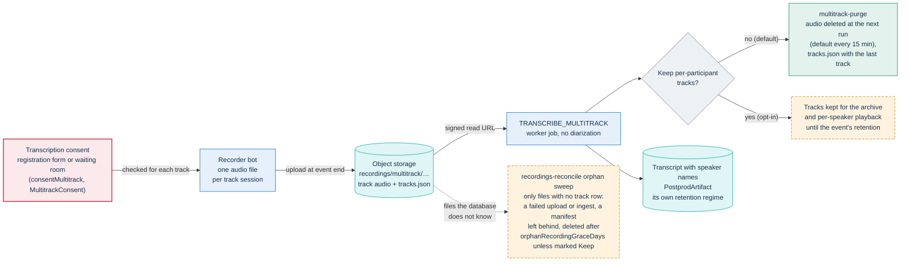
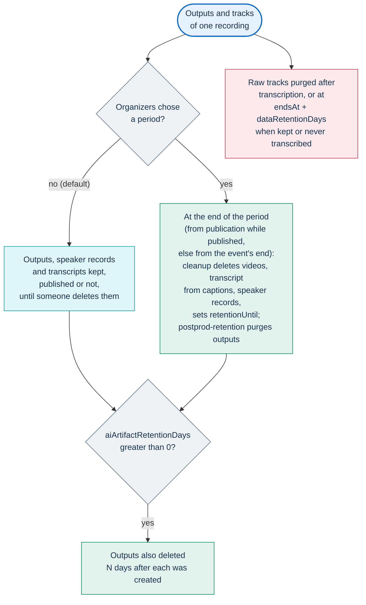
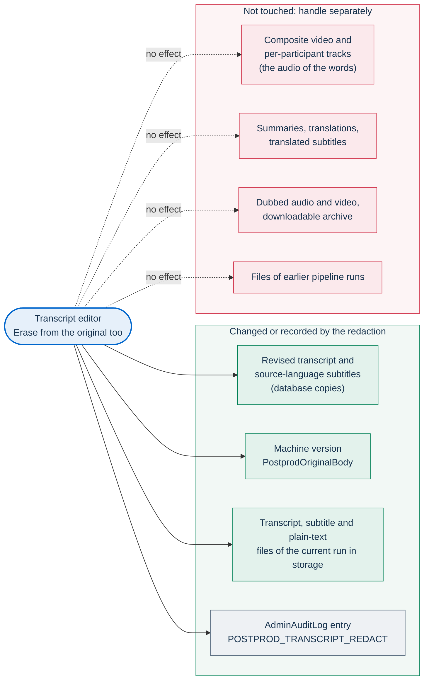

# Recordings, voice data and AI outputs

This page covers the most sensitive data PA Webinar can produce: event
recordings, the isolated voice of each participant, the texts and synthetic
audio that AI post-production derives from them, and the transcript an event
can keep from its live captions. It is written for
data protection officers (DPOs), controllers and auditors who need to know
what the platform does before they write a privacy notice or a data protection
impact assessment (DPIA).

It describes the behavior of the code. It is not legal advice: the legal
assessment belongs to the controller of each installation.

| For | See |
|---|---|
| The full personal-data inventory, event retention, the cleanup job, data-subject rights | [Privacy and data protection](../GDPR.md) |
| How the two capture paths work | [Recording](../architecture/recording.md) |
| The AI pipeline: jobs, models, operation | [AI post-production](../POSTPROD.md) |
| Live captions and how the transcript from captions is built | [Live captions](../architecture/live-captions.md) |
| The values that turn each capture path on | [Setting up recording](../operations/recording-setup.md) |
| Object keys, providers and signed URLs | [Object storage](../configuration/storage.md) |
| Job schedules and what breaks when a job does not run | [Scheduled and background jobs](../architecture/background-jobs.md) |
| What a privacy notice has to say about all this | [Privacy notice checklist for controllers](privacy-notice-checklist.md) |
| Why the design is what it is | [ADR-013](../adr/013-multitrack-speaker-attribution.md), [ADR-016](../adr/016-in-cluster-ai-postproduction.md) |

## In short

- No audio or video is recorded unless the event asks for it. Composite video
  needs `recordingEnabled`. Per-participant audio also needs
  `aiTranscriptEnabled` and `multitrackRecordingEnabled`. AI processing also
  needs the site-wide switch `aiPipelineEnabled`. The speaking timeline (who
  spoke when, with display names) is collected in every live room that a
  moderator attends.
- Per-participant audio is recorded only for the people who consented to the
  transcription of what they say. The consent is separate from the recording
  consent, optional, and asked of everyone, moderators and speakers included;
  refusing it does not keep anyone out. For moderators and speakers, in an
  event that records the video, it counts only together with their recording
  consent, which they are also asked for, optionally. The recorder asks the portal before
  recording each voice and skips the others.
- Each event that records declares where the video goes, reserved or public,
  and the consent box says so. A reserved video cannot be shown to everyone
  ([Recording destination](#recording-destination)).
- The registration form and the waiting room show a privacy sheet, computed
  from the event, with what is recorded, transcribed and published
  ([The privacy sheet](privacy-notice-checklist.md#the-privacy-sheet)).
- An event can keep a transcript built from its live captions, without a
  recording and without AI post-production. The same consent decides whose
  sentences it keeps, with their name; of everyone else it keeps only when a
  voice spoke.
- A video without per-person tracks holds the voices of everyone in it, so the
  pipeline does not transcribe it on its own: staff start it after confirming
  that everyone who speaks has consented.
- No language model reads the text of the chat, and the chat is never published.
  Q&A questions reach a model only where the event page publishes them, without
  names.
- The platform stores no voiceprint, speaker embedding or voice model, and
  never compares voices across recordings.
- By default, a participant's isolated audio is deleted soon after it has been
  transcribed. It stays longer when the event is set to keep it (**Keep
  per-participant tracks**), or when transcription never completes. It then
  goes at the event's retention, provided the purge job runs.
- The event page labels transcripts, summaries and dubbed audio as
  machine-generated. Subtitles in the player and downloaded files carry no
  marker. The models used for a recording appear on the event page only when
  the pipeline produced a summary.
- Dubbing uses catalog synthetic voices, never a participant's voice, assigned
  by speaking time. Nothing is inferred about the speaker from their name.
- Every model runs inside the installation; no recording or transcript is sent
  to an external AI service.
- The recording (the composite video, the AI outputs and the transcript from
  captions) is a record of the event and does not follow the event's data
  retention: published or not, it stays until someone deletes it, or until the
  period its organizers chose ends (`recordingDeleteAfterDays`, counted from
  publication while the video is published, otherwise from the event's end).
  The participants' data around it, per-participant tracks included, still
  goes at the event's retention.
- The content of a recording (video, voices, transcripts, summaries, report,
  translations, subtitles, dubbing) is for the organizers of the event and its
  participants. An administrator who does not organize the event sees only that
  it exists, its status and its processing jobs; the instance key never sees
  content. Staff reads are written to the GDPR log
  ([Who can see recording content](#who-can-see-recording-content)).
- A person can ask not to appear in a recording, from **My data** or through
  the controller. An administrator covers and mutes the intervals in which
  the person appears or speaks, the person's tracks go, and post-production
  runs again ([Removing a person from a recording](#removing-a-person-from-a-recording)).
- Several gaps need operator attention: see [Known limitations](#known-limitations).

## What is captured and when

| Capture | Turned on by | Consent collected | What it contains | Where it is stored |
|---|---|---|---|---|
| Composite video (Jibri) | **Enable video recording** (`recordingEnabled`). A moderator starts it, or it starts on its own with `autoStartRecording` | `consentRecording` at registration, with the destination and the version of the text read; in the waiting room, a checkbox for whoever has no consent that covers the event, stored as proof (`RecordingConsent`), never a condition of entering; for moderators and speakers too, stored with their grant or staff account | One MP4 file with the conference video and the mixed audio of everyone who consented: Jibri's session does not see the others | `recordings/` in the recordings storage domain |
| Per-participant audio (recorder bot) | **Per-participant recording (high accuracy)** (`multitrackRecordingEnabled`). The toggle appears only with recording and **Automatic transcription** on. The bot starts when the event goes `LIVE` | The optional transcription consent: `consentMultitrack` at registration, or a checkbox in the waiting room stored for the conference seat (`MultitrackConsent`). The bot records only the tracks of people who gave it | One audio file per consenting participant and per track session, plus a manifest that names the participant of each file | `recordings/multitrack/<eventId>/<recordingId>/` in the recordings storage domain |
| Live caption sentences | **Transcript from captions** (`captionsTranscriptEnabled`), with live captions running for the event | The same transcription consent | For people who consented: the text of each final caption sentence and the speaker's name. For everyone else: the times of their sentences only | `caption_segments` in PostgreSQL, text and name encrypted |
| Who is in the room | Every event of an installation where live captions are available and on for the instance, whatever the event's own captions switch, and every event with per-participant recording, while Prosody loads `mod_pa_occupants` (the chart and Docker Compose load it); otherwise nothing | No dedicated consent | The bridge endpoint and the conference seat of each occupant who joined with a token, with join and leave times. No name | `room_occupants` in PostgreSQL |
| Speaking timeline | Always, in every live room that a moderator attends, recorded or not | No dedicated consent | Who was the dominant speaker and when: the Jitsi endpoint ID and the display name | `CallSession.dominantSpeakerLog` in PostgreSQL |

AI outputs are produced after the event from the composite video or from the
per-participant tracks. That happens when the event has **Automatic
transcription** (`aiTranscriptEnabled`) and the site-wide AI switch is on; a
composite video also waits for staff to confirm that everyone who speaks in it
has consented ([The full room recording](#the-full-room-recording)). The
transcript from captions is built from the stored sentences, without the AI
pipeline ([Transcript from live captions](#transcript-from-live-captions)).

### Composite video

Jibri records the conference as seen by a participant: the video layout and
one mixed audio track, without the voice and image of people who have no valid
recording consent ([Consent model](../GDPR.md#consent-model)). Its retention (the temporary catch-up copy,
and the recording's own period, `recordingDeleteAfterDays`) is described in
[Recording retention](../GDPR.md#recording-retention). When post-production transcribes a
composite video, it separates the voices with diarization. See
[No voiceprints](#no-voiceprints).

### Recording destination

`Event.recordingDestination` is what a person consents to when ticking the
recording box. The rules are in `app/src/lib/recording/destination.ts`.

| Destination | Who can see the video | Box |
|---|---|---|
| Reserved (`REGISTRANTS`) | The organizers of the event, and registrants for as long as their registration exists. It is not public and not in the video library | `gdpr.consent.recordingReserved` |
| Public (`PUBLIC`) | Anyone, once staff publish it | `gdpr.consent.recordingPublic` |
| Not declared (null) | What staff decide after the event, with a warning when they publish. Only events that recorded before the choice existed, events that received a file after their room opened, instant calls, and imported archives, which publish with no warning | `gdpr.consent.recording` |

- **Starting value.** Staff choose it, or the event's format and template
  propose it. On an invitation-only event a proposed public destination goes back
  to reserved; a public one that staff chose stays, and the wizard says so. An
  event or a copy that starts recording with no choice starts reserved, and so
  does an event that starts recording through an edit, or through an uploaded
  file while its room has never opened. Instant calls and imported archives stay
  without a destination, with their copies, and so does an event that receives a
  file after its room has opened. A moderator link cannot choose the destination
  or attach a new video.
- **Changes.** A declared destination cannot be removed. Until the room first
  opens staff can change it either way; afterwards it can only become reserved,
  because the people in the video read that text.
- **What a consent covers.** A consent is stored with the destination of the
  text read and its version. A consent to a public video also covers a reserved
  one, not the other way round, and a consent to a text without a destination
  does not cover an event with one. Whoever is not covered is asked again in the
  waiting room, and stays out of the video without a new consent. A page left
  open while the destination changes is told so: the registration form asks to
  read the text again, and the waiting room shows the current text.
- **The guard.** On a reserved event the API refuses with `409`
  (`RECORDING_DESTINATION_NOT_COVERED`) a recording shown to everyone, a video or
  transcript published for everyone, a new external video or catch-up address,
  and, where recordings storage is configured, a new video address outside it.
  It looks at the event, never at single proofs: everyone in the video
  holds a consent that covers the event. Narrowing is never refused.
- **Access by registrants.** They prove the registration with the personal link
  of the recording notice, or with the event's access cookie, and the
  registration must still exist: after the event's retention or an erasure the
  video stays with staff. On an event with a declared destination a video for
  registrants does not depend on `postEventPublic`, so the event page can stay
  private; `postEventPublicUntil` still applies.
- **Reserved by audience.** Staff can limit a video to registrants
  (`recordingAudience`) also where the destination is public or not declared.
  Registrants then reach it as above, and the next point applies.
- **Questions and catch-up.** A recording reserved by its destination or by its
  audience publishes no Q&A questions, neither the summary nor the report reads
  them, whatever the post-event settings say, and the room offers no temporary
  catch-up copy (`registrazioneRiservata`). The rule looks only at those two
  fields, so it also holds for a reserved event that no longer records.
- **Public reads.** The event lists and the public event API give the address of
  the video only when it is published for everyone and inside the post-event
  window, whatever the event's status. An event without a visible page answers
  `404`.
- **No room video.** On an installation without Jibri the box says that the room
  video is not recorded (`gdpr.consent.recordingNoVideo`) and the sheet names no
  destination. Without per-person tracks either, nothing is recorded and no
  recording consent is asked. An event that records still starts reserved, so an
  uploaded file stays reserved. A consent to that text states no destination: if
  the installation later adds a room video, the person is asked again.

### Per-participant audio

The recorder bot joins the conference on a hidden domain, so it normally does
not appear in the participant list
([details](../architecture/recording.md#the-invisible-bot-hidden-prosody-domain)).
Before it records a remote audio track, the bot asks the portal whether the
person behind it consented (`GET /api/internal/recorder/consent`,
`infra/recorder/src/consent.ts`). The bot knows only the track's bridge
endpoint; the portal finds the conference seat behind it, which Prosody
reported when the person joined (`mod_pa_occupants`), and the consent of that
seat. Without consent the track is not recorded, and the same happens when the
portal does not answer or does not know the endpoint: the check fails closed.
Because Prosody can report a join a moment after the track arrives, a refusal
is asked again twice, after a few seconds, before the track is skipped.
Moderators and speakers are checked like everyone else. Where the event
transcribes, from captions, from the video or from the tracks with the AI
pipeline, the recorder accepts only a consent to the current text; elsewhere a
consent to any version covers the audio track
(`app/src/lib/ai/voice-consent.ts`). When the portal still does not know the
endpoint after the retries, the bot logs a warning that names
`mod_pa_occupants`. Without that module, as with an external Jitsi that does
not load it, the bot records no track at all, and the chart refuses to render
`recorder.enabled` when `XMPP_MUC_MODULES` does not load it.

The recorder starts a new file for each track session. A participant who
rejoins, or whose audio track is removed and added again, produces another
file. Each file is labeled with the display name that person used in the
conference. That name is stored encrypted in the database
(`RecordingTrack.displayName`). The recorder also writes a manifest,
`tracks.json`, next to the audio files, and it holds the same names in plain
text.

A per-participant capture has its own signal in the room: a written notice and a
sound when it starts or stops, for everyone in the room, and a fixed mark in the
top bar while it runs (`app/src/components/live/capture-notice.tsx`). The consent
box described below tells people about it before they enter.

### Speaking timeline

The browser of every moderator in a live room reports Jitsi's dominant-speaker
changes to the portal, whether or not the event is recorded. Other participants'
browsers do not report them. The log stores the display names in plain text.

The public transcript endpoint uses the log at read time to put names on the
anonymous voice clusters of a composite recording, so a public transcript can
show names nobody entered by hand. In a recording where each person was asked for the
transcription consent, a cluster gets a name only when the participant behind
it, traced from the bridge endpoint to the conference seat (`RoomOccupant`),
has given that consent (with the text version that applies to the recording);
otherwise it keeps a numbered label and never takes another participant's
name. The consent counts as asked for every new recording: the mark
`Recording.transcriptConsentRule` is false only on rows that predate the rule on
the video, and a recurring event can hold both kinds. For those older rows it
counts as asked when the event records per-participant tracks or keeps a
transcript from captions that actually runs (captions on and the service
installed), or when the room left traces of it: caption rows, consent proofs
from the waiting room, or per-participant tracks. Answers given at registration
alone do not count, because the switch may have been turned off before the
event. With the mark, or when caption rows exist, the text version that includes
the name applies. A switch turned off after the event therefore does not bring
back the names of people who said no (`app/src/lib/ai/voice-consent.ts`). The
endpoint keeps the answer for a few minutes per recording, so a change of
consent shows on the public page within that delay. With this check, a
cluster whose main speaker has no name in the log stays unnamed too, instead
of taking the name of the second speaker. The post-production worker never reads the speaking log,
and the names it yields are not stored anywhere. When the cleanup job empties
the log at the event's data retention, a published transcript shows numbered
labels again for the clusters nobody named.

### What participants are told

At registration and in the waiting room, the
[privacy sheet](privacy-notice-checklist.md#the-privacy-sheet) says what the event
records, transcribes and publishes. Then the boxes ask.

At registration, an event with per-participant recording, with a transcript
from captions or whose video the AI pipeline transcribes, adds a separate,
optional checkbox (`gdpr.consent.multitrack`, or `gdpr.consent.multitrackRetained`
where tracks are kept), with a note that taking part does
not depend on it (`gdpr.consent.multitrackOptional`, or
`gdpr.consent.multitrackOptionalShort` where a person's voice stays out of the
video without the recording consent). The registration API accepts a request
without it and stores the answer. The waiting room shows the same text and
note under **Transcript of what you say**; entry does not wait for it. The
exact texts and their keys are listed in
[Privacy and data protection](../GDPR.md#consent-texts-shown-to-users). The
sentence that matters most on this page is the promise the text makes:

> If the event records a separate audio track for each person, my voice is
> recorded for this purpose only and the track is deleted after transcription;
> it is not used to identify or reproduce my voice.

Where tracks are kept, the text says so instead
([The consent text and retained tracks](#the-consent-text-and-retained-tracks)).

Registrants who consented at registration and open the room in the browser
they registered with are not asked again. Everyone else is asked in the
waiting room: moderators, speakers (named `SPEAKER` grants), guests, and
registrants who open their personal link in another browser or on another
device ([who is asked](../GDPR.md#in-the-room),
[the box](../architecture/waiting-room.md#consent-and-transparency-notices)).
A tick given in the waiting room is stored as proof for the conference seat
(`MultitrackConsent`) when the conference token is issued, and that proof is
what the recorder and the transcript from captions check. Each consent is
stored with the version of the text it was given to
(`Registration.consentMultitrackVersion`, `MultitrackConsent.textVersion`).
Wherever the event transcribes, from captions, from the video or from the tracks
with the AI pipeline, only the current version counts, which names the
transcription with one's name; a registrant who consented to the earlier text,
which covered only the audio track, is asked again in the waiting room of such
an event. Without the AI pipeline the tracks are not transcribed, and the earlier
text is enough. A new tick adds a proof for the current text; the earlier proof
stays as it was, as the record of the consent to the audio track.

With the site-wide AI switch on, the sheet's **Artificial intelligence** row says
which outputs the event produces, with the site setting **AI notice in the
waiting room** (`aiConsentDisclosure`) in place of the sentences on summary,
translation and dubbing for the page's language. It has no checkbox. Instant
calls have no sheet: they show the same setting, or the built-in
`waiting.aiNotice`, as a notice under **AI processing after the event**.

These texts give the purpose and exclude biometric use. They do not cover
encryption, the legal basis or rights: the event's privacy notice
(`privacyPolicyUrl` or `privacyPolicyText`) has to say those. The event's
`recordingConsentText`, where set, goes with the recording box at registration,
in the waiting room and in the room, **Consents** dialog included
([Custom recording consent text](privacy-notice-checklist.md#custom-recording-consent-text),
[Recording: consent gates](../architecture/recording.md#consent-gates)).

## Who can see recording content

The content of a recording is what it shows or says and what is derived from
it: the composite video, the per-participant tracks and the archive, the
waveform, the transcripts (AI and from captions), the summaries, the event
report, the translations, the subtitles and the dubbed audio. The rule is in
`app/src/lib/recording/content-access.ts` for staff and in
`app/src/lib/recording/audience.ts` for everyone else
([ADR-021](../adr/021-recording-content-access.md)).

| Who | Content |
|---|---|
| The organizers of the event (the staff account that created it, and every staff account with a valid organizer grant on it, administrators included) | Everything, before and after publication: reading it, correcting it, producing more of it and publishing it |
| An administrator who does not organize the event | None. They see that the recording exists, its status, duration, size and files, the processing jobs and their errors, the quality figures of the transcript and the languages produced, and can cancel queued jobs |
| The instance API key | None |
| Registrants | A recording reserved for registrants, while their registration exists |
| Whoever was in an instant call while it was recorded | The recording of that call, from the call's link, until the call's data retention ends; the recording stays for the organizers |
| Anyone | A recording published for everyone |

- **Instant calls.** When the recording starts, the room of each person present
  asks the portal for a presence pass, proving its seat with the room tokens of
  that visit. The portal checks that the recording is running and that a token
  of the call came from the portal, then sets an `HttpOnly` cookie
  (`rec_pass_<eventId>`) that expires when the call's data retention ends.
  Consent does not matter: someone who stayed out of the video was still in
  the call. Nothing is emailed and there is no link to forward.
- **Every staff read is logged.** A staff member who reads content as staff
  writes a `RECORDING_CONTENT_READ` row in the event's GDPR log, with the
  surface, the recording, the role and the account ID, and no name or address
  ([Audit trails](../GDPR.md#audit-trails)).
- **No storage addresses in browsers.** Pages, APIs and emails carry the
  portal's route for a video, which checks access again and redirects to a
  signed address valid for 120 minutes. The portal signs only files of the
  event being asked for.
- **Post-production is the organizers' work.** Correcting transcripts, naming
  speakers, editing summaries, translating, archiving and publishing need an
  organizer of the event.
- **The block is in the application.** Whoever holds the storage or database
  credentials, `PII_ENCRYPTION_KEY` or the cluster can read the files and
  decrypt the texts. The worker and the recorder keep their own access.

## Voice data

### No voiceprints

Under Article 4(14) GDPR, voice becomes biometric data only when specific
technical processing allows or confirms a person's unique identification. The
design keeps every audio path clear of that use:

- **Composite recordings.** pyannote diarization groups the voices of a
  single recording into anonymous clusters (`SPEAKER_00`, `SPEAKER_01`, …).
  The embeddings it computes stay in the worker's memory and scratch volume,
  and they are gone when the job's pod ends. The output is only a label per
  transcript segment. Names come from people, who map labels in the
  administration area, or from the speaking timeline. They never come from the
  voice.
- **Per-participant recordings.** No diarization runs. Each track already
  belongs to one participant, and the name is the display name that person
  used in the conference, not something derived from their voice.
- **Dubbing.** The speech synthesizer reads translated text. No participant
  audio goes into it. Voices are handed out by speaking time, neither from the
  speaker's name nor from their voice
  (see [Dubbing without cloning](#dubbing-without-cloning)).
- **Storage.** The `Speaker` model has no field for voice features, and no
  code compares voices across recordings or events.

The design treats voice as the input of a transcription, not as a means of
identification, so it does not treat the processing as Article 9 biometric
processing. The extra safeguards on isolated tracks exist because a
single-speaker recording is still highly sensitive. Whether this reasoning
holds for a given installation is for the controller to confirm in its DPIA.

### Tracks are intermediate

A per-participant track exists to be transcribed. After that, only the
attributed text is needed.

A person who withdraws the transcription consent from the room
([Withdrawing consent](../GDPR.md#withdrawing-consent)) is not recorded from
the reconnection on, and the tracks recorded before are no longer handed to
the transcription: the claim of a per-participant transcription or of an
archive leaves out every track whose bridge endpoint belongs to a seat with a
withdrawn consent and no consent given again
(`app/src/app/api/internal/postprod-claim/route.ts`). The next
`multitrack-purge` run deletes those track files, also when the event keeps
participant tracks, unless a job that already took them is still running.

The `multitrack-purge` job (`app/src/app/api/cron/multitrack-purge/route.ts`)
runs every 15 minutes by default (`infra/helm/pa-webinar/templates/cronjob-multitrack-purge.yaml`).
It selects the tracks whose audio is still present and whose recording meets
all three conditions:

- a `TRANSCRIBE_MULTITRACK` job has finished (`DONE`) at least once;
- no transcription re-run or archive job that reads the tracks is pending or
  running;
- the event does not keep its tracks.

For each selected track, it deletes the audio file and stamps `audioPurgedAt`.
When no track of a recording has its audio left, it also deletes the
recording's `tracks.json`, and `postprod-retention` does the same when it
purges a recording's tracks. The database row stays, with its encrypted name and timing, because the
transcript's attribution refers to it. The `cleanup` job deletes those rows
when the event's data retention expires.

The purge job never selects a track whose transcription never finishes. That
happens when the AI switch is off, when every track is silent (the recording is
then marked `POSTPROD_FAILED`) or when the job fails for good. Those tracks
wait for the event's data retention, when `multitrack-purge` or
`postprod-retention` deletes them ([Retention regimes](#retention-regimes)).

### Keeping tracks

**Keep per-participant tracks** (`retainParticipantTracks`, badge **Extends
retention**) appears in the event wizard only when per-participant recording is
on. It serves two features of the administration area:

- **Per-speaker playback:** the mixed recording plays with each participant's
  track at its offset;
- **Downloadable archive:** an on-demand `ARCHIVE` job muxes the composite
  video, one audio track per participant labeled with the name, and the
  subtitles into one MKV file.

Only the organizers of the event can use them: the staff account that created
it and those with an organizer grant on it, administrators included only when
they organize it. Each use is written to the event's GDPR log. The audio and
archive links are signed URLs that expire after 120 minutes
(`app/src/app/api/admin/postprod/recordings/[id]/tracks/route.ts`). Nothing
from this feature appears on public pages.

The purge job keeps retained tracks until the recording's own
`Recording.retentionUntil`, which the cleanup sets only when the recording's
period ends. In practice, retained tracks are deleted by `postprod-retention`
when the event's data retention expires (`endsAt` plus `dataRetentionDays`),
whether or not the video is published, or earlier when the recording's period
ends first. The wizard warns
whoever sets the option that it "extends retention of sensitive personal data
(isolated voice) until the event's retention deadline".

### The consent text and retained tracks

The consent box says what happens to the track. With **Keep per-participant
tracks** off and the AI pipeline on, the track "is deleted after transcription"
(`gdpr.consent.multitrack`). With the option on, or with the AI pipeline off,
where tracks are never transcribed and stay until the event's retention, the
track "is kept with the event data" (`gdpr.consent.multitrackRetained`). The
sheet follows the same rule. The two texts have the same purpose and the same
version, so a consent given to one stays valid under the other.

Both settings can still change after people have consented, and their consent
then does not say what happens to their track. A controller who turns the option
on, or the pipeline off, after registration has opened has to say so in the
event's privacy notice and in its own communication to participants.

### Where voice data lives and who can reach it

| Item | Where | Who can read it | Protection |
|---|---|---|---|
| Track audio | Object storage, `recordings/multitrack/<eventId>/<recordingId>/audio/` | The recorder bot writes each file through its own signed upload URL. The worker reads the files through signed URLs valid for its job lease. Staff play retained tracks | Never public. At-rest encryption is the storage provider's |
| `tracks.json` | Same prefix | Anyone allowed to list the bucket | Display names in plain text. Nothing reads it after the upload; the purge jobs delete it with the recording's last track |
| Track rows (`RecordingTrack`) | PostgreSQL | The portal | Display name encrypted |
| Downloadable archive | Object storage, `postprod/…/archive.mkv` | The organizers of the event, through a signed URL | Never public |
| Mixed audio | Inside the composite MP4 | Anyone who reaches the waiting room, guests included, through the temporary catch-up copy (24 hours), which a reserved recording does not offer; the public, once the video is published for everyone; registrants, for a reserved video | See [Privacy and data protection](../GDPR.md) |

The worker receives each participant's name in clear text through the internal
API, because it writes names into the transcript. On a recording with the mark
`transcriptConsentRule` a track reaches the transcription, with its name, only
with a consent to the current text. Without it the voice stays out of the
transcript and of what is built from it; the downloadable archive still takes
the track, under an anonymous label. Signed-URL mechanics are in
[Object storage](../configuration/storage.md).

### Operator responsibilities

- **The purge jobs.** The chart renders `multitrack-purge` when
  `postprod.enabled` or `recorder.enabled` is true, and `postprod-retention`
  only when `postprod.enabled` and `postprod.retention.enabled` (on by default
  in `infra/helm/pa-webinar/values.yaml`) are both true. `multitrack-purge`
  deletes a track once its transcription is done, and a track that no
  transcription consumes when the event's data retention expires, so an
  installation that records without AI post-production also deletes its
  tracks on time.
- **Docker Compose runs the same jobs.** The `cron` service calls
  `multitrack-purge`, `recordings-reconcile` and `postprod-retention`, which
  act once object storage is configured
  ([how](../architecture/background-jobs.md#docker-compose)).
- **The orphan sweep is the backstop for tracks.** `recordings-reconcile`
  lists every object under `recordings/` and knows the composite video
  (`Event.recordingUrl`, `CallSession.recordingUrl`,
  `CallSession.recordingFilename`) and every track whose audio is still
  present, with the `tracks.json` of its recording, while something holds it:
  the event's data retention, a later retention date of the recording itself,
  or a pipeline task that still reads it. Until then a track awaiting
  transcription, never transcribed or retained is not an orphan: the purge
  jobs delete it by the rules above. After that, a track still present has
  escaped them (`postprod-retention` not running, for example) and becomes an
  orphan. So do files with no track row (an upload whose
  ingest failed, the files of a recording whose rows were deleted) and a
  manifest whose deletion failed. The sweep deletes orphans after
  `orphanRecordingGraceDays` (default in `app/prisma/schema.prisma`; `0` turns
  the automatic deletion off) unless an administrator marks them **Keep**,
  and stamps `audioPurgedAt` on the track rows of the files it deletes.
  **Delete now** on a track deletes it at the next run, even inside the
  retention window.
- **Deleting an event or a call session deletes rows, not files.** Deleting an
  event removes its recordings, tracks, speaker records and AI outputs from
  the database by cascade, and every file stays in the bucket. Deleting a call
  session from the event's management page (the delete control next to the
  session's video, confirmed in the **Delete session** dialog) removes that
  session's recording tree the same way and deletes only the session's
  composite video file. Track files under `recordings/` later appear in
  **Orphans**; files under `postprod/` are never removed.

## Transcript from live captions

An event with **Transcript from captions** (`captionsTranscriptEnabled`, off
by default) keeps a transcript built from its live captions, with no recording
and no AI pipeline needed. How it is built is described in
[Live captions](../architecture/live-captions.md#transcript-from-captions);
this section covers what matters for privacy.

- **What is processed and what is kept.** While captions run, the voice of
  everyone who speaks is transcribed, and the captions service sends every
  final sentence to the portal. The portal keeps the text only when the
  conference seat behind the voice has the transcription consent: then the
  text and the speaker's name are stored, encrypted, with the seat
  (`CaptionSegment`). For any other voice it keeps a row with the bridge
  endpoint, the language and the times only. The seat behind each voice comes
  from Prosody's record of who is in the room (`RoomOccupant`), which holds
  endpoints and seats and no names. Only consents given to the current version
  of the text count (see [What participants are told](#what-participants-are-told)).
- **The name.** It is the name given with the consent in the waiting room, or
  else the registration's name.
- **What people are told.** The waiting room's captions notice says that the
  text is kept, with the name, only for the people who consented to the
  transcription of what they say (`waiting.captionsNoticeTranscript`), and the
  transcription box asks for the consent, at registration and in the waiting
  room (see [What participants are told](#what-participants-are-told)).
- **Voices without consent in the transcript.** The rows without text become
  marks in the transcript (`untranscribed`: start and end only, with no
  speaker and no text, nearby rows merged), and the public transcript panel
  shows them as **Not transcribed: the speaker did not consent**, so a reader
  following the transcript knows that someone spoke there. Live captions are
  shown to everyone in the room for accessibility; the consent governs what
  is kept, not what is captioned live.
- **The full room recording.** See
  [The full room recording](#the-full-room-recording).
- **The transcript.** After the event the sentences become a
  `TRANSCRIPT_JSON` artifact (model `live-captions`) on the event's recording,
  or on a recording without media created for it, with one speaker label per
  person named after them (`Speaker.displayName`, in plain text): sentences are
  grouped by registration for registrants, and by the name entered for other
  seats, so a reconnection keeps the same label. The text is encrypted in the
  database, and nothing goes to object storage. When an AI transcript later
  replaces it on the same recording, its speaker labels and names are deleted
  before the AI's are written, and the event's recordings without media that
  held a transcript from captions not corrected by hand are deleted. While
  the AI pipeline is transcribing a recording of the event, no transcript from
  captions is built.
- **Publication.** Staff decide it: **Publish the transcript on the event
  page** (`transcriptPublished`) or publishing the video, while the post-event
  page is public. With only the transcript published, the public sees the
  transcript text in its source language and nothing else. The public panel
  says that the text comes from the live event's automatic captions and
  includes only the people who consented, and shows speaker names.
- **Retention.** The occupant rows and the sentences are deleted by the GDPR
  cleanup at the event's retention, on every installation, Docker Compose
  included. The transcript built from them is part of the recording and stays,
  published or not, until someone deletes it or the recording's period ends:
  then the cleanup deletes it, a recording that holds only the transcript
  whole, with its job, artifact, machine version and speaker labels, and from
  a recording with video the transcript and the speaker labels
  ([Retention regimes](#retention-regimes)). After the event's retention it is
  not rebuilt, because its sentences are gone.
- **Rights.** The self-service export includes the person's stored sentences,
  and erasure deletes them, with the room records, for the conference seats of
  the registration. Erasure also removes the person's sentences, name and
  speaker entry from the transcript already built, in its published text and
  in the original text kept at the first correction: the transcript keeps, in
  its encrypted body, the registration behind each registrant speaker for this
  purpose. Lines that staff moved by hand to another speaker stay with that
  speaker, and a transcript left empty is deleted. Withdrawing the consent does
  the same, also from a proof kept after the registration is gone. The words of
  a guest, who has no registration, are removed with the editor's erasure mode
  ([Erasing a passage](#erasing-a-passage)).

## AI outputs

### What the pipeline produces

From a composite video or a set of tracks, the pipeline produces a transcript
(structured JSON, source-language subtitles, plain text), a waveform for the
editor, and, when the event asks for them, a summary (Markdown and a
structured version), translations with translated subtitles, and dubbed audio.
It can also build the downloadable archive described above. The jobs, models
and storage layout are in [AI post-production](../POSTPROD.md).

The transcript carries names: the display names of per-participant tracks with
the right consent, or the names mapped to diarization labels. The language model
that writes the summary and the translations reads that transcript. For the
summary it also receives the event's agenda and a timeline of the room, built
from the
[live action journal](../architecture/live-interaction.md#live-action-journal)
and the room's tables: agenda topics, poll questions and results, word-cloud
prompts with their most frequent words, the titles of shared materials, and the
number of chat messages, reaction-bar reactions and raised hands in each
five-minute window. The texts of Q&A questions and of written answers enter only
where the event page publishes them. The text of the chat never enters, not even
questions marked in the chat. The timeline names no author
([Room timeline](../POSTPROD.md#room-timeline)). The summary can end up on the
event page, so what the model reads can come out reworded. All of this happens
inside the installation.

### The full room recording

The composite video contains the voice of everyone who consented to the
recording, including people who said no to the transcription. The AI pipeline
therefore does not transcribe it on its own: for every new recording, and for an
older one of an event where this consent was asked
([Speaking timeline](#speaking-timeline)), the recording webhook enqueues
nothing, and the event's transcript stays the one from captions or from the
per-participant tracks, if any. The same holds when only the hosts speak: the
video does not say who spoke.

Staff can start the transcription from the administration area, after confirming
that everyone who speaks in it has consented. The **After the event** tab lists
it as still to start. The confirmation is written to the admin audit log
(`allVoicesConsented`), and a request without it gets a `409`. A recording with
per-participant tracks needs no confirmation, because the tracks hold only the
voices of people who consented.

### Marking machine-generated content

How the pipeline marks its outputs (the `isSynthetic` column, the
**AI-generated content** badge and disclaimer, the dubbing banner, the
watermark and the waiting-room notice) is described in
[AI post-production](../POSTPROD.md#transparency-ai-act-article-50). The gaps
that matter for a privacy notice:

- the `.srt` download and the dubbed audio carry the AI marker only in the
  HTTP response header, because the formats have no place for it (the audio
  also carries its watermark); subtitles served from storage instead of the
  database copy, which happens only above the 8 MiB inline limit, carry none;
- the public transparency panel appears only on events with a summary (see
  [Processing transparency](#processing-transparency));
- the panel names a fixed language-model vendor and license, constants in
  `app/src/lib/ai/pipeline-snapshot.ts` that match only the default model;
- the dubbing watermark is best effort (see
  [Dubbing without cloning](#dubbing-without-cloning)).

### Processing transparency

When the last job of a run finishes successfully, the portal saves a
`Recording.pipelineSnapshot` built from the outputs actually produced
(`app/src/lib/ai/pipeline-snapshot.ts`). If the last job to finish fails, no
snapshot is written for that run, and a snapshot from an earlier run, if any,
stays in place. The snapshot names the engines and models, the languages, the
time processing completed and the pipeline version, and it lists the speakers
with their display names and speaking time. The full description is in
[AI post-production](../POSTPROD.md#transparency-ai-act-article-50).

Three points matter for privacy:

- **It is a record of the run.** Later edits, such as renaming or rectifying
  a speaker, do not change the names it holds, and no purge clears it.
- **It is public with the outputs.** The public transcript endpoint returns
  it, speaker names included, whenever the outputs are public.
- **The panel needs a summary.** The event page shows it under **AI processing
  transparency**, inside the summary card above the video. That card appears
  only when the pipeline produced a structured summary, so an event without
  **Summary and chapters**, or whose summary failed, publishes no transparency
  panel. The administration area always shows it.

This is the platform's answer to the transparency obligations of Article 50 of
the AI Act. Whether it is sufficient for a given use is for the deployer to
assess.

### Dubbing without cloning

**Audio dubbing** (`aiDubbingEnabled`) needs translation to be on. The worker
reads the translated subtitles and speaks them with Piper voices from a
catalog that ships inside the worker image. Voice cloning is not implemented.

Voices are assigned in order of speaking time, with no link to the speaker's
own voice and without reading their name, so a dubbed voice says nothing about
the person. The site settings describe the assignment under **Editorial line
on voice**.

The worker then embeds an inaudible AudioSeal watermark in the dubbed audio
and records `watermarkType` on the output. Watermarking is best effort. If the
AudioSeal model is missing from the model cache or the step fails, the audio
is published without a watermark and `watermarkType` stays empty. Setting
`AI_WATERMARK=0` on the worker turns watermarking off.

### Data sovereignty

The allowed engines are a closed list in `app/src/lib/ai/providers.ts`, and
all of them run inside the installation's cluster. No recording, track or
transcript leaves the installation except to its object storage. Missing model
weights can still be fetched from the internet (weights only, never data);
seed them as described in
[AI post-production](../POSTPROD.md#data-sovereignty), which also explains
where the rule is enforced. See
[ADR-016](../adr/016-in-cluster-ai-postproduction.md).

### Who can see AI outputs

- **The public** can reach the transcript, subtitles, summaries, dubbed audio,
  the downloads (`.txt`, `.srt`, `.vtt`, `.md`) and the pipeline snapshot only
  when all four conditions hold (`app/src/lib/ai/access.ts`):
  - the AI switch is on;
  - the event's video is published (`recordingPublished`);
  - the post-event page is public (`postEventPublic`);
  - `postEventPublicUntil`, when set, is still in the future.

  That holds with the event's audience set to everyone. With a reserved
  recording the public gets none of this: the same content goes to people who
  prove a registration that still exists, without the need for
  `postEventPublic` on an event with a declared destination
  ([Recording destination](#recording-destination)).

  With only the transcript published (`transcriptPublished`), or with the AI
  switch off and a transcript from captions kept, the public reaches the
  transcript text in its source language and its `.txt` and `.srt` downloads,
  and nothing else; with the AI switch off, only a transcript built from
  captions is served, never an AI transcript. Otherwise every public AI
  endpoint answers `404`. Public transcripts show
  speaker names. In the transcript panel, an unnamed cluster gets a name from
  the speaking timeline while the log exists, or else a numbered label
  (**Participant N**, in the page language). In the downloads
  and subtitles, an unnamed cluster keeps its raw label (`SPEAKER_00`).
- **The organizers of the event** (the staff account that created it and those
  with an organizer grant on it, whatever their role) see everything in the
  administration area. That includes raw diarization labels, retained tracks
  and the archive. An administrator who does not organize the event sees the
  status of the recording and of its jobs, not the outputs
  ([Who can see recording content](#who-can-see-recording-content)).
- **During a removal request**, a named administrator account opens the
  recording of the request from the removal editor, for as long as the request
  is open, and each opening is logged
  ([Removing a person from a recording](#removing-a-person-from-a-recording)).

### The event report

Staff can request an AI report of the event from the **After the event** tab
once the event has ended, within its data retention and with the site-wide AI
switch on ([AI post-production](../POSTPROD.md#the-event-report)).

- **What the model reads.** Inside the installation, when the job is claimed:
  the event's description and its public organizations and people; the
  transcript the public page would show, with its speaker names; published
  polls; word-cloud words; the post-event questionnaire's averages and open
  comments without authors, and the older star ratings; the agenda's agree and
  disagree counts; the platform's figures. The Q&A questions and answers, without
  authors, enter only where the event page publishes them. Of the chat it gets
  only the number of messages: the report can come out on the event page, and
  what the model reads can come out reworded.
- **What is stored.** On the event (`Event.postEventReport`): the figures the
  platform computed (counts, averages, distributions, the texts of published
  polls, of the most voted questions and of the most frequent words) and the
  model's text in each requested language. The text of the questions stays with
  staff: the public page does not receive it. The model is instructed to state
  only facts from the inputs, to name only the event's listed people and
  named speakers, to attribute no comment to anyone and to avoid personal data;
  its feedback section rewords the comments in its own words, without authors.
  The portal removes email addresses and phone numbers from the model's text
  before storing it.
- **Review and publication.** A new or regenerated report is not public.
  Staff review it in a preview and publish it on the event page; the page
  says that the text is written by an AI model from the event's material and
  reviewed by staff, and that the figures come from the platform.
- **Retention.** The report is not an output of a recording, so neither the
  recording's period nor the post-production purges touch it. Like the event recap, it stays with
  the event after the event's retention, and goes only when the event is
  deleted. Self-service erasure does not reach it: staff withdraw it from the
  page or regenerate it when a request concerns it.

## Retention regimes

Three kinds of data follow different clocks:

- **Raw track audio:** deleted after transcription, or at the event's
  retention when kept or never transcribed, published or not.
- **The recording:** the composite video of every session, the AI outputs
  (artifacts, their machine versions, speaker records, job payloads) and the
  transcript from captions. It is a record of the event and does not follow
  the event's data retention: published or not, it stays until someone deletes
  it or until the period its organizers chose ends. The rule, the choices and
  who sets them are in [Recording retention](../GDPR.md#recording-retention).
- **The participants' data around it** (registrations, consents given in the
  room, caption sentences, the record of who was in the room, the speaking
  timeline) follows the event's retention.

Three jobs enforce them. `multitrack-purge` is described above. The GDPR
cleanup (`app/src/app/api/cron/cleanup/route.ts`) deletes, at the end of the
recording's period, the video files and what lives only in the database (the
transcript from captions, the speaker records), fails the open jobs and sets
`Recording.retentionUntil`. `postprod-retention`
(`app/src/app/api/cron/postprod-retention/route.ts`) then deletes the stored
outputs; it runs daily by default (`postprod.retention.schedule` in
`infra/helm/pa-webinar/values.yaml`).

Tracks that are not retained are deleted after transcription on every branch;
the diagram shows when the remaining ones go. The site-wide limit
(`aiArtifactRetentionDays`), when set, deletes old outputs on every branch,
a published transcript included.

### The recording's period

With no period (**No automatic deletion**, the default) the outputs stay with
the recording, published or not, after the event's retention and after the
video is deleted by hand: **Delete recording** removes the event's video file
only. Their speaker records and job payloads stay with them.

With a period (`Event.recordingDeleteAfterDays`), the recording goes when it
ends: counted from publication while the video is published, and from the
event's end otherwise. The cleanup's phase 2 deletes the video files of the
event and of every session, unpublishes the video and the transcript, deletes
the transcript from captions and the speaker records, fails the open
post-production jobs, writes `RECORDING_DELETED` and sets
`Recording.retentionUntil` to that moment; the next `postprod-retention` run
purges the rest. The consent proofs of the recording leave at the next cleanup
run that finds nothing left to cover them. A recording listed in the video
library is treated like any other.

### Site-wide limit: `aiArtifactRetentionDays`

**Artifact retention (days)** in the post-production site settings defaults to
`0`, which means no limit (`app/prisma/schema.prisma`). With a value N greater
than zero, the job deletes every artifact created more than N days ago,
published or not, whatever the recording's period. It deletes the artifact's
file, its row and, through the foreign key, its machine version.

This pass deletes artifacts only. Speaker records and job payloads wait for
the recording-level purge, so they stay as long as the recording. Tracks
follow their own rules, described above. The value can therefore shorten
retention but never extend it, and the field's help text says so.

### Per-recording date: `Recording.retentionUntil`

Both jobs honor this date, and the administration area displays it. The
cleanup writes it when the recording's period ends; it can also be written
directly in the database, to purge one recording's outputs on a given date,
and the cleanup keeps an earlier date it finds. On that date the recording's
outputs are purged whatever the event's retention or the video's publication.
For retained tracks, the purge job waits for this date. The site-wide limit
still applies to the recording's artifacts.

### What a purge deletes and what it leaves

A recording-level purge (`retentionUntil`) deletes:

- the output files and their rows, with their machine versions;
- the `Speaker` records: names, and links to address-book persons;
- the track files and rows;
- the job payloads, replaced by `{ "scrubbed": true }`, and the last error
  messages.

It then marks the recording `ARCHIVED`. Only these recording-level purges
delete job payloads; the site-wide limit does not.

A purge leaves:

- the `Recording` row, including `pipelineSnapshot`, with the speaker
  names emptied;
- the admin audit log entries `POSTPROD_SPEAKER_MAP`, which hold each name
  given to a speaker label until the GDPR cleanup empties their detail
  (`AUDIT_LOG_PERSONAL_DATA_RETENTION_DAYS`, default 90 days);
- the `PostprodJob` rows, with kind, status and timing;
- files from earlier pipeline runs;
- `tracks.json`;
- the composite video, which the cleanup job handles.

`postprod-retention` writes nothing to the GDPR audit log: the counts appear
only in its own response and log; the end of the recording's period is
recorded by the cleanup (`RECORDING_DELETED`). Both jobs work in bounded
batches, so a large backlog drains over several runs. They postpone a
recording while a job still reads its tracks, and they do nothing when
recording storage is not configured.

## Editing and erasure

### Machine version and revised version

Staff correct transcripts in the transcript editor. At the first correction,
the platform copies the transcript as the machine produced it into
`PostprodOriginalBody`. It copies the encrypted body as is, together with the
model that produced it. From then on both versions exist, and **Show original
text** displays the machine's line under each corrected one. For a public body's
minutes, the two must stay distinguishable. Only the first correction is
copied; later ones do not create a history.

If the admin audit log already holds corrections for the recording when the
copy is taken, the copy is flagged **Origin not certain**
(`certainMachineOrigin`), because it cannot be proven to be machine text. A
machine version is deleted with its artifact. When the pipeline runs again,
the new output is machine text again and the old machine version is
discarded. The summary editor keeps no machine version: it overwrites the
summary.

An ordinary correction changes the database copies of the transcript and its
source-language subtitles. Outputs generated afterwards start from the
corrected text: before handing a corrected transcript to a summary or
translation job, the platform writes it to object storage, and before an
archive job it does the same with the source-language subtitles
(`app/src/lib/ai/transcript-input.ts`). Dubbing follows its translation.
Outputs already produced are not regenerated.

### Erasing a passage

An ordinary correction must not touch the machine version, or the two
versions would no longer be comparable. To remove a person's words for good,
the editor has a separate mode: **Erase from the original too**, saved with
**Save and erase from the original**. It applies the same line changes to the
machine version of the transcript and of its source-language subtitles. It
rewrites the plain-text transcript, and the stored transcript, subtitle and
plain-text files of the current run, with the revised version (every time, so
repeating an erasure after a failed write rewrites the files again), and
writes a `POSTPROD_TRANSCRIPT_REDACT` entry to the admin audit log instead of
`POSTPROD_TRANSCRIPT_EDIT`. Only lines whose text changed are rewritten in the
machine version. If rewriting the stored files fails, the editor says so and
the removal can be repeated.

Erasure works on text. The spoken words stay in the recording itself: in the
composite video, which is public once published, and in the per-participant
tracks while they exist. Removing them is a removal from the recording
([Removing a person from a recording](#removing-a-person-from-a-recording)),
or unpublishing the video.

Public pages and downloads read the database copies, so the redacted source
transcript is what visitors see from then on. The outputs derived from it are
not regenerated:

- **Summaries, translated ones included:** can be edited by hand in the
  summary editor, per language. That changes the database copy only; the
  stored file keeps the old text.
- **Translated subtitles:** have no editor. Running the pipeline again starts
  over from the audio and would put the passage back.
- **Dubbed audio and video, and an archive already built:** keep the passage
  until they are purged.

### Removing a person from a recording

A person who appears in a recording can ask not to appear in it. A registrant
asks from **My data**; anyone else asks the controller, and an administrator
registers the request. The request, its statuses and its audit are described
in [Privacy and data protection](../GDPR.md#removal-from-a-recording); the job
in [AI post-production](../POSTPROD.md#removal-from-a-recording).

The administrator opens the recording of the request in the removal editor,
by exception: only with a named administrator account, only that recording,
only while the request is open, and every opening is written to the admin
audit log. The editor proposes where the person appears and speaks, from the
record of who was in the room with the voice in the video, the caption
sentences, the speaking timeline and the per-participant tracks, all
anchored to the recording's time zero; the administrator corrects the
intervals while watching the video and previews the result.

| Data | What the removal does |
|---|---|
| Composite video | Each interval becomes a full-frame card, **Content removed on request**, with the audio muted; the duration does not change. The redacted file replaces the original as the recording's source and, when it was the same file, as the event's published video. The original file is deleted |
| Per-participant tracks of the person | Deleted whole, files and rows, with the recording's `tracks.json` |
| Caption sentences of the person | Deleted for the whole event; the person leaves the transcript built from captions |
| Speaking timeline | Kept until the event's retention, without the person's name |
| Transcript, subtitles, summaries, translations, dubbing, waveform, archive | Deleted, with the files of every earlier run; when the recording had an AI transcript and the pipeline is on, a new run produces them again from the redacted video or from the remaining tracks |
| Speaker labels of an AI transcript | Deleted with it; the new run creates its own |
| Copies outside the platform (a video on another site, downloads, a different published file) | Not reached: the editor reminds the administrator |

A new run from the composite video does not ask again for the confirmation
that every voice consented: the redacted video holds fewer voices than the
one it was given for. A recording transcribed from per-participant tracks runs
again from the remaining tracks only, never from the composite video.

### Data-subject requests

The self-service privacy pages (`/en/privacy/my-data`,
`/it/privacy/i-miei-dati`; see
[Privacy and data protection](../GDPR.md#self-service-access-and-erasure)) do
not reach recordings or AI outputs, with two exceptions, the transcript from
captions and the request not to appear in a recording:

- the export lists registrations and their consent flags, including
  `consentMultitrack`, the consent proofs kept for an existing recording, and the
  person's sentences stored for a transcript from captions, but no built
  transcripts, speaker records or tracks;
- the erasure deletes registrations and what depends on them, including those
  stored sentences, and removes the person from the transcript built from
  captions ([Transcript from live captions](#transcript-from-live-captions));
  it does not reach recordings, tracks or AI outputs. The proof of a consent to
  a video or transcript that exists, published or not, stays, without a name;
- the access page offers, for each registration to an event with a
  recording, **I don't want to appear in this recording**: the request goes to
  the controller and the page shows its status
  ([Removing a person from a recording](#removing-a-person-from-a-recording)).

Requests about recordings and transcripts therefore go to the controller, who
handles them in the administration area:

| Right | How to act on it |
|---|---|
| Access | Read the transcript in the transcript editor and provide a copy |
| Rectification | Correct a line, reassign a segment to another speaker, or rename a speaker label. A rename writes a `POSTPROD_SPEAKER_MAP` entry to the admin audit log that holds the new name until the GDPR cleanup empties its detail. A correction changes the database copies: outputs generated later (an added translation language, a new archive) start from the corrected text, and outputs already produced stay as they are |
| Erasure of words | Use **Erase from the original too**, then handle the derived outputs listed above and, if needed, the video |
| Erasure from the recording: image, voice and what derives from them | Handle the removal request in the removal editor, or register it there when it arrived by other means ([Removing a person from a recording](#removing-a-person-from-a-recording)) |
| Erasure of a voice track | A removal request deletes all the tracks of the person. Otherwise no control deletes a single track: **Delete session** removes the recording's rows but leaves its track and output files in storage, so delete those in storage as well, or wait for the next purge or orphan sweep |

Once a track has been purged, the audio no longer exists. The attribution
inside the transcript remains, and a request about it is handled on the
transcript, not on the track.

## Legal bases as designed

The platform does not encode a legal basis: it provides the gates, the
notices and the records. This is the design's assumption. The controller's
privacy notice states the actual basis.

| Processing | Basis the design assumes | Evidence the platform keeps |
|---|---|---|
| Recording the event | Art. 6(1)(a): consent to a text that says where the video goes, optional, never a condition of entering | `Registration.consentRecording` with `consentRecordingDestination` and `consentRecordingVersion`, and waiting-room proofs (`RecordingConsent`), with the same facts and the periods they replace. They go at the event's retention. A copy stays (`RetainedConsentProof`) while a video or transcript is published and, after an erasure, while one exists, published or not ([details](privacy-notice-checklist.md#retention-and-where-to-change-it)) |
| Per-participant track | Art. 6(1)(a): explicit consent, separate from the recording consent, optional, checked for each track before it is recorded | `Registration.consentMultitrack`, deleted with the registration at the event's retention. A `CONSENT_RECORDED` entry in the GDPR audit log, with the flags but no identity, which is kept. Waiting-room ticks are stored for the conference seat (`MultitrackConsent`) and deleted at the event's retention. A copy stays in the same cases (`RetainedConsentProof`) |
| Keeping a person's words in the transcript, with their name, from captions or from tracks | Art. 6(1)(a): the same consent, given to the current version of its text | The same records, with the version of the text each consent was given to. Each stored sentence carries the conference seat whose consent allowed it (`CaptionSegment.seatId`) |
| Transcribing the composite video | The same consent, for everyone who speaks in it; the system cannot check it voice by voice, so staff confirm it | The confirmation in the admin audit log (`allVoicesConsented`) |
| Summary, translations and dubbing | The basis of AI post-production, which the controller states: no consent of their own. They start from the transcript | The event's flags. `Recording.consentSnapshot` records the event's AI and per-participant settings when the recording is queued (`app/src/lib/ai/enqueue.ts`). It is evidence only: no code reads it, so it does not restrict what happens to outputs after a setting changes |
| Keeping tracks beyond transcription | The same consent, plus the privacy notice | Only the event flag. `consentSnapshot` does not include **Keep per-participant tracks** or dubbing |
| The AI event report | The basis of AI post-production; staff decide whether to publish it | `AdminAuditLog` entries `EVENT_REPORT_REQUESTED`, `EVENT_REPORT_PUBLISHED` and `EVENT_REPORT_WITHDRAWN`. The report records the model that wrote it |
| Per-participant AI choices (summary, translation) | Not offered | A person's consent covers the transcription of what they say; summaries and translations are built from that transcript. `Registration.aiConsentTranscript`, `aiConsentSummary` and `aiConsentTranslation` are columns left over from an earlier design: the application ignores them and they are always empty |

Points for the controller's assessment:

- The platform does not offer recording on a basis other than consent: whoever
  has no valid consent stays out of the recording, except where the voice cannot
  be left out or the hosts are always in it. For registering and joining, a
  public body often relies on Art. 6(1)(e), a task in the public interest; the
  box at registration is an acknowledgement of the notice
  ([Purposes and legal bases](privacy-notice-checklist.md#purposes-and-legal-bases)).
- Neither consent conditions participation. Whoever refuses the recording
  consent takes part and can speak without being recorded. Whoever refuses the
  transcription consent takes part, and is neither recorded on a track of their
  own nor kept in the transcript from captions. Consider whether a note next to
  the video and a `***` mark in the transcript are enough for your context.
- Live captions process the voice of everyone who speaks, consenting or not,
  to show the captions in the room. Only the transcript from captions depends
  on consent.

## Encryption at rest

| Data | Store | At rest |
|---|---|---|
| Inline copies of text outputs (transcripts, subtitles, summaries up to the size limit in `app/src/lib/ai/schemas.ts`) | `PostprodArtifact.inlineBody` | AES-256-GCM with `PII_ENCRYPTION_KEY` (`encryptPII`) |
| Machine versions | `PostprodOriginalBody.body` | The same ciphertext, copied without decrypting |
| Track display names | `RecordingTrack.displayName` | Encrypted |
| Caption sentences and their speakers' names | `CaptionSegment.text`, `CaptionSegment.speakerName` | AES-256-GCM with `PII_ENCRYPTION_KEY`; rows of people who did not consent hold neither |
| Who is in the room | `RoomOccupant` | Plain text: endpoint, seat and meeting identifiers and times, no names |
| Speaker names | `Speaker.displayName` | Plain text |
| Pipeline snapshot | `Recording.pipelineSnapshot` | Plain text JSON, including speaker names until the AI outputs are purged |
| Speaker renames | `AdminAuditLog.details` (`POSTPROD_SPEAKER_MAP`) | Plain text JSON, including the name, until the GDPR cleanup empties the detail |
| Speaking timeline | `CallSession.dominantSpeakerLog` | Plain text, emptied at the event's retention |
| Every output file, track audio, `tracks.json`, composite video | Object storage | The storage provider's server-side encryption. Access through signed URLs |

Each AI output also exists as a file in object storage. The encrypted database
copy is an extra copy for fast reads, not a replacement for the file. The
transcript from captions is the exception: it exists only as its encrypted
database copy.
Key handling and the secrets map are in
[Security architecture](../architecture/security.md) and the
[Configuration reference](../CONFIGURATION.md).

## Known limitations

Access:

- **Recording content is protected by the application, not by encryption.**
  Storage, database and cluster credentials read it whatever the portal
  allows; signed addresses already handed out stay valid until they expire.

Consent and transparency:

- **Leaving a person out of the composite video depends on Jitsi and on
  Prosody.** It uses Jitsi's `hidden-from-recorder` feature, and the mark comes
  from the current `mod_pa_media_lock`: with an old module loaded nobody is left
  out, and the room still says so. Retry it after every Jitsi upgrade, and
  restart Prosody after an upgrade that changes the modules.
- **What is already in the composite video stays after a withdrawal.** Removing
  a person's passages is a removal request, which an administrator handles in
  the removal editor.
- **A removal does not reach copies outside the platform,** nor a published
  video that is a different file from the recording, nor the AI event report
  and the recap. On an installation without the post-production worker a
  removal from a video never runs, and with the post-production switch off it
  waits.
- **Keep per-participant tracks can change after people have consented.** A
  consent given to the text that promises deletion stays valid
  ([The consent text and retained tracks](#the-consent-text-and-retained-tracks)).
- **`recordingConsentText` is not compared with the event.** Written for one
  destination, it can contradict the box and the sheet on another.
- **The platform cannot check who speaks in a composite video.** The transcript
  of a video without tracks rests on the confirmation given by staff.
- **A registrant without the personal link cannot ask for it on a private
  page.** A reserved video stays open to them, but where the event page is
  private no form sends the link again, and the access cookie expires a few hours
  after the event.
- **Per-participant AI consent is not implemented.** The `aiConsent*` columns
  of `Registration` are unused, whatever their schema comment says.
- **The transparency panel is public only on events with a summary.** Without
  a structured summary the event page shows no panel, although the public
  transcript endpoint still returns the snapshot.
- **A run whose last job fails writes no snapshot.** The panel then shows the
  previous run's snapshot, or nothing.
- **The transparency panel names a fixed LLM vendor and license.** They are
  constants in `app/src/lib/ai/pipeline-snapshot.ts` and match only the
  default model. The model ID is the real one.
- **Subtitles and downloaded files are not marked.** Subtitles in the player
  and downloaded files (`.txt`, `.srt`, `.vtt`, `.md`) carry no AI marker; the
  disclosure comes from the transcript panel and the transparency panel.
- **The watermark is best effort.** Dubbed audio can be published without it.
- **The speaking timeline has no dedicated consent.** It is collected in every
  live room that a moderator attends and stored with plain-text names until the
  event's retention.
- **The record of who is in the room has no dedicated consent.** It holds no
  names, but a registrant's seat identifier leads to the registration. It is
  written for every event of an installation where live captions are
  available and on for the instance, whatever the event's own captions switch,
  and for every event with per-participant recording, and deleted at the
  event's retention.
- **Voice attribution depends on Prosody.** Without `mod_pa_occupants`, the
  recorder records no track and the transcript from captions keeps no text: the
  check fails closed.

Retention and deletion:

- **A recording without a period stays.** With **No automatic deletion**, the
  default, the video and its outputs stay after the participants' data is
  gone, until someone deletes them; deleting the video by hand leaves the
  outputs. Choose a period in the recording panel, the wizard or the template
  where the notice promises one.
- **The outputs of an expired recording need `postprod-retention`.** The
  cleanup deletes the video files and what lives only in the database, and
  marks the rest; with `postprod.retention.enabled` off, the stored outputs and
  the remaining tracks stay.
- **The site-wide limit deletes artifacts only.** It leaves speaker records
  and job payloads in place.
- **Speaker names in the admin audit log.** The `POSTPROD_SPEAKER_MAP`
  entries keep the names given to speaker labels until the GDPR cleanup
  empties their detail (`AUDIT_LOG_PERSONAL_DATA_RETENTION_DAYS`, default 90).
- **Files of earlier pipeline runs are never deleted.** After a re-run, the
  previous run's files under `postprod/` are no longer referenced by any row,
  and no job removes them.
- **`postprod-retention` exists in the chart only with `postprod.enabled`.**
  Without it, tracks that an event keeps after their transcription are
  deleted only by the orphan sweep, after the event's retention.
- **Deleting an event or a call session leaves files in storage.** Deleting a
  session removes only its composite video file; its track and output files
  stay, and `postprod/` files are never swept.
- **Deleting an event deletes its consent proofs,** also when a video stays
  online on an external site.
- **AI and track purges do not appear in the GDPR audit log.** Only the end of
  the recording's period does (`RECORDING_DELETED`).

Data-subject rights:

- **Self-service export and erasure exclude recordings, tracks and AI
  outputs.** Only the transcript from captions is reached, by erasure and by the
  withdrawal of a consent. A registrant can ask not to appear in a recording,
  and an administrator handles the request.
- **A correction reaches the stored files only when a job needs them.** The
  file stays as it was until a summary, translation, dubbing or archive job
  takes it. If that write fails, the job reads the previous file, and only
  the application log says so.
- **Erasing a passage does not reach derived outputs or the recording.** No
  control regenerates translations or dubbing from a revised transcript, and
  the spoken words stay in the video and the tracks. A removal from the
  recording does reach them, by the intervals, and redoes the outputs.

## Related pages

- [Privacy and data protection](../GDPR.md): the data inventory, event retention and self-service rights.
- [Recording](../architecture/recording.md): the capture paths, consent gates and recording lifecycle.
- [Live captions](../architecture/live-captions.md): the captions service and the transcript from captions.
- [AI post-production](../POSTPROD.md): the pipeline, its models and its administration pages.
- [Setting up recording](../operations/recording-setup.md): the values that turn each path on.
- [Object storage](../configuration/storage.md): key layout, signed URLs and who deletes what.
- [Runtime settings](../configuration/runtime-settings.md): the post-production site settings.
- [Scheduled and background jobs](../architecture/background-jobs.md): `multitrack-purge`, `postprod-retention`, `cleanup` and `recordings-reconcile`.
- [Privacy notice checklist for controllers](privacy-notice-checklist.md): what to disclose.
- [ADR-013](../adr/013-multitrack-speaker-attribution.md): per-participant recording for speaker attribution.
- [ADR-016](../adr/016-in-cluster-ai-postproduction.md): in-cluster AI post-production.
